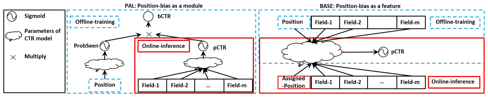
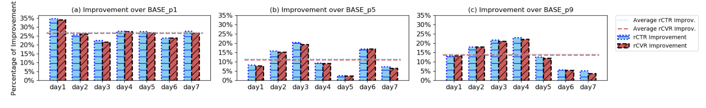

# PAL 怎样用日志位置训练，再用无位置分数排序

历史点击同时受到用户兴趣和展示位置的影响。直接把位置拼进 CTR 网络，训练时可以用日志里的真实位置，但在给候选排序之前，系统还不知道每件物品会排到哪里。给所有候选补一个固定位置虽然只需打一遍分，不同的补值却可能改变排名。PAL 把训练时的点击概率拆成位置分支和条件点击分支，服务时只保留后者。

## 从真实位置构造训练样本

每行曝光保留用户、物品和请求上下文 $x$、日志中的位置 $j$、点击标签 $y$。作者假设只有看到物品才可能点击，然后加两项条件独立假设：看到物品的概率只依赖 $j$，看到后的点击概率只依赖 $x$。模型于是将点击概率写为

$$q(x,j)=a(j)b(x),\qquad a(j)=P(\mathrm{seen}\mid j),\quad b(x)=P(y=1\mid x,\mathrm{seen}).$$

作者原图，Guo 等，RecSys 2019 图 3，采用 PDF 第 4 页（出版页 454）。先看左半边的离线训练区域。位置直接送 ProbSeen，其余字段进入 pCTR，两个输出相乘得到 bCTR。红色框标出线上保留 pCTR 的路径。右侧基线把位置和其他字段放入同一网络，在推理输入补一个位置。

以两件游戏为例。设日志中 A 曾排在位置 3，两个分支给 $a(3)=0.3$、$b(x_A)=0.20$，模型对这次曝光的点击率是 $0.06$。B 曾在位置 1，$a(1)=0.8$、$b(x_B)=0.12$，乘积为 $0.096$。若 A 此次未点、B 已点，逐行训练损失分别取 $-\log(1-0.06)$ 和 $-\log(0.096)$。日志没有“是否看见”的独立标签，这两个分支都从乘积对点击标签的误差学习。排序前假定其他排序因素相同，服务用 $0.20$ 和 $0.12$ 让 A 在前。A 排到位置 1 时，如果模型假设成立且需要估计这个具体位置的曝光点击率，可以用 $a(1)b(x_A)=0.16$。这是教学习例，数值并非作者线上测量。

## 点击监督约束乘积，潜变量还依赖假设

用展示日志检验概率时，哪些曝光进入分母决定了应检查哪个输出。给定位置的曝光点击频率可用于检查两分支乘积，查看后才点击的条件分支缺少独立的查看标签。见[曝光点击概率校准](../../知识库/问题/排序分数怎样校准为曝光点击概率.md)。

只有点击标签时，$a(j)b(x)$ 在概率合法范围内允许一边乘常数、另一边除同一常数，点击损失保持不变。位置和候选内容长期绑定，也会降低两个分支从日志中分出各自作用的能力。如果首屏布局、卡片尺寸或前序内容会改变注意力，只用 $j$ 估计查看率可能不够。pCTR 是这个结构学到的条件分数，独立查看测量或位置随机化才能进一步校验其行为解释。

§2.3 式 (3) 将损失描述为点击标签与概率乘积 $q$ 的二元交叉熵。按该定义，对 $0<q<1$ 有 $\partial\ell/\partial q=(q-y)/[q(1-q)]$，再乘另一分支的概率以及本分支对参数的导数。原文式 (4)–(5) 写成 $(q-y)$ 直接乘后两项，未给出前述分母。这个因子在对单个 logit 求导时可以由 sigmoid 的导数约去，但原式链式求导的中间量是两个概率的乘积。译文保留原式并标注差异，实际训练实现未核实。

## 在线对照测的是排序策略的真实下载结果

下一天日志上的离线比较把基线推理位置从 1 改到 10。作者报告 p9 的 AUC 最好、p5 的 LogLoss 最低、p1 两项最差，PAL 两项都未取得最佳。这里标签仍来自原线上服务产生的曝光，不能直接看见更换配置后的请求结果。

作者原图，Guo 等，RecSys 2019 图 4，采用 PDF 第 5 页（出版页 455）。每个小图是一周，分别对比 p1、p5、p9。柱子表示每天相对对照变化，虚线表示各周平均。实验组与对照组分别覆盖 2% 用户，作者在游戏推荐场景以相同 DeepFM 主结构做试验。论文将每日下载数除以曝光数称为 rCTR，除以访问用户数称为 rCVR。摘要报告相对提升 3%–35%。三种对照分周切换，周与周的差值同时受流量时段变化影响。图 4 未报告置信区间，不能用图确认精确显著性。

§3.4 的排序距离用观测 rCTR 和 bid 所构造的排序作参照，仍受线上曝光过程影响。跨用户个性化以两个用户的前 $L$ 结果重合比例度量，原式 (7) 的分母对应不同用户的有序对，求和没有明确排除同一用户。自身配对贡献为零，按不同用户对理解更清楚。列表重合较少回答跨用户差异，单独不说明偏好识别正确。见[位置怎样进入点击学习](../../知识库/问题/位置怎样进入点击学习与线上排序.md)。

## 原文与阅读范围

Huifeng Guo、Jinkai Yu、Qing Liu、Ruiming Tang、Yuzhou Zhang，《PAL: A Position-bias Aware Learning Framework for CTR Prediction in Live Recommender Systems》，RecSys 2019，452–456。[出版 DOI](https://doi.org/10.1145/3298689.3347033)与[固定 PDF 镜像](https://raw.githubusercontent.com/wzhe06/Reco-papers/2c617a1659c38f60848c051b377f3faef5df831f/Cold%20Start%20and%20Debias/%5BPAL%5D%20A%20Position-Bias%20Aware%20Learning%20Framework%20for%20CTR%20Prediction%20in%20Live%20Recommender%20Systems.pdf)。采用文件含 ResearchGate 封页，五页论文正文带 RecSys 出版信息。已核正文 §1–4、式 (1)–(7) 和图 1–6，参考文献仅定位。

中文 PDF 为 7 页，译出摘要、正文 §1–4、7 个编号式、六图图注和脚注，图内文字及参考文献保留英文。未取得作者的 LaTeX，保留本地 XeLaTeX 重排工程 `.local/papers/SRC-PAL/translation/translated-sources/`。正式译文位于 `.local/papers/SRC-PAL/translation/SRC-PAL.中文.pdf`，已逐页目视并核对中文提取。采用原文与中文 PDF 已实际登录下载验证，见[私有备份下载说明](../../文档/工具/中文PDF发布.md)。
