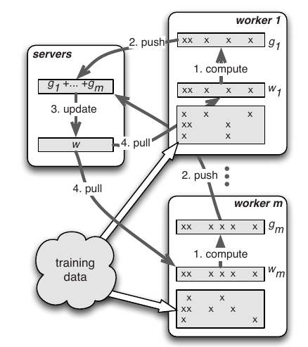
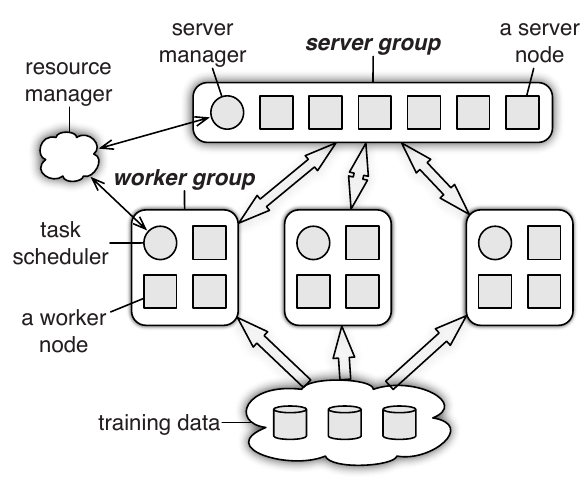
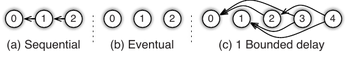
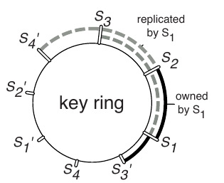
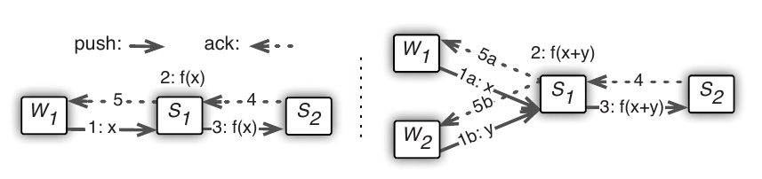
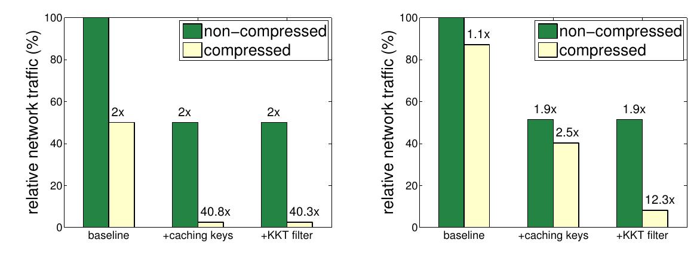
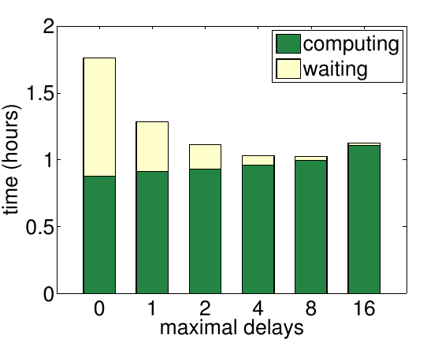

# Parameter Server · 一次稀疏梯度怎样跨机器生效

广告点击模型只需要读本批命中的特征权重，但完整模型可能大到不能放在单机。每台工作者保存一份完整表会耗尽内存，逐个标量发送请求又会让消息开销盖过有效数据。Li 等把参数组织成全局共享的有序键值向量，由服务器组分片保存，工作者只拉自己的工作集。向量语义让工作者能做局部点积、服务器能对同一范围聚合和运行更新函数。任务依赖可以独立约定哪些推送或拉取必须先完成。

## 从点击标签到对应的键范围

作者原图，Li 等，OSDI 2014 图 2，采用 PDF 第 5 页。顺着 1–4 看工作者计算、服务器接收、服务器更新、本地工作者拉取。每个工作者保留的数据和权重坐标不同，命中相同键时由同一个服务端主分片汇合。

用原文 §2.2 的点击二分类做教学算例。令一条点击样本 $y=+1$，命中物品键 23，其标量特征 $x_{23}=1$，其他坐标在本例取零。当前权重 $w_{23}=0.4$，分数为 $z=x^\top w=0.4$。逻辑损失为 $\log(1+\exp(-yz))$，键 23 的导数为 $-1/(1+\exp(0.4))\approx-0.4013$。工作者按键范围把这一项与本地同范围其他梯度推送给服务端。若另一个工作者给 23 推送 $+0.10$，服务端聚合后为 $-0.3013$。本例暂不加正则，取学习率 $0.1$ 的普通 SGD，写到主分片的就是 $0.43013$。下一次读到更新版本的样本会用新权重，是否必须等到这个版本要看任务依赖。

作者原图，Li 等，OSDI 2014 图 4，采用 PDF 第 7 页。工作者组的调度器管理数据计算任务。服务器管理器维护节点和键范围元数据。工作者相互之间无需直接交换模型参数，而用当前路由找出拥有范围的节点。服务器组内部会为容错和扩缩容交换数据。

键 23 是模型的完整键，在服务器上按键读写，哈希用于选持有者。别的键也落在该服务端时，除非特征编码已经合并键，否则有各自的值。按范围发送可把多个不同键放进一个消息，范围内未存的键有稀疏零语义。重复使用相同键列表时双方可以缓存列表，后续发列表的哈希标识，减少重复发送键的成本。值仍由同一套范围消息传输和更新。[原文 §3.1–3.3、§4.2](https://www.usenix.org/system/files/conference/osdi14/osdi14-paper-li_mu.pdf#page=7) · [共享参数与完整键分片](../../知识库/问题/稀疏ID哈希何时会共享参数.md)。

## 依赖边回答这一轮能不能继续

作者原图，Li 等，OSDI 2014 图 6，采用 PDF 第 9 页。每个圆是一个任务。顺序模式逐项等待，最终模式可并发开始，有界延迟模式等待允许窗口之外的旧任务完成。图 5 的具体例子中，第 11 轮不等第 10 轮拉取结束就开始，第 12 轮则等第 11 轮结束。若第 11 轮在键 23 的新权重返回前开始，可能仍以旧值 0.4 算梯度。对同一局部数据，这甚至会得到上一轮相同的梯度。

服务端计算也可依赖多条 push。算法 1 让服务端等所有工作者贡献齐全再更新。算法 3 按随机选择的参数块处理一阶梯度和对角二阶量，放宽到有界延迟，并用 KKT 过滤抑制预计不会改变零权重的通信。该原文描述的是任务完成的约束。SSP 按工作者时钟指定被读取状态须包含的更新，并要求读己之写。同样叫“有界”，要先问界在哪个动作上。[原文 §3.4–3.6](https://www.usenix.org/system/files/conference/osdi14/osdi14-paper-li_mu.pdf#page=8) · [时钟视图与缓存](../SRC-SSP/阅读笔记.md#在时钟-6-读同一个物品向量)。

## 确认写回还需要考虑复制和重试

作者原图，Li 等，OSDI 2014 图 7，采用 PDF 第 11 页。键和虚拟节点都映到环上。服务端 1 负责一个键范围，还保存相邻范围的副本。增加或移除节点时改动的是范围归属，完整键和值可随范围迁移。

作者原图，Li 等，OSDI 2014 图 8，采用 PDF 第 11 页。左边演示主节点调用用户函数并同步复制改动后确认。右边先合并工作者的输入 $x+y$，再应用服务端函数并复制。对本例，承载键 23 的主分片用合计梯度更新，再按协议把新值和时间戳传给副本。聚合较多更新可减少副本流量，但延迟被聚合任务的确认。

范围向量时钟记录节点在各键区间对应的时间戳。若原来 $[0,100)$ 对某节点处于时钟 7，把 $[20,30)$ 写成 8，则保留两侧为 7，中间变成 8，不需为每个键存一条时钟。迁移时先复制旧数据和时钟，再交接预复制期间的改动并通知其他节点。应答丢失使工作者重发时，接收方用保留的范围时钟识别已处理的同一写入。此机制说明论文怎样处理重复消息和单节点交接，不能直接推得包含样本偏移、模型和所有优化器状态的任意端到端恢复协议。[原文 §4.1–4.5](https://www.usenix.org/system/files/conference/osdi14/osdi14-paper-li_mu.pdf#page=9)。

## 看同一目标值下的总时间与流量

作者原图，Li 等，OSDI 2014 图 11，采用 PDF 第 14 页。左为单服务器出站流量，右为单工作者出站流量，按各自未压缩基线归一化。稳定键列表的缓存约节约一半流量，因为 64 位键和值同宽。服务器侧大量零值来自 $\ell_1$ 促成的稀疏权重，工作者侧使用 KKT 过滤。对不断遇到新键的在线批次，键集合重复情况会不同。

作者原图，Li 等，OSDI 2014 图 13，采用 PDF 第 14 页。横轴是允许的任务延迟 $\tau$，纵轴是每工作者到相同收敛条件的分项时间。稀疏逻辑回归用 1,700 亿条样本、800 台工作者和 200 台服务器。作者报告 $\tau=0$ 时约 50% 的时间在等，$\tau=16$ 时约 1.7%，但后者需要更多计算。总用时在测试的 $\tau=8$ 附近最低。它说明等待下降和收敛步数增加可以同时发生，选择延迟要看达标时间。另有 LDA 实验在 5 亿用户对比 1,000 与 6,000 台机器时报告约四倍收敛提速，图 14 左侧的 50 亿用户是另一组设置。CountMin 的 0.8 秒故障恢复是研究集群 15 台机器下终止一个节点的结果。[原文 §5、图 13–14、表 5](https://www.usenix.org/system/files/conference/osdi14/osdi14-paper-li_mu.pdf#page=14)。

## 原文与译本

采用 USENIX OSDI 2014 官方 17 页文件，含出版封页，阅读覆盖 §1–6、图 1–14、表 1–5 和算法 1–4。算法 3 近端式的最小化变量和二次项符号有印刷疑点，算法 4 初始化和后续哈希循环的轴次序未对齐，译本保留并标注。上文普通 SGD 教学例不依赖算法 3 的疑似记号。中文译本共 20 页，已逐页核验。原文和中文 PDF 已通过私有附件的认证下载核验。见[访问说明](../../译文/PDF目录.md)。译文覆盖摘要、正文、算法、图表标题、脚注与致谢，保留图内标签与原语言参考文献。问题对照见[稀疏参数分布式训练怎样控制读写陈旧](../../知识库/问题/稀疏参数分布式训练怎样控制读写陈旧.md)。[USENIX 原文入口](https://www.usenix.org/conference/osdi14/technical-sessions/presentation/li_mu)。
