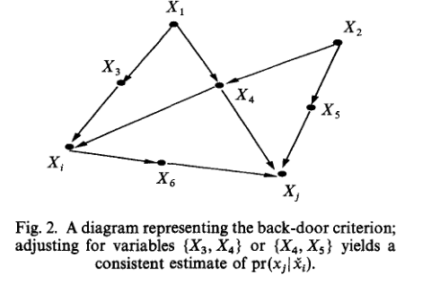
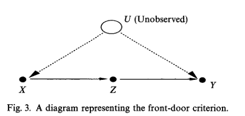

# 因果图如何告诉我们该调整哪些变量

历史发券日志中，收到券的人可能原本就更常下单。Judea Pearl 的 *Causal Diagrams for Empirical Research*（Biometrika, 1995）把这个问题放到有方向的因果图上：先找出观察到的组间差异沿哪些路径形成，再判断能否只用观测分布算出强制发券时的结果。原文写作 $P(y\mid\hat x)$，以下用 $P(y\mid do(x))$ 表示把处理 $X$ 设为 $x$。 [原文 §2.3–3.2，第 5–8 页](https://ftp.cs.ucla.edu/pub/stat_ser/R218-B.pdf#page=5)

## 后门从指向处理的箭头进入

令 $T$ 表示是否指派一张券，$Y$ 表示七日下单，$A$ 表示指派前购买意向。若 $A$ 同时影响发券和下单，$T\leftarrow A\to Y$ 会使券组聚集更多高意向用户。要用历史数据估计全体合格用户的发券结果，可先在每种 $A$ 里估计发券结果，再按目标人群的 $P(A)$ 求平均。Pearl 的后门准则要求调整集 $Z$ 不含 $T$ 的后代，并阻断所有以指向 $T$ 的边起步的 $T$–$Y$ 路径。以 $T\leftarrow A\to Y$ 为例，条件化于非碰撞点 $A$ 会阻断路径。碰撞点两边的箭头都指向该点，条件化于它或其后代可能打开原先闭合的路径。因此，选变量要看整条路径。 [原文定义 3、定理 1 与式 (6)](https://ftp.cs.ucla.edu/pub/stat_ser/R218-B.pdf#page=6)

作者原图 2，刊页 675，固定 PDF 第 7 页裁取。沿箭头从 $X_i$ 找到因果链 $X_i\to X_6\to X_j$，再沿指向 $X_i$ 的箭头逆向找后门。仅调整 $X_3$ 留下一条经 $X_4$ 和 $X_5$ 的路径。图中的两个充分调整集分别是 $\{X_3,X_4\}$ 和 $\{X_4,X_5\}$。 [原文图 2](https://ftp.cs.ucla.edu/pub/stat_ser/R218-B.pdf#page=7)

若高、低意向各占 50%，无券下单率分别为 40% 和 10%，有券时分别为 45% 和 15%，标准化后 $E[Y\mid do(T=0)]=25\%$，$E[Y\mid do(T=1)]=30\%$。这里 $P(A)$ 对两种动作取同一份总体构成。若发券组八成高意向、对照组两成高意向，直接比较观察均值会得到 $39\%-16\%=23$ 个百分点。实施前还要核对每个纳入的意向层是否有两臂数据。 [历史发券算例与结果回归](../../知识库/问题/历史发券日志如何估计补贴增量.md)

## 前门先估处理如何改变中介，再估中介如何改变结果

作者原图 3，刊页 675，固定 PDF 第 7 页裁取。$U$ 未观测并同时指向 $X,Y$。$X$ 经 $Z$ 影响 $Y$，$X$–$Z$ 没有后门，后门 $Z\leftarrow X\leftarrow U\to Y$ 可以用 $X$ 阻断。 [原文图 3](https://ftp.cs.ucla.edu/pub/stat_ser/R218-B.pdf#page=7)

设 $T$ 是优惠提示，$M$ 是是否查看一个固定的优惠详情，$Y$ 是下单。用这个例子理解前门需要假定：提示的所有因果作用都经过查看详情，提示与详情之间没有未阻断后门，详情到下单的所有后门都能由提示阻断。这是对教学图的设定。真实业务中，提示文案直接促进下单、潜在购买意向同时影响查看和下单等路径会破坏相应条件。 [原文定理 2](https://ftp.cs.ucla.edu/pub/stat_ser/R218-B.pdf#page=8)

$$
P(y\mid do(t))=\sum_m P(m\mid t)\sum_{t'}P(y\mid m,t')P(t').
$$

外层用可观测的 $P(m\mid t)$ 描述提示改变查看率的方式。内层将 $t'$ 固定在每个历史提示状态，估 $M$ 到 $Y$ 的结果，再使用边际 $P(t')$ 标准化。若两种提示状态各半，$P(Y=1\mid M=1,T=t')$ 的两值是 0.4、0.6，$M=0$ 的两值是 0.1、0.3，则内层分别为 0.5 和 0.2。如果两种干预让查看率分别达到 0.8 和 0.2，外层给出 0.44 和 0.26，差为 0.18。内层需要各 $(m,t')$ 的支持。 [原文式 (7)–(9)](https://ftp.cs.ucla.edu/pub/stat_ser/R218-B.pdf#page=8)

后门调整使用处理前的充分调整集，前门识别依赖中介和三项路径条件。对现实的券指派、曝光和核销，需要逐条核对这些条件。使用观测倾向得分是压缩满足条件的处理前特征的一种方法。 [倾向得分原论文精读](../SRC-ROSENBAUM-RUBIN-PS/阅读笔记.md)

采用版为 Biometrika 82(4), 669–710 的 UCLA 作者归档扫描件。本次精读 §2.3、§3.1–3.2、§4.3 对前门公式的再推导，翻看 §5 的识别例子。 [DOI](https://doi.org/10.1093/biomet/82.4.669)
