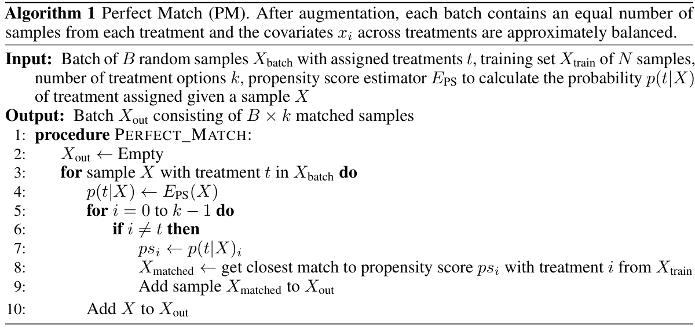
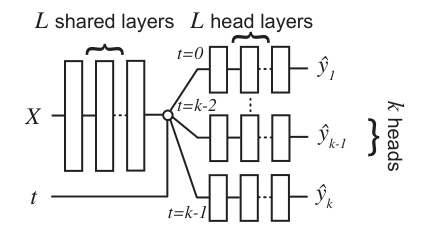
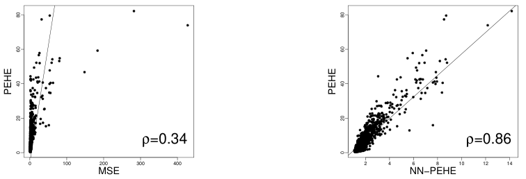
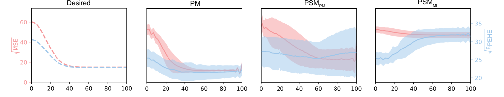
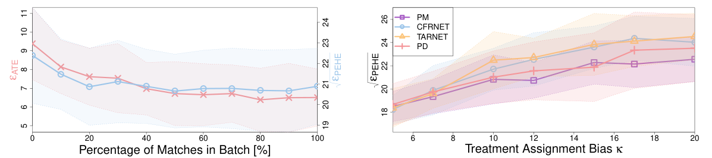

# Perfect Match：用事实近邻重组多处理训练批次

用历史发券日志训练三头 TARNet 时，无券、小券、大券各自的头只收到该档的事实样本。比如大券过去大多发给沉默用户，即便该头在沉默用户上拟合得好，给高活跃用户打大券分时仍要跨分布外推。Perfect Match 将近邻匹配放进小批次采样器。匹配决定哪些事实样本共同参与一次更新，输出头继续用各自样本的真实结果学习。 [原文 §3](https://arxiv.org/pdf/1810.00656v5#page=3) · [双头结果回归与表征平衡](../../知识库/问题/历史发券日志如何估计补贴增量.md#结果回归怎样利用不同臂的样本)

## 一个小券样本怎样调进另外两臂

设有一条小券日志 $x_a$、动作 $t=1$、事实结果 $y_a=1$。倾向模型按三档输出 $(p_0,p_1,p_2)=(0.45,0.35,0.20)$。在无券库里，算法按第 0 档的概率找接近 0.45 的 $x_b$；在大券库里，按第 2 档的概率找接近 0.20 的 $x_c$。两条入选日志分别带自己的结果 $y_b=0$ 和 $y_c=1$。单个锚点扩成三个样本，来自三个臂。

*作者原图。Schwab、Linhardt 与 Karlen，arXiv v5，PDF 第 5 页算法 1，裁去版边。第 5–9 行按候选档使用该档的倾向坐标，最后一行保证原锚样本进入批次。* [原文](https://arxiv.org/pdf/1810.00656v5#page=5)

原批次有 $B$ 条记录和 $K$ 个动作，所有臂可匹配时扩成 $BK$ 条，各臂 $B$ 条。同一近邻可能反复入选。论文实现先用 SVM 估计带概率的指派，再每臂按本臂倾向建有序索引，单次近邻查找是 $O(\log n_t)$。附录实际从最接近的 6 条中随机抽 1 条，用来分散边缘点过度复用。该开销与固定网络规模是两个概念。一批若要补 $B(K-1)$ 条真实记录，仍需这些查找以及对扩展样本前后向。 [附录 D、表 S1](https://arxiv.org/pdf/1810.00656v5#page=12)

## 三条日志分别更新哪些输出头

三条输入 $x_a,x_b,x_c$ 都经过同一编码器 $h(x)$。无券头收到 $h(x_b)$ 和 0，小券头收到 $h(x_a)$ 和 1，大券头收到 $h(x_c)$ 和 1。小批次事实均方误差为
$[(\hat y_0(x_b)-0)^2+(\hat y_1(x_a)-1)^2+(\hat y_2(x_c)-1)^2]/3$。
各头收到本臂的梯度，三路梯度汇入共享层。因此即便作者从反事实补齐的视角解释近邻，算法 1 实际加入的是一条带自己画像、动作和结果的记录。上线时给同一个新画像运行三个头，用 $\hat y_2(x)-\hat y_0(x)$ 评估大券相对于无券的预测效应。此时网络直接打分。 [原文 §3、图 1](https://arxiv.org/pdf/1810.00656v5#page=4)

*作者原图。arXiv v5，PDF 第 4 页图 1，裁去版边。沿 $X$ 到共享层，再循训练臂索引走一条结果头。图对应论文用的多处理 TARNet。*

全量 PSM 可先生成一份匹配训练集再洗牌，小批次 PM 直接让每步更新同时见到各臂的相似样本。CFRNet 则在事实损失外加表示分布距离，改变优化目标。三者都依赖测得足够的处理前变量和可比支持。按臂对一个坐标近似匹配，可以平衡该动作与其余动作在该坐标下的已测分布，不能让两个同分画像的潜在结果逐点相等。例如 $e_2$ 相同的两人可有不同历史消费，大券响应仍可不同。论文定理 1 与附录 C 用收敛、趋近精确匹配、平滑性及近邻一致性连接到逐点结果，使用时需区分真 $X$ 上的局部邻域、估计倾向层内的条件平均和每个小批次的分布平衡。共同支持以外的动作与未测混杂仍没有来自这个采样器的识别信息。 [原文定理 1](https://arxiv.org/pdf/1810.00656v5#page=4) · [附录 C](https://arxiv.org/pdf/1810.00656v5#page=12)

## 怎样用只有事实标签的验证集选模型

对每条验证记录，用协变量欧氏距离为各臂寻找近邻，以近邻的观察结果代替缺失结果。二元 NN-PEHE 是预测增量与该近邻增量之差的均方，多处理时在 $\binom K2$ 个无序对上做平均。论文 IHDP 验证集的真实 PEHE 与事实 MSE 的 Pearson 相关为 0.34，与 NN-PEHE 为 0.86。近邻代理依赖画像接近且两臂有支持，图中相关性是这个半合成基准上的校验。

*作者原图。arXiv v5，PDF 第 5 页图 2，保留两张散点图。横轴分别为事实误差和近邻代理，纵轴为由模拟结果机制给出的 PEHE。* [原文](https://arxiv.org/pdf/1810.00656v5#page=5)

*作者原图。arXiv v5，PDF 第 6 页图 3。横轴是归一化训练进度，红线为事实误差，蓝线为反事实误差，阴影是跨配置标准差。先看期望形状，再看三种匹配。* [原文](https://arxiv.org/pdf/1810.00656v5#page=6)

*作者原图。arXiv v5，PDF 第 7 页图 4–5。左图改变批内加入匹配的比例，右图改变 News-8 的模拟指派偏差参数。* [原文](https://arxiv.org/pdf/1810.00656v5#page=7)

表 1 中 News-8 的测试 $\sqrt{\widehat{\epsilon}_{\rm mPEHE}}$ 为 PM $20.76\pm1.86$、同匹配逻辑预处理全量数据的 PSMPM $22.16\pm1.79$、TARNet $22.39\pm2.32$，各 50 次重抽。News-4 上 Propensity Dropout 均值 20.88 低于 PM 的 21.58，表中未标与 PM 有显著差异。IHDP 是二元处理，News 以模拟结果和指派构造多档，量纲与协议不同。该误差比较不能直接兑换成随机发券收益。 [原文表 1](https://arxiv.org/pdf/1810.00656v5#page=8) · [补贴增量评估](../../知识库/问题/怎样验证补贴增量的排序幅度和策略价值.md)

## 阅读范围

Patrick Schwab、Lorenz Linhardt、Walter Karlen。采用 2019-05-27 的 arXiv 1810.00656v5，已读正文 §1–6、图 1–5、算法 1、表 1 及附录 A–I。按清单仅解读。未运行模型。 [固定版 PDF](https://arxiv.org/pdf/1810.00656v5)
