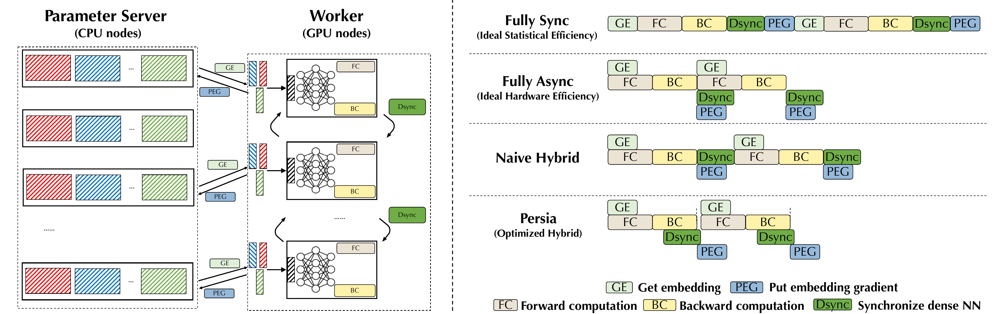
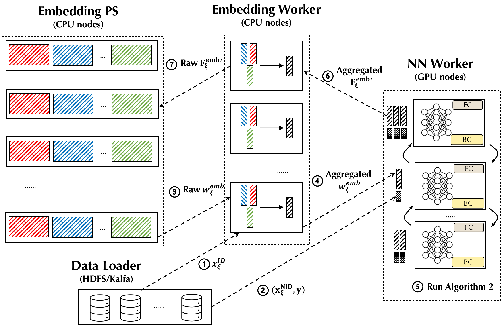
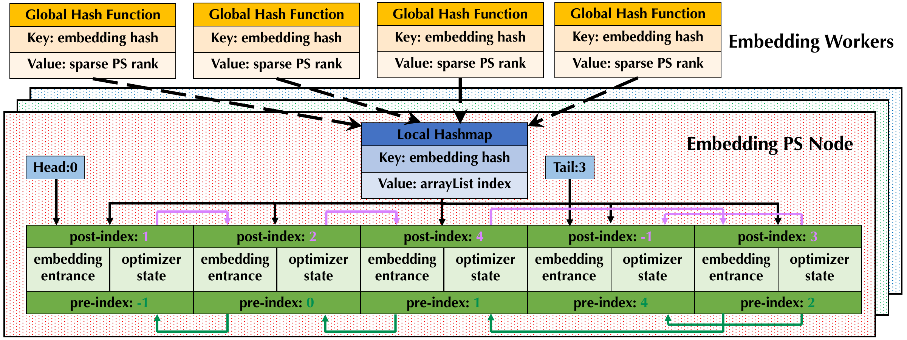
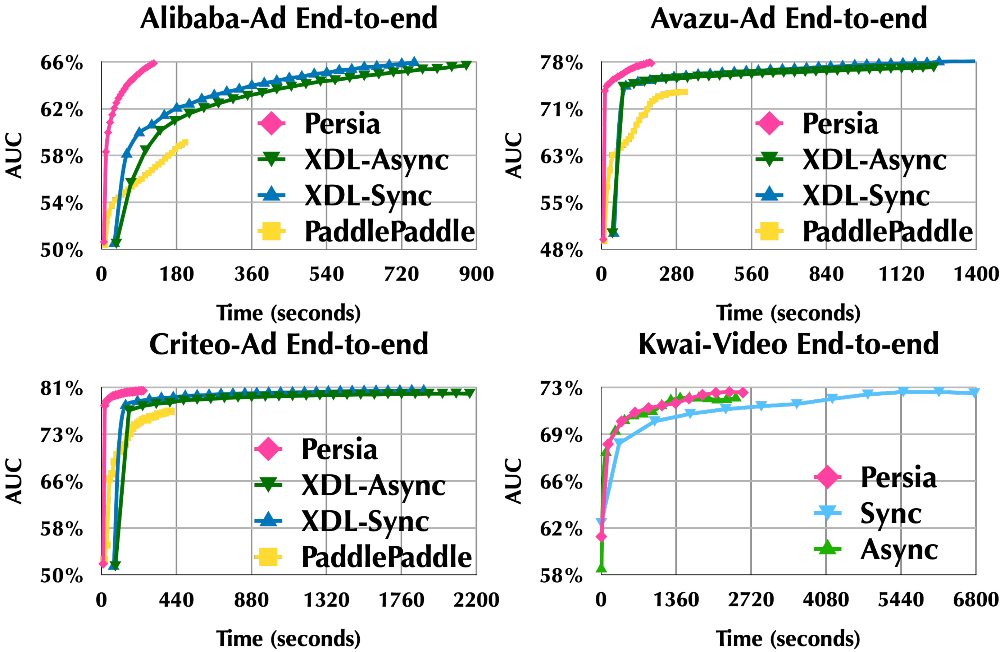
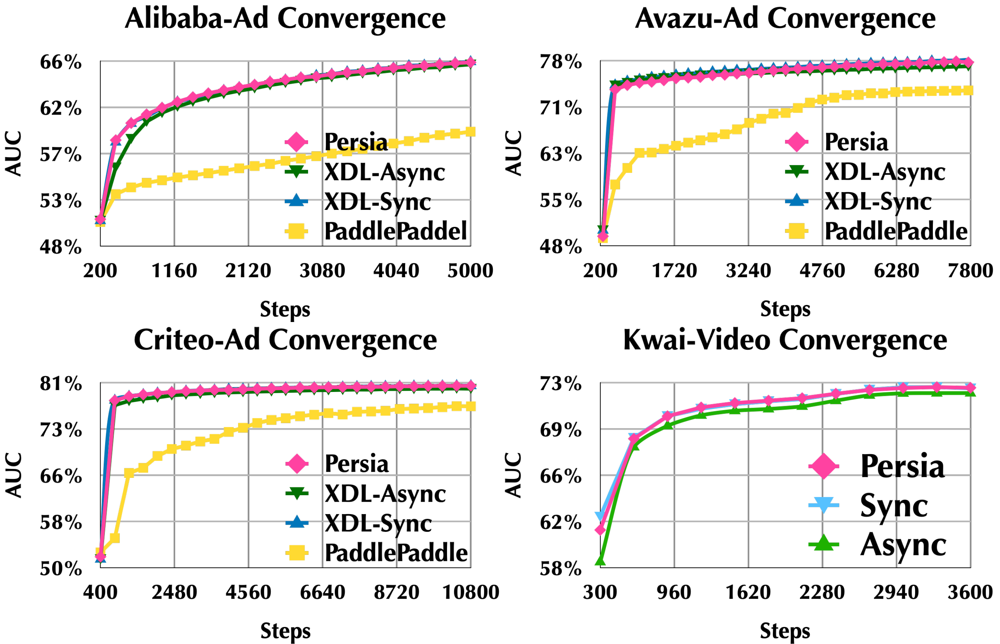
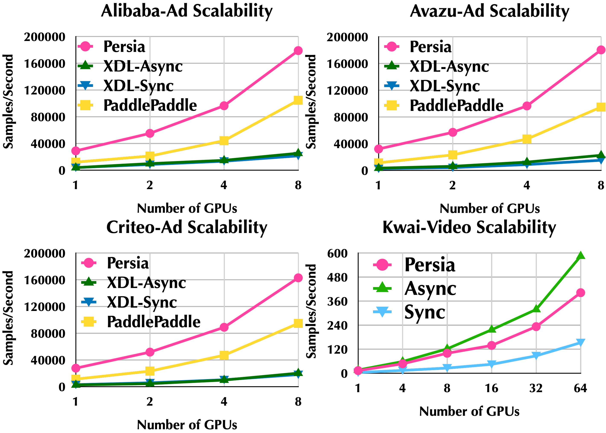
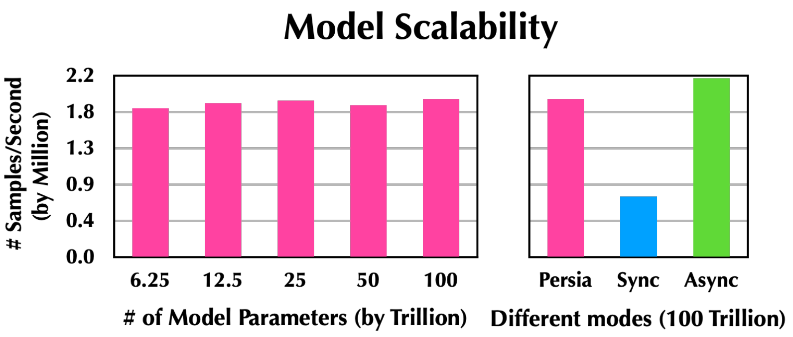

# Persia · 让稀疏表异步写回，稠密网络按步同步

一条点击样本只触及大嵌入表里的几行，却会用到大部分稠密网络权重。把所有参数集中到参数服务器，会让每批稠密计算也承担远端推拉。把所有更新都改成异步，稠密权重又会频繁收到基于旧版本算出的梯度。Persia 把两种更新拆开。CPU 参数服务器保存稀疏行并按键接收异步梯度。GPU 各持一份稠密网络，每轮同步梯度。两侧的依赖始终存在，因为 GPU 的前向和反向都需要该样本的嵌入。[原文 §2–3](https://arxiv.org/pdf/2111.05897v2#page=3)。

## 一条点击样本怎样走完两条路径

作者原图，Lian 等，arXiv v2 图 3，PDF 第 4 页。右侧比较全同步、全异步、朴素混合与优化后的混合执行。读混合行时，先跟随同色的小批跨过查表、GPU 计算与嵌入梯度回写，再看另一颜色的小批何时可以提前进来。

设一次曝光的完整物品键为 23，还有连续特征和点击标签 $y=1$。CPU 嵌入工作节点先保存该样本对应的 ID 特征，分配样本 ID $\xi$。GPU 工作节点凭 $\xi$ 把非 ID 特征、标签和返回的嵌入接起来。两种 ID 有不同用途：样本 ID 找到保管本次查表上下文的工作节点，物品键 23 找到持有该行的参数服务器分片。模型拿到 $E_{23}$ 后用小批的点击标签计算损失。设教学例中只有这一行参与池化，则该样本 GPU 反传得到的嵌入输出梯度可直接归到键 23；若多个向量被聚合，嵌入工作节点再按聚合的反传规则把梯度归到对应行。

作者原图，arXiv v2 图 4，PDF 第 6 页。编号 1–4 对应样本拆分、缓存和拉取，5 是 GPU 前后向及稠密同步，6–7 将嵌入梯度按样本 ID 送回，再按模型键落到嵌入 PS。GPU 的 AllReduce 汇总稠密梯度，既不会替稀疏行排序，也不会等待每一笔嵌入梯度应用完成。[算法 1–2 与第 4 节](https://arxiv.org/pdf/2111.05897v2#page=5)。

例如 GPU 读到 $E_{23}^{(8)}=0.4$ 后，另一条曝光将这一行改到版本 9，取值 0.5。当前样本仍用 0.4 的前向缓存反传。若梯度为 $-0.2$，用步长 0.1 演示普通 SGD，分片收到梯度时从 0.5 更新到 0.52。梯度依据读取时的参数，但写入作用于接收时的状态。与此同时，两台 GPU 用各自的小批得到稠密梯度，同步聚合后从同一组旧稠密权重推进到同一组新权重。下一轮 GPU 计算可以继续看到不同时刻取回的嵌入行。[同一键在 PS、SSP、XDL 与 Persia 中怎样推进](../../知识库/问题/稀疏参数分布式训练怎样控制读写陈旧.md)。

## 读得早、等得久和总命中是三种量

从嵌入查表完成到梯度应用，中间可以经历组批、GPU 计算、通信和分片排队。即便相同墙钟时间过去，冷门行可能一次也没变，热门行可能已经更新多次。分片按组内完整键打散可缓解整组访问堆到一台机器，但过热的单一完整键仍需在其归属分片更新。

作者原图，arXiv v2 图 5，PDF 第 7 页。先按全局哈希定位节点，再用节点内哈希表找到数组槽。槽存嵌入、优化器状态及 LRU 的前后下标，下标使序列化时可以直接拷贝内存。组内打散属于分片路由，图中的 LRU 处理内存管理。运行中还要区分 RPC 批内去重带来的通信收益、热点带来的排队，以及稠密 AllReduce 的独立开销。[原文 §4.2](https://arxiv.org/pdf/2111.05897v2#page=7)。

## 小频率怎样进入收敛界

式 (2) 在时间 $t$ 使用嵌入 $E_{D(t)}$ 和最新稠密参数 $W_t$ 来求同一随机样本的两个梯度，分别应用到当前 $E_t,W_t$。$D(t)\le t$ 表示前向实际使用的较早嵌入时刻。定理 1 使用下界目标、Lipschitz 梯度、方差上界 $\sigma^2$ 以及假设的最大延迟 $t-D(t)\le\tau$，并用 $\alpha$ 表示任一 ID 被样本命中的概率上界。

在论文的学习率和常数约定下，$T$ 轮的平均期望梯度范数平方的上界写作

$$
\frac{1}{T}\sum_{t=0}^{T-1}\mathbb E\|\nabla f(E_t,W_t)\|^2
\lesssim \frac{\sigma}{\sqrt T}+\frac{1}{T}+\frac{\alpha\tau}{T}.
$$

附录通过只激活一部分坐标的 Hessian 给出稀疏频率因子。直觉是一次查表只动少数坐标，因此参数换了版本也未必影响手上的样本。总表很大仍可能有一个几乎每条样本都命中的键，此时 $\alpha$ 接近 1。论文所称多数场景延迟小于 5 是作者描述，定理要求的上界需要在具体系统中另行验证。它也没有提供 SSP 那样按工作者时钟约束读视图的协议。[原文 §5 式 (2)–(6)](https://arxiv.org/pdf/2111.05897v2#page=9) · [附录 Lemma 1](https://arxiv.org/pdf/2111.05897v2#page=16)。

## 时间、统计质量与可装下的模型规模

作者原图，图 6，PDF 第 10 页，各子图按原顺序换成两行。前三个公开 CTR 基准用 8 个 GPU 工作者比较达到同一 AUC 的时间。淘宝相对同步、异步 XDL 的作者报告分别为 7.12 倍和 8.4 倍，相对 PaddlePaddle 为 1.71 倍。右下生产任务的 XDL 在 100 小时内未收敛，因此论文另报样本吞吐，Persia 是 XDL 的 19.31 倍。该子图仍画 AUC 对时间的曲线，比较 Persia 的三种模式。PaddlePaddle 因缺所需算子未完成该任务。[原文 §6.1](https://arxiv.org/pdf/2111.05897v2#page=10)。

作者原图，图 7，PDF 第 11 页，子图按原顺序换成两行。表 2 的生产任务中，混合与同步均显示 72.63%，完全异步为 72.16%。公开三组的混合与同步差分别为 0.07、0.09、0.04 个百分点。部分基线为 XDL，对照随任务改变。表中有效位数不足以独立支持正文所称生产混合与同步差小于 0.001%，也没有区间估计。[原文 §6.2、表 2](https://arxiv.org/pdf/2111.05897v2#page=11)。

作者原图，图 8，PDF 第 11 页，子图按原顺序换成两行。生产数据的稀疏参数为 2 万亿。作者报告混合模式最高达完全同步的 3.8 倍吞吐。全异步可进一步加快，判断整体效果需连同 AUC 曲线看。

作者原图，图 9，PDF 第 11 页。Criteo-Syn 以原始 Criteo 为基础合成随机 ID，嵌入宽度固定为 128。Google Cloud 容量集群使用 64 张 A100、100 个嵌入工作实例、30 个各配 12 TB 内存的 PS 实例。表 1 报告最大 100 万亿稀疏参数，图 9 的混合吞吐约为该规模同步模式的 2.6 倍。这个试验固定资源并改变模型容量，测的是训练通路能处理的规模与吞吐。真实任务的预测质量要回到图 7 和表 2。[原文 §6.3](https://arxiv.org/pdf/2111.05897v2#page=11)。

## 原文与译本

采用 [arXiv:2111.05897v2](https://arxiv.org/pdf/2111.05897v2)，2021-11-15，首页题名为 *A Hybrid System*，后续书目也用 *An Open, Hybrid System*。读了摘要与第 1–8 节，复核图 1–9、表 1–2、算法 1–2，并追到理论附录。原文假设 1 重复列全局最小值，概率上界取定理 1 中的定义。附录的失效交叉引用按第 2 节的查表定义定位。采用版 arXiv 页面标示 CC0 1.0，正式 PDF 按本库私有附件流程存放。译本按[私有附件访问说明](../../译文/PDF目录.md)获取。中文译本覆盖摘要、正文、图表标题、算法描述与脚注，图内标注、参考文献与附录沿用原文。
