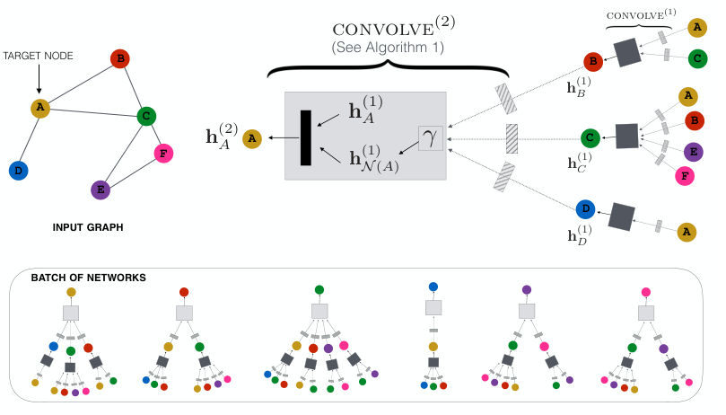
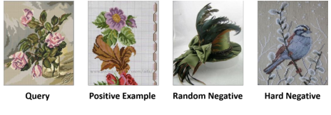
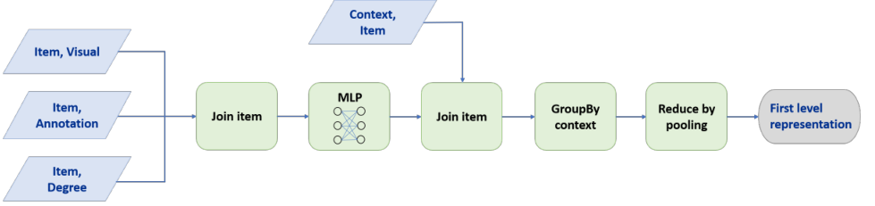
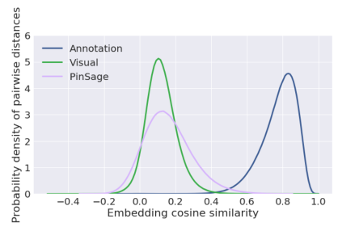

# PinSage 怎样把局部图卷积扩展到十亿级物品

[原文版本与中文 PDF 位置](#原文与阅读范围) · [私有备份下载说明](../../文档/工具/中文PDF发布.md#登录下载)

以耳机为种子查推荐。普通内容近邻仅比较图片和文本，用户将耳机与耳机套收藏到同一看板的关系没有直接进入向量。直接从看板展开所有邻居，遇到大看板后又会让每条样本的计算大小难以控制。PinSage 用从种子出发的游走访问次数选择少量邻居，并把次数转为聚合权重。邻居同时带来内容信号和看板上的协同关系。[§1，第 1 页](https://arxiv.org/pdf/1806.01973v1#page=1) · [§3.1–3.2，第 3–4 页](https://arxiv.org/pdf/1806.01973v1#page=3)

Ying 等作者原图 1，arXiv 1806.01973v1; KDD 2018，PDF 第 2 页。上图从小图读出两层局部计算，下图说明同批目标可以各自展开邻居。

## 访问频率先决定邻居，再决定每个邻居的分量

在 Pinterest 的二部图上，节点是 Pin（内容）和 Board（看板），边表示 Pin 被放入 Board。训练正对另从行为日志取相邻交互的 $(q,i)$，与构图收藏边有各自含义。教学中把 $[耳机,耳机套,零食]$ 的交互想象为几条历史，另取历史看板「随身音频」收录耳机与耳机套、「运动装备」收录耳机套和另一款耳机。由耳机出发模拟随机游走，若入选的两邻居访问 8 和 2 次，在这两个邻居归一化的权重为 0.8 和 0.2。真实论文用固定 $T$ 个高访问节点，将访问次数作为 importance pooling 权重。直接求一跳邻居的均值会失去访问集合与强弱的区分。[§3.1–3.2、算法 1–2，第 3–5 页](https://arxiv.org/pdf/1806.01973v1#page=3)

令层 $k-1$ 的节点状态为 $h_v$，第 0 层来源是原始特征。邻居先共享一套变换 $r_v=\operatorname{ReLU}(Qh_v+q)$，再按权重池化得 $n_u$。最后把 $n_u$ 与自己的状态拼接，过 $W$ 与 ReLU 并单位化。若变换后两邻居为 $(1,0),(0,1)$，加权邻居状态便为 $(0.8,0.2)$，自身另占拼接位置。各层参数不同，同一层的节点共用。生成小批量表示时从目标层往回找依赖邻居，再从浅层往深层依次算节点表示，顶层另做全连接投影。采样控制训练子图的大小，图结构仍会影响邻居覆盖。[§3.2，第 4 页](https://arxiv.org/pdf/1806.01973v1#page=4)

## 难负例让模型把相近候选排开

历史中种子耳机之后出现降噪耳机，因此取正对 $(q,i)$。同批共享约 500 个随机负物品，复用负例图表示。极易负例如食品与音频相距很远，损失很快归零。作者再在个性化 PageRank 名次 2000–5000 中采样难负例，第一轮只用普通负例，随后逐轮加入困难例。若正对内积 0.8、易负例 0.1、难负例 0.72，边际 $\Delta=0.2$，$\max(0,s_{\rm neg}-s_{\rm pos}+\Delta)$ 分别为 0 与 0.12。后者同时推动两路节点图编码器，提高真相关与近似相关的区分。日志未观测到的相似 Pin 可能也是用户想要的内容，难采样的监督仍受旧系统覆盖限制。[§3.3，第 4–6 页](https://arxiv.org/pdf/1806.01973v1#page=4) · [图 2，第 6 页](https://arxiv.org/pdf/1806.01973v1#page=6)

Ying 等作者原图 2，arXiv 1806.01973v1; KDD 2018，PDF 第 6 页。沿查询、正例、随机负例和难负例的顺序比较图像语义。

## 批量建索引时按节点复用，而服务不用重跑图

训练过程中从 CPU 内存构建批内子图与重新索引后的特征块，再交给 GPU。CPU 可准备下一批，同时 GPU 处理当前批。全图推理以层为单位，MapReduce 投影各节点后，把选定邻居状态关联到需要它的节点，再做聚合。一个中间向量可以被多个目标复用。若请求到达才对每个候选展开邻居，会重复大量工作。论文离线生成 Pin 向量，将向量库存到检索系统，服务根据种子数字向量取近邻。新 Pin 需要可用特征与特定推理路径，在完全缺图边时内容分支如何退化还取决于实际部署。模型参数能用于未见节点，与节点即时进索引是两个问题。[§3.4–3.5，第 6–7 页](https://arxiv.org/pdf/1806.01973v1#page=6) · [§4.5，第 9 页](https://arxiv.org/pdf/1806.01973v1#page=9)

Ying 等作者原图 3，arXiv 1806.01973v1; KDD 2018，PDF 第 7 页。先关联物品属性并投影，再关联上下文、按上下文分组聚合。

## 同一个作者实验的分母含义

作者从 500 万个测试 Pin 计算 Hit-rate@500，使用 $1/\lceil \mathrm{rank}/100\rceil$ 版本的 MRR。表内 importance pooling 加难负例命中约 0.67，MRR 约 0.59，优于该文的内容组合基线。摘要和正文提到全图约 20 亿 Pin；测试命中率仍以 §4.2 的采样候选为准。该离线对照的正例来自旧系统流量，作者将 Pixie 留给其他评估。原文另报告线上首页 repin rate 相对内容基线提高 10–30%，随实验设置而异。文中给出约 24 小时的全图离线嵌入时间，这个耗时属于所列集群和批处理协议，不能当成一次请求时延或新品发布 SLA。[§4.2–4.5，第 8–9 页](https://arxiv.org/pdf/1806.01973v1#page=8)

图 4 展示随机物品对的余弦分布。PinSage 对比视觉或标注向量的峰度更低。这是随机配对的整体分布，无法单独判断某条请求的召回质量。[§4.2、图 4，第 8 页](https://arxiv.org/pdf/1806.01973v1#page=8)

Ying 等作者原图 4，arXiv 1806.01973v1; KDD 2018，PDF 第 8 页。三条曲线分别来自标注、视觉和 PinSage 向量，比较随机物品对分数的分布。

[交互图传播条件与代价](../../知识库/问题/利用交互图传播协同表示.md) · [LightGCN](../SRC-LIGHTGCN/阅读笔记.md)

## 原文与阅读范围

采用 arXiv 1806.01973v1，核对正文、训练与推理算法、离线和生产实验。[固定版本](https://arxiv.org/abs/1806.01973v1) · [KDD DOI](https://doi.org/10.1145/3219819.3219890)

中文 PDF（11 页）依据采用版 PDF 和作者 LaTeX单栏重排，覆盖摘要、§1–5、算法说明、公式、图表说明与致谢。图内文字及参考文献保留，部分叙述合并表述。

本地文件 `.local/papers/SRC-PINSAGE/translation/SRC-PINSAGE.中文.pdf`，可编辑工程主文件 `.local/papers/SRC-PINSAGE/translation/translated-sources/main.tex`。[许可与范围盘点](../../译文/PDF目录.md) · [私有备份下载说明](../../文档/工具/中文PDF发布.md#登录下载)
