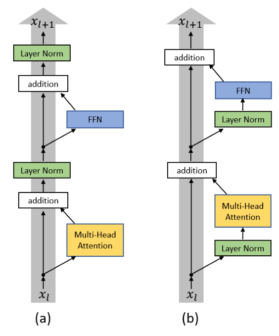
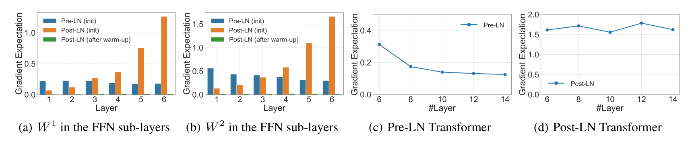
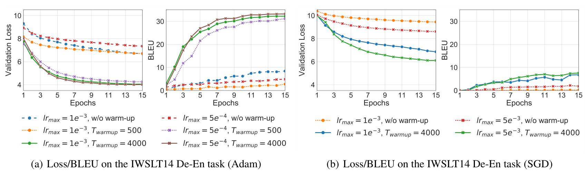
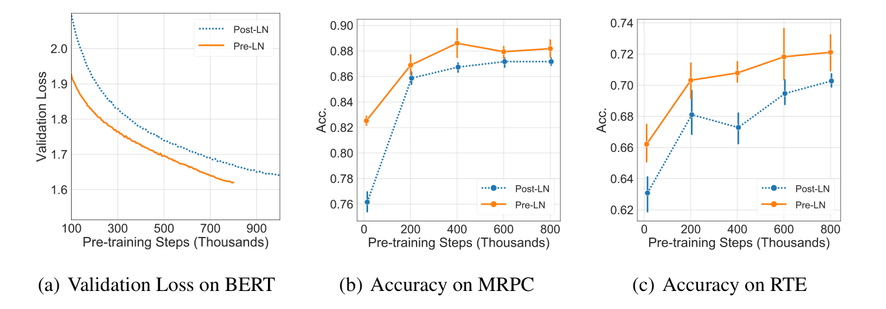

# Pre-LN：把归一化移进残差分支，初始化梯度会怎样

原版 Transformer 接到一个位置的向量时，先经过注意力，再把注意力输出和输入相加，最后做 LayerNorm，之后 FFN 子层再走同样三步。每次梯度穿过一个残差块，直接支路也会穿过 LayerNorm。Xiong 等比较的 Pre-LN 顺序是先规范化分支的输入，再让注意力或 FFN 处理，最后加回原向量。残差主路因此能连续传递未归一化的状态，堆叠后的 final LN 再把它接到输出头。

作者原图 1，固定版第 2 页，Xiong 等。从底部 $x_l$ 沿灰线向上看。左图每次 addition 上方都有绿色 LN，右图绿色 LN 在通往黄色 Attention 和蓝色 FFN 的分支上。右图画的是单层，§3.3、表 1 在整个堆叠末尾另外定义 final LN。

## 从输出头沿残差支路倒走

取 “hello world .”，用自回归任务举例，world 位置接收由上下文算出的状态 $x$，词表头在该处预测句号。设 $F$ 表示一个 Attention 或 FFN 子层，Pre-LN 得 $x+F(\mathrm{LN}(x))$，Post-LN 得 $\mathrm{LN}(x+F(x))$。词表交叉熵把梯度送回读出位置，逐个子层后的 Jacobian 分别为 $I+J_FJ_{\rm LN}$ 和 $J_{\rm LN}(I+J_F)$。前者每层展开时有一项 $I$，其余项仍能改变总梯度的尺度和方向。各位置共享的输出投影将状态变成词表分数，论文 §3.3 用词嵌入矩阵 $W^{emb}$ 表示这一步。词表和参数共享的条件见[词表嵌入与权重共享](../../知识库/概念/词表嵌入与权重共享.md)。

Pre-LN 另有贯穿全模型的缩放机制。§3.3 为了分析初始化，简化成单头注意力，令初始 $W^Q,W^K$ 都为零而注意力均匀，其他主要权重按 Xavier 高斯初始化，并假定输入与损失导数满足相应条件。引理 2 给出 Pre-LN 残差流的平方范数期望随深度近似线性增长，Post-LN 相加后到归一化前的相应尺度维持 $O(d)$。如果每层加入近似不相关的更新，逐层叠加便会累积平方范数。final LN 的导数尺度又与归一化输入的中心化范数成反比。定理 1 在集中条件下对最后一层 FFN 的第二个权重矩阵给出高概率上界，Post-LN 为 $O(d\sqrt{\ln d})$，Pre-LN 为 $O(d\sqrt{\ln d/L})$。这是特定参数、初始化与假设下的上界。对其他层作者给的是初步分析与实测。链式法则的细节见[归一化与残差梯度](../../知识库/概念/LayerNorm与残差梯度.md)。

作者原图 3，固定版第 7 页，Xiong 等。左侧比较 6 层设置中不同层的 FFN 梯度范数，Post-LN 初始化柱在后层升高。右侧把模型总层数从 6 改到 14，末层 $W^2$ 在 Pre-LN 变小，Post-LN 约持平。左图的跨层比较和右图的跨模型比较回答两个问题。

## 预热实验控制了哪些因素

作者原图 2，固定版第 4 页，Xiong 等。横轴为 epoch，每组同时读验证损失与 BLEU。§3.2 在同一任务下改变峰值学习率、预热步数及优化器。无预热时 Adam 的一个配置仅有 8.45 BLEU，使用预热约为 34。SGD 同样有收益，所以预热作用并不只出现在 Adam。附录 H 用固定小学习率缓解 Post-LN 损失发散，但收敛较慢。

作者原图 5，固定版第 8 页，Xiong 等。横轴为千步，左侧看 BERT 验证损失，中、右分别为 MRPC、RTE 微调准确率。在机器翻译中，Pre-LN 无预热可接近 Post-LN 最终表现，IWSLT14 第 9 个检查点接近 Post-LN 第 15 个。BERT 比较还改变了峰值学习率，§4.2 对 500k 和 700k 的模型标签与图 5 趋势存在对调迹象。图 5 支持较早达到相近损失的方向。若采用 700k 与 500k 作步数比较，倍率是 1.4，所省步数约 28.6%。训练数据、优化器参数和学习率改变时，需要重新验证预热长度。

阅读范围为固定版摘要、§1–5 及补充材料的初始化证明、扩展与小学习率对照。正文中文 PDF，英文附录改用单栏排版以保留长公式。未运行作者实验。[固定原文](https://arxiv.org/pdf/2002.04745v2) · [中文 PDF 访问说明](../../文档/工具/中文PDF发布.md)
