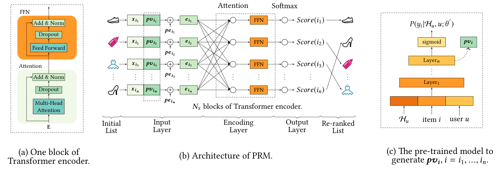
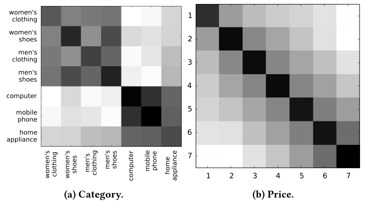
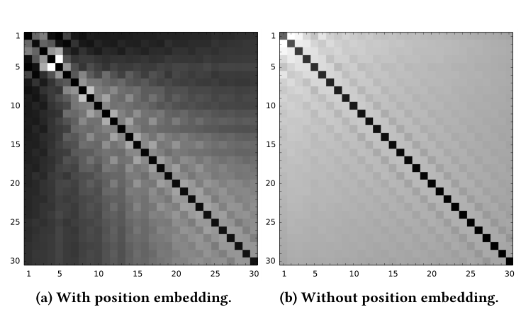

# PRM 怎样让同一候选列表对不同用户产生不同排序

一次独立打分可以判断某个短途产品对用户是否相关，但无法直接读取这个产品在当前备选项里和谁同类、和谁价位接近。PRM 将基础排序后的整个列表送入双向自注意力。每行仍对应一个原候选，编码完成后给所有行同时打分，再排序一次。用户偏好向量在编码前进入每一行，因此同一候选列表换一位用户时，行间注意力及最终分数都可能改变。[arXiv 1904.06813v3 §3–4，第 2–4 页](https://arxiv.org/pdf/1904.06813v3#page=2)。

## 原名次和个性化向量分别从哪里来

同一请求仍用河边步道 A、同河段攻略 B、郊外骑行 C 三个候选。基础排序为 A、B、C。第 $i$ 个候选有基础排序特征 $x_i$，个性化版还有 $pv_i$。它是预训练 CTR 网络对该用户与候选的倒数一层表示，输入含用户历史、侧信息和当前物品。在平台曝光日志上先训练点式二元预测，再抽取 Sigmoid 前的向量供重排。原文式 (10) 写的是对数似然，若按损失最小化需取整体负号。基础 PRM 可以省略 $pv_i$，以对照预训练个性化的增量。[§4.2、§4.5，式 (4)–(5)、(10)，第 3–4 页](https://arxiv.org/pdf/1904.06813v3#page=4)。

先将 $[x_i;pv_i]$ 与按**基础名次**查表的同宽位置嵌入逐分量相加，再投影至 $d$ 维，组成 $n\times d$ 的编码输入。式 (5) 右侧把待投影矩阵印成 $E$，依式 (4)、维度与前文应读作 $E^{\prime\prime}$。比如 C 起初排第三，即使最后被提到第二，也读的是位置 3 的嵌入。这给模型保留基础排序的先验。它不同于用新输出位置折扣加权的 [Airbnb MLR](../SRC-AIRBNB-MLR/阅读笔记.md#一个位置的相关性随展示位置衰减)。[§4.2–4.3，第 3 页](https://arxiv.org/pdf/1904.06813v3#page=3)。

Pei 等，固定 v3 图 1，PDF 第 4 页，作者原图。中栏从基础排序读取每行候选，在输入处合并右栏提供的用户—物品向量与原位置。左栏表示每层自注意力和逐行前馈。最右输出连线是对同一批候选重新排序。

## 所有候选一起编码，输出名次一次确定

任一头在每个候选处构造查询、键和值，对全部候选计算 $\operatorname{softmax}(QK^\top/\sqrt{d_k})V$，其中 $d_k$ 是键向量维度。逐行前馈层接着处理每个位置，堆叠多个编码块。A 的查询可以同时读取 B、C，C 也能直接读取 A。假设某个头对 A 行产生 $(0.20,0.65,0.15)$ 的权重，该行结合了 B 的表示。权重大只说明读取了 B 的值，最终打分可升可降。还要经过多头拼接、残差、前馈和打分层。[式 (6)–(8)，PDF 第 3–4 页](https://arxiv.org/pdf/1904.06813v3#page=3)。

设得出的教学 logit 为 $(1.2,0.1,0.8)$，列表 Softmax 约为 $(0.499,0.166,0.335)$。排序产出 A、C、B。选完 A 后不会再改 B 和 C 的 logit，因为没有逐步解码器。$n$ 项的密集自注意力有平方级候选对计算，但单层的候选行可并行，最终另需一次排序。与 [Seq2Slate](../SRC-SEQ2SLATE/阅读笔记.md) 的逐位指针不同，输入上下文可以全局，输出之间仍共享同一张分数表。

## 日志中多个正例怎样共同推梯度

原文式 (9) 按列表对点击正例求 $-\sum_i y_i\log p_i$，$p_i$ 来自同列表归一化，$y_i\in\{0,1\}$。若日志中 A、C 被点，B 未点，则每分支对 logit 的梯度为 $m p_i-y_i$，其中 $m=2$ 是本列表正例数。以算例计算约为 $(-0.002,0.332,-0.330)$。B 虽没有单独的正例损失，仍通过归一化分母收到梯度。反向信号经过线性输出和候选自注意力，更新跨行上下文编码。该概率归一于列表，可用于排序，和预训练模块的独立 Sigmoid CTR 需分开理解。印式按原样对正例求和；包含点击数不同的请求时，其归约与每条列表先除以点击数的做法有不同权重。[§4.4–4.5、式 (8)–(10)，第 4 页](https://arxiv.org/pdf/1904.06813v3#page=4)。

## 离线与线上实验分别说明什么

Yahoo Letor 把人工相关性等级变成二值标签，加位置衰减模拟曝光，使用 SVMRank 或 LambdaMART 生成初始列表。表 3 中，SVMRank 初始列表的 MAP 为 DLCM 64.50、PRM-BASE 65.60，LambdaMART 初始列表对应 65.24、65.72，单位均为百分数。真实电商数据表 5 的 MAP 是 DLCM 28.19、PRM-BASE 28.85、预训练个性化 PRM 30.15，后两者的相对增幅约 4.5%。固定的日志反馈反映已展示列表下的互动。[§5、表 2–5，PDF 第 5–8 页](https://arxiv.org/pdf/1904.06813v3#page=7)。

表 6 联合比较基础 DNN、DLCM 和两种 PRM。相对无重排的 DNN，PRM-BASE 的 GMV 为 +0.36%，预训练个性化版为 +6.65%。正文所称 6.29% absolute increase 是两个相对基线增幅的 6.29 个百分点之差。在线样本量量级为数十万用户和数百万请求，原文未给出足以进一步复算的随机化与区间信息。[§5.6、表 6，PDF 第 7–8 页](https://arxiv.org/pdf/1904.06813v3#page=8)。

Pei 等，固定 v3 图 2，PDF 第 8 页，作者原图。左图按类目聚合，右图按价格级别聚合，越深代表平均注意力越大。较大权重可指向相似商品，热图不显示调整名次的方向。

Pei 等，固定 v3 图 3，PDF 第 8 页，作者原图。有初始位置嵌入时排在前部的项可在距离较远的位置收到较大权重。两图描述模型权重分布，支持初始名次进入编码的解释。对照一次打分与前缀解码的适用条件见[列表顺序与前缀依赖怎样建模](../../知识库/问题/列表顺序与前缀依赖怎样建模.md)。

## 原文与译文

采用 arXiv 1904.06813v3，2019-07-23 修订，原文 9 页。阅读摘要、正文 §1–6、图 1–3 与表 1–6。 [固定原文](https://arxiv.org/pdf/1904.06813v3) · [RecSys 2019 记录](https://doi.org/10.1145/3298689.3347000)。 7 页译文使用作者 LaTeX 双栏，涵盖摘要、正文、图表说明与描述性脚注。图 1 用采用版 PDF 矢量裁图替代旧 TikZ 布局，图内原标签、文献和 ACM 权利声明保留。 正式译本位于 `.local/papers/SRC-PRM/translation/PRM_中文翻译.pdf`。 [私有备份下载说明](../../文档/工具/中文PDF发布.md)。
