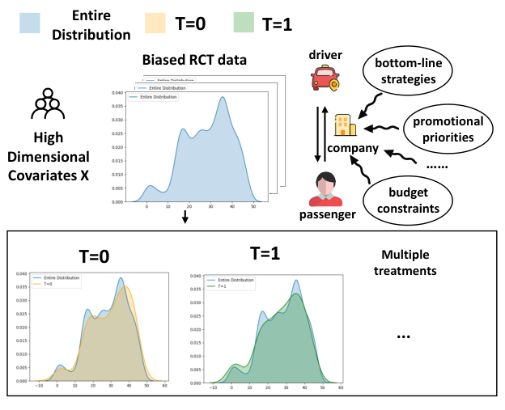
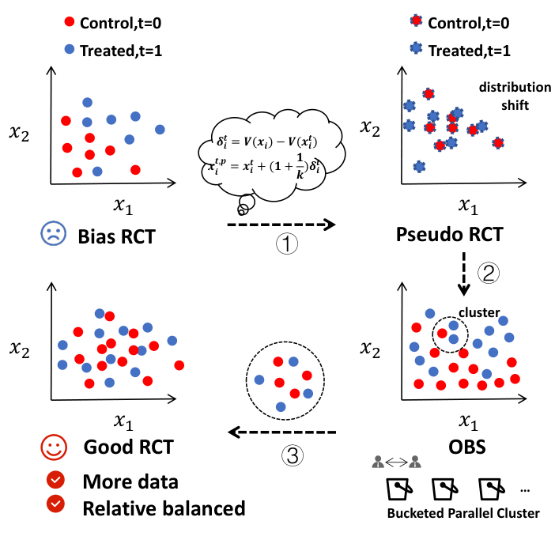
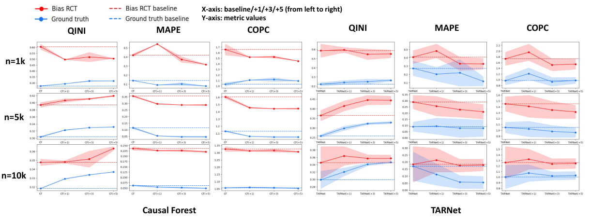
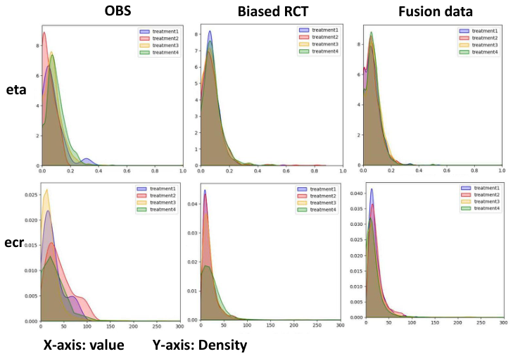

# 伪样本匹配：按各折扣臂的配额从观测日志补样本

滴滴场景在报价时给乘客分配 33 档折扣，预测下单率对不同折扣的响应。作者指出可用的试验流量约占 0.65%，预算、城市促销优先级及执行过程还可能让不同试验臂面对不同供需条件。扩大试验样本与纠正试验组失衡是两个同时存在的问题。论文用合并后试验人群的均值作目标，先算出各档应补进怎样的画像，再从该档观测日志找可用的真实记录。 [原文 §1、§3](https://arxiv.org/pdf/2509.18148v1#page=2)

*作者原图。Han 等，arXiv v1，PDF 第 2 页图 1，裁去版边。先看合并分布，再看两臂和业务优先级的示意。*

## 为什么新加入的样本必须补到均值另一侧

取某城市中一维处理前特征，例如每个报价请求前估计的等车时间。设所有已入试验请求的均值是 6 分钟，小券臂均值是 4 分钟。每条试验记录计划补 $k=2$ 条同档观测记录。如果新记录均值只是 6，合并后均值只有 $(4+2\cdot6)/3=5.33$。要达到 6，补进来的记录均值需为 7。

一般地，令 $V_i$ 为试验第 $i$ 档在所选字段上的均值向量，$V_{\rm avg}$ 为全试验的均值。平衡等式 $(V_i+kV_i^{\rm obs})/(1+k)=V_{\rm avg}$ 给出
$V_i^{\rm obs}=V_i+(1+1/k)(V_{\rm avg}-V_i)$。
小券臂对每条试验记录加平移量 $(1+1/2)(6-4)=3$ 分钟。因此一条原来等车 5 分钟的记录生成目标向量中的 8 分钟。保留原档位，其他非选中字段保持原值，试验记录的标签也留在伪样本元组里。此时生成的行只用于检索。最终被加入训练的是匹配到的真实小券报价及其实际是否下单。 [原文 §3.2 与算法 1](https://arxiv.org/pdf/2509.18148v1#page=4)

*作者原图。arXiv v1，PDF 第 3 页图 2，裁去版边。按①平移、②同桶近邻查找、③将真实观测行加回原试验读图。*

作者把伪样本和观测特征按列缩放。关键字段先分桶，跨桶距离视为无穷，再在同一档 $O_i$、同一桶中按所选特征 L2 距离取 $k$ 个近邻，允许业务给特征加权。分桶也提供并行单位。等式依赖每条实际加入 $k$ 条、取回均值等于目标的理想情况。匹配阈值、重邻居的去重和局部支持不足都可能让实际达到的均值偏离。论文算法 1 的输出只有选中的观察集合，正文和图 2 再把它并入原试验；对于跨查询去重、并列以及桶中缺邻居，作者未明确给出完整约定。 [原文 §3.2–3.3](https://arxiv.org/pdf/2509.18148v1#page=4)

## 试验内平衡、外部代表性与未测混杂

例中的小券臂补到 6 分钟只对齐了一个均值。高峰和低峰有不同尾部及联合分布，仍应看两臂在重要的时间、城市、供需特征和动作支持上能否比较。若部署全量人群本身均值为 9 分钟，目标取已入试验人群的 6 分钟，也没有把效应自然搬运到全量。试验内随机指派、试验入组代表性和观测样本结果可比需要各自的条件。该方法从 OBS 引入事实标签，因此若 OBS 仍有未测混杂或结果机制随渠道变化，均值对齐不能提供识别保证。Perfect Match 则用训练集的其他臂事实近邻重组梯度批次，两者改变样本分布的位置不同。 [Perfect Match 的批次匹配](../SRC-PERFECT-MATCH/阅读笔记.md#一个小券样本怎样调进另外两臂) · [历史发券的识别条件](../../知识库/问题/历史发券日志如何估计补贴增量.md#在哪一群人哪个时刻比较发与不发)

## 测试集也偏时，离线指标会怎样反转

模拟实验将同一模型分别放在有偏 RCT 测试与真值测试下衡量。图 4 的红蓝两组曲线反映两套评估人群可以给出不同排序结论，随机增样的对照还用来区别样本量与定向选择。线上实验前，真实日志用 15 档的样本人群比加权汇总。1:3 相比原试验训练，$w$-Qini 由 0.0907 降到 0.0796，$w$-MAPE 从 0.0441 降到 0.0308，$w$-COPC 从 0.9509 变为 0.9343，接近作者给出的 0.92 目标。选择该配置反映排序与幅度校验的取舍。 [模拟表 2](https://arxiv.org/pdf/2509.18148v1#page=6) · [离线表 3](https://arxiv.org/pdf/2509.18148v1#page=6)

*作者原图。arXiv v1，PDF 第 7 页图 4。先定模型与样本量，再沿横轴比较融合比例，红线用有偏试验评估，蓝线用真值。*

*作者原图。arXiv v1，PDF 第 7 页图 5。列从 OBS 到有偏试验再到融合数据，比较各档的密度。图只展示两个字段。*

在线用 62 城市一周实验，将预测折扣敏感度交给预算系统。表 4 报告 GMV +0.87%、作者按 GP 与 AA 差异调整后的利润 +0.41%。这是整个发券策略的指标，且表中没有给出区间或足以复算指标的分子分母。 [原文 §4.3.2、表 4](https://arxiv.org/pdf/2509.18148v1#page=7) · [随机留出怎样验证增量和价值](../../知识库/问题/怎样验证补贴增量的排序幅度和策略价值.md)

## 阅读范围

Kairong Han、Weidong Huang、Taiyang Zhou、Peng Zhen、Kun Kuang，采用 2025-09-16 的 arXiv 2509.18148v1，共 8 页。核对正文 §1–5、算法 1、图 1–5 与表 1–4。采用版使用 CIKM 2025 会刊版式，页首 DOI 为模板占位符，版本定位以固定 arXiv 号为准。按清单仅解读，未运行模拟或线上试验。 [固定版 PDF](https://arxiv.org/pdf/2509.18148v1)
