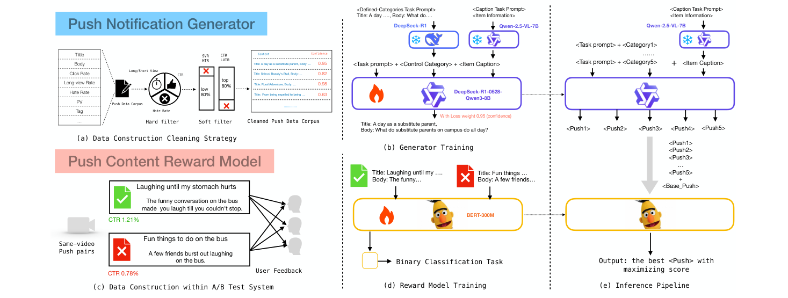
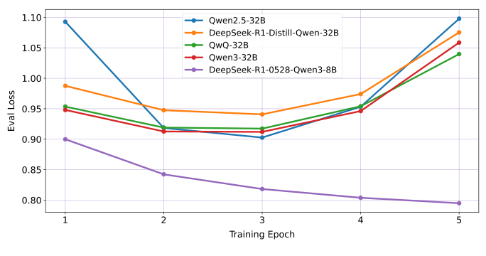
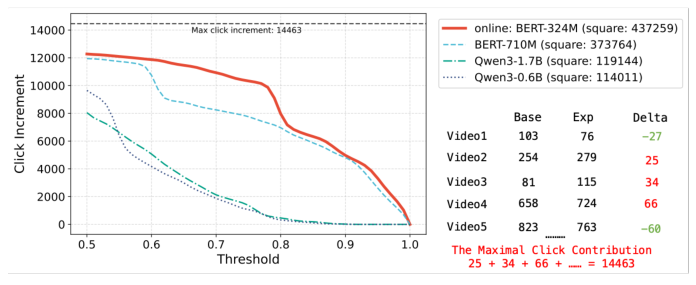

# PushGen：先按风格生成候选，再用同视频点击反馈筛选

给一条短视频推送通知时，平台已有待推的视频和原文案。人工能根据视频挑一个具体亮点，但在大规模视频池中难以逐条撰写。大语言模型可以扩充产量，推理时仍要控制风格，也要判断哪条候选更可能被点开。PushGen 将两件事拆开。生成器根据视频证据写多个版本。奖励模型用同一视频的文案 A/B 数据学习比较两条文案，并据此决定是否替换旧文案。[原文 §1–2](https://arxiv.org/pdf/2512.14490v1#page=1)

作者图 2，Shifu Bie 等，固定版第 2 页。左上是过滤后的历史文案，左下是同视频 A/B 所产生的点击胜负对。中间上下两支分别训练生成器和奖励模型。右侧流程把按类别生成的候选及原 DeepSeek V3 671B + RAG 文案送入筛选。图中的 “Other Push” 是旧方案文案，排序的对象是同一视频的文字。

## 从视频证据到可控的文案候选

假设平台决定推一条介绍两种镜头收纳方法的视频。这是用于走通机制的教学例子。冻结的 7B 视觉语言模型读视频帧、语音识别文本、原标题和类别元数据，输出如“用分隔盒收纳镜头，盒内另设干燥剂位置”的详细文字描述。下游文本模型用这段描述作为内容依据。给类别“实用”时可以生成“两个镜头收纳技巧，分区防潮”；给“悬念”时可以生成“镜头盒里这个小隔层为什么空着？”。显式描述让审核人有事实可查。它本身也可能漏掉或误读视频信息，不能保证生成内容都忠实。

监督样本是历史文案。先按点击、短观看、长观看、厌恶和曝光量硬筛，再在标签簇内截掉表现较差的分位样本。清洗后用冻结语言模型多次判断文案风格并要求一致，形成风格条件。模型用“任务指令 + 风格条件 + 视频证据”预测历史文案的 Token，原式把单样本 SFT 损失乘以置信权重。该权重随 CTR 和曝光量变化，原式对小曝光的对数项为负。以自然对数代入满足曝光与 CTR 硬门槛的 801 次曝光、CTR 0.7%，总权重约为 −0.56。论文没有报告裁剪、重标定或其他实现细节，不能据此认定训练实际用了负权重。[原文 §2.1.1–2.1.3，第 2–3 页](https://arxiv.org/pdf/2512.14490v1#page=2)

作者图 3，固定版第 3 页。横轴是训练轮数，纵轴是作者图所列 Eval Loss。论文在历史百万量级语料中筛出超过 7 万个样本，依据所测损失曲线选 DeepSeek-R1-0528-Qwen3-8B 做 SFT。表 2 用同输入、同提示和奖励筛选比较预训练与 SFT：超过旧基准的比例由 44% 到 83%，实用风格占比由 1.8% 到 9%，悬念由 6% 到 11.8%。这些是该候选池及选择器上的结果。[§4.1–4.2、表 2](https://arxiv.org/pdf/2512.14490v1#page=4)

## 同一视频的 A/B 为奖励模型提供胜负标签

假设同一视频的实用文案和原文案都分到 2,000 次可比曝光，分别有 20、12 次点击。实测 CTR 为 1% 和 0.6%。样本把两条文字拼成 $[{\rm CLS}],a,[{\rm SEP}],b,[{\rm SEP}]$，BERT 的 CLS 向量经 MLP 和 sigmoid 输出第一条胜过第二条的概率。标签是实测 CTR 的严格大小比较，例中为 1，使用二元交叉熵更新判别器。由同一视频构造对比可固定视频、作者和主题，但两个 CTR 仍受样本量、受众和实验分流影响。没有置信区间或曝光明细时，不能把很小的 CTR 差当作稳定的文案效应。

部署时，生成器按多个类别采样，判别器参与筛选是否用新文案替换旧文案。§2.2.2 直接对文案对输出概率，§4.2 写成 $x=\sigma(s_{\rm Exp}-s_{\rm Base})$。直接对文案对建模不保证分数可分解为各文案的独立效用，也不保证换序一致或比较传递。论文没有交代线上如何衔接两种形式，也没有给出所有候选的比较顺序。该训练标签与候选池的联系见[生成式推荐的偏好对齐](../../知识库/问题/生成式推荐怎样从似然训练走向偏好对齐.md#同一视频的胜负反馈用于文案筛选)。[原文 §2.2、§4.2](https://arxiv.org/pdf/2512.14490v1#page=3)

作者图 4，固定版第 3 页。用横轴概率阈值保留部分视频，再汇总相对旧文案的点击变化。作者用同批数据中总能选中观测 CTR 胜者的方式估算点击增量上界示例（14,463 次）。这个上界依赖具体候选及观测噪声。表 1 中 BERT-710M 的离线胜负准确率 73.77%，略高于 BERT-324M 的 73.58%。§4.2 的对应约称是 700M 与 300M。作者据点击增量曲线选择 300M 左右的模型，说明按对计的准确率与按曝光及点击差汇总的效果可给出不同选择。[§4.1–4.2、表 1 和图 4](https://arxiv.org/pdf/2512.14490v1#page=3)

## 线上收益和文案事实性各看自己的证据

生产流程使用 SFT 及成对奖励模型筛选。作者探索了 DPO、PPO 和 GRPO，§3 报告奖励中的实体显著性可能放大为投机。例中的生成器若为了点击杜撰热门品牌或具体价格，即使得分提高，实际文案的事实性也会变差。论文没有量化不同后训练方案的事实性退化幅度，因此该段是作者观察。表 3 的多日 A/B 报告机器文案替换量占发送量的 85.2%，替换口径的 CTR 增加 14.080%，公域整体 CTR 增加 4.026%，去重 DAU 增加 0.067%。中、低活跃用户的去重 DAU 分别增加 0.196% 和 0.176%。这几项基数不同，百分数沿用作者报告。实验变更是文案生成和筛选。发送时机、发送相对不触达的增量以及长期打扰还需要各自的实验设计。[§3、§4.3 与表 3](https://arxiv.org/pdf/2512.14490v1#page=4) · [Push 触达阅读路线](../../知识库/阅读/Push触达与时机论文路线.md#内容推荐与发送时机分别看)

采用 arXiv 2512.14490v1，核对摘要及 §1–5、四图和三表，未运行作者实现。译文在作者 LaTeX 副本上翻译并以 XeLaTeX 单栏编译，共 7 页，已逐页目视。译文保留图内英文、公式与参考文献，在正文注明交叉引用和奖励模型分数口径差异。[固定原文](https://arxiv.org/pdf/2512.14490v1) · [中文 PDF 访问说明](../../文档/工具/中文PDF发布.md)
