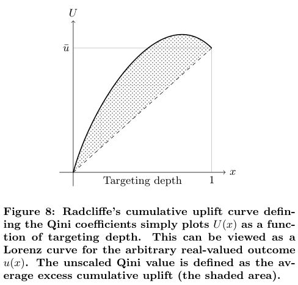

# Qini 怎样用随机对照检验发券排序

响应率排序会优先找到容易买的人。发券排序需要找到发券后比不发券多买的人，因此要在同一排名深度比较处理组与对照组。Nicholas J. Radcliffe 2007 年论文的机构摘要确认它讨论营销实例和二元、连续效果指标。这里据 Surry 与 Radcliffe 的 2011 年论文 §4 和 Cheng 等综述 §3.A 核对可计算的公式。 [2007 机构摘要](https://www.research.ed.ac.uk/en/publications/using-control-groups-to-target-on-predicted-lift-building-and-ass) · [2011 原文](https://stochasticsolutions.com/pdf/kdd2011late.pdf#page=5)

## 一张券先比较排名前缀

在独立随机样本上用发券前特征计算分数。将同分用户作为一组或预先固定打破平局的办法。令前 $k$ 人中两臂样本数为 $n_1,n_0$，下单总数为 $y_1,y_0$，两臂都有样本时，Cheng 等综述式 (9) 的 Qini 点为
$$
Q_{\mathrm{count}}(k)=y_1-y_0n_1/n_0=n_1(\bar Y_1-\bar Y_0).
$$
如果前缀有 20 个发券用户与 40 个对照，两个组分别有 9、10 个订单，则发券组自然订单的估计为 $10\times20/40=5$，估计多出 4 单，增量率为 0.20。综述式 (8) 的 Uplift 曲线把相同率差乘前缀总人数，得到 12 单，对应面向这批目标人群全部发券的增量估计。局部臂比波动时，两条曲线的比例也会变。 [综述式 (8)–(10)](https://arxiv.org/pdf/2202.02896v1#page=4)

2011 论文令 $F_T(d),F_C(d)$ 为两臂各自在覆盖深度 $d$ 前的累计结果，以各自全臂人数作分母。其 $U(d)=F_T(d)-F_C(d)$，并取 $\int_0^1[U(d)-dU(1)]\,{\rm d}d$ 为未归一化超额面积。如果全样本共 100 处理、200 对照，前缀两臂都覆盖自己人数的 20%，例中 $U(0.2)=9/100-10/200=0.04$，恰等于 $Q_{\mathrm{count}}/100$。共用分数阈值时两臂各自覆盖比例可能不同，应明确是分臂分位还是共用阈值、使用全样本臂比还是局部臂比、扣除基线与否以及归一化分母。 [2011 论文 §4，式 (10)–(15)](https://stochasticsolutions.com/pdf/kdd2011late.pdf#page=5)

Surry 与 Radcliffe 的作者原图 8，2011 作者稿第 6 页裁取。横轴是排序投放深度，实线是累计增量，虚线连起原点与全量结果，阴影为超额面积。论文二元 $Q$ 和另一归一化 $q_0$ 使用不同的理想曲线，连续结果也要另核对分母。实际面积可在固定深度网格用梯形积分。 [2011 原文图 8 与式 (22)–(23)](https://stochasticsolutions.com/pdf/kdd2011late.pdf#page=6)

## 已知分层概率时怎样构造曲线

如果测试中不同用户以不同概率拿券，可以把某个分数前缀看作固定策略，使用 $n^{-1}\sum_i\mathbf 1\{i\text{ 在前缀}\}[T_iY_i/e_i-(1-T_i)Y_i/(1-e_i)]$ 估计每个合格用户的累计增量，并按目标人数恢复订单单位。这里 $e_i$ 是实验指派概率。极小前缀的样本方差可能很大，定量比较时用相同人群、概率和深度网格，报告所选投放深度对应的置信区间。发券成本及影响其他店铺的替代效应还要按政策目标计算。 [评估排序、幅度和价值](../../知识库/问题/怎样验证补贴增量的排序幅度和策略价值.md)

P68 的 2007 年刊文核到爱丁堡大学题录与摘要，公开全文待取得。公式精读覆盖 Surry 与 Radcliffe 2011 年作者稿 §3–4 和 Cheng 等 2022 年综述式 (8)–(10)。
