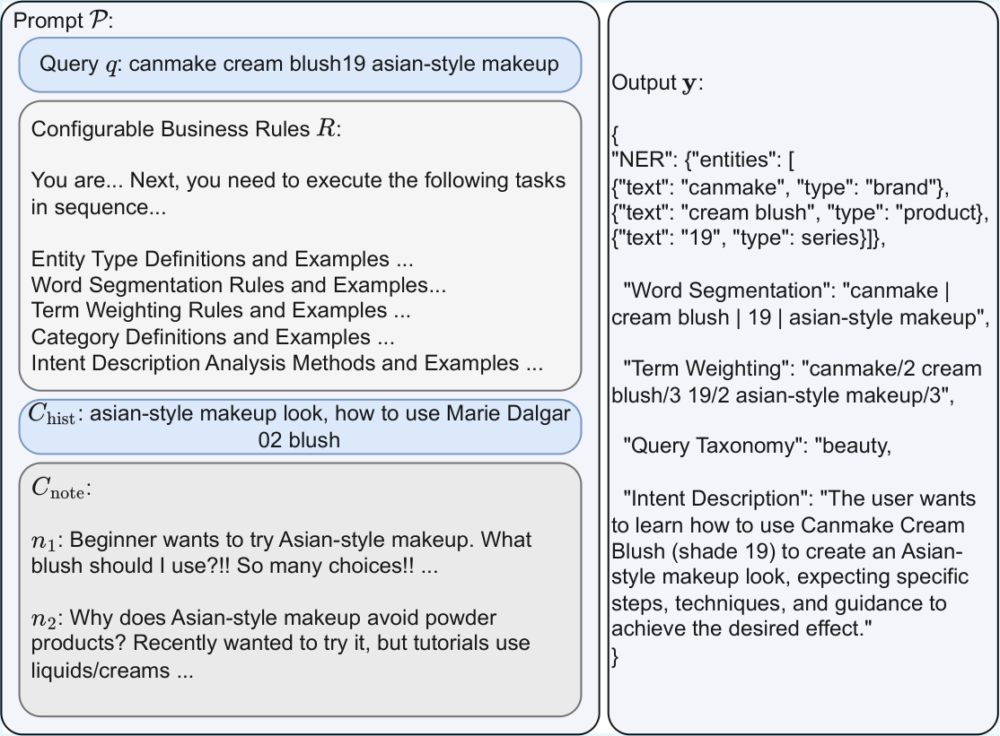
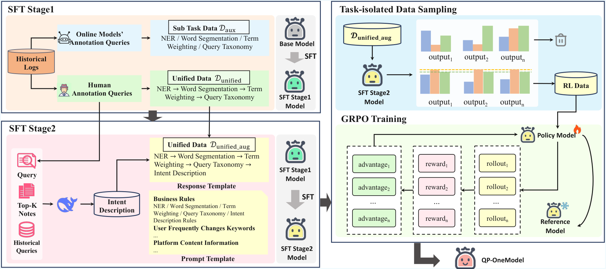
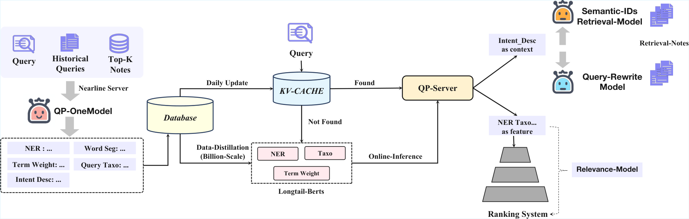

# QP-OneModel：用实体、分词和权重接通搜索意图

用户在小红书只输入“1c1”。经典流水线先做人名或商品实体识别，再分别给出分词、词项权重和类目。若识别器没认出这是色号，下游可能把它当普通字符，甚至检索到其他领域。QP-OneModel 用一个 RedOne 系生成模型依序产出实体、分词、词项权重、分类和自然语言意图。作者例子保留 1c1 的商品系列标签，同时在意图描述中补出可能的雅诗兰黛粉底和色号比较需求。后者是推断信号，当前查询没有明确说出品牌或肤色。[原文 §3、§4.1、§5.4，表 7](https://arxiv.org/pdf/2602.09901v1#page=9)

*作者原图 2 · 同一提示中提供业务定义、用户改写历史及候选笔记，依序预测五项结果。Jianzhao Huang 等，arXiv:2602.09901v1 第 4 页。*

## 先判断词项表示什么，再决定哪些必须匹配

给定当前查询、任务指令、业务定义和可用动态上下文，输出一个 JSON 序列。实体首先给出片段类型，分词可据此保留完整色号，接着为每个词项预测 0–3 级的重要度，最高级影响必匹配逻辑。分类按相关度排列多标签，随后输出自由文本意图。条件概率逐词元分解，后项可读到前面生成内容。统一模型能利用这条依赖，也可能把一次实体误判传到分词及词项权重。训练对照中，统一 8B 的总体分 79.36 高于独立模型汇总的 78.11，分类却是 79.59 对 80.51。该对照不能单独拆出共享骨干与输出顺序的贡献。[原文 §4.1，式 (1)–(3)，表 2](https://arxiv.org/pdf/2602.09901v1#page=7)

提示可提供业务定义以及会话近期改写、初始检索的候选笔记，以应对新实体、热词和语境歧义。比如若近期查询确实讨论粉底，同一个“1c1”的品牌推断更有依据。候选本身也可能有错，不能直接把候选里的品牌或肤色限制写成硬过滤。论文列出四项基础任务加一项意图描述，以及另行评估的文档意图和权威意图，未给出九项核心任务清单。[原文 §3、§4.2、§5.2.4](https://arxiv.org/pdf/2602.09901v1#page=4)

## 从旧模型的覆盖，过渡到近期标注和分任务反馈

第一阶段联合使用约千万条旧系统伪标注及十万量级的联合人工样本。伪标注单条主要用于一个任务，帮助覆盖大量查询；人工 JSON 教模型各字段互相一致。第二阶段只在较新的人工联合标注上训练，调整到当下分布。第三阶段根据预测与参考的各任务得分作加权和，再对同一请求的一组生成求相对优势。实体识别同时要求片段和类型正确，词项权重用“分词边界、权重”严格匹配的联合 F1，分类平均 Top-1 准确率和多标签 F1。自由文本意图描述没有独列评分和奖励细节。[原文 §4.3、§5.1，式 (7)–(12)](https://arxiv.org/pdf/2602.09901v1#page=5)

如果两个输出的实体结果相同、色号切分也相同，只在色号是不是关键匹配词上不同，组内奖励更容易定位词项权重的影响。作者用第二阶段模型筛选这类请求，保留目标任务奖励有差异而其余任务稳定的样本。这是采样策略，式 (11) 仍是组相对目标及 KL 约束，不代表在线逐字段独立强化学习。8B 经过 RL 后词项权重 F1 从 64.91 到 66.17，分类从 79.70 到 79.68；0.6B 的 NER 也从 81.91 到 81.64。各任务未同步上升。[原文 §4.3.3、表 4](https://arxiv.org/pdf/2602.09901v1#page=7)

*作者原图 1 · 左侧两阶段监督，右侧按奖励分歧筛样本后做 GRPO。Jianzhao Huang 等，arXiv:2602.09901v1 第 3 页。*

## 区分结构指标、下游增量和线上执行

约 2500 条近期流量上的人工黄金集里，8B 总体分 79.89 对 BERT 的 72.54，差 7.35 个百分点。0.6B 总体以表 1、表 4 的 78.81 为准，正文另印 78.37。文档意图少样本提示准确率 82.40% 对 Qwen3-32B 的 74.80%，权威意图 71.56% 对 71.62%。加入 LoRA 的评估有梯度更新，应与仅用提示示例的对照区分。原文未详列测试示例与训练数据的去重细则。[原文 §5.1–5.2，表 1、4、5](https://arxiv.org/pdf/2602.09901v1#page=7)

*作者原图 3 · 近线预计算每日更新结果缓存，搜索引擎读取结构字段和意图描述。Jianzhao Huang 等，arXiv:2602.09901v1 第 6 页。*

线上各 5% 实验与对照流量、至少 14 天。更换基础结构信号时，人工标注前八结果的无关惩罚 DCG 0/1 下降 0.21%，少结果率下降 0.4631%。另一实验在原有大模型改写中加入意图描述，训练用作推理链监督，推理作增强输入。有效点击率和搜索活跃用户次日留存分别增 0.17%、0.044%。均为论文列报的绝对差，两个实验不能合并归因。图示的每日近线更新与后端读缓存，也不是实测每次实时生成延迟；未公开缓存失效、未命中与 P99 细则。[原文 §5.3、表 6](https://arxiv.org/pdf/2602.09901v1#page=8)

## 采用版与中文 PDF

采用 arXiv:2602.09901v1。核对固定 10 页原文和作者工程，12 页中文正文 PDF 经逐页渲染目视，保留公式、图内文字、部分技术表头及参考文献。原文和中文 PDF 已完成私有备份与认证下载，未复现工业实验。[固定原文](https://arxiv.org/pdf/2602.09901v1) · [与 LinkedIn 比较](../../知识库/问题/搜索查询怎样变成下游可执行的结构.md) · [私有 PDF 访问说明](../../文档/工具/中文PDF发布.md)
