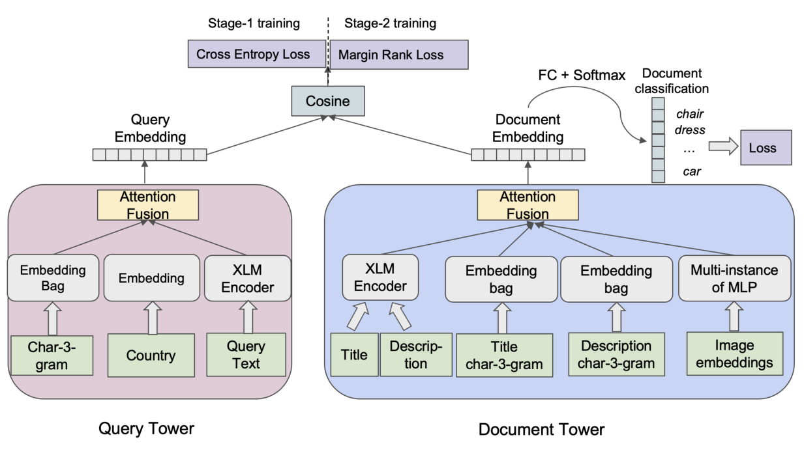
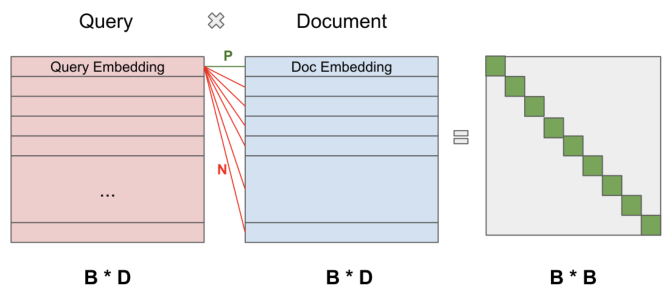
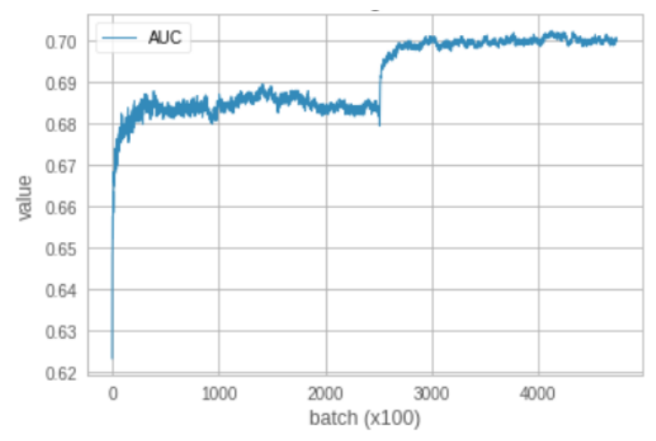
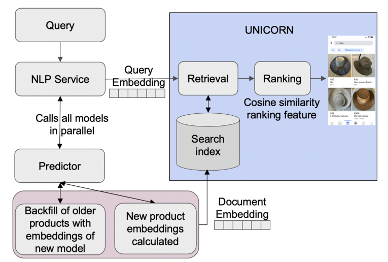

# Que2Search 怎样兼顾多模态匹配、独立索引与多阶段排序

Marketplace 的传统召回能有效找回词项匹配的商品，碰上同义写法、卖家描述缺失或只有图像能说明商品时，词项和字符 n-gram 的覆盖会下降。Que2Search 把查询和商品各自编码成单个向量，在各塔内部融合模态，线上只比较两个向量。商品向量可以在上架后异步入索引，查询侧只承担小 XLM 和一次向量融合。模型上线以后，同一个余弦分数还会进入两级排序。[§1–3，出版页 3376–3380](https://dl.acm.org/doi/epdf/10.1145/3447548.3467127)。

## 塔内注意力决定怎样读字段

*Yiqun Liu 等，KDD 2021 正式版图 2，PDF 第 3 页。从采用版裁取图区。*

用查询 “hats” 贯穿一次过程。查询塔将字符三元组哈希后做 EmbeddingBag 求和，同时编码国家类别和 2 层 XLM 的 [CLS] 向量。某款帽子的商品塔读取标题、描述与图片，文本字段共用 6 层 XLM-R，各自保留字符三元组。多张图先用预训练 GrokNet，再经共享 MLP 和 Deep Sets 汇总。对应同一塔的各通道 $\phi_i$ 拼接后投影，Softmax 给各通道权重，最终只保留 $\sum_i w_i\phi_i$。权重只读取当前塔，因此商品编码不随现场查询重算。若某个卖家的描述很短，描述文本与描述三元组往往同时缺失。作者以这种关联定义模态组，在训练中用一塔全模态对另一塔单组计算附加损失，推理仍执行全模态模型。[§3.1、§3.6，式 (1)、(6)，出版页 3378、3380](https://dl.acm.org/doi/epdf/10.1145/3447548.3467127#page=3)。

表 1 分组 Gradient Blending 相对 ROC AUC 提升 0.91%，独立通道方案为 −1.2% 且不显著。式 (6) 右塔分支印出重复的余弦，按前两行的相似度逻辑应只算一次。§3.7 的两个文本通道平均权重 0.64/0.36、查询少于 5 字符时三元组权重占优，和另一个基于消融的表 2 是两个口径。图 2 还有国家通道，原文未交代该权重分析如何处理它。[§3.6–3.7，表 1–2，出版页 3380–3381](https://dl.acm.org/doi/epdf/10.1145/3447548.3467127#page=6)。

## 用同一个批内矩阵从随机负例切换到难负例

正例代理为搜索、点击、给卖家发消息、卖家回复，四步在较短窗口内发生。训练没有读取消息内容。把一批正对编码后，余弦矩阵对角线对应正对，其余列在该行作负例。第一阶段对一行所有列做带尺度的交叉熵。尺度取 15–20，改变 Softmax 的分布尖锐程度。待验证 ROC AUC 收敛后，第二阶段只选一行中最高分的非对角商品，用间隔损失 $\max(0,m-s_{ii}+s_{in})$。若帽子正例余弦为 0.70、难负例 0.64、间隔 0.15，则当前损失为 0.09。训练会拉大差距。同批的另一顶帽子也可能满足真实意图，自动负例要按弱监督理解。商品端的辅助分类用最常见的 4.5 万条查询，多个正类别各分 $1/k$ 标签权重。[§3.1.1–3.3，式 (2)–(5)，出版页 3378–3379](https://dl.acm.org/doi/epdf/10.1145/3447548.3467127#page=4)。

*Yiqun Liu 等，KDD 2021 正式版图 4，PDF 第 5 页。从采用版裁取图区。*

*Yiqun Liu 等，KDD 2021 正式版图 3，PDF 第 4 页。从采用版裁取图区。*

实验选择的是间隔损失。式 (4) 中负样本对数项前印了正号，按标准二元交叉熵最小化该项应取负号。表 4 人工相关性 ROC AUC 从基线 0.795 到整体 0.849，增量为 5.4 个百分点。课程训练一行从 0.825 到 0.833，验证集的正文概述则超过 1 个百分点。表 3 的共享 XLM-R 0.7456 到 0.7459 约为相对 0.04%，正文写 0.18%。不同集合、指标和印刷数字分别记录。[§3.3–3.4、§5，表 3–4，出版页 3379–3382](https://dl.acm.org/doi/epdf/10.1145/3447548.3467127#page=7)。

## 召回出来的商品还需要由排序模型读互动信号

*Yiqun Liu 等，KDD 2021 正式版图 5，PDF 第 6 页。从采用版裁取图区。*

新款帽子上架后异步算向量并写 Unicorn，查询走 NLP Service 和 Predictor。查询向量推理报告 1.5 ms P99，文档向量 7 ms 未标百分位。查询发起后，搜索词项和 ANN 可做并集，位置等明确过滤在查询层用 AND 处理。首请求用更保守的探簇数和距离阈值，后续翻页可给更大预算。召回分数继续进入分片级 GBDT 和后续 DLRM 类排序模型。首屏与翻页的索引成本可对照[向量索引怎样影响候选覆盖](../../知识库/问题/向量索引怎样影响候选覆盖.md)。直接用余弦替换 GBDT 时，作者看到 NDCG 上升、线上互动下降。相似度是有用的独立信号，用户与商品的交叉互动特征仍需由排序侧消费。[§4、§6.1–6.6，出版页 3381–3384](https://dl.acm.org/doi/epdf/10.1145/3447548.3467127#page=6)。

表 5 的 +2.80% 和 +1.24% 分别对应替换先前向量召回方案和增加排序特征，均以前序技术上线为前提。会话率的原始水平、随机化单位、持续时间和置信区间未披露。训练的批内 Recall、对未来会话的近邻 Recall、人评 AUC、线上互动各对应不同证据。在[粗排的表达与计算预算](../../知识库/问题/粗排如何在计算预算内保留精排候选.md)中，将这种可索引的单向量匹配同 IntTower 多头后匹配、COLD 联合交叉对照。与 PinSage 和 LogQ 的训练差别见[双塔负样本](../../知识库/问题/负样本怎样改变双塔召回目标.md)。

## 原文与阅读材料

采用 [ACM KDD 2021 正式版](https://doi.org/10.1145/3447548.3467127)，共 9 页。核对全文、六个编号公式、图 1–5 和表 1–5，未运行模型。未找到作者 LaTeX，中文 PDF 根据正式 PDF 重排，覆盖摘要、正文、图表说明、脚注与致谢，保留图内文字、参考文献及 ACM 权利声明。中文 PDF 共 13 页，保留可编辑的排版工程。正式原文与译文均通过私有备份的认证下载与哈希核验。见[私有备份下载说明](../../文档/工具/中文PDF发布.md)。
