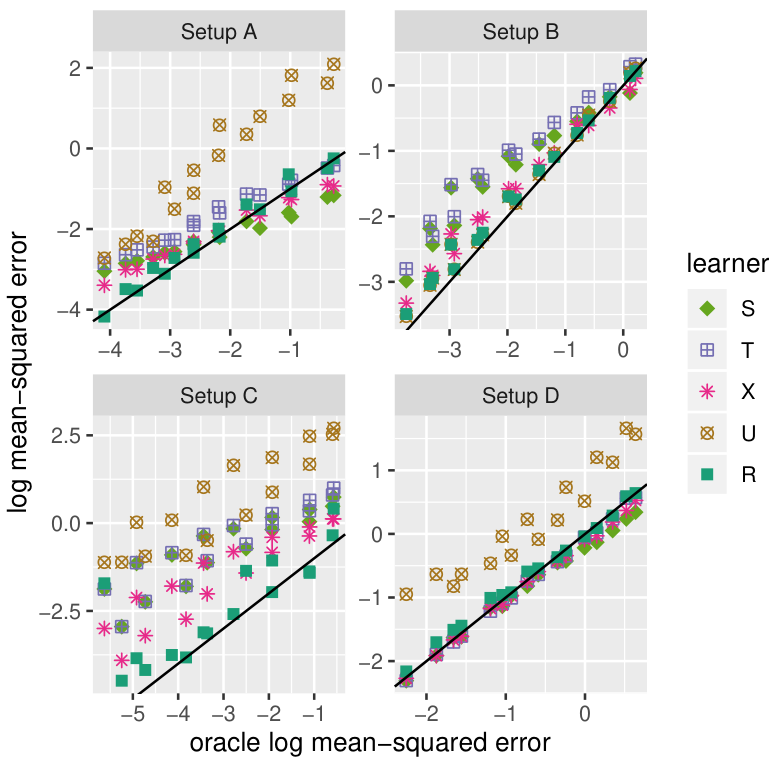

# R-learner 怎样在日志残差上学每类用户的增量

双头结果回归分别拟合有券与无券的下单曲线，再取差。如果两条曲线都复杂，但券效应只由少量特征决定，分别拟合曲线可能会让共同的基准波动进入差值。Nie 与 Wager 借用 Robinson 的条件均值变换，将有券与无券的变化写进同一个残差损失，让第二阶段直接拟合效应函数。 [原文 §1–2](https://arxiv.org/pdf/1712.04912v4#page=2)

## 一条样本怎样监督效应网络

令 $m(X)=E[Y\mid X]$，$e(X)=P(W=1\mid X)$。在给定 $X$ 可交换且具有重叠的二元处理数据中，$E[Y\mid X,W]=m(X)+\{W-e(X)\}\tau(X)$。第一阶段对 $m,e$ 做折外预测。第二阶段拟合 $\tau$，使 $Y-\hat m-(W-\hat e)\tau$ 的平方足够小，并对效应函数正则化。 [原文式 (1)–(4)](https://arxiv.org/pdf/1712.04912v4#page=3)

若某类用户历史发券概率 0.75、平均下单率 0.35，有券且下单的一条记录的结果残差为 0.65，处理残差为 0.25。假设当前 $\hat\tau(x)=0.08$，该效应解释了 0.02 个订单残差，平方误差为 $0.63^2$，对效应输出求导为 $-2\times0.25\times0.63$。优化时其他事实结果也会进入损失。部署时直接输出 0.08 这个条件效应，历史倾向和事实结果用于训练阶段。也可将每行残差比值作为回归目标、以处理残差平方为权重。处理残差接近 0 时直接使用乘法形式可以避免显式相除。 [原文式 (4)](https://arxiv.org/pdf/1712.04912v4#page=3) · [DML 与 R-learner 的目标比较](../../知识库/问题/残差化怎样估计营销干预效应.md#r-learner-直接拟合效应函数)

## 准预言机界约束什么

用真 $m,e$ 构造损失时，超额风险为 $E[e(X)(1-e(X))(\hat\tau(X)-\tau(X))^2]$。它把有分配变化的位置权重提高。只有倾向远离 0 与 1，超额风险才与普通效应均方误差有双向常数界。实际训练用估出来的 $m,e$。定理 3 在合适的 RKHS、惩罚、重叠和辅助估计条件下，证明可行估计器能达到与已知 $m,e$ 的参照估计器相同阶的风险上界。其中辅助误差条件包含均方根收敛快于 $n^{-1/4}$，还要求倾向估计一致地贴近真值。换成其他学习器可以复用损失，定理需另行核实。 [原文引理 2、定理 3 与式 (21)](https://arxiv.org/pdf/1712.04912v4#page=14)

作者图 4，固定 PDF 第 19 页。横轴是预言机的对数均方误差，纵轴是可行学习器的对数误差，斜线表示两者相等。每组改变样本量、特征数与噪声。A 与 C 的基线结构和分配不同，图中 R-learner 相对更接近斜线。B 模拟随机试验，D 模拟不等处理比例与复杂响应面，方法之间差距变小。实证比较依赖模拟真值。真实券试验应另外检验排序、校准和策略收益。 [原文 §6、图 4 与附录 B](https://arxiv.org/pdf/1712.04912v4#page=19)

采用 arXiv 1712.04912v4，精读 §1–7 的目标、实现、核方法条件与模拟，再核对附录实验与证明位置。41 页中文译本覆盖摘要、正文 §1–7、图表说明和致谢，附录、参考文献和图内文字保留原文。本地正式译文位于 <code>.local/papers/SRC-R-LEARNER/translation/中文.pdf</code>。 [固定原文](https://arxiv.org/pdf/1712.04912v4) · [Biometrika 正式条目](https://doi.org/10.1093/biomet/asaa076) · [私有备份下载说明](../../文档/工具/中文PDF发布.md#登录下载)
