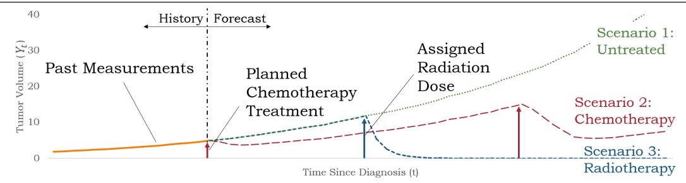
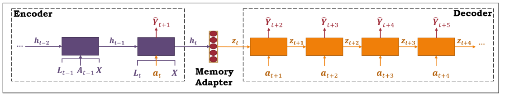
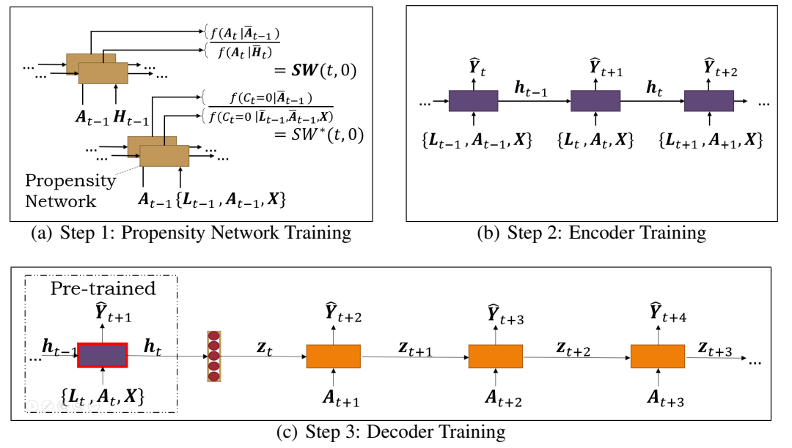
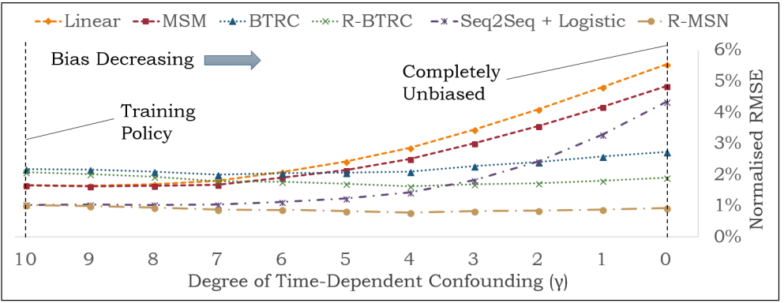

# R-MSN 怎样用加权的历史轨迹预测计划下的结果

计划今天发券、明天不发，到了后天会有多少订单？把历史里恰好执行了这套动作的用户挑出来算平均值，会把历史策略的选择带进答案。今天的券改变晚间活跃，晚间活跃又影响明天是否发券和后天是否下单。R-MSN 把这条时间链拆成两项计算。先用历史日志估计每一步实际动作出现的概率，构造整条路径的权重。再用加权的事实标签训练一个序列到序列预测器，比较从同一段历史出发的不同未来行动方案。原论文比较的是非小细胞肺癌模拟中不同治疗方案下的肿瘤体积，下面的发券数字仅用于走通计算。 [NeurIPS 2018 正式版 §3–4](https://proceedings.neurips.cc/paper_files/paper/2018/file/56e6a93212e4482d99c84a639d254b67-Paper.pdf#page=3)

*作者原图。Lim、Alaa 与 van der Schaar，NeurIPS 2018，PDF 第 2 页图 1，从正式版裁取。先找到历史与预测的分界，再从同一个起点沿三条曲线读肿瘤体积。*

## 用动作概率校正两天日志的选择

令 $H_t$ 包括当前分配前可见的协变量 $L_t$、更早的协变量、历史行动和静态特征。经典边际结构模型通常分开建模历史指派与行动序列下的结果。权重分母使用完整行动前历史预测事实动作 $A_t$，分子使用较简化的历史 $A_{<t}$ 预测同一个动作。普通逻辑模型可用累计治疗次数和近期体积近似历史。若实际策略读取过去 15 天的平均肿瘤直径，近期单个值或累计次数可能无法重建动作分配。R-MSN 改用循环倾向网络，让随时间更新的状态读取完整序列。多步仍用每期的概率比连乘，式 (4) 还乘上删失权重并用第 1、99 百分位截尾、按时距均值归一。 [正式版 §3、§4.1，式 (2)–(4)](https://proceedings.neurips.cc/paper_files/paper/2018/file/56e6a93212e4482d99c84a639d254b67-Paper.pdf#page=4)

假设日志中的事实动作是 $A_t=1,A_{t+1}=0$。第一天对发券的简化、完整概率为 0.5 和 0.8；第二天对不发券的概率是 0.6 和 0.3。训练第二步结果时，这次记录的未截尾、无删失权重是 $(0.5/0.8)(0.6/0.3)=1.25$。第二天不发券在该完整状态下比简化条件下少见，所以在相同第一天权重之上多乘了 2。训练第一步结果时只用 0.625。每个分子和分母都取事实动作对应概率，二元情形中若模型输出发券率，实际未发券的行取其补数。把发券后活跃直接固定进整个两日方案的对照人群，会切断早期发券通过活跃产生的路径；这里它进入第二期权重分母。 [正式版式 (2)–(5)](https://proceedings.neurips.cc/paper_files/paper/2018/file/56e6a93212e4482d99c84a639d254b67-Paper.pdf#page=3)

用权重需要每一步行动在对应历史下都有支持，且条件于已测历史后没有额外的共同原因。更灵活的 LSTM 能改善行动分配的拟合，无法从历史日志恢复从未出现的策略，也无法补上未记录的指派变量。式 (2) 的第二个等号写成各个分量条件概率的乘积。共用 LSTM 状态能反映共同的历史信息。若同一时点的多个动作在给定历史后仍相关，从边际概率取乘积需要额外条件，部署时应核对联合动作概率。 [正式版 §4.1 与官方附录 B](https://proceedings.neurips.cc/paper_files/paper/2018/hash/56e6a93212e4482d99c84a639d254b67-Abstract.html)

## 首步读当前状态，后续只推进计划动作

*作者原图。Lim 等，NeurIPS 2018，PDF 第 5 页图 2，从正式版裁取。紫色最后一步使用当前协变量和首个计划动作，橙色部分仅接收余下的计划动作。*

用同一条日志的今天作为预测起点。编码器依序读静态特征、历史状态和行动，最后送入已知 $L_t$ 和今天的事实动作 $A_t=1$。它输出下一期结局的预测和状态 $h_t$。如果观测结果是 8，预测是 6，未归一化首步损失贡献就是 $0.625(8-6)^2=2.5$。编码器训练结束后，提取各训练起点的隐藏状态及细胞状态。记忆适配器将两者的拼接投影成解码器初始状态，解码器读取明天的事实动作 0，输出后天的预测。假如事实后天结果是 10，模型预测 9，则该步损失贡献是 $1.25(10-9)^2=1.25$。梯度更新解码器和适配器。倾向网络用事实指派作为分类标签，结果网络用实际观测的各期结局作为标签。每个样本只提供一条行动路径的事实结果。 [正式版 §4.2–4.3，式 (5)](https://proceedings.neurips.cc/paper_files/paper/2018/file/56e6a93212e4482d99c84a639d254b67-Paper.pdf#page=5)

*作者原图。Lim 等，NeurIPS 2018，PDF 第 5 页图 3，从正式版裁取。按 (a) 概率、(b) 一步状态、(c) 计划动作单独推进的顺序阅读。*

推理时把同一起点各跑一次 $(1,0)$ 和 $(0,1)$。两次首个计划动作不同，所以要分别更新编码器末端状态。随后把各自的第二个动作送入解码器，比较同一时距的输出。未来的活跃等协变量未在计划时刻观测，解码器用内部状态承载历史如何影响未来。若决策规则要在明天查看活跃后再决定是否发券，需估计这个规则诱导的路径分布及策略价值。一次固定动作序列对照只回答具体计划下的预期轨迹。 [正式版图 2，§4.2](https://proceedings.neurips.cc/paper_files/paper/2018/file/56e6a93212e4482d99c84a639d254b67-Paper.pdf#page=5)

## 模拟检验了指派机制变化

模型以 $\gamma_c=\gamma_d=10$ 的混杂指派模拟数据训练，训练、验证和测试轨迹分别为 10,000、1,000 和 1,000。作者改变测试指派机制的倾向强度，观察肿瘤体积预测 RMSE，以最大肿瘤体积归一化。图 4 与官方附录表 2 给出的 $\gamma=0$ 一步 RMSE 分别是 R-MSN 0.92%、带逻辑 IPTW 的 Seq2Seq 4.34%、无权重 Seq2Seq 1.52%、传统 MSM 4.84% 和 R-BTRC 1.91%。无权重网络在这个设置下也胜过设定较弱的逻辑权重网络，说明需要同时检查权重质量及网络架构。 [正式版 §5.1–5.3 与官方附录 C](https://proceedings.neurips.cc/paper_files/paper/2018/hash/56e6a93212e4482d99c84a639d254b67-Abstract.html)

*作者原图。Lim 等，NeurIPS 2018，PDF 第 8 页图 4，从正式版裁取。横轴是测试分配对历史状态的依赖强度，纵轴是归一化 RMSE。*

表 1 在 $\gamma_c=\gamma_d=0$ 时报告 R-MSN 第五步 RMSE 1.14%、MSM 5.84%。原文对 R-BTRC 的一步相对改善报告为 66.1%，从附录的 1.91% 和 0.92% 计算则约为 51.8%。若对表 1 五个时距取均值，再以 MSM 为分母，训练指派和无偏指派下分别下降约 38.2% 与 78.0%。原表末列的 61% 与 95% 缺少可复算口径。这里以逐时距误差作为对照证据。模拟轨迹上的预测误差衡量给定机制下的结果预测。把模型用于营销还要分别检验历史动作支持、增量幅度和冻结策略在真实分配下的价值。 [正式版 PDF 第 8–9 页，附录 C 表 2](https://proceedings.neurips.cc/paper_files/paper/2018/file/56e6a93212e4482d99c84a639d254b67-Paper.pdf#page=8)

## 原文与中文译本

采用 NeurIPS 2018 会议论文集 11 页版本，通读正文 §1–6、式 (1)–(9)、图 1–4、表 1，定向核对官方补充材料附录 A–C。未运行模型。11 页中文译本根据正式 PDF 重排，翻译摘要、正文、图表说明和致谢，英文参考文献作为末页保留，独立补充材料与图内文字保留原文。 [中文 PDF 访问](../../译文/PDF目录.md) · [会议原文与补充材料](https://proceedings.neurips.cc/paper_files/paper/2018/hash/56e6a93212e4482d99c84a639d254b67-Abstract.html)

同一类纵向任务还可用对抗梯度改变共享历史表示。参见[CRN 的序列计算](../SRC-CRN/阅读笔记.md)和[两种训练机制的对照](../../知识库/问题/多期发券怎样从时变混杂日志估计增量.md#路径权重不稳定时怎样训练共享历史状态)。
