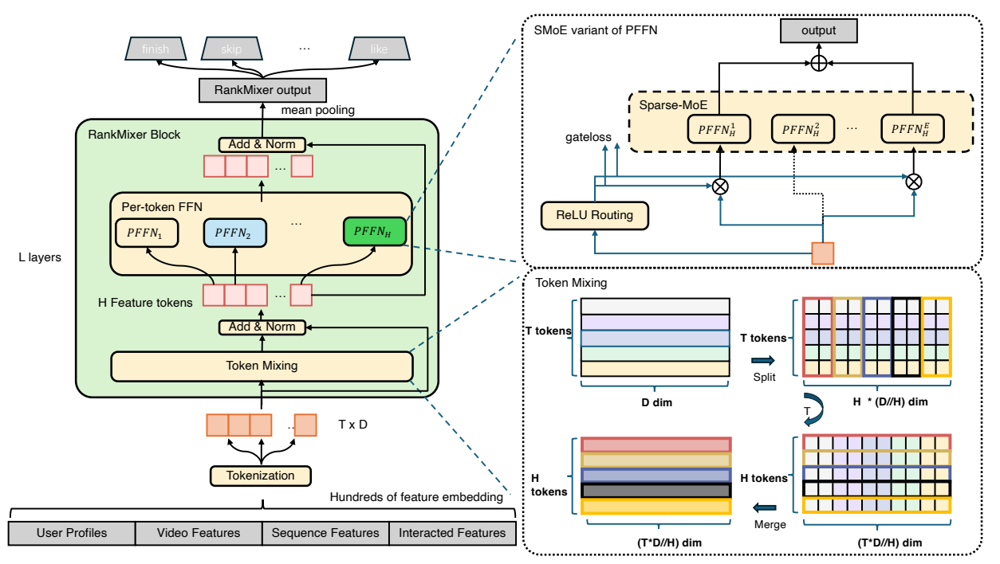
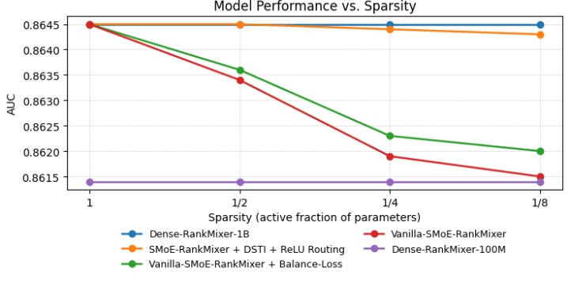

# RankMixer：让特征交互的容量、计算与硬件利用率一起扩展

传统精排已经拿到候选物品，接下来要回答“这个用户对这条视频会不会完播、快划、点赞”。它不是从整个物品库逐 Token 生成物品 ID，而是把用户、候选、历史及交叉特征交给模型，为候选输出多个行为分数。RankMixer 改造的正是这段稠密特征交互骨干：先把特征组织成少量等宽 Token，用固定重排交换信息，再给各 Token 配置独立的前馈网络。重点既在表达能力，也在能否把计算组织成 GPU 擅长的大矩阵乘法。

[固定原文：2507.15551v3](https://arxiv.org/pdf/2507.15551v3)，Jie Zhu、Zhifang Fan、Xiaoxie Zhu等21位作者，ByteDance；2025年7月21日首发，7月26日修订。中文PDF访问与私有备份范围见[附件说明](../../译文/PDF目录.md)。与其他交叉网络的共同问题见[稀疏特征交互比较](../../知识库/问题/稀疏特征的低高阶交互学习.md)。

## 从拼接特征到适合并行计算的输入

先沿一个构造样本看传统过程。用户刚看了徒步视频，候选 C 是登山装备讲解；输入包括用户画像、C 的视频与作者信息、历史序列模块输出，以及用户与 C 的交叉统计。经典 MLP 把它们的 Embedding 拼成一个长向量，统一送入几层全连接网络。DeepFM 还提供因子内积的二阶路径，DCNv2 用原输入逐坐标乘当前表示的矩阵变换，形成显式交叉。这些方法的参数共享及阶数限制并不相同，详见[公共比较](../../知识库/问题/稀疏特征的低高阶交互学习.md#矩阵交叉让每个坐标学习不同组合)。

RankMixer 作者指出，工业链路中堆叠异构交叉模块，容易产生大量访存受限的小算子；只加宽、加层，不一定获得足够效果，也未必用满 GPU。这是论文的设计动机与其生产案例，不是对所有 MLP 或交叉网络的硬件性能定理。其改动是重组交互骨干，不负责替代输入之前的所有序列模型。[§1–3，PDF第1–4页](https://arxiv.org/pdf/2507.15551v3#page=1)。

*作者原图1，采用版PDF第3页；Jie Zhu等。由该PDF渲染裁剪，未改图内内容。左侧自下而上是特征→Token化→重复的混合与FFN→均值池化→各任务输出；右下展开固定重排，右上是可选稀疏MoE。图中 H/T 的标记结合正文 H=T 理解，不把原图当作另一个Token数配置。*

Token 化在这里不是文字分词，也不是 TIGER 的物品语义码。作者先按领域语义将不同维度的 Embedding 分组、依次拼接为 $e_{\rm input}$，再按宽度 $d$ 切片，每片经投影得到 $D$ 维向量：

$$
x_i=\operatorname{Proj}(e_{\rm input}[d(i-1):di]),\quad i=1,\ldots,T.
$$

因此输入是 $X_0\in\mathbb R^{T\times D}$，一行是一个特征 Token；它仍是连续向量，没有被量化为离散物品编号。分组数 $N$ 与最终 Token 数 $T$ 不是同一个定义。正文没有给出全部字段的分组清单、切片边界或不足一片时的处理，不能由“语义分组”推断每行恰好对应一个业务字段。作者选择较少且较宽的 Token，在过细切分导致的小矩阵与单Token退化为大MLP之间取舍。[§3.2、式(2)，PDF第3页](https://arxiv.org/pdf/2507.15551v3#page=3)。

## 固定重排怎样让不同特征进入同一个网络

为看清形状，把投影后的输入简化成 $T=H=2,D=4$，所有数字均为教学构造：

$$
x_1=(1,2\mid3,4),\qquad x_2=(5,6\mid7,8).
$$

两行暂代表两组用户／历史与候选／交叉信息；真实字段划分并非只有这两组。先把每行均分为两个头，再把所有 Token 的同号头拼起来：

$$
\operatorname{TokenMixing}(X)=
\begin{bmatrix}1&2&5&6\\3&4&7&8\end{bmatrix}.
$$

第一行收集各原 Token 的第一头，第二行收集第二头。它没有算 $QK^\top$、Softmax 或样本相关权重，只是同一批数的固定置换。一般输出为 $H\times TD/H$；设置 $H=T$，才能直接与 $T\times D$ 输入相加。算例中加残差后为 $(2,4,8,10)$ 与 $(8,10,14,16)$，再按行 LayerNorm 得到 $S$。忽略归一化的 $\epsilon$、设缩放1和偏置0，两行在这个刻意选择的例子中恰好都约为 $(-1.265,-0.632,0.632,1.265)$；这只是数值巧合，不表示混合会使各Token相同。

真正学习交叉的是后续网络及其与混合的组合：新行已经含原来不同 Token 的坐标，FFN 可以对它们做联合非线性变换。仅有无参数混合本身不会产生可学习的选择权重，也不等于完成乘法交叉。原文称各头可视为低维投影，这里按实际公式理解为切片，不能据此补出独立的可学习头投影。[§3.3.1、式(3)–(5)，PDF第3–4页](https://arxiv.org/pdf/2507.15551v3#page=3)。

## 为什么每个 Token 要有自己的 FFN

第 $t$ 行先扩宽再压回原维度：

$$
v_t=\operatorname{GELU}(s_tW_1^t+b_1^t)W_2^t+b_2^t,
\quad W_1^t\in\mathbb R^{D\times kD},\quad W_2^t\in\mathbb R^{kD\times D}.
$$

$k$ 是中间层扩张比。完整块是

$$
S=\operatorname{LN}(\operatorname{TokenMixing}(X)+X),\qquad
X'=\operatorname{LN}(\operatorname{PFFN}(S)+S).
$$

同一个样本的各 Token 并行计算，但每行使用自己的 $W_1^t,W_2^t$。上一节即使两行归一化数值相同，经过不同参数仍可不同；它们不是复制的相同函数。堆叠 $L$ 块后均值池化 $o=T^{-1}\sum_tX_{L,t}$，交给完播、快划、点赞等任务输出头。[§3.1、§3.3.2、式(1)、(6)–(9)，PDF第2–4页](https://arxiv.org/pdf/2507.15551v3#page=2)。

和 Transformer 共享 FFN 比较时，需要把参数存储与执行次数分开。相同 $T,D,k,L$ 下，共享版一层只有约 $2kD^2$ 个 FFN 权重，但也要对 $T$ 行分别执行；独立版存约 $2kTD^2$ 个权重，执行仍为 $T$ 次同形矩阵变换。因此这种“解除共享”的比较可以近似不增加算术量，代价是参数内存、优化器状态与可能不同的访问成本。若进一步增加 $D,T,L$，FLOPs 仍会增长；论文近似式为 $P\approx2kLTD^2,F\approx4kLTD^2$，忽略偏置、归一化、输入／输出头、Embedding及其他链路，不是所有扩模都免费。它与 MMoE 也不同：MMoE 专家读同一完整输入，RankMixer 各 FFN 读不同的混合行。

## 一个曝光样本怎样产生监督与梯度

继续用户与候选 C：线上日志提供是否完播、是否快划等标签，模型的输入中可有候选身份，因为任务就是对这个已知候选预测行为；不能输入当前曝光发生之后的行为结果。原文没有公开完整任务头、任务损失组合、采样与负例细节，不能伪称下面是生产实现。

仅为说明监督怎样穿过骨干，构造一个完播二分类教学头 $z=w^\top o+b,p=\sigma(z)$。若标签 $y=1$、$z=\log3$，则 $p=0.75$，二元交叉熵 $\ell=-\log0.75\approx0.28768$，$\partial\ell/\partial z=p-y=-0.25$。设 $T=2$，经过均值池化反传到每行的末端向量梯度为 $-0.125w$；再经残差、LayerNorm 和各行 FFN 到前层。固定重排没有参数，但仍将梯度反向置换，因此不会截断跨组信号。输入投影与可训练 Embedding 也可通过链式法则获得信号，前提是对应路径没有被工程设置冻结；论文只报告稠密部分 RMSProp、稀疏部分 Adagrad 的更新方式，未给完整冻结配置。

这解释“无参数混合”与“可训练交互”如何并存，也解释未单独计一个 Token Loss 的行为什么仍能训练。真实多任务权重、UAUC实现和曝光偏差处理仍待实现证据，不由常见做法补齐。[实验设置§4.1，PDF第5页](https://arxiv.org/pdf/2507.15551v3#page=5)。

## 稀疏专家让不同 Token 使用不同计算预算

逐 Token 独立参数增加容量，也放大专家训练不足风险。固定 Top-$k$ 给所有 Token 相同数量的专家，可能浪费预算于信息少的行。RankMixer 的变体把一行 FFN 换成多个专家，并使用非负 ReLU 门：

$$
g_{ij}=\max(0,h(s_i)_j),\quad
v_i=\sum_{j=1}^{N_e}g_{ij}e_{ij}(s_i),\quad
\mathcal L=\mathcal L_{\rm task}+\lambda\sum_{i,j}g_{ij}.
$$

这里 $h(s_i)_j$ 明确写出路由向量的第 $j$ 分量，是对原式(10)省略分量下标的解释；$N_e$ 是每Token专家数。门既不做 Softmax 归一化，也不固定每行激活数。教学例中，一行路由输出 $(0.6,-0.2,0.1)$，ReLU后为 $(0.6,0,0.1)$，输出 $0.6e_{i1}(s_i)+0.1e_{i3}(s_i)$；另一行输出 $(-0.1,0.4,-0.3)$，只用第二位专家。正则惩罚两行门值和 $1.1$，不是惩罚“恰好三个激活”的计数；作者称动态调节 $\lambda$ 控制平均激活预算，但未给完整更新规则。

DTSI 使用训练路由器 $h_{\rm train}$ 与推理路由器 $h_{\rm infer}$，训练时更新两者、只对后者加稀疏正则，推理只用后者。直觉是让训练阶段更多专家有机会获得信号，服务时再稀疏使用。正文未给两个路由输出如何共同进入完整任务损失、是否每步全部专家非零的细节，因此不能把名称“稠密训练”升级成已核实的全激活算法。[§3.4，PDF第4页](https://arxiv.org/pdf/2507.15551v3#page=4)。

*作者原图3，采用版PDF第6页。横轴为激活参数比例1至1/8，纵轴AUC；蓝色1B稠密模型是参照，橙色DTSI+ReLU接近它，红色标准稀疏MoE随稀疏而退化，绿色加负载均衡仍有差距。它支持该组合在本次离线设置下保留效果，不证明未来10B已经上线，也不能从曲线恢复所有训练配置。*

## 证据分别支持效果、扩展和服务的哪些部分

离线使用抖音两周日志，含300多个特征；作者称每天万亿条记录、数百GPU，稀疏异步／稠密同步训练，稠密优化器为RMSProp（学习率0.01）。完播／快划为不同二分类目标，AUC和用户级UAUC不是业务收益。文中未给可复现的时间切分、样本量明细、seed、重复实验方差与UAUC加权公式，不能把“AUC增加0.0001可视为显著”的表述当成充分统计检验。

| 同表模型 | 完播AUC收益（沿用原表%） | 稠密参数 | 每批训练FLOPs（batch=512） |
|---|---:|---:|---:|
| DLRM-MLP基线 | 绝对AUC 0.8554 | 8.7M | 52G |
| DLRM-MLP-100M | +0.15% | 95M | 185G |
| DCNv2 | +0.13% | 22M | 170G |
| HiFormer | +0.48% | 116M | 326G |
| Wukong | +0.29% | 122M | 442G |
| RankMixer-100M | +0.64% | 107M | 233G |
| RankMixer-1B | +0.95% | 1.1B | 2.1T |

原表没有明确增幅是相对AUC还是绝对百分点，故不替作者换算。表题虽称“约100M”，实际参数和FLOPs不完全匹配：RankMixer比Wukong参数和计算都少，比DCNv2却都多，不能把整张表称为严格等参或等算力实验。规模曲线说明本次观测中增加容量有效，没有给出普遍幂律拟合或对其他数据分布的保证。[§4.1–4.3、表1、图2，PDF第5–6页](https://arxiv.org/pdf/2507.15551v3#page=5)。

组件消融中，去掉混合、改为共享FFN的 $\Delta$AUC 分别为 -0.50%、-0.31%；用自注意力替代路由为 -0.03%，参数+16%、FLOPs+71.8%。这支持混合和独立参数对该配置有用，但共享FFN消融同时改变容量，不能单独证明“隔离一定消除了高频支配”；自注意力实验也不证明所有异构Attention均无效。[§4.4、表2–3，PDF第6页](https://arxiv.org/pdf/2507.15551v3#page=6)。

## 为什么多了参数，延迟仍可能持平

生产表6报告15.8M→1.1B参数、107G→2106G FLOPs、MFU 4.47%→44.57%、fp32→fp16、时延14.5→14.3ms。参数约69.62倍，FLOPs按表数约19.68倍，原表“20.7倍”与之不符。摘要／引言另说“百倍／两个数量级”，不能用同一实表精确支持百倍。MFU约9.97倍，改变精度和算子融合也参与了结果；不是仅换一个数学模块就保证成本不增。

作者以“参数量×每参数FLOPs÷（MFU×硬件理论吞吐）”解释计算时间，可理解为给定负载与硬件条件下的计算分解。真实端到端时延还包括访存、通信、批处理、排队、Embedding和其他模块；吞吐量也不普遍等于时延的倒数。每批训练FLOPs、单请求前向FLOPs与在线时延需要分别测量。表6没有给出完整硬件型号、精度吞吐定义、在线batch、QPS和分位数，不能照搬到另一服务成本预算。[§4.6、表6，PDF第7页](https://arxiv.org/pdf/2507.15551v3#page=7)。

线上表4报告抖音总体活跃天数+0.2908%、时长+1.0836%，低活跃组分别+1.7412%、+3.6434%；极速版总体为+0.1968%、+0.9869%。表5广告AUC +0.73%、ADVV +3.90%。作者称信息流有八个月长期反向A/B观察，结果于2025年7月24日更新且未收敛。原稿没有完整流量、随机化、置信区间和多重检验细节；低活跃组收益更高本身不足以证明某一独立泛化机制。结论把时长写为1%，精确数以表4定位，不静默把译文改成新数。[§4.7、表4–5、脚注1，PDF第7–8页](https://arxiv.org/pdf/2507.15551v3#page=7)。

与 TIGER、OneRec-V2 的关系可以沿服务接口判断：前两者可生成物品语义码形成候选，RankMixer接收已知候选及交叉特征输出效用分数；能组合使用，并不是同任务下互相替代。与序列扩展模型比较，也应明确历史编码器和候选交互骨干分别计入哪些参数与成本。

## 阅读与翻译范围

本次依据固定v3的9页PDF及实际编译的LaTeX，阅读正文§1–5、12个编号公式、图1–4及表1–6；未运行模型，未核官方算法实现，不将源码注释中的旧稿与模板当成实验。正文、摘要、图表标题与描述译为中文，原公式、表内数字、原图与参考文献保留；图内英文、作者姓名/机构保留。原稿含未填会议模板，不据此确认会议发表；arXiv非独占分发许可不等于公开译文许可，全文译文仅保留本地及私有附件范围。可编辑工程为本地忽略路径 `.local/papers/SRC-RANKMIXER/translation/translated-sources/`；已生成7页正文中文PDF并全部逐页渲染目视，公式、图表、引用与中文排版已检查；译后私有副本移除自动跳转动作，与编译版7页逐页渲染像素一致。原文9页与中文7页已备份至私有附件库，2026-11-18首次真实登录下载核对PDF类型、大小、页数和完整SHA256通过，访问与版本见附件目录。
