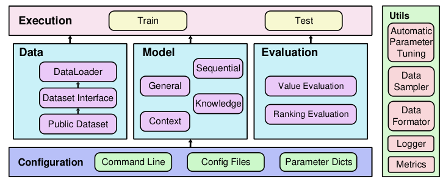
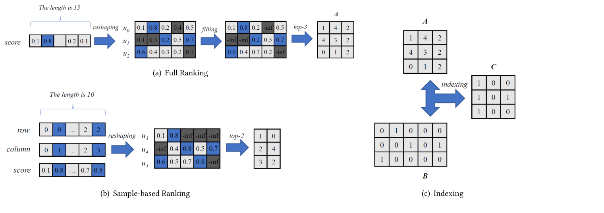
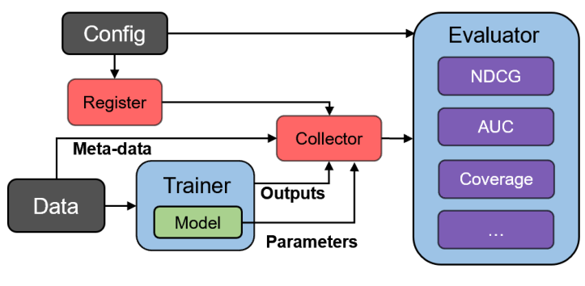

# RecBole：统一数据流与评估接口怎样帮助比较推荐算法

推荐算法比较的困难，常常先出现在模型之外：原始数据怎样过滤、历史怎样排序、训练测试怎样切分、评估时从哪些物品中选答案。RecBole把这些共有步骤放进统一PyTorch框架，让算法实现主要处理损失和预测，实验配置负责控制数据与协议。它降低重复实现成本，也让协议差异更容易检查；统一入口本身不证明实验公平。

本文采用2021年的arXiv v3，报告实现73个模型、收集28个数据集，覆盖通用、上下文感知、序列和知识推荐四类。社交推荐虽已有输入文件设计，代码当时仍在开发。这个历史版本与[另行固定的仓库README](../SRC-RECBOLE/阅读笔记.md)属于不同来源，下面的接口描述不能直接当当前安装版本教程。

作者原图，Zhao 等，arXiv 2011.01731v3 图 1，PDF 第 2 页（固定 PDF 裁取，原标签保留）。

图中配置层定义四类模块的运行参数，数据与模型进入执行层的 Train/Test，评估模块接收测试输出。统一的是各模块之间的接口。

## 数据统一分成外部文件与内部批张量

[§2.1，PDF第2–4页](https://arxiv.org/pdf/2011.01731v3#page=3)把数据流分成：

原始输入 → 原子文件 → 基于pandas.DataFrame的Dataset → 输出Interaction的DataLoader → 算法。

原子文件把输入拆成六种表：.inter存用户—物品交互，是所有任务必需的；.user和.item存侧特征；.kg存图谱三元组；.link连接物品与实体；.net存社交边。基本字段类型为token、token sequence、float与float sequence。组合这些表可以复用同一交互数据，例如序列任务额外接入物品属性，无需为模型重写原始输入。

Dataset负责过滤、ID映射、缺失值、标签生成和归一化。内部Interaction则是“特征名 → torch.Tensor”的字典式对象，张量按batch组织，提供设备搬移、重复与更新。模型按特征名取值，加载器承担原始文件到批张量的转换，把“输入是什么”与“算法怎样用它”分开。

同一.inter经过不同过滤、排序或采样，定义的学习问题仍会变化。历史接口也不等于当前schema：原文表3把.kg/.link类型写为int，后文却描述为token；.inter字段分隔描述为逗号。本轮未核当前实现，不能据论文直接生成导入配置。Interaction段的“GRU-oriented”也疑为GPU笔误，译文保留并加注。

## 算法接口复用计算框架，不替代实现核验

[§2.2与§3，PDF第6、8页](https://arxiv.org/pdf/2011.01731v3#page=6)将训练与评估接到`calculate_loss`和`predict`，新模型还需初始化`__init__`并继承相应抽象类。框架提供BPR损失、MLP和多头注意力等组件，支持保存加载、断点恢复、早停，以及Grid、Random、TPE和Adaptive TPE调参。

接入[成对排序BPR](../../知识库/问题/隐式反馈的相对偏好学习.md)时可以复用加载与评估模块，但三元组构造、负例分布和正则缩放仍影响结果。[SASRec](../../知识库/问题/从历史顺序预测下一物品.md)还需正确处理序列可见性与目标。封装操作不证明不同模型获得同样的可用信息或调参预算。

作者报告每模型在两个或四个选定数据集测试，并邀请审查者检查实现。这是作者的工程过程陈述；论文没有73模型统一效果排行榜，本轮未检查这些代码或运行训练。表6四类实际模型行数为24、18、23、8，合计73；上下文类源码multirow参数17与实际行数不符。

## 协议显式化后，比较仍需对齐问题

[§2.3.2、表7，PDF第6页](https://arxiv.org/pdf/2011.01731v3#page=6)将协议封装成Group、Split、Order、NegSample。

| 设置 | 操作 | 需要区分的含义 |
|---|---|---|
| RO_RS | 随机排序、比例切分 | 时间可用性未由此保证 |
| TO_LS | 时间排序、留一切分 | 用户内留一不等于统一日历时点切分 |
| RO_LS | 随机排序、留一切分 | 测试行为不必是真实下一事件 |
| TO_RS | 时间排序、比例切分 | 需明确按用户还是全局切分 |
| full | 全候选排序 | 核实候选池与训练物品屏蔽 |
| uniN | 一个正例与N个负例 | 记录数量、分布及抽样方式 |

前四行处理数据如何成为训练/验证/测试集，后两行处理测试候选空间，不能互相替代。论文明确不负责选“最合适协议”，包括提供当时有争议的抽样设置。固定版所引评估研究中的 [On Sampled Metrics](../SRC-SAMPLED-METRICS/阅读笔记.md) 已取得正式全文，可以直接核对均匀采样怎样改变名次分布及模型次序。

沿一个用户 U 的序列走一遍。原始事件是 09:00 看物品 3、10:00 看 5、11:00 看 1。用教学版 TO_LS 留最后一次为测试、倒数第二次为验证。全目录现有物品 1–5，约定本次屏蔽验证结束时的已见物品 3、5。把其余物品分数写入固定列 $D_U=[0.7,0.2,-\infty,0.9,-\infty]$，$K=2$ 时索引 $A_U=[4,1]$，$B_U=[1,0,0,0,0]$，收集出 $C_U=[0,1]$。换成只抽到 2 的 uni1，物品 4 不参加比较，$A_U=[1,2]$，$C_U=[1,0]$。模型对各物品的分数固定，NDCG@2 已从 $1/\log_2 3$ 变成 1。例中的可见范围和屏蔽约定是人为设定，需要在真实协议中单独记录。

即使[SASRec](../SRC-SASREC/阅读笔记.md)和[LightGCN](../SRC-LIGHTGCN/阅读笔记.md)都报告NDCG，也须分别核切分、负例与候选，不能用框架名消除协议差异。具体比较见[统一框架下的实验可比性](../../知识库/问题/统一框架下怎样保持实验协议可比.md)。

## 给定分数后的top-k与命中计算可以批量化

[§2.3.3、图2，PDF第6–7页](https://arxiv.org/pdf/2011.01731v3#page=7)限定优化对象：模型打分方式不同，因此重点优化给定得分后的top-k选择和指标计算。

作者原图，Zhao 等，arXiv 2011.01731v3 图 2，PDF 第 7 页（固定 PDF 裁取，原标签保留）。

图 (a)、(b) 分别从全量和抽样分数生成 top-k 索引。图 (c) 用索引读取真值矩阵中的对应列，将一个位置的物品 ID 转成命中标志。

设当前批n个用户、m个物品。全排序得到得分矩阵D；抽样排序按论文描述也建立n×m矩阵，先填负无穷再写入抽样分数。若屏蔽训练物品，把相应分数设负无穷，不删除列，保留统一物品索引。GPU topk产生n×K索引矩阵A；以二值矩阵B表示用户测试正例，按A收集得到：

$$
A_{u,:}=\operatorname{TopK}(D_{u,:}),\qquad
B_{u,i}=\mathbf{1}[i\in T_u],\qquad
C_{u,k}=B_{u,A_{u,k}}.
$$

T_u为用户u的测试正例集，C为n×K命中矩阵；这是对原文操作的数学整理。gather批量取得C，拼接各批计算指标。例如某行A=[4,1,2]，测试正例为物品1、2，C对应[0,1,1]，保留位置与命中。

做法将逐用户操作变为CUDA批量计算，不改变模型预测含义。D与B有O(nm)存储代价，batch限制n，不能认为任意规模全用户全物品矩阵可常驻显存。抽样分数放进稠密矩阵不等于稀疏存储。这不是ANN，未消除模型打分成本，更不是线上延迟证据。图3将collector收集资源与evaluator计算分开，便于新增指标。

作者原图，Zhao 等，arXiv 2011.01731v3 图 3，PDF 第 7 页（固定 PDF 裁取，原标签保留）。

Register 从指标配置声明所需数据，Collector 汇聚这些数据及模型输出，Evaluator 对汇聚结果计分。

## 表8支持特定评估实现加速，计时边界仍有缺口

[§2.3.4、表8，PDF第7–8页](https://arxiv.org/pdf/2011.01731v3#page=8)比较同一BPR实现启用/关闭加速，MovieLens三个规模，8:1:1切分，运行十次取平均。硬件为Xeon Silver4216（16核32线程、2.10GHz）及RTX3090 24G，Linux。

| 实现 / 秒 | MovieLens-100k | MovieLens-1M | MovieLens-10M |
|---|---:|---:|---:|
| BPR | 0.245 | 2.478 | 29.900 |
| BPR acc | 0.009 | 0.090 | 2.210 |

表支持报告实现显著评估加速，但未分项消融，作者将各技术贡献列为未来工作。相邻计时文字口径不够一致：先说列表生成及NDCG@10/Recall@10计算总时间，随后又说只统计测试集生成top-10推荐时间。因此不称这些数字为包含全部打分、数据搬移或训练的端到端速度，不推导线上收益。

[表9，PDF第9页](https://arxiv.org/pdf/2011.01731v3#page=9)比较17库，统计截至2021-08-21。作者称“最全面”，但LibRec为93模型，高于RecBole的73；宜理解为强调任务、数据和接口综合覆盖，不能称模型数单项最多，也不把2021年star与issue数当当前维护状态。

---

固定arXiv:2011.01731v3（2021-08-28），CIKM 2021，DOI 10.1145/3459637.3482016，Wayne Xin Zhao等19作者。已读12页正式PDF正文§1–6、图1–4与表1–9，无附录；未逐篇核引用、未读算法实现或运行模型。翻译覆盖正文、摘要、图表标题与描述性脚注，图内英文和代码截图保留。已保存中文Markdown（本地附件，不随 Git 分发）：`.local/papers/SRC-RECBOLE-PAPER/translation/RecBole_中文翻译.md`、译后主文件（本地附件，不随 Git 分发）：`.local/papers/SRC-RECBOLE-PAPER/translation/translated-sources/main.tex`与[原文PDF](https://arxiv.org/pdf/2011.01731v3)。另有9页中文PDF（本地附件，不随 Git 分发）：`.local/papers/SRC-RECBOLE-PAPER/translation/RecBole_中文翻译.pdf`，已逐页渲染目视检查；为兼容Unicode编译，调整译后模板hyperref加载顺序并移除未使用旧符号字体包，原件保持不变。

公开访问：[固定版本原文](https://arxiv.org/abs/2011.01731v3)；全文译文的公开状态与许可见[译文目录](../../译文/目录.md)。文中行内代码形式的 `.local/` 路径是本地附件，不随 Git 分发；原有阅读/翻译/编译记录保持其当次事实。
