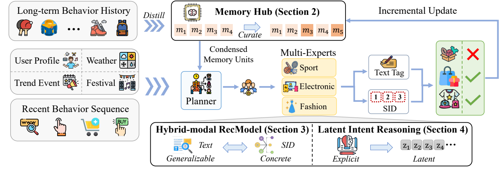
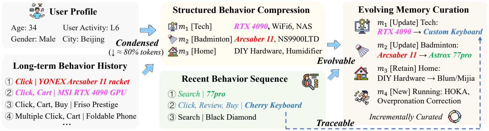
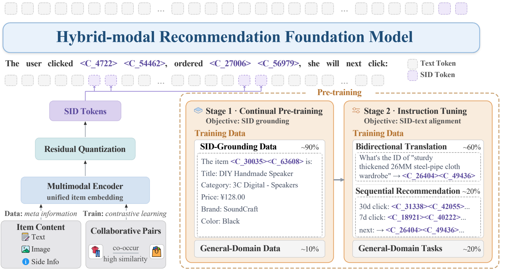
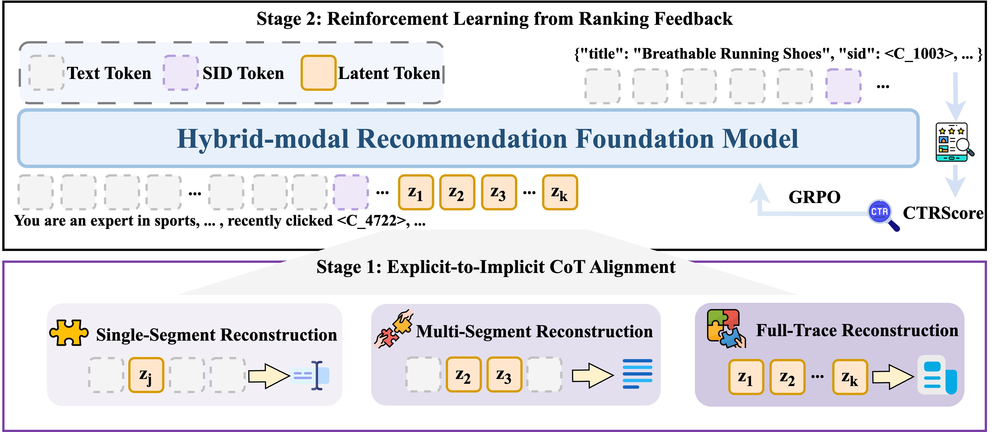
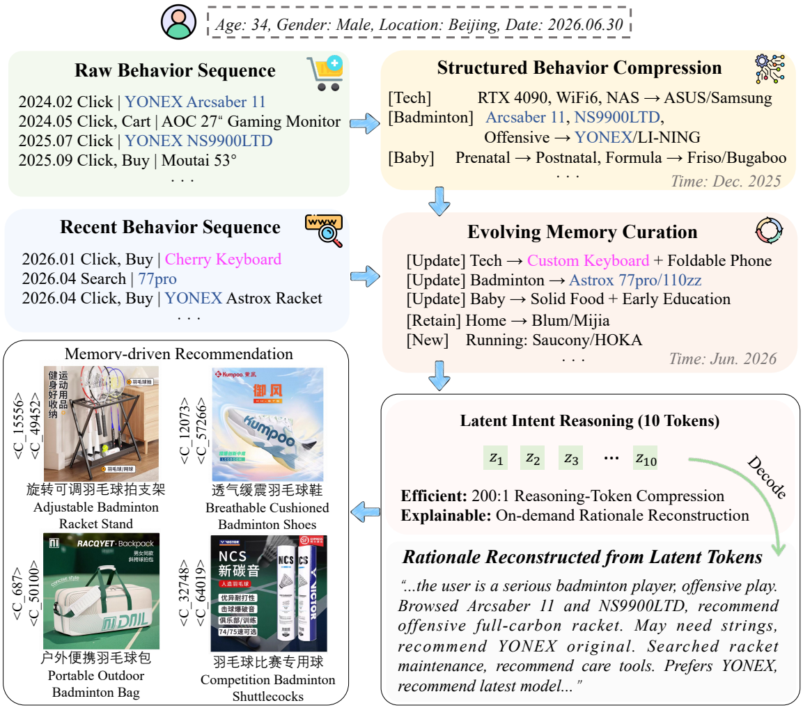

# RecGPT-V3：记住长期兴趣，用文本与语义码推理，再交给检索和排序

一个用户去年反复看全碳羽毛球拍和高端手胶，最近又搜索Astrox系列。经典序列推荐器可以把行为ID编码成向量，检索相近物品；语言模型也可以读标题，推断“认真打球、偏进攻打法”，再生成装备标签。但把这条语言路径规模化，会遇到三个实际问题：每次重读全历史很贵；“专业羽毛球装备”这样的文本太宽，难以落实到具体商品；几千Token的文字推理比最终推荐结果长得多。

RecGPT-V3分别改变这三个接口：把长期历史保存成可更新的记忆单元，让专家同时理解自然语言与商品语义ID，把显式推理蒸馏进短潜在Token序列。最后仍要经过专门检索模型、生产排序器和曝光，LLM输出不是直接保证展示的最终商品列表。

[固定原文2607.15591v2](https://arxiv.org/abs/2607.15591v2)，*RecGPT-V3 Technical Report*，RecGPT Team，Bowen Zheng、Chao Yi等29位作者，Alibaba/Taobao。首发2026年7月17日，采用7月24日修订版，未另核正式会议出版。中文PDF访问见[附件目录](../../译文/PDF目录.md)。下文羽毛球主线沿用作者表4和图9的场景，另造的Token、概率和分数会明确说明。

## 先看旧链路在哪里重复计算和丢信息

RecGPT-V2先由Global Planner（全局规划器）读用户行为，拆成多个意图persona，再分派给专家。这里persona是一个待处理的兴趣视角，例如“羽毛球装备”，不是独立真人或一个永久独立模型。各专家生成商品标签，下游将标签检索为商品。

对活跃用户，规划器每轮可处理约55K Token；作者称它约占Agent意图分析计算的95%。历史里“偏爱高端全碳拍”等稳定模式被反复重新发现。第二个损失发生在标签出口：一句“轻量马拉松跑鞋”无法完整传递具体物品之间的协同关系。第三个代价来自显式CoT：先逐Token写长理由，再生成很短的标签或商品表示。三个问题分别属于输入状态、输出接口和中间计算，不能只换一种loss就同时解决。[§1–2、§4，PDF第3–5、11页](https://arxiv.org/pdf/2607.15591v2#page=3)。

*作者原图2，固定v2 PDF第4页，RecGPT Team。自左向右先读长期历史/近期行为，记忆交给规划器，再分派给专家；专家输出文本标签和SID，右侧才落实商品。下方两块说明专家使用的混合模态基座和潜推理，不表示两条独立推荐结果。源码PDF完整转PNG，只转换格式。*

沿贯穿样本，旧系统每次重新分析“旧球拍→手胶→新Astrox浏览”；新系统保留羽毛球记忆，用新Astrox行为修订摘要，再将这次羽毛球兴趣分给专家。用户还可能有科技、育儿等其他记忆，它们不是都要进入同一个专家。本文没有给出完整分派算法、专家数量或各专家参数共享细节，不能把图中三个图标当实际固定部署数。

## 长期记忆是结构化数据，不是模型权重里的永久知识

Memory Hub先用LLM把完整行为序列压成少量单元：

$$
\mathcal M=\mathcal F_\phi(\mathcal B)=\{m_1,\ldots,m_K\},\qquad K\ll |\mathcal B|.
$$

$\mathcal B$是已发生行为，$\mathcal F_\phi$是初始构建函数；式中$\phi$标识函数参数，不意味着本文给出了在线更新权重的训练算法。每个$m_k$包含行为模式标识、自然语言偏好摘要、代表行为索引、品牌、时间活动特征和时间戳。模式来自数百个预设类别，无匹配且新簇置信度高时允许受控扩展。它既不是只有一句摘要，也不是保留全历史的无损压缩。[§2.1、式(1)、表1，PDF第6页](https://arxiv.org/pdf/2607.15591v2#page=6)。

羽毛球单元可以写“偏爱全碳拍和高端手胶”，并保留支撑行为的索引。索引的作用是回溯“这段判断根据哪些已发生行为”，不能直接证明推断就是用户真实偏好。原文模式正确率和索引正确率也是两个不同标注对象。

*作者原图3，固定v2 PDF第6页。左侧原历史，中间压缩单元，下方新行为，右侧更新后的记忆。蓝色/紫色文字提示具体变化；虚线Traceable指向行为出处，不是完整决策因果解释。保留原图全部标签与箭头。图内“约80% Token”与图注94.5%的差异见后文。*

### 新行为只重写相关单元

初始压缩只做一次，之后维护函数只看旧记忆和新行为增量：

$$
\mathcal G(\mathcal M^{(t)},\Delta\mathcal B)
 \longrightarrow (\mathcal M^{\rm update},\mathcal M^{\rm new}),\qquad
\mathcal M^{(t+\delta)}=\mathcal M^{\rm update}\cup\mathcal M^{\rm new}.
$$

对每个旧单元，存在相关新行为就重写摘要和元数据，没有相关证据就原样保留。未被任何旧单元接收的行为形成新集合，再从其中抽取连贯模式；没有连贯新模式就不新建。两项操作合在一次模型调用中完成，而不是先逐个单元调用、再调用一次发现新兴趣。**一次调用仍可能自回归生成多Token，不是一次矩阵运算完成全部维护。**[§2.2、式(2)–(7)、表2，PDF第7–8页](https://arxiv.org/pdf/2607.15591v2#page=7)。

例如Astrox点击更新羽毛球单元，键盘购买更新科技单元；没有新家居证据就保留家居摘要，连续跑步行为才可能新建跑步单元。更新会把受影响单元重新综合成当前快照，不是将新旧描述一直拼接。生产中**每两个月**维护一次；规划器读取压缩记忆和近期增量，所以两次维护间也不是完全看不到新行为。[§2末段，PDF第8页](https://arxiv.org/pdf/2607.15591v2#page=8)。

这种机制没有显式给出删除、衰减、容量上限、跨单元冲突处理和压缩错误恢复。无新证据就保留，可能保存稳定偏好，也可能保留已经过期的判断；不能把“Evolving”扩写成已实现自动遗忘。相比[User Personas](../SRC-USER-PERSONAS/阅读笔记.md#线上请求读取缓存画像重建在后台)的异步画像刷新，本篇具体规定了旧单元更新/保留/新建及增量可见性；二者都用状态复用节约LLM成本，但更新语义不同。

### 压缩率、维护成本和全系统成本分开算

原文引言和图3图注写Token减少94.5%，§2列表和图内写80%，未交代是否不同样本/分母，属于内部口径不一致。译文保留原数，不把其中一个当已纠正值。表8的成本则自洽：相对V2用户建模成本100%，新规划推理33.43%，记忆维护摊销10.77%，合计44.20%，节省55.80%。这首先是**规划/用户建模子链路**，不是整个推荐系统GPU下降55.8%。[图3、表8，PDF第6、18页](https://arxiv.org/pdf/2607.15591v2#page=18)。

人审2,514个行为模式，准确率82.89%；21,268个代表索引，准确率95.27%。论文未报两者的完整条件集合、采样和一致性协议，不能解释为“模式已经正确时索引95.27%”，也不能用索引准确率代替长期推荐质量。[§5.2、表7，PDF第17–18页](https://arxiv.org/pdf/2607.15591v2#page=17)。

## SID把商品语义接进语言词表

“羽毛球装备”表达开放语义，却不能精确保留某款拍的内容和共现关系。混合模态基座在Qwen3-14B原生文本词表外加入商品语义码Token，让专家既能理解语言，也能读取/生成物品地址。

*作者原图4，固定v2 PDF第9页。下方向上：文本/图片/属性及行为共现→多模态表征→残差量化→SID Token；右侧先做SID语义落地，再做双向转换和序列任务，并混入通用数据。65,536是新增词表大小，不是用户输入长度。*

### 先让共现和内容共同决定商品向量

商品$i$有标题/描述$I^i_{\rm text}$、图片$I^i_{\rm image}$和属性元数据$I^i_{\rm side}$。CN-CLIP调用相应文本或视觉塔，属性先文本化；Q-Former融合成向量：

$$
H^i=F(E(I^i_{\rm text}),E(I^i_{\rm image}),E(I^i_{\rm side})).
$$

日志中高频共现先产生正对候选，再剔除多模态相似度低的对，减少偶然共现。保留的$i,i^+$作为正对，同batch其他物品为负例；融合向量、文本向量和图像向量各有一项InfoNCE。这里协同来自行为正对，内容来自多模态输入，两者在量化前交汇。[§3.1、式(8)–(9)，PDF第9–10页](https://arxiv.org/pdf/2607.15591v2#page=9)。

理解单项InfoNCE可写$-\log[\exp(s_+/\tau)/(\exp(s_+/\tau)+\sum_-\exp(s_-/\tau))]$：正对分数进入分子，负对只竞争分母。若教学取$\tau=1,s_+=2,s_-=0$，正对概率0.8808、损失0.1269；对两分数的梯度分别约−0.1192、+0.1192，梯度下降提高正对相似度、降低负对相似度。这是通用展开和构造算例，原文未给该组数值或温度。作者称此阶段缓解量化码本坍塌，但未单独提供完整等预算坍塌消融，不能升级为普遍保证。

### 两级码本合起来只给每个物品两个Token

RQ-VAE逐级量化残差，最终用两级码本，每级32,768项，共新增65,536个Token。一个物品由两项组成，如作者示例`<C_18921><C_40222>`。第一项表示较粗簇，第二项细化；不同层各自有词表区间，不能把所有物品都理解成一个65K单Token分类，也不能把65K误作序列长度。残差量化通用细节见[TIGER的码本训练](../SRC-TIGER/阅读笔记.md)。原文没有完整说明碰撞消歧、商品上下架和合法码约束，不能假定生成任意两码均唯一落到当前可售商品。[§3.1，PDF第10页](https://arxiv.org/pdf/2607.15591v2#page=10)。

新增Embedding随机初始化，再与骨干一起经过域训练。持续预训练把SID与标题、类目等文本配对，约10%是通用数据；指令微调含sid2title 13.8%、title2sid 14.7%、sid2tag 11.5%、tag2sid 6.2%、sid2cmd 13.8%、sid2sid 20%，六项合计80%，另20%保留通用指令。sid2sid从已发生点击的多时间窗口预测下一点击SID，监督目标仍是日志行为；它没有直接获得用户潜在心理真值。[§3.2、表3，PDF第10–11页](https://arxiv.org/pdf/2607.15591v2#page=10)。

在我们的教学样本中，标题“某款Astrox全碳拍”和它的SID在语义落地阶段建立联系；序列阶段再学习“这些拍与手胶之后常点什么”。推理时只能读此前历史、画像及提示，下一点击是训练标签，不能作为服务输入。本文没有披露完整数据量、去重/时间隔离、优化器及各阶段可训练参数配置，不能据常规做法补成已核实实现。

## 潜在Token压缩的是中间表达，监督仍来自可见文本与答案

专家条件$x$由规划器persona和近期点击构成，每件点击商品包含SID与短标题。显式模型先生成文字推理$R$再产生标签$y$：

$$
p_\theta(R,y\mid x)=p_\theta(R\mid x)p_\theta(y\mid x,R).
$$

V3引入$z=(z_1,\ldots,z_K)$，将条件改为$p_\theta(y\mid x,z)$。$z_j$是新增的潜在位置Token，Embedding起初随机；同一位置Token在不同用户上可复用，**经上下文计算得到的隐藏状态随用户变化**，不是为每个用户新建一个词表项。原式(11)仍写$p_\theta(z\mid x)$，而工程说明又强调固定位置和prefill；具体位置Token怎样选择/插入、数量怎样在服务决定，未完整交代，不能补造逐步连续隐状态回灌算法。[§4.1、式(10)–(12)，PDF第12–13页](https://arxiv.org/pdf/2607.15591v2#page=12)。

*作者原图5，固定v2 PDF第12页。先看下方单段/多段/整轨迹重建，再看上方GRPO按CTRScore细化。图中蓝色、紫色和黄色分别是文字、SID、潜在Token；黄色不表示商品ID。源码原PNG完整引用。*

### 一个位置如何对应一段推理

作者先把教师推理按**换行步骤**分为$N$步，以最多$C$步一段：

$$
K=\min\left(\left\lceil N/C\right\rceil,K_{\max}\right),\qquad C=20,\ K_{\max}=10.
$$

$N$不是文本Token数。教学取$N=45$，有3段，覆盖20、20、5步；若$N=225$，最多10段只覆盖前200步。原文又说不足预算时尾Token可对应空段，与该按$N$决定$K$的公式不完全一致，是否固定补足10位置未给统一算法。约2,300文字Token压为最多10潜在Token的“约200倍”只是中间表达数量级，并非端到端200倍加速。[§4.1–4.2，PDF第13–15页](https://arxiv.org/pdf/2607.15591v2#page=13)。

预热先把部分连续文字跨度替成潜在Token，对混合序列保留的文本位置计算自回归loss：

$$
L_{\rm warm}=-\sum_{t\in\mathcal T}\log p_\theta(w_t\mid w_{<t}),\quad w=(x,\widetilde R,y).
$$

潜在位置不直接计loss，不等于它们不训练：后续文本状态通过Attention读取它们，文本损失可经隐藏状态回传至潜在Embedding和可训练骨干。原文文字同时称“预测被遮跨度”，但式(13)只定义保留文本的loss，没有单独给被遮跨度目标；两种描述的差异保留，不替作者补实现。[§4.1、式(13)，PDF第13页](https://arxiv.org/pdf/2607.15591v2#page=13)。

### 重建任务怎样把潜在位置与文字片段联系起来

三类任务用同一形式：选择片段索引$\mathcal J$，把这些$R_j$替换为$z_j$，其他片段保留文本，构成

$$
c(\mathcal J)=(x,e_1,\ldots,e_K,y),\quad
 e_j=\begin{cases}z_j,&j\in\mathcal J,\\R_j,&j\notin\mathcal J,\end{cases}
\qquad L(\mathcal J)=-\log p_\theta(R_{\mathcal J}\mid c(\mathcal J),\mathcal P).
$$

$\mathcal P$是要求解释指定潜在位置的任务提示。单段只隐藏一段，多段隐藏若干段，整轨迹隐藏全部段。羽毛球表4中，文字过程分别说明认真打球/全碳拍偏好、从近期点击列举装备、保留具体标签；单段重建第2段时，还能看见第1/3段及最终标签。整轨迹没有可见$R_j$，但**仍能看$x$和最终$y$**。[式(14)–(15)、表4，PDF第13–14页](https://arxiv.org/pdf/2607.15591v2#page=13)。

用普通交叉熵理解其信号：若目标片段下一个词的教学概率0.2，该位置loss为$-\log0.2=1.6094$，梯度通过词表头与解码状态回到条件Token。条件$y$是重建训练与解释调用可见的答案，不应混入真正预测下一点击时的输入。附录C的三个例子展示能恢复包、服装和汽车相关理由；因为重建可以利用答案及其他文字，**可读重建不独立证明潜在状态是原决策的忠实原因**。还需去掉/干预$z$、控制$x,y$等专门实验，而原文未提供。[附录C，PDF第29–32页](https://arxiv.org/pdf/2607.15591v2#page=29)。

显式教师为DeepSeek-V3.2；先学教师文字，再做潜在内化，另混入通用推理和部署格式的标签预测，后者只监督输出。表5三类比例21.43%、69.58%、8.43%合计99.44%，不是100%；其中三种重建6.45+6.56+8.42=21.43%。原数照录，余下0.56%未解释，不自行归一化。[§4.2、表5，PDF第15页](https://arxiv.org/pdf/2607.15591v2#page=15)。

## 排序反馈奖励究竟在优化什么

只模仿教师不能直接对齐部署链路，简单命中率又可能让同组候选奖励相同。RLRF让专家生成标签$y$，按标签检索候选，交给生产排序器评分，再取**前100个CTRScore的平均**：

$$
r_{\rm ctr}(y)=\frac1{100}\sum_{k=1}^{100}s_{(k)},\qquad
R(y)=r_{\rm ctr}(y)\,
\mathbf1[\operatorname{align}(y)\ge\tau_a]
\mathbf1[\operatorname{div}(y)\ge\tau_d]
\mathbf1[\operatorname{len}(y)\ge\tau_l].
$$

$s_{(k)}$为第$k$大的排序分。对齐分来自人工偏好对训练的奖励模型，多样性和长度是另两项约束；三门全过，CTRScore才传递。**这是生产模型的预测代理，不能直接叫用户真实点击奖励。**它可能比离散HR更细，但仍可能受排序器偏差、校准、候选热门度和奖励模型误判影响；门控全失败时同组仍可全零。[§4.2.2、式(16)–(17)，PDF第15–16页](https://arxiv.org/pdf/2607.15591v2#page=15)。

理解组相对优化，可用构造的四个奖励0.04、0.06、0.08、0.10。组均值0.07，按总体标准差0.02236标准化，优势约为−1.342、−0.447、0.447、1.342；朴素策略梯度中$-A\nabla\log p_\theta(y\mid x)$提高正优势输出概率、降低负优势输出概率。**这是GRPO方向的教学算例，不是本文未披露的完整目标**；原文只声明使用GRPO，没报组大小、clip、KL、参考策略、优化器或潜在位置的精确策略概率。若四个结果都被门控为0，奖励差也消失，不能说稠密CTRScore已经根除稀疏性。

与[OneRec-V2](../SRC-ONEREC-V2/阅读笔记.md)的真实观看/负反馈优势、[OneReason](../SRC-ONEREASON/阅读笔记.md)的日志命中乘码多样性、[LatentR³](../SRC-LATENTR3/阅读笔记.md)的答案负PPL相比，反馈对象和奖励来源都不同。共同点是改变生成分布，差别在它学着讨好谁以及怎样验证最终效用；不能按都叫RL就比较奖励数值。

## 文本和SID怎样共同落到候选

生成一个SID不等于完成整个召回系统。附录B明确给了混合输入的候选打分器：文本标签$t_i$编码为$e_t^{(i)}\in\mathbb R^d$，配对SID$d_i$编码为$e_d^{(i)}\in\mathbb R^d$，拼接后线性投影：

$$
q_i=W_{\rm proj}[e_t^{(i)}\|e_d^{(i)}]+b,
\qquad W_{\rm proj}\in\mathbb R^{d\times2d}.
$$

所得意图向量作为Target-Attention的query读取候选商品表示，产生候选检索分数。拼接先保留两个通道，再由投影/Attention共同使用；不是把两路独立结果简单并集。**原文没有把完整候选发现、索引、ANN结构和最终排序衔接全报清楚**，因此原清单中的“三塔”只能保留为最初关注点，不能冒充本篇已经核实的三塔部署实现。[附录B.1、式(20)，PDF第27–28页](https://arxiv.org/pdf/2607.15591v2#page=27)。

训练同时约束点击效用与语义相关性。点击集合$\mathcal C$中每个正例与未点击候选竞争：

$$
L_{\rm util}=-\frac1{|\mathcal C|}\sum_{i\in\mathcal C}
\log\frac{e^{s_i}}{e^{s_i}+\sum_{j\notin\mathcal C}e^{s_j}}.
$$

其他点击正例没有被放进这个正例的负分母，不能误抄成全候选单一Softmax。教学上，一个点击正例分数2、两个未点击分数1和0，则正例概率约0.6652，loss约0.4076；它提高点击正例相对未点击的分数，却无法单独区分同为未点击的两件商品是否符合“专业羽毛球”。

因此增加多级相关性对比：对意图$i$的每个相关正例$j\in\mathcal P(i)$，以对应负集合$\mathcal N(i,j)$竞争，平均负log概率；最终$L=L_{\rm util}+0.5L_{\rm rel}$。负例按clicked > exposed > non-exposed分级，不允许负例交互优先级高于正例，减少相关性loss与点击效用冲突。相关正例如何逐级放宽、语义标签怎样标、负例采样和空集合怎样处理，未完整披露。[附录B.2、式(21)–(23)，PDF第28–29页](https://arxiv.org/pdf/2607.15591v2#page=28)。

回到样本，专家给出羽毛球装备文本和SID，混合打分器把开放语义与商品关联共同用于候选；候选还要经生产排序与展示资格，用户才可能看到球拍架、球鞋等商品。RLRF正是将生成结果通过检索和生产评分来评价，而不是直接将候选检索loss端到端反传穿过离散生成、检索索引与线上用户。

*作者原图9，固定v2 PDF第23页。上方旧历史与新行为在中间更新记忆，下方右侧10个潜在位置可按需解释，左侧是生成/检索出的商品示例。日期、品牌和商品图均保留原样；这是一例展示，不能据此估算总体准确率或证明用户确实需要这些商品。*

## 实验支持哪些改进，仍没隔离什么

### 领域训练、文字推理和潜推理分别看

表9中，混入通用数据时类目HR@30为0.3050，不混为0.2250；评价基于两周实际点击，类目命中与精确商品命中不同。原文称提升26.2%，但以0.2250为基线应是$(0.3050-0.2250)/0.2250=35.56\%$；26.2%接近除以最终0.3050得到的26.23%。译文保留作者数字，此处明确分母差异。通用数据还关系到GSM8K/MMLU/CMMLU/IFEval保留，但“移除通用数据”的训练是否严格等总量/等步数未报完整，不能将差值解释成单一能力迁移因果。[§5.3、图6–7、表9，PDF第19–20页](https://arxiv.org/pdf/2607.15591v2#page=19)。

| 同一混合模态基座后的阶段 | 类目HR@30 | 前100候选CTR指标 |
|---|---:|---:|
| 无推理基座 | 0.3050 | 0.0624 |
| 显式CoT监督微调 | 0.3508 | 0.0638 |
| 潜在推理 | 0.3462 | 0.0649 |
| 潜在推理再加RL | 0.3693 | 0.0679 |

潜在压缩后HR略低于显式CoT，代理CTR更高；再加RL两项改善，支持该课程下的质量/效率取舍。原文表10把第二列写CTR，方法节奖励明确来自生产CTRScore，实验没有交代它与真实点击统计的独立关系，因此不把0.0679当随机线上CTR。Qwen3原生推理从0.2276到0.2347，是另一组无领域训练配置，不能与混合基座差值只归因于推理长度。[§5.4、表10，PDF第20–21页](https://arxiv.org/pdf/2607.15591v2#page=20)。

### 两种信号互补，不等于SID因果上天然更个性化

| 候选配置 | 物品HR@500 | 物品HR@1000 |
|---|---:|---:|
| 仅文本标签 | 0.1503 | 0.2044 |
| 仅SID | 0.1539 | 0.2144 |
| 混合 | 0.1571 | 0.2168 |

表13支持此离线集合中的互补性；两列是物品命中，不与上表类目HR@30混用。表12报告类目广度文本1.40、SID0.84，跨用户类目重叠11.36%、4.61%；图8的PCA显示文本对应商品更分散、SID更聚集。这些是覆盖和分布描述，没有单独控制训练信息、频次、候选数、码本/文本容量等混杂，不能据此证明“协同信息就是全部个性化来源”。[§5.5、表12–13、图8，PDF第21–23页](https://arxiv.org/pdf/2607.15591v2#page=21)。

### 端到端速度和资源要带分母

同硬件、1,000样本，表11把含最终答案的平均输出从2,840降到122 Token，减少95.70%；总时间1,020秒到295秒，即3.46倍加速。输入TPM 166K到498K，输出TPM 531K到66.7K，不能只看输出TPM下降就说总体变慢，也不能把10潜在Token当全部122输出。原文在不同段落用约2,300、2,700、2,840、3,000描述长轨迹/输出，口径不完全相同，不拼成同一次精确压缩实验；硬件具体型号、batch、并发和服务P95未报。[表11，PDF第21页](https://arxiv.org/pdf/2607.15591v2#page=21)。

相对V2，专家因SID与上下文增加约15%计算，规划器原成本约为单专家20倍；用旧成本20+1为分母，新成本$20\times0.442+1.15=9.99$，比例$9.99/21=0.4757$，节省52.43%，与作者52.4%吻合。这是作者当前部署构成的加权计算，换专家数量、调用频率、缓存命中率就可能改变；不是某个算子固定节省52.4%。

### 线上结果验证整体方案，未分离三个组件的业务收益

实验和对照**各用平台总流量1%**，V3对V2，分商品网格和混合信息流。各项均为相对百分比：

| 场景 | IPV | CTR | PV | DAU | 成交笔数TC | GMV |
|---|---:|---:|---:|---:|---:|---:|
| 商品 | +3.08% | +0.98% | +2.02% | 不适用 | +3.10% | +7.51% |
| 信息流 | +1.28% | +1.00% | +0.83% | +0.56% | +1.97% | +3.97% |

IPV是商品详情页访问次数，PV是页面浏览次数，TC是成交笔数。CTR +1.00%不是加1个百分点。论文称结果显著，但未报实验时长、随机化单位、置信区间或检验细节；平台数亿DAU也不是实验样本数。整体A/B支持系统接入后的业务改进，不能把GMV增幅单独归给记忆、SID或潜在Token，亦不能仅凭DAU增幅断言收益均匀覆盖所有人群。[§5.1、表6，PDF第16–17页](https://arxiv.org/pdf/2607.15591v2#page=16)。

## 和同一批论文放在一起怎样理解

| 论文 | 历史被改成什么 | 生成后交给哪里 | 主要训练/使用边界 |
|---|---|---|---|
| TIGER | 历史物品的多级语义码 | 直接生成下一物品码，目录映射 | 物品量化与序列似然分阶段；不生成长文字理由 |
| OneRec V2 | 长行为压缩后的上下文 | 目标三个SID，候选检索/服务 | 共享上下文和目标解码；真实反馈GBPO |
| OneReason | 跨域行为与多粒度预训练表示 | 文本理由及目标域商品码 | 教师理由、分域RL、专家整合与近线使用分开 |
| AMEN | 预测的未来连续状态 | 候选注意力及CTR判别器 | 连续生成器先训练再冻结；不直接生成在售物品 |
| User Personas | 概括兴趣与探索主题文本 | 文本约束已有序列检索，再排序 | 异步缓存、教师蒸馏，具体学生loss缺报 |
| RecGPT-V3 | 结构化记忆＋近期增量 | 专家文本/SID→混合检索→生产排序 | 记忆维护、领域训练、重建及排序代理奖励是不同环节 |
| RankMixer | 候选相关特征Token | 已知候选的精排分数 | 固定混合/逐Token网络；不属于直接生成候选 |

比较入口分别在[兴趣演化](../../知识库/问题/候选相关兴趣如何随历史演化.md)、[潜推理与反馈](../../知识库/问题/推荐潜推理怎样从答案反馈中学习.md)、[混合检索](../../知识库/问题/生成候选怎样结合连续检索与冷启动.md)和[服务成本](../../知识库/模块/在线服务、更新与计算效率.md)。同批阅读便于对齐接口，不构成跨数据集、跨任务或等资源效果排名。

## 阅读、译文与证据范围

本次读取固定v2正文§1–6（PDF第1–24页）、附录A–C（第27–32页）及实际源码，32页原文均逐页目视；参考文献未逐篇精读，未读作者算法实现，未运行模型。译文由当前对话模型在独立LaTeX副本完成，涵盖题名、摘要、六节正文和图表说明；作者机构、参考文献、原图内标签和附录保留英文。为避免wrap浮动重叠，译后改为普通浮动环境，未删正文。采用版本、原件哈希与范围见[来源记录](来源.json)；正文中文PDF共27页已全部逐页目视，公式/表数/引用、字体与中文映射、动作检查通过，清理前后27页像素一致。原文32页及中文27页均已私有备份并于2026-11-18真实登录下载核对完整SHA256；访问见附件目录。本地正式PDF及可编辑工程在忽略目录 .local/papers/SRC-RECGPT-V3/translation/，不随Git分发。
