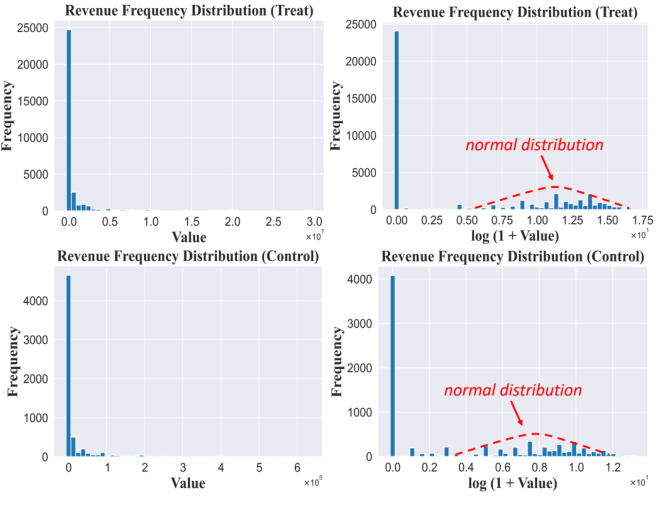
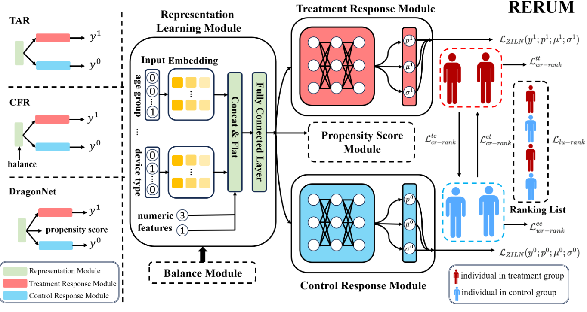
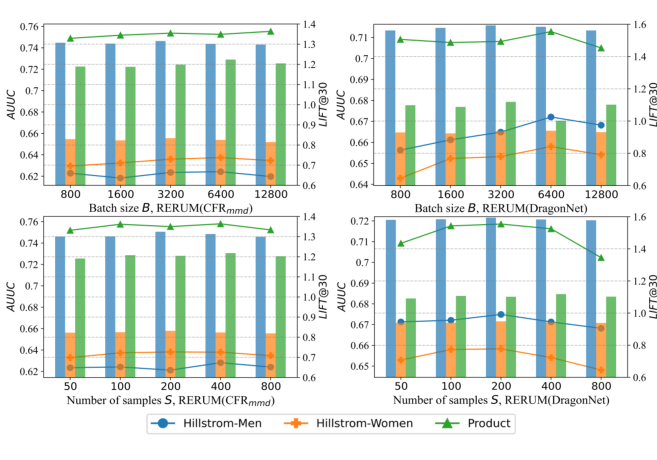
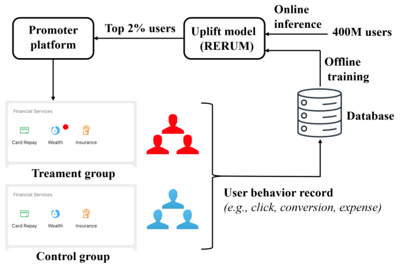

# RERUM 怎样用收入日志学习挑谁发券

同样是给两人排序，预计两人都会消费和预计哪一人的消费更容易被券改变，是两项不同的计算。TARNet 一类模型用干预前特征制作用户表示，按随机指派选择事实响应头计算回归损失，线上再用双头相减。投资金额零值多且正值长尾时，原金额的均方误差会让大额样本主导更新。两臂的金额拟合各自改善，也未必让它们相减后的用户顺序改善。RERUM 把事实金额的分布、可观测金额之间的排序、以及随机组间的增量排序一起用于训练。 [arXiv v2 §1–4](https://arxiv.org/pdf/2405.15301v2#page=2)

He 等，v2 第 2 页图 1，从采用版原 PDF 裁出。每行是一臂，左列保留原金额，右列展示对数变换。在零值占比高的条件下，正额的形状和是否付费可以分别学习。 [v2 图 1](https://arxiv.org/pdf/2405.15301v2#page=2)

## 两个响应头怎样同时给出零概率和金额

以用户 A、B 为例，每行有干预前特征 \(X\)、随机指派 \(T\) 和观察窗口金额 \(Y\)。离散字段查嵌入，接共享表征。两臂的头分别输出付费概率 \(p_t\)、正收入对数的均值 \(\mu_t\) 和标准差 \(\sigma_t>0\)。实际领券且消费 30 的 A 用券头的 \(-\log p_1\) 加上 \(\log(30\sigma_1\sqrt{2\pi})+(\log30-\mu_1)^2/(2\sigma_1^2)\) 训练。未发券且消费为零的 B 只用对照头的 \(-\log(1-p_0)\)。两个事实损失都回到共享表示。采用 CFR 时，还可加两组表示平衡项。DragonNet 底座可另读其指派预测分支。 [v2 §4.1、式 (3)–(4)](https://arxiv.org/pdf/2405.15301v2#page=4) · [CFR 的事实头与平衡项](../SRC-CFRNET/阅读笔记.md)

He 等，v2 第 4 页图 2，从采用版原 PDF 裁出。从中间读取输入嵌入和两条事实损失，再到右边的同臂、跨臂用户对和混合列表。虚线表示随底座变化的可选模块。 [v2 图 2](https://arxiv.org/pdf/2405.15301v2#page=4)

上线比较两臂的条件均值 \(m_t=p_t\exp(\mu_t+\sigma_t^2/2)\)。这是由正额对数正态的期望推出的原金额量纲。假设 A 的两臂付费概率为 0.4、0.2，正额均值同为 100，则增量为 20。B 的两臂付费概率均为 0.8，发券和对照的正额均值分别为 105、100，增量为 4。按发券后均额会优先 B，按增量先选 A。两臂有识别共同支持且因果假设成立时，这个分数对应给定 \(X\) 的平均效应。 [v2 式 (2)–(4)](https://arxiv.org/pdf/2405.15301v2#page=4) · [其他金额分布建模方式](../../知识库/问题/补贴怎样改变消费金额的分布.md)

## 事实金额和反事实增量各把什么传回预测头

同一臂的两位用户都可观测该臂的金额。论文先比较预测与事实两组差的符号。符号颠倒时罚两组差之差的平方，零乘积按印刷式无惩罚。跨臂时把一个人的事实金额与另一个人的预测配成差，再用互换后的差作对照。例如 A 在券臂，B 在对照臂，跨臂正向比较 \(\hat y_A^1-y_B^0\) 与 \(y_A^1-\hat y_B^0\)。两处参与的预测都是各自事实臂。论文的三角不等式证明两种组合上界都不超过四个点的绝对误差和。四项绝对误差和的目标与均方误差不同，可由 Cauchy–Schwarz 上界到四项平方和的平方根。这个推导和训练使用的符号门控平方损失强度也不同。 [v2 §4.2–4.3，式 (5)–(14)](https://arxiv.org/pdf/2405.15301v2#page=5)

混合小批里，每位用户用两个头算出 \(\hat\tau=\hat m_1-\hat m_0\)，全部人的 \(\hat\tau\) 共用一个 softmax 得 \(q_i\)。式 (20) 加的是券臂事实金额加权的负 \(\log q_i\) 均值，再减去对照臂同口径均值。A 的正权重使它的相对分数上升，B 的负权重直接给它相反方向的分数信号，共用归一分母还沿整个列表传递梯度。权重为 \(w_i=Y_i/n_1\) 或 \(-Y_i/n_0\) 时，分数梯度为 \(q_i\sum_k w_k-w_i\)。因而每步的净方向还取决于整批，两个头通过分数差收到符号相反的信号。推导以等分配概率的随机试验为组间同分布依据。理论式 (18) 取 \(s=\log\tau\)，只有严格正的真实效应才能直接定义该对数和概率权重。式 (20) 本身仍可算，其权重可为负，宜按带符号的排序代理理解。 [v2 §4.4–4.5，式 (15)–(21) 与算法 1](https://arxiv.org/pdf/2405.15301v2#page=6)

## 排名上升时金额拟合也会上升吗

Hillstrom 的响应是邮件后两周实际消费，男装和女装分别与共同的无邮件组比较。Product 数据用购基金额，动作为激励券，三组数据均按 60/10/30 切分，五个随机种子取平均。表 2 的 Hillstrom-Men/DragonNet AUUC 从 0.6028，加入增量排序后为 0.6534，再加入响应排序为 0.6684，最后添加 ZILN 及其响应头为 0.6721。Product 上 TAR+UR+RR 的 LIFT@30 为 1.0610，变为完整 RERUM 后是 1.0247。表 3 的 TAR/Product 在仅加 ZILN 时 MAPE 为 0.1378，完整模型为 0.1535，作者没有在该节说明零金额分母的处理。处理和测试协议都固定时，这些对照可以观察同一底座在多种训练目标下的差异。 [v2 §5.1–5.2.4、表 1–3](https://arxiv.org/pdf/2405.15301v2#page=8)

He 等，v2 第 8 页图 3，从采用版原 PDF 裁出。四个子图分别变化批量大小和抽取样本数，报两类骨干的平均结果。 [v2 §5.2.3](https://arxiv.org/pdf/2405.15301v2#page=8)

He 等，v2 第 9 页图 4，从采用版原 PDF 裁出。四亿量级人群先评分，每个待测模型的前 2% 中再随机分组，干预是通知红点，指标是一个月内两臂销售收入均值差。表 4 的三场活动相对线上底座分别提升 9.20%、37.24%、15.43%，平均 20.61%。该表衡量被选前缀内部的增量，面额与成本优化需要另有动作与标签。 [v2 §5.2.5、图 4 与表 4](https://arxiv.org/pdf/2405.15301v2#page=9) · [排序、幅度和策略价值](../../知识库/问题/怎样验证补贴增量的排序幅度和策略价值.md)

## 版本与译本

Bowei He、Yunpeng Weng、Xing Tang、Ziqiang Cui、Zexu Sun、Liang Chen、Xiuqiang He、Chen Ma。采用 KDD 2024 作者版 arXiv v2，阅读正文、评价指标和补充消融，未运行模型。10 页中文 PDF 翻译摘要、正文、图表说明、作者说明和致谢，图内文字、文献和附录保留原文。译本已逐页渲染核对，原文与译本均完成私有备份和认证下载校验。 [中文 PDF 私有下载说明](../../译文/PDF目录.md) · [固定原文](https://arxiv.org/pdf/2405.15301v2)
