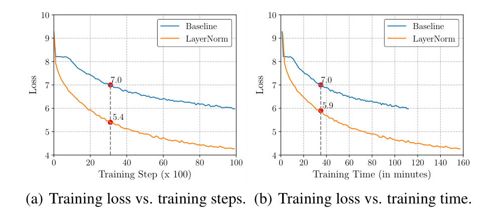
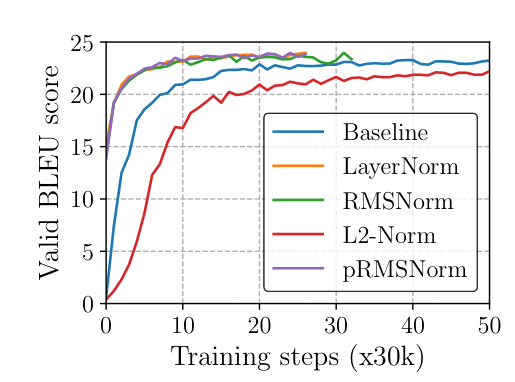

# RMSNorm：只控制长度，保留公共偏移

归一化可以改变训练达到给定损失所需的步数，也会增加每一步运算。Zhang 和 Sennrich 在 §1 用 GRU 翻译展示这两个效应。图 1 中，LayerNorm 训练到约 5,400 步时已经低于无归一化对照的损失。如果把横轴换成钟表时间，速度收益要重新判断。作者据此考察去均值与重缩放是否都需要，提出只保留后者的 RMSNorm。

作者原图 1，固定版第 2 页，Biao Zhang、Rico Sennrich。两图均看训练损失，横轴分别是训练步数和分钟。Baseline 是无归一化的 GRU RNNSearch。图中尚未加入 RMSNorm。

## 同一条向量如何通过两种归一化

“hello world .” 的 world 位置上，假设四维预激活为 $[2,4,6,8]$。忽略稳定项，RMSNorm 的分母是 $\sqrt{(4+16+36+64)/4}=\sqrt{30}$，得到 $[0.365,0.730,1.095,1.461]$。LayerNorm 的分母是中心化后的 $\sqrt5$，输出中的前两项变为负数。原输入乘以 2 时，RMS 也乘以 2，因此归一化输出不变。每个维度都加 3 时，RMS 输出会改变，因为分子方向和长度都改变了。非零 $\epsilon$ 会破坏严格的重缩放不变量，尤其是输入很小的时候。

归一化后的向量按维乘 $g$，再进入后续的非线性或残差分支。以预测句号的词表交叉熵为例，损失先经输出头到达缩放层，$g$ 在共享的位置上接收梯度，分母也把当前向量各维耦合起来。设 $r=\sqrt{\mathrm{mean}(x^2)+\epsilon}$、$z=x/r$、$a=g\odot\partial L/\partial y$，则 $dL/dx=(a-z\,\mathrm{mean}(az))/r$。LayerNorm 的对应式另减去 $\mathrm{mean}(a)$。原文式（5）在一般网络表示里保留偏置，常见实现可省略它。RMSNorm 与 LN 的轴、梯度和残差放置关系见[归一化与残差梯度](../../知识库/概念/LayerNorm与残差梯度.md)。

§5 的 pRMSNorm 用固定子集估计整条向量的 RMS，例如四维只看前两维，分母变成 $\sqrt{10}$，其余维也除以这个值。缩放仍随输入同倍变化，但对全体特征的尺度估计可能偏差很大。论文动机是假设子集足够代表整体，实际选取前 $p$ 比例的维度。pRMSNorm 的反向也不同，只有参与分母估计的维度有从分母来的直接梯度项。子集比例是稳定性与成本的超参数。

## 在何种实现里节省时间

作者原图 2，固定版第 6 页，Biao Zhang、Rico Sennrich。横轴每单位是 3 万训练步，纵轴是 newstest2013 验证 SacreBLEU。LN、RMSNorm 与部分 RMS 的初期曲线接近，L2-Norm 和无归一化对照较慢或较低。表 2 在 WMT14 英译德、TensorFlow Nematus 上报告每 1,000 步的耗时，LN 665 秒，RMSNorm 501 秒，pRMSNorm 493 秒，未归一化基线为 399 秒。RMSNorm 相对 LN 的单步时间下降约 24.7%。Test14/Test17 分数分别为 22.4/23.7 和 LN 的 22.6/23.6。该对照支持用 RMSNorm 节省特定实现的单步成本，在两项测试 BLEU 上接近 LN。

§6 中 Transformer 的节省小于循环模型。作者在 CNN/Daily Mail 阅读理解、MS COCO 图文检索和 CIFAR-10 上也比较多种归一化，最优指标随任务而异。CIFAR-10 表 10 的错误率 8.96% 与 8.83% 相差 0.13 个百分点，正文印为 0.013%，保留表值作为比较依据。算子融合、硬件、归一化轴和网络结构都会影响实际耗时。

阅读范围为固定版摘要、§1–7、核心图表和相关附录。正文译为中文，参考文献与附录保留英文。实验数字为作者报告。[固定原文](https://arxiv.org/pdf/1910.07467v1) · [中文 PDF 访问说明](../../文档/工具/中文PDF发布.md)
