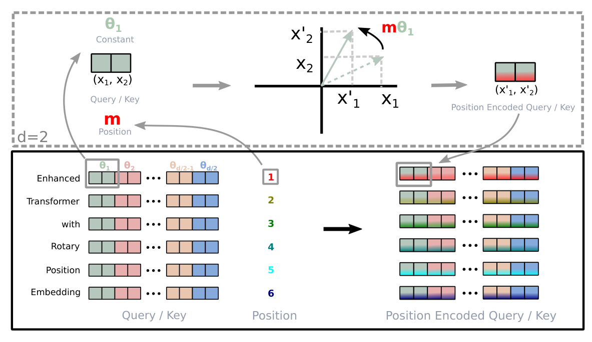
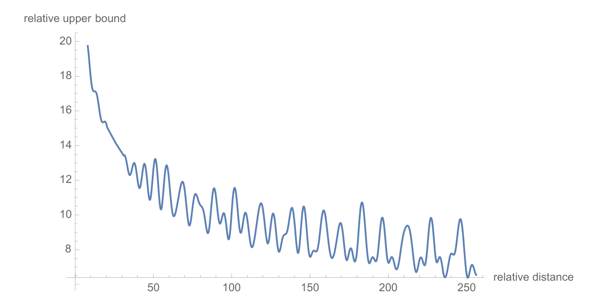
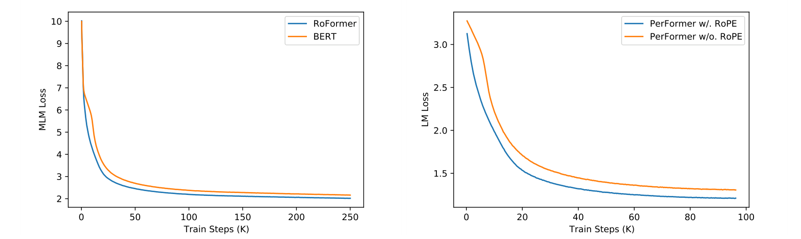

# RoFormer：位置旋转如何改变注意力分数

把同一个词放在句首或句尾，单凭词嵌入，注意力的内容点积看不出位置。经典 Transformer 在输入上加正弦位置向量，BERT 则使用可学习的位置表。两种做法都会让位置影响后续投影，但投影展开后同时存在内容项、位置项和交叉项，改动绝对索引时很难要求分数只依赖位移。RoFormer 把位置移到注意力投影之后，用同一个二维旋转族分别处理查询和键。

## 从一对旋转走到一行注意力

给定 “hello world .”，考察位置 2 的 world 查询和位置 1 的 hello 键。设其中一组二维坐标的未旋转值为 $q=(1,0),k=(0,1)$，教学角频率为 $\theta=\pi/2$。原点积为 0。旋转查询得到 $R_{2\theta}q=(-1,0)$，旋转键得到 $R_\theta k=(-1,0)$，点积成为 1。如果同样内容移动到位置 3 和 2，旋转后的向量都变成 $(0,-1)$，点积仍是 1。一般地，每组使用
$$
(R_{m\theta}q)^\top(R_{n\theta}k)=q^\top R_{(n-m)\theta}k.
$$
右边只依赖这些内容向量与相对位移。用论文 §3.2 的复数表示，取 $q\overline{k}$ 的实部时相位写为 $(m-n)\theta$，符号与旋转矩阵放在右侧的记法相容。论文式（16）最后一个等号漏写 $W_q$ 的转置，展开时应为 $x_m^\top W_q^\top R_{n-m}W_kx_n$。

作者原图 1，固定版第 5 页，Su 等。上图把一对坐标转过 $m\theta_1$。下图每行是一个位置，每种颜色表示二维配对。头维数 $d$ 为偶数时共有 $d/2$ 对，每对使用自己的 $\theta_i=10000^{-2i/d}$（从 0 编号）。计算可用逐元素 sin、cos 与交换带符号的坐标，无需构造稠密矩阵。

将各组点积相加后除以 $\sqrt d$，再施加任务所需的因果或 Padding 掩码，对允许的键做一次 Softmax。值向量由原投影产生，仍按这一行的概率加权求和。以自回归预测为例，world 行能读取 hello 和 world，最后的词表头在该处预测句号。损失经注意力权重回到 $W_Q,W_K$，原版 RoPE 频率是固定的，反向穿过二维旋转时对向量乘其转置。增量推理保存各历史位置已旋转的 K 以及对应 V，新查询使用当前 position ID。各层投影、旋转配对方式与绝对索引必须一致。实现细节见 [Transformer 位置编码](../../知识库/概念/Transformer位置编码.md)。

## 相对位移的衰减与线性注意力

作者原图 2，固定版第 8 页，Su 等。横轴为位移，纵轴为作者构造的相位上界量。§3.4.3 将各组内积写成带复数权重的相位求和，用 Abel 变换拆出位置相位的部分和。图中是上界量的总体衰减趋势，局部仍有振荡。单个头对某对词的分数还受内容权重影响，Softmax 另受同一行其他键影响。有定义的位置也可能落在训练未覆盖的范围。

§3.3 对线性注意力的处理也有额外条件。通常分子先预聚合 $\sum_n\varphi(k_n)v_n^\top$，再乘查询特征 $\phi(q_m)^\top$。RoPE 可先旋转特征 $\phi,\varphi$ 后做同样的聚合，因为各位置的旋转独立。论文分母继续用未旋转的非负特征，用以避免旋转后符号相消带来的零分母风险。这样仍保留因式分解，但分子的值权重可能为负，归一化结果也不一定构成概率分布。

## 哪些实验支持收敛和长文本优势

作者原图 3，固定版第 10 页，Su 等。横轴为千训练步，左图是 BERT 与 RoFormer 的 MLM 损失，右图是字符级 Performer 在 Enwik8 上有无 RoPE 的语言建模损失。图支持作者配置中的收敛趋势。§4.2 的 BERT 基线称为 bert-base-uncased，却又称替换其正弦位置编码，和原版 BERT 可学习位置表的描述不一致。该节还写两者训练 100k 步，而图 3 左图横轴画到约 250k，缺少解释。GLUE 表 2 的六项中有三项提升，SST-2、QNLI、MNLI 更低。WMT14 英译德的 BLEU 从 27.3 到 27.5。

中文 CAIL2019-SCM 表 5 中，RoFormer 的测试准确率从 512 下的 68.29% 到 1024 下的 69.79%，差 1.50 个百分点。同长 512 的 WoBERT 为 68.10%。表中无 WoBERT-1024，且中文 RoFormer 预训练已经包含长度 1536 的阶段，因此这组比较展示了可用上下文增长的收益，无法单独估计 RoPE 相对其他位置方案的长度外推收益。

阅读范围为固定版摘要、§1–5、公式、作者图和实验表。正文为中文，作者图内标签与参考文献保留原版。作者实验未复跑。[固定原文](https://arxiv.org/pdf/2104.09864v5) · [中文 PDF 访问说明](../../文档/工具/中文PDF发布.md)
