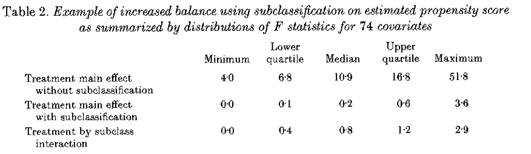

# 倾向得分怎样让发券组与对照组可以比较

发券前有多个属性时，逐项精确匹配会让大部分小格子缺少某个处理臂。Rosenbaum 与 Rubin 在 1983 年证明，只要已测特征满足强可忽略性，可以用它们预测历史发券的条件概率 $e(X)=P(T=1\mid X)$，再在相同概率的人群里比较结果。理解匹配必须分开两件事：概率分层为什么能平衡已测特征，以及均值差在什么条件下有因果含义。 [原文 §1–2，刊页 41–47](https://www.stat.cmu.edu/~ryantibs/journalclub/rosenbaum_1983.pdf#page=2)

## 同一层里的发券概率相同

令 $X$ 是指派前特征，$T$ 是发券指派，$Y(1),Y(0)$ 是七天下单的潜在结果。对于任意满足 $e(x)=s$ 的 $x$，$P(T=1\mid X=x,e(X)=s)=s$。对层内所有 $x$ 加权后，$P(T=1\mid e(X)=s)$ 也等于 $s$。于是 $T\perp X\mid e(X)$，给定同一个真倾向，两臂的 $X$ 分布相同。原文定理 2 给出更一般的结论：$b(X)$ 是平衡得分，当且仅当真倾向 $e(X)$ 可由 $b(X)$ 确定。$b(X)=X$ 与 $b(X)=e(X)$ 都可行，后一项把同倾向的状态合并得最彻底。 [原文定理 1–2，PDF 第 5 页](https://www.stat.cmu.edu/~ryantibs/journalclub/rosenbaum_1983.pdf#page=5)

例中 100 位高意向用户有 80 人拿券，100 位低意向用户有 20 人拿券。假设高意向两臂下单率为 45%、40%，低意向为 15%、10%。比较整体观测均值为 $39\%-16\%=23$ 个百分点。按 0.8 与 0.2 分层后，每层差为 5 个百分点。举例若只有发券者需要复盘，可以按 80%、20% 的发券组层权汇总 ATT。估全体 ATE 用目标总体的 50%、50% 层权。两种估计量在这个例子的同质效应设定下数值相同，异质时会分开。 [原文定理 4、推论 4.1–4.3，PDF 第 7–8 页](https://www.stat.cmu.edu/~ryantibs/journalclub/rosenbaum_1983.pdf#page=7)

## 把平衡性质接到识别和有限样本匹配

强可忽略性同时要求 $(Y(1),Y(0))\perp T\mid X$ 与 $0<e(X)<1$。用真倾向形成层后，可先对 $X$ 积分。给定 $e$ 和 $T$，由平衡性质去除 $X$ 分布对 $T$ 的依赖，由可忽略性去除潜在结果给定 $X$ 后对 $T$ 的依赖，因此两种潜在结果在该层仍与 $T$ 独立。用事实结果一致性将两臂均值差接到同一层的条件效应。不可见的购买意向若同时改变两者，观察变量再平衡也无法确定该假设成立。 [原文定义 1.3、定理 3–4，PDF 第 4、6–7 页](https://www.stat.cmu.edu/~ryantibs/journalclub/rosenbaum_1983.pdf#page=4)

实际只有估计倾向。先用旧策略样本拟合 $T$，查看两组得分的重叠，再做近邻匹配或分层。保留多少处理样本、是否重复使用对照和层权怎样汇总，决定估计的人群及不确定性。对几乎必发券的高意向用户，匹配可能找不到合适对照，删去他们会改变目标人群。发券分类指标不能检验匹配后协变量是否平衡。可逐项检查两组可见协变量与样本覆盖，匹配推断还要使用适配匹配设计的方差计算。 [原文 §3.2–3.3，PDF 第 10–14 页](https://www.stat.cmu.edu/~ryantibs/journalclub/rosenbaum_1983.pdf#page=10)

作者原表 2，刊页 52，固定 PDF 第 13 页裁取。作者用估计倾向的五分位分层，在冠心病手术与药物疗法的观察数据上，对 74 个处理前协变量比较平衡。各变量治疗主效应 $F$ 统计量的中位数由 10.9 降为 0.2。这里检验的是样本的协变量可比性。五层切分效果依赖数据分布。 [原文表 2](https://www.stat.cmu.edu/~ryantibs/journalclub/rosenbaum_1983.pdf#page=13)

采用版为 Biometrika 70(1), 41–55 的 CMU 托管扫描件，精读 §1–2、§3.2–3.3，核对两张表。 [DOI](https://doi.org/10.1093/biomet/70.1.41) · [历史发券识别与估计](../../知识库/问题/历史发券日志如何估计补贴增量.md)
