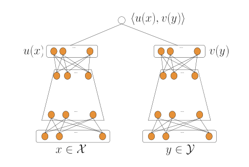
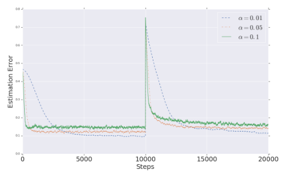
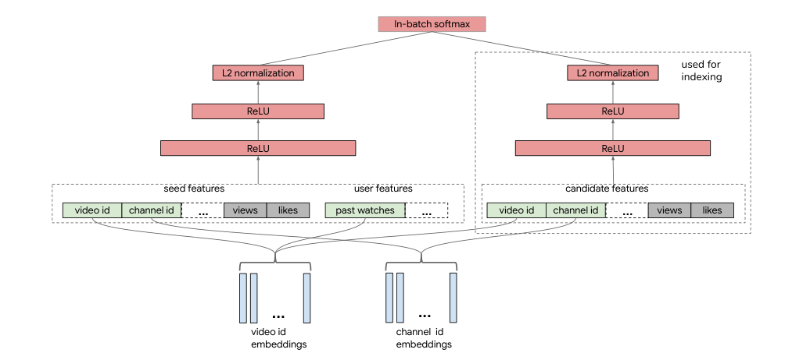
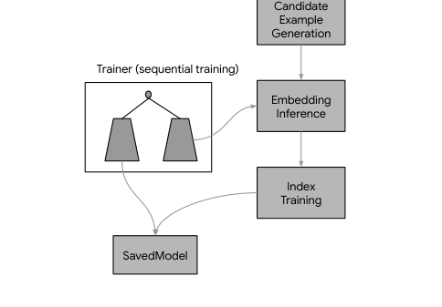

# 批内物品频次怎样影响 YouTube 双塔的学习

全库分类要为同一请求计算数百万物品的分数。双塔分开编码请求和物品，可把同一批的物品向量复用为其他请求的对照。这样省去了大量物品塔计算，但这个候选池继承了日志频率。Yi 等用流式估计的候选命中概率修正 softmax logit，并分别发布模型、生成物品向量和建立索引。

作者原图 1，Yi 等，RecSys 2019，PDF 第 2 页。下方的两个输入各走自己的塔，顶部点积是可以在全库检索的打分。

## 批中难免反复看到热门候选

一次训练接收 $B$ 条正配对 $(x_i,y_i,r_i)$，分别表示请求、目标物品和目标事件奖励。编码产生 $B\times d$ 的请求与物品矩阵，相乘得到 $B\times B$ 的 logit 矩阵，按每行在其目标列取概率。如果热门耳机在很多请求的正例里出现，它也常作为别行的对照。设温度为 $\tau$，用归一化后的双塔向量得 $s(x,y)=u(x)^\top v(y)/\tau$。论文在式 (4) 的批内交叉熵中使用 $s_c(x,y)=s(x,y)-\log p_y$，$p_y$ 是该物品在训练批出现的概率。奖励乘到每行的对数损失，选中的物品行、查询行以及各塔共享参数由此更新。

例如一条请求的正例是降噪耳机 A、批内对照是 B 耳机套，裸 logit 分别为 1.2、0.6，列采样概率为 0.5、0.1。修正后为 1.893、2.903，正例批内概率从约 0.646 降为 0.267。较罕见的 B 在被看到时在分母占的权重变大。该二列例仅说明梯度如何改变，线上索引仍按裸塔分数排序，无需已知本次批的出现概率。[原文 §3，式 (3)–(5)，PDF 第 2–4 页](https://storage.googleapis.com/gweb-research2023-media/pubtools/5716.pdf#page=3)。

## 用命中间隔更新候选分布

对物品 $y$ 的哈希桶存 $A_h$ 上次出现步数和 $B_h$ 指数平滑间隔。若当前步 $t$ 命中，先更新 $B_h\leftarrow(1-\alpha)B_h+\alpha(t-A_h)$，再写 $A_h=t$。在独立且平稳的批命中假设下，几何间隔期望等于 $1/p_y$，用 $1/B_h$ 得在线估计。若前估计 10 步，本次间隔 4 步，$\alpha=0.2$ 则得到 8.8 步与概率约 0.114。多个物品哈希到同一桶会提高合并命中率，因而原文尝试多哈希并取较大间隔，以降低碰撞影响。取倒数后仍存在有限样本误差。原文 Proposition 4.1 式 (7) 的印刷形式与从 EMA 递推得 $(1-\alpha)^t(B_0-\delta)$ 有差别，算例采用递推式。[原文 §4，算法 2–3、式 (6)–(8)，PDF 第 4–5 页](https://storage.googleapis.com/gweb-research2023-media/pubtools/5716.pdf#page=4)。

作者原图 4，同版 PDF 第 7 页。横轴为训练步，切换分布后较大的学习率通常响应较快。读左侧切换前后的误差，并区分短期适应和稳定期波动。

## 训练校正之后用裸分数服务

作者原图 2、3，同版 PDF 第 6 页。图 2 展示请求侧行为和候选侧特征如何进入双塔。图 3 的训练、物品向量生成与索引更新是各自有状态的步骤。判断线上是否在同一分数空间，需核对请求模型与物品索引的出库版本。

YouTube 实验在 1,000 万视频的候选语料中检索点击视频，固定 $\tau=0.05$、训练点击权重为 1 时，表 2 的 Recall@50 从 0.4586 到 0.5322。线上表 3 使用更贴近参与度的奖励，报告与各自共同基线相比的 engagement 改善 +0.20% 与 +0.37%。两组分别是候选检索和在线指标证据。修正采样概率没有提供从未曝光物品的正反馈，也无法由此推出针对原展示策略的因果校正。[原文 §5–6，表 2–3，PDF 第 6–8 页](https://storage.googleapis.com/gweb-research2023-media/pubtools/5716.pdf#page=8)。

采用 [RecSys 2019 DOI 10.1145/3298689.3346996](https://doi.org/10.1145/3298689.3346996) 的 Google Research 完整 PDF，阅读 §1–7、频率估计证明、实验图表。公式与混合采样的比较见[负样本怎样改变双塔召回目标](../../知识库/问题/负样本怎样改变双塔召回目标.md)。

中文学习译本 10 页。摘要、正文 §1–7、图表说明及算法描述译为中文，图内英文与参考文献保留。依据会议 PDF 重排。本地附件为 `.local/papers/SRC-SAMPLING-BIAS-CORRECTION/translation/采样偏差修正.中文.pdf`。采用版原文与译文均已认证下载并核对完整 SHA-256。见 [PDF 备份说明](../../文档/工具/中文PDF发布.md)。
