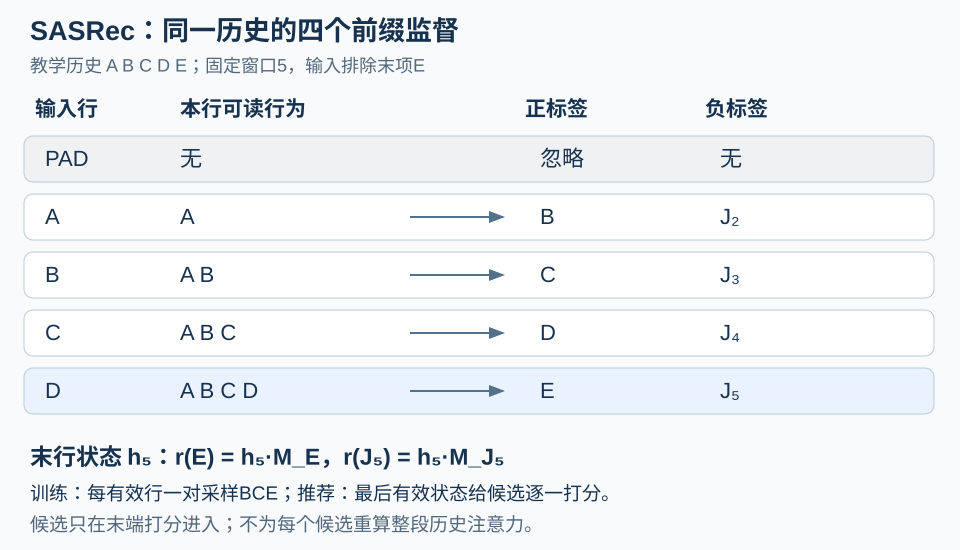

# SASRec：用因果自注意力形成下一物品的上下文

[学习思考](学习思考.md) · [固定官方实现](../SRC-SASREC-CODE/阅读笔记.md) · [中文PDF位置](#原文与译文入口) · [私有备份下载说明](../../文档/工具/中文PDF发布.md#登录下载)

推荐历史里，最近一次行动有时已足够：买了相机，下一步可能找镜头；另一些时候，需要结合更远的偏好。固定阶数的马尔可夫模型预先规定看几步，RNN 则将历史逐步压入状态。SASRec 的选择是在可见历史窗口内，用自注意力给不同位置赋权，再形成预测下一物品的向量。它允许使用远处信息，也允许权重集中在近期；**没有因此省掉对窗口内注意力矩阵的计算**。

Wang-Cheng Kang 与 Julian McAuley 的 *Self-Attentive Sequential Recommendation*，这里读取 [arXiv 1808.09781v1（2018）](https://arxiv.org/pdf/1808.09781v1) 全部 10 页。论文考察的是下一物品预测，输入为物品行为顺序，不是带曝光负标签的 CTR 预测，也没有显式建模事件间时间间隔。

## 先分清要预测的是什么

沿用同一条教学行为序列：$[A,B,C,D,E]$ 分别表示相机、镜头、相机包、三脚架、存储卡。这里只用物品ID区分行为，不把名称或商品文本喂给模型；动作先后来自记录顺序，例子不表示购买因果关系。假定这五次都是当前训练片段，下一物品训练可用A预测B、AB预测C、ABC预测D、ABCD预测E；正式实验另按用户留出末两项做验证和测试，不能把留出真值混入训练。

只看上一项的模型在ABCD处只能根据D判断；固定高阶模型必须预先决定保留几项；RNN的 $h_t=f(h_{t-1},M_{s_t})$ 则逐步更新状态。SASRec让D位置直接读取窗口内A、B、C、D的上一层状态，用训练学到的权重组织这些信息。不保证每次都找到远处偏好，也不会因为权重集中而自动跳过其他位置的计算。[§I、II与III，第1–5页](https://arxiv.org/pdf/1808.09781v1#page=3)。

可以借用Transformer的Q/K/V、残差与FFN，但本篇**没有另一个源句编码器或交叉注意力**。整个用户历史是一个因果自注意力序列；目标也从下一词表概率改成推荐物品分数和采样二元监督。复习入口：[输入标签对齐](#一条历史如何变成四个前缀监督)、[分数与梯度](#用同一位置算出正负分数损失和梯度)、[推荐接口](#训练完后怎样给这位用户推荐)。

## 一条历史如何变成四个前缀监督

为把截断和补齐也接进实例，取窗口长度 $n=5$：输入 $[PAD,A,B,C,D]$，对齐标签为 $[忽略,B,C,D,E]$。PAD只是补齐符号。输入中没有E；但B、C、D分别出现在后续输入位置，所以早期行必须遮住未来。

| 窗口行 | 输入ID | 可用行为前缀 | 正标签 | 示例负标签 |
|---|---|---|---|---|
| 1 | PAD | 无 | 不计损失 | 无 |
| 2 | A | A | B | J₂ |
| 3 | B | A、B | C | J₃ |
| 4 | C | A、B、C | D | J₄ |
| 5 | D | A、B、C、D | E | J₅ |

$J_t$表示按训练采样规则取到的未观察物品，不是有曝光证据的真实厌恶，也不假定四个负例必不同。这里选以E为正标签的末行作后续算例。查表时 $M_A$ 是全用户共享的A物品向量，而不是这个用户的专用参数；同一用户换一条历史会形成不同状态。

先读图左侧每行能看哪些行为，再读右侧同一行的正负分数。四行共用网络、一次前向可并行算完，但每行的历史条件不同。最上面的PAD不进入监督；图中只画有效行为连接，具体实现还须妥善处理全被遮掉的填充查询，不能把全 $-\infty$ 行的Softmax当作正常概率。原文没有完整给出padding遮罩实现；本轮另核对固定官方代码，见[填充与切片](../SRC-SASREC-CODE/阅读笔记.md#填充遮罩与末位置切片)。

## 从错位一格的序列构造监督

设用户历史为 $(i_1,\ldots,i_T)$，训练输入为 $(i_1,\ldots,i_{T-1})$，期望输出为 $(i_2,\ldots,i_T)$。每个有效位置用截至该位置的前缀预测下一个物品。上述ABCDE训练片段就提供A→B、AB→C、ABC→D、ABCD→E四个监督；前缀中的后续物品不能泄漏给较早预测。

为批处理，固定最大长度 $n$。过长保留最近 $n$ 次输入行动，过短在左侧填充，填充物品表示为零。查物品矩阵 $M\in\mathbb R^{|I|\times d}$ 后，加上可学习位置矩阵 $P\in\mathbb R^{n\times d}$：

$$
H_i^{(0)}=M_{s_i}+P_i.
$$

$s_i$ 是定长序列第 $i$ 个物品，$d$ 为向量维度。物品告诉模型“是什么”，位置告诉模型“在窗口哪里”。论文报告固定位置编码在其设置中较差，不代表所有序列推荐都应使用可学习绝对位置。[§III-A、式 (1)，PDF 第 3 页](https://arxiv.org/pdf/1808.09781v1#page=3)。

### 位置是共享槽位，不是用户专属编号

$P\in\mathbb R^{n\times d}$在全用户间共享；同一窗口槽位查同一行，梯度沿batch的各次使用相加。比如两条样本对槽位5的输入梯度为$(1,2)$和$(-0.5,3)$，在相同归约约定下，该位置查表路径贡献$(0.5,5)$。不是每个用户各学一套P，也不是所有槽位用同一向量；[共享参数与梯度详解](../../知识库/概念/Transformer位置编码.md#共享位置表怎样广播和累积梯度)给出公式。

窗口长5时，[PAD,A,B,C,D]追加E后变[A,B,C,D,E]，A–D各向左移动一格；即使冻结P，取到的位置行也变了。固定官方代码逐窗口生成0到n−1的位置ID，输入物品还乘$\sqrt d$；这些实现细节见[代码入口](../SRC-SASREC-CODE/阅读笔记.md#共享物品表与窗口位置表)。这正是后文缓存不能无条件复用的原因。

## 遮住未来，才能并行计算全部训练位置

查询Q决定当前行找什么，键K供查询比较，值V承载实际读出的信息；三者来自不同的可学习投影，不是人工指定的兴趣标签。对输入矩阵 $H$ 投影：$Q=HW^Q,K=HW^K,V=HW^V$，其中 $W^Q,W^K,W^V\in\mathbb R^{d\times d}$。一个自注意力层为：

$$
A_{ij}=\operatorname{softmax}_{j}\left(
\frac{Q_iK_j^\top}{\sqrt d}+C_{ij}\right),\qquad
S_i=\sum_j A_{ij}V_j,
$$

其中 $C_{ij}=-\infty$ 当 $j>i$，可见历史位置取 0；上式是把原文的因果禁止连接显式写为遮罩。填充位置也须排除，不把填充当真实行为。原文说明零填充、忽略填充监督，但没有在注意力公式中完整列出填充遮罩实现；固定代码还区分归一化后的Q输入与未归一化的K/V输入，见[实现差别](../SRC-SASREC-CODE/阅读笔记.md#归一化路径与论文概括式不同)。[§III-B、式 (2)–(3)，PDF 第 3 页](https://arxiv.org/pdf/1808.09781v1#page=3)。

所有训练位置可以在一个矩阵运算中同时计算，但第 $i$ 行只见到前 $i$ 个输入。query 与 key 用不同投影，允许方向不同的关联；这不是把物品余弦相似度作为固定权重。

逐位置两层前馈网络进一步混合潜在维度：

$$
F_i=\operatorname{ReLU}(S_iW^{(1)}+b^{(1)})W^{(2)}+b^{(2)}.
$$

同一组权重作用于每个位置，不在该层跨位置混合。原文说自注意力“最终仍是线性模型”，应限定理解：给定权重，对 value 是线性加权；权重本身由输入的点积及 softmax 决定，因此整体映射已是非线性的。FFN 增加的是逐位置的非线性特征变换。[式 (4)，PDF 第 3 页](https://arxiv.org/pdf/1808.09781v1#page=3)。

默认堆叠两块。每个子层在原文的概括公式中采用输入 LayerNorm、输出 Dropout、再残差相加的形式，可用不混淆函数名的记号写为 $H_{out}=H+\operatorname{Dropout}(g(\operatorname{LN}(H)))$。残差让最后物品等低层信息更容易保留，Dropout 缓解过拟合。原文 LayerNorm 公式分母是 $\sqrt{\sigma^2+\epsilon}$，文字却称 $\sigma$ 为方差；本笔记按 $\sigma^2$ 是方差解释，译文保留原式并注出差异。[§III-C，PDF 第 4 页](https://arxiv.org/pdf/1808.09781v1#page=4)。

### 论文结构与实际脚本怎样对照

原始Transformer翻译骨干的典型子层是$LN(X+Dropout(g(X)))$，SASRec论文写$X+Dropout(g(LN(X)))$。在论文这个形式下，前者残差和仍过LN，后者有绕过LN的恒等支路；完整[Jacobian推导](../../知识库/概念/LayerNorm与残差梯度.md#pre-ln的恒等梯度项从哪里来)说明这不保证训练中梯度恒定。

本次定向核对作者TensorFlow代码后，要再区分一层：脚本Q取$LN(X)$，K/V取X，注意力残差加$LN(X)$；FFN也以已归一化输入作残差，内有两次Dropout，末尾另有final LN。FFN的两次宽度1卷积为$d\to d\to d$，同一层权重跨batch和位置共享，每个block则有自己的参数。因此不能把论文概括式、固定脚本与标准Pre-LN三者视为逐算子相同；静态细节见[实现解读](../SRC-SASREC-CODE/阅读笔记.md#归一化路径与论文概括式不同)。

### 沿着D这一行看状态怎样形成

D查表得到 $M_D$，加窗口第5行位置向量 $P_5$，得到 $H_5^{(0)}$。它不是直接预测E的概率。按论文子层输入先LN的概括式，第一块以归一化后的向量形成Q/K/V；固定代码只对Q来源先LN，K/V取未归一化输入，二者不能混用。D的query匹配四个有效键A、B、C、D，沿它们Softmax。假设本次教学权重为 $[0.1,0.2,0.2,0.5]$，则注意力输出为 $0.1V_A+0.2V_B+0.2V_C+0.5V_D$；它还要走Dropout、残差、逐位置FFN，再进入下一块。这里的权重是构造值，不能读成论文发现“三脚架贡献50%”。

第二块虽然仍只看前缀，但读取的是上一块各位置的上下文状态：C行已能含ABC的信息，D行能再次组合它们。最后输出矩阵有5行、每行$d$维；用于本例E监督的是D所在的第5行 $h_5$，不是把整个矩阵平均，也不是从所有行里选分数最大的行。完整Attention数值展开可回看[Transformer单行算例](../SRC-TRANSFORMER/阅读笔记.md#沿一次读取算出新的上下文向量)，此处只替换物品输入和可见范围。

位置、遮罩与监督是三件事：$P_5$告诉网络该输入在窗口的位置；因果连接限制能读什么；Loss只在有正标签的有效行计算。单把PAD物品向量设为0不能保证加上位置或偏置后它永远不影响网络；这正是要另外核对padding处理的原因。[依据§III-A–C，第3–4页的实例化](https://arxiv.org/pdf/1808.09781v1#page=3)。

## 历史状态与物品共享一张表，却仍能表示方向

最终位置状态为 $h_t=F_t^{(b)}$，预测物品 $i$ 的分数为：

$$
r_{i,t}=h_tM_i^\top.
$$

默认将输入物品表与输出物品表绑定。虽然 $M_iM_j^\top$ 本身对称，历史经过非线性变换后，$f(M_i)M_j^\top$ 与 $f(M_j)M_i^\top$ 不必相等；因此共享表不强迫转移对称。模型通过行动前缀产生用户状态，不必为每个用户保存独立向量。作者尝试另加用户向量，未得到改善；这只是本篇设置的观察。[§III-D、式 (6)，PDF 第 4 页](https://arxiv.org/pdf/1808.09781v1#page=4)。

用二维反例看清共享与对称不是一回事：设$M_A=(1,0),M_B=(0,1)$，暂取非对称线性变换$W=\begin{bmatrix}0&2\\1&0\end{bmatrix}$，则$(M_AW)M_B^\top=2$，$(M_BW)M_A^\top=1$。连线性非对称变换都足以打破此对称；论文给的非线性FFN是实际可用机制，不是数学上非对称的必要条件。真实模型还由位置和整个前缀决定状态；相同模型、相同历史及位置规则在确定性推理下，会给不同用户ID同样的状态，不能把它当作额外身份记忆。

推理时先编码当前历史，再用内积给候选排序。单候选评分为 $O(d)$，全物品直接打分仍需 $O(|I|d)$；可与向量检索接口衔接是结构分析，原文未验证现代 ANN 系统的延迟或召回损失。历史权重由各历史位置产生，最终候选仅进入末端内积，不是每个候选都重新计算整段历史注意力。

## 抽样二元分类与 BPR 的分差目标不同

论文先写了对全部非历史物品求和的二元交叉熵，实际说明每个 epoch 为每条序列每个时间步随机生成一个负物品。忽略填充后，一个正物品 $o_t$、一个负物品 $j_t$ 的实际采样形式可写为：

$$
\ell_t=-\log\sigma(r_{o_t,t})-\log\sigma(-r_{j_t,t}).
$$

这是依据原文采样说明重写的形式；未乘负物品集合大小时，它不等于完整负例求和的无偏估计。采样分布、正负权重影响目标，不能简单把它叫“全物品 softmax”或直接解释成校准后的真实选择概率。[§III-E，PDF 第 4–5 页](https://arxiv.org/pdf/1808.09781v1#page=5)。

[BPR 精读](../SRC-BPR/阅读笔记.md)的损失则是 $-\log\sigma(r_+-r_-)$，直接调整相对分差。两者用同一正负例也不是同一目标：SASRec 上式分别推动正分升、负分降，BPR 只依赖两者差值；统一给分数加常数不会改变 BPR 数据项，却会改变上述二元损失。SASRec 与 BPR 也不处在同一层级：前者包含序列编码架构和所采用目标，后者首先是可配不同打分器的训练准则。不能把本篇表中的 BPR-MF 结果当作所有 BPR 训练模型的上限。

## 用同一位置算出正负分数、损失和梯度

把上面的末行状态暂取为 $h_5=(1,0)$，候选向量取 $M_E=(1,1)$、$M_{J_5}=(-1,1)$。这是二维构造值，与论文真实训练维度无关。于是 $r_+=h_5M_E^\top=1$，$r_-=h_5M_{J_5}^\top=-1$，$\sigma(1)=0.7311$、$\sigma(-1)=0.2689$。采样BCE为

$$
\ell_5=-\log0.7311-\log(1-0.2689)\approx0.6265.
$$

这两个sigmoid分别判断一个采样正/负对，它们的输出不要求在全目录加和为1。碰巧这组正负概率相加为1来自分数互为相反数，不是BCE的归一化约束。其余三个有效行也各算一对损失；若教学中按四行平均，则 $\mathcal L=\frac14\sum_{t=2}^5\ell_t$，只知道末行0.6265还不能算出整序列平均损失。

末行未经平均的梯度为

$$
\frac{\partial\ell_5}{\partial r_+}=\sigma(r_+)-1=-0.2689,\qquad
\frac{\partial\ell_5}{\partial r_-}=\sigma(r_-)=0.2689,
$$
$$
\frac{\partial\ell_5}{\partial h_5}=(\sigma(r_+)-1)M_E+\sigma(r_-)M_{J_5}\approx(-0.5379,0).
$$

只看本损失的输出端贡献，正例E的向量更新沿本次历史状态方向，负例向量沿相反方向；共享表下，E以后作为输入的向量也使用同一份参数。$h_5$的误差还经FFN和注意力传到前缀A–D的输入向量、位置表与投影参数。因此E即使不在当前输入中也能通过输出端更新；前缀物品没有在末行直接当标签，也可通过上下文路径收到梯度。实际梯度依赖参数与Dropout等条件，不能保证每条路径非零。[根据§III-D–E，第4–5页的公式推导](https://arxiv.org/pdf/1808.09781v1#page=4)。

同样 $r_+=1,r_-=-1$ 时，BPR给出 $-\log\sigma(2)\approx0.1269$。不能因0.1269小于0.6265就判BPR更好：损失定义和尺度不同；对比应看目标如何约束分数，再在同样数据/预算下评价。

### 从打分到物品表和位置表的一次反传

只看末行的未平均数据损失，记$a=\sigma(r_+)-1$、$b=\sigma(r_-)$，则

$$g_h=aM_E+bM_J,\qquad g_{M_E}^{out}=a h,\qquad g_{M_J}^{out}=b h.$$

在上面的构造值中，$g_h=(-0.5379,0)$，输出端两行梯度分别为$(-0.2689,0)$和$(0.2689,0)$。若全损失按四个有效目标平均，上述本行贡献均除以4；其他位置另有自己的贡献。链式法则把$g_h$先送过输出前存在的final LN，再倒序穿过各block；论文概括式没有明确写出的算子不能随意补到论文中，实际脚本按[固定计算图](../SRC-SASREC-CODE/阅读笔记.md#归一化路径与论文概括式不同)反传。

以FFN的裸核心解释一段：令$R=XW_1+b_1$、$U=ReLU(R)$、$Y=UW_2+b_2$，上游为$D_Y$，则

$$D_{W_2}=U^\top D_Y,\quad D_R=(D_YW_2^\top)\odot\mathbf1[R>0],\quad D_{W_1}=X^\top D_R,\quad D_X=D_RW_1^\top.$$

这里把所有样本和位置展平成行，所以共享参数的梯度自然跨行求和；bias梯度是相应上游的行和。ReLU在0处采用常见的零导数约定。Dropout训练时乘本次随机遮罩及缩放，残差的上游按各分支分发，LN需计入均值/方差对输入的依赖，不能只给“主要支路”反传。

注意力反传有两条主路径：$O=AV$的值路径为$D_V=A^\top D_O$，权重路径先由$D_A=D_OV^\top$进入Softmax Jacobian，再到Q/K投影。这使D这一行的监督能训练前文A–C；并非只更新末物品。多头需反向拆分/拼接，真实脚本还要按Q与KV的不同LN路径分发。屏蔽连接在理想数学mask下不传分数梯度，其他有效路径仍可有信号。[通用QKV完整反传](../../知识库/概念/语言模型的词表预测与交叉熵.md#attention中的qkv怎样接到反传)和[LN输入梯度](../../知识库/概念/LayerNorm与残差梯度.md#哪些是参数哪些只是当前输入的统计量)分别给出其展开。

设已经得到输入层梯度$G^0_{bt}$，论文式(1)的$H^0_{bt}=M_{s_{bt}}+P_t$给出

$$D_{P_t}^{input}=\sum_bG^0_{bt},\qquad D_{M_i}^{input}=\sum_{b,t:s_{bt}=i}G^0_{bt}.$$

共享物品表总梯度为输入查表贡献加所有正负输出贡献，再加适用正则项。固定代码的输入是$\sqrt d M+P$，所以仅物品输入路径额外乘$\sqrt d$；位置路径和输出打分不跟着乘。PAD清零屏蔽其输入路径；没有独立用户表可更新。Adam在梯度形成后更新参数，不把梯度本身叫作更新量。各层实际数值依赖当前权重，本例只为输出端指定了数值，不能补造完整真实网络的中间梯度。

### 采样BCE与词表Softmax的竞争方式不同

对同一$[r_+,r_-]=[1,-1]$，两类Softmax若把正例当唯一真值，损失为$-\log(e^1/(e^1+e^{-1}))\approx0.1269$，本篇BCE为0.6265；二者梯度不同。两候选Softmax恰等于$-\log\sigma(r_+-r_-)$，但全目录Softmax还包含全部其他物品，不能把这个特例当作通用BPR等价。

一般全目录交叉熵为$-r_++\log\sum_{i\in I}e^{r_i}$，所有物品通过分母竞争，logit梯度为$p_i-\mathbf1[i=o]$；采样BCE为$softplus(-r_+)+softplus(r_-)$，对两个分数分别给$a,b$。BCE采用不同负采样分布、数量或权重时目标会变，不能把sigmoid直接当真实全目录选择概率；采样Softmax也不是采样BCE的同义词。这里比较的是数学目标，不由损失数值大小推断推荐优劣。

## 训练完后怎样给这位用户推荐

若当前已观察历史是ABCD，补齐/截断后前向编码，只取最后有效历史状态；对业务给定候选逐一计算 $hM_i^\top$，按分数排序。这里无需在历史末尾添加待预测的E，也无需MASK。若用户已经新发生E行为，下一次请求输入就改成ABCDE，再用新的末端状态预测之后的物品。

排序对同一候选集可直接比较logit内积，因为sigmoid单调；并不需要先计算校准概率。输入历史排除、已购物品过滤、可售性与去重属于候选策略，不能从内积公式自动推出。本篇实验采用的101候选指标也不能等同于全目录服务效果。

与翻译解码器相比，因果条件思想相似，但原版SASRec一次输出候选分数，没有EOS、束搜索或物品多Token生成链；与BERT4Rec相比，它用最后真实物品的状态预测下一项，后者用新增MASK的状态。两者后续可在[同一历史对照](../../知识库/问题/从历史顺序预测下一物品.md#把同一段历史放进两种训练任务)逐行比较。

### 序列长度是在读出切片时去掉的

带batch的嵌入是$[B,n,d]$。若用H个头且$d_k=d/H$，Q/K/V可组织为$[B,H,n,d_k]$，注意力为$[B,H,n,n]$，每头输出$[B,H,n,d_k]$；拼头后回到$[B,n,d]$。FFN只改变最后特征轴，残差和LN也不压缩n，因此各block之后仍有n个状态。原SASRec主要设置单头，通用多头形状不是声称其默认有多个头。[逐轴说明](../../知识库/问题/序列怎样用自注意力建立上下文.md#投影分头与张量形状)。

训练从所有有效行分别取正负分数，形状均为$[B,n]$，并按目标mask计损失；当前推荐只要一个最新前缀，所以选最后有效历史行，得到$[B,d]$（保留行轴时$[B,1,d]$）。再乘候选表$M_C^\top\in\mathbb R^{d\times |C|}$，得到$[B,|C|]$；$1\times|I|$只是在单样本、全目录且采用矩阵记法时的特例。序列长度没有在MHA中神秘消失，编码成本也没有因切片被追溯消除。

固定官方脚本实际先给所有行算101候选分数，再切最后一行；上面的“先切片再打分”是等价且更省重复打分的数学组织，不冒称原代码已优化。[实现边界](../SRC-SASREC-CODE/阅读笔记.md#填充遮罩与末位置切片)。

### 大目录可接向量检索，但需保持打分语义

历史编码完后，候选只进入$hM_i^\top$；单候选d次乘加为$O(d)$，遍历全目录为$O(|I|d)$，不含历史编码、Top-K选择和业务过滤成本。若目录很大，可用物品表建立最大内积检索索引，先返回较小候选集，再按原内积精确重排、补齐可售/去重等规则。这是打分结构允许的工程扩展，论文和固定作者脚本均未实现或测量现代ANN服务。

不能把最大内积直接换成余弦而声称排名不变：单位化物品会去掉原分数中的模长信息。近似检索还需核验相对精确Top-K的候选召回、过滤后数量、延迟及索引新鲜度；模型物品表更新后，索引与用户状态也要按版本对齐。这个分析不承诺某个索引算法的速度或无损效果。

### 新行为与KV缓存要先检查窗口是否重排

若旧行为的位置ID、上下文与模型参数都不变，且推理Dropout关闭，因果结构保证旧位置状态不受追加行为影响；新的末状态则会改变。逐层缓存历史K/V只计算新增行在这些条件下可成立。

本篇定长左填充的[PAD,A,B,C,D]追加E却变成[A,B,C,D,E]，旧输入位置已经移动，所以不能直接复用旧缓存。滑动窗口移除A还可能改变后续高层状态，即使保留位置ID也不能把缓存头部简单删掉就当作重编码结果。按模型、历史编辑和位置方案判断失效范围，见[缓存成立条件及逐层过程](../../知识库/概念/Attention计算与存储.md#因果缓存成立需要固定哪些条件)。原论文与固定代码均未提供KV缓存实现或吞吐实验。

## 四个数据集的结果依赖 101 物品候选协议

作者把评论/评分的存在转成隐式交互，以时间戳排序，删除行动少于 5 次的用户和物品。每用户最后行动测试、倒数第二行动验证、其余训练；测试历史包含验证行动。这是逐用户时间留出，不是统一日历时间切分，不能据此认为所有用户之间也避免了未来信息交叉。[§IV-A、表 II，PDF 第 6 页](https://arxiv.org/pdf/1808.09781v1#page=6)。

| 处理后数据 | 用户数 | 物品数 | 平均行动/用户 |
|---|---:|---:|---:|
| Amazon Beauty | 52,024 | 57,289 | 7.6 |
| Amazon Games | 31,013 | 23,715 | 9.3 |
| Steam | 334,730 | 13,047 | 11.0 |
| MovieLens-1M | 6,040 | 3,416 | 163.5 |

评估为每个用户随机采 100 个负物品，与一个真实下一物品一起排序。若真实物品排名为 $q$，Hit@10 为 $\mathbf1[q\le10]$，NDCG@10 为 $\mathbf1[q\le10]/\log_2(q+1)$，再对用户平均。**这是 101 物品上的采样指标，不能当作全物品库 Recall/NDCG。** 原文未在此完整交代负例排除范围、候选采样种子与重复区间；本次固定代码核对发现其evaluate仅拒绝train与0、未去重候选，不能直接补成论文主表每次运行的完整协议，见[评估实现](../SRC-SASREC-CODE/阅读笔记.md#101候选评估与论文未披露部分)。[§IV-D，PDF 第 7 页](https://arxiv.org/pdf/1808.09781v1#page=7)。

表 III 中作者报告的 SASRec 与各行最强基线为：

| 数据 | SASRec Hit@10 | 最强基线 Hit@10 | SASRec NDCG@10 | 最强基线 NDCG@10 |
|---|---:|---|---:|---|
| Beauty | 0.4854 | TransRec 0.4607 | 0.3219 | TransRec 0.3020 |
| Games | 0.7410 | TransRec 0.6838 | 0.5360 | GRU4Rec+ 0.4759 |
| Steam | 0.8729 | GRU4Rec+ 0.8018 | 0.6306 | GRU4Rec+ 0.5595 |
| ML-1M | 0.8245 | Caser 0.7886 | 0.5905 | Caser 0.5538 |

作者报告对最强基线平均相对提升 Hit 6.9%、NDCG 9.6%；不能把这些百分比当作百分点。结论仅覆盖这些数据、基线和采样协议，未运行本仓库复现。[表 III，PDF 第 7 页](https://arxiv.org/pdf/1808.09781v1#page=7)。

BPR、FMC、FPMC、TransRec 由作者用 TensorFlow/Adam 实现，GRU4Rec、GRU4Rec+、Caser 使用对应作者代码。维度在 10–50 中选择，用验证集调参，20 个 epoch 不改善则停止。默认两块单头、Adam 0.001、batch 128；ML-1M 截断 200、丢弃率 0.2，其余截断 50、丢弃率 0.5。这里丢弃率是**关闭概率**，与 [DeepFM](../SRC-DEEPFM/阅读笔记.md)把 dropout 数字称为保留率的约定不同。[§IV-B–C，PDF 第 7 页](https://arxiv.org/pdf/1808.09781v1#page=7)。

## 消融支持共享与残差，却不支持处处都要位置编码

表 IV 固定 $d=50$。Beauty 默认 NDCG 为 0.3142，而表 III 最优调参结果为 0.3219，不能把二者当成同一设置下重复值。Beauty 去 PE 后为 0.3183，略高于默认；其他三数据则下降。不共享物品表、去残差、去 Dropout 多数明显变差；一块在 Games、三块在 ML-1M 略优，双头在这里均稍差。它们说明当前配置中各组件的作用，不证明两块单头在所有数据最优。[表 IV，PDF 第 8 页](https://arxiv.org/pdf/1808.09781v1#page=8)。

原文将无 PE 描述为“顺序不再重要”，这一说法过强：因果遮罩仍定义前缀，最后物品作为最后 query 且有残差，多层还聚合不同前缀。移除显式位置向量不等于证明整个网络对历史任意重排不变。图 4 的平均热图显示不同数据上关注范围不同，但平均注意力不是对单个推荐因果解释的证明。[§IV-F、H，PDF 第 7–9 页](https://arxiv.org/pdf/1808.09781v1#page=9)。

## 并行更快，不表示长序列成本线性

固定块数时，每层主要计算为 $O(n^2d+nd^2)$，参数为 $O(|I|d+nd+d^2)$；显式计 $b$ 块时，网络部分也随 $b$ 增长，训练激活中的注意力矩阵仍随 $n^2$ 增长。可并行降低串行依赖，不能消除二次计算量。[§III-F，PDF 第 5 页](https://arxiv.org/pdf/1808.09781v1#page=5)。

作者在单 GTX-1080 Ti、ML-1M、截断 200 的对照中报告 SASRec 1.7 秒/epoch，Caser 19.1 秒、GRU4Rec+ 30.7 秒；约 350 秒收敛。图 3 同时显示另两模型用完整历史效果更好，所以“快多少”必须连同窗口和代码条件阅读。这是训练更新耗时，不是线上服务时延。[§IV-G、图 3，PDF 第 8 页](https://arxiv.org/pdf/1808.09781v1#page=8)。

表 V 从 $n=200$ 到 600，训练时间由 341 增至 1895 秒，NDCG 由 0.587 到 0.595，约 500 后饱和。它说明在该基准上数百长度可行，不表示可直接处理数万历史。原文也把受限注意力和分段列为未来工作。[表 V，PDF 第 9 页](https://arxiv.org/pdf/1808.09781v1#page=9)。

可复用问题比较见 [从历史顺序预测下一物品](../../知识库/问题/从历史顺序预测下一物品.md)，训练目标差异另见 [隐式反馈的相对偏好学习](../../知识库/问题/隐式反馈的相对偏好学习.md)。

上轮记录（本轮补齐前）：实际阅读：1808.09781v1 全部 10 页，正文 §I–V、图 1–5、表 I–V、参考文献；未运行模型、核对算法代码或独立精读所引论文。保存 原始 PDF（本地）：`.local/papers/SRC-SASREC/original/SASRec.1808.09781v1.pdf`、上游源码包（本地）：`.local/papers/SRC-SASREC/original/SASRec.1808.09781v1.source.tar.gz`、中文 Markdown（本地）：`.local/papers/SRC-SASREC/translation/SASRec_中文翻译.md`和译后主文件（本地）：`.local/papers/SRC-SASREC/translation/translated-sources/SASRec.tex`。全部活跃正文及图表文字已译，图内英文与参考文献保留；远程编译同样返回 ZMQ 资源错误，既有本地命令行无 TeX 引擎，前篇应用回退依赖下载超时，本篇未重复该慢回退。无中文 PDF，未核验译后 PDF 排版，属于降级交付。

2026-10-26补齐：复用译后源码并修复本地编译与排版，交付中文PDF（本地）：`.local/papers/SRC-SASREC/translation/SASRec_中文翻译.pdf`（7页）与可编辑工程（本地）：`.local/papers/SRC-SASREC/translation/translated-sources/SASRec.tex`；最终各页已渲染目视，图表、公式及文献排版已核查。翻译范围沿用上述说明，原件、旧译文与诊断保留；本轮未运行模型实验。

公开访问：[固定版本原文](https://arxiv.org/abs/1808.09781v1)；全文译文的公开状态与许可见[译文目录](../../译文/目录.md)。文中行内代码形式的 `.local/` 路径是本地附件，不随 Git 分发；原有阅读/翻译/编译记录保持其当次事实。

2026-11-15此前重读：按固定原文补齐ABCDE的前缀监督、状态形成、采样损失与推荐接口，新增构造算例和机制图；沿用既有译文与PDF，未重新翻译、核对新增实现或运行模型。

## 原文与译文入口

固定原文为[1808.09781v1 PDF](https://arxiv.org/pdf/1808.09781v1)，本地原件为 `.local/papers/SRC-SASREC/original/SASRec.1808.09781v1.pdf`；既有中文PDF为 `.local/papers/SRC-SASREC/translation/SASRec_中文翻译.pdf`（7页），可编辑工程主文件为 `.local/papers/SRC-SASREC/translation/translated-sources/SASRec.tex`。以上路径是本地附件，不随Git分发；[私有备份下载说明](../../文档/工具/中文PDF发布.md#登录下载)提供有权账号的恢复方式。本轮不重跑翻译。[学习思考](学习思考.md)整理2026-11-15外部交流批次的45条问题，并将完整反向传播作为独立延伸。新增代码来源只做静态阅读；本篇新增公式、数值与缓存条件是对已核机制的教学推导，不是原训练或线上缓存实测。
