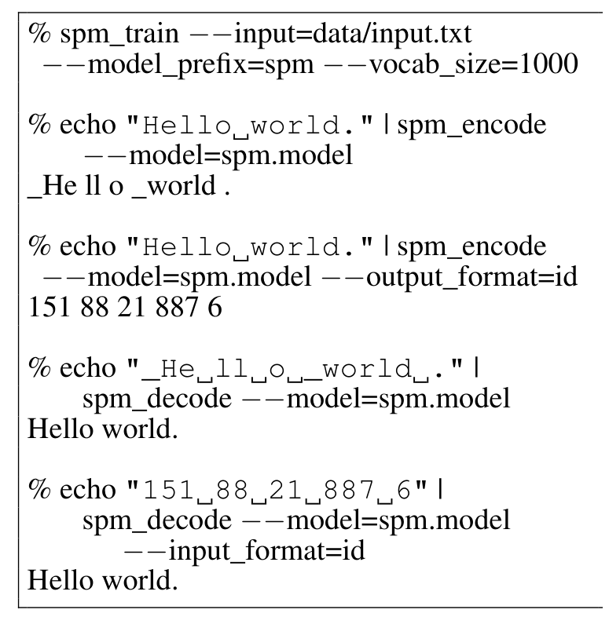
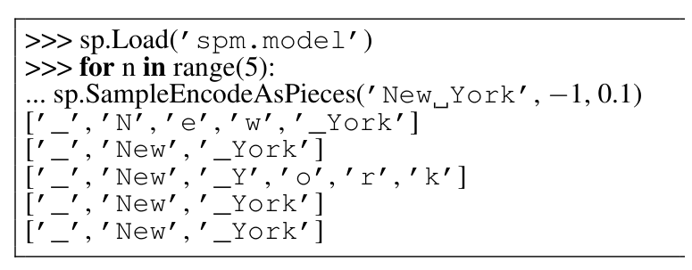

# SentencePiece 把文本规范化、分词和 ID 映射装进同一个模型

假设训练用脚本把 "Hello world." 变成 [Hello, world, .]。推理时用户输入原始文本，模型输出三个 ID。反分词器只看到三个词元，它并不知道句号之前原本没有空格。英语可额外写标点规则，换成「こんにちは世界。」则还要处理日文分词与拼接。问题同时出现在训练语料的准备、模型输入和生成文本的恢复。SentencePiece 的做法是让同一份模型保存足以重做这些步骤的规则与词表。

## 用空白标记还原规范化输入

从原文的 Hello world. 出发，训练器先规范化语料，再从规范化字符序列学习 BPE 或 unigram 模型。该模型固定后，编码器用同一套规范化规则。例如概念上把词间的空格写成 ▁，就能得到 [Hello, ▁wor, ld, .]。把片段接起来，再把 ▁ 还原为空格，可重建没有句号前空格的字符串。原文 §3.1 将关系写成 $D(E(N(x)))=N(x)$，分别表示解码、编码和规范化。输入里的全角字母可能在 $N$ 中被折叠，因此等式右边是规范化文本。遇到未知字符时还需看具体编码配置，不能从等式直接推断任何输入都能逐字节逆转。

作者原图 1（Taku Kudo、John Richardson，EMNLP 2018，固定 PDF 第 2 页）。第一段训练产生 spm.model，随后同一句可编码成子词文本或 151、88、21、887、6 这组 ID。两种形式经解码后都是 Hello world.。图中的下划线在论文叙述中表示空白标记 U+2581。训练与部署要使用相同模型文件，ID 串单独没有还原文本所需的词表。

## 固定词表的 ID，允许训练切分变化

编码阶段既可返回字符串片段，也可经词表映射直接返回 ID。有了 ID，翻译模型才能查嵌入、在目标端以交叉熵学习预测目标词元。生成时先得到目标 ID，再用解码器还原文本。翻译监督来自平行句对，训练分词器只使用原始或已预分词文本的统计。多语模型可以把源、目标文本放一起学习，并保留 <2ja> 一类虚拟词元。跨模型仅凭 ID 相同无法判断词元身份。

Unigram 分词在固定词表中考虑多种切分，每段由其词元概率贡献。对 New York，可以采样 [▁, New, ▁York]，也可以抽到 [▁, N, e, w, ▁York]。训练中即时采样让同句对应不同 ID 路径，这是子词正则化的使用方式。标准确定性编码仍可用于固定输入管线。相比之下，[BPE 原论文](../SRC-BPE/阅读笔记.md)按频率学一套有序合并操作。两者在同一工具中可选。

作者原图 6（固定 PDF 第 5 页）。每次 SampleEncodeAsPieces 调用都用同一份 spm.model 和同一个输入。变的是分词路径，输出的每个片段仍来自固定子词模型。抽到同一个切分也正常。

对 BPE 切分，论文对比每轮重扫相邻对的 $O(N^2)$ 与用堆维护合并候选的 $O(N\log N)$，这里 $N$ 是输入句或词的符号长度，训练整份语料的耗时要另看实测。模型文件还保存预编译的规范化有限状态转换器、切分参数和保留 ID。NFKC 规范化使用最左最长匹配，论文脚注明确未实现完整 CCC 重排序。这样同一模型文件定义了预处理规则，降低工具版本或命令行参数变化带来的口径漂移。

## KFTT 中省掉预分词的条件

论文用英语、日语维基百科句对，训练集 44 万，开发与测试各 1166、1160 句。主实验使用 GNMT 与 unigram SentencePiece，预分词对照使用 Moses（英语）和 KyTea（日语），按区分大小写的 BLEU 评价，日语输出在算分前仍用 KyTea。直接从原始句学习的 8k 共享子词，相比 80k/80k 词级基线，日译英为 29.55 对 28.24，英译日为 21.62 对 20.06。对比相同 8k 配置加预分词，日译英 29.85 略高，英译日 20.86 较低。表 1 比较的是这些设置，效果还受词表大小、语言和评估切分影响。

表 2 用 16k 词表、BPE 和 Xeon 3.5 GHz CPU 对比运行时间。原始日语切分 216.2 秒对 5.9 秒，按表为约 36.6 倍，正文写约 380 倍，口径不一致。日文预分词还要额外 24.6 秒。判断收益时应对比相同语料、配置与计时边界。

## 原文与中文 PDF

[正式原文 D18-2012](https://aclanthology.org/D18-2012.pdf)｜[词表、ID 与权重共享](../../知识库/概念/词表嵌入与权重共享.md)｜[私有备份下载说明](../../文档/工具/中文PDF发布.md)。

正文 §1–5、图 1–6 与表 1–2 已对照固定版。中文翻译以相应 arXiv 作者源码为排版基础，保留示例代码、公式、数值、参考文献，另加速度数字差异译注。未运行原论文实验。
