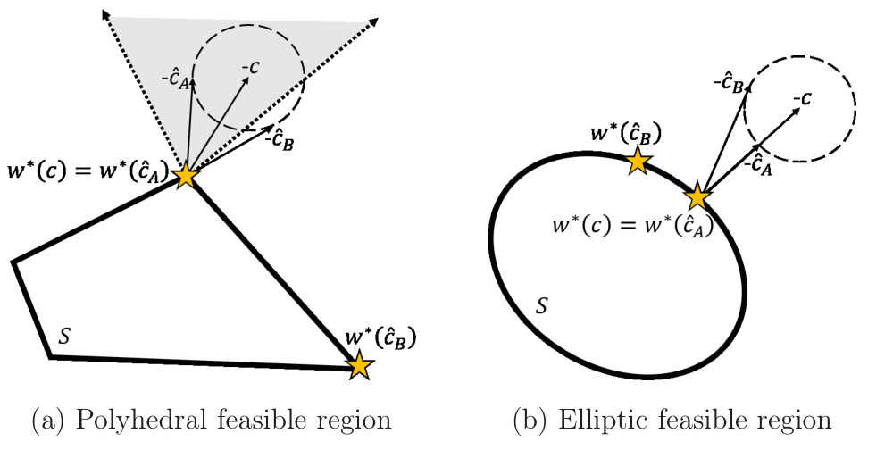
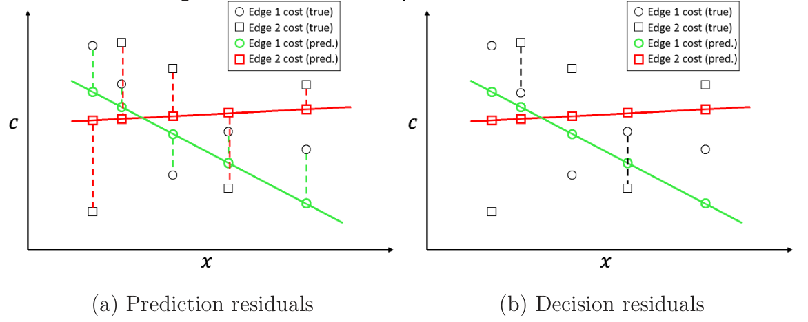
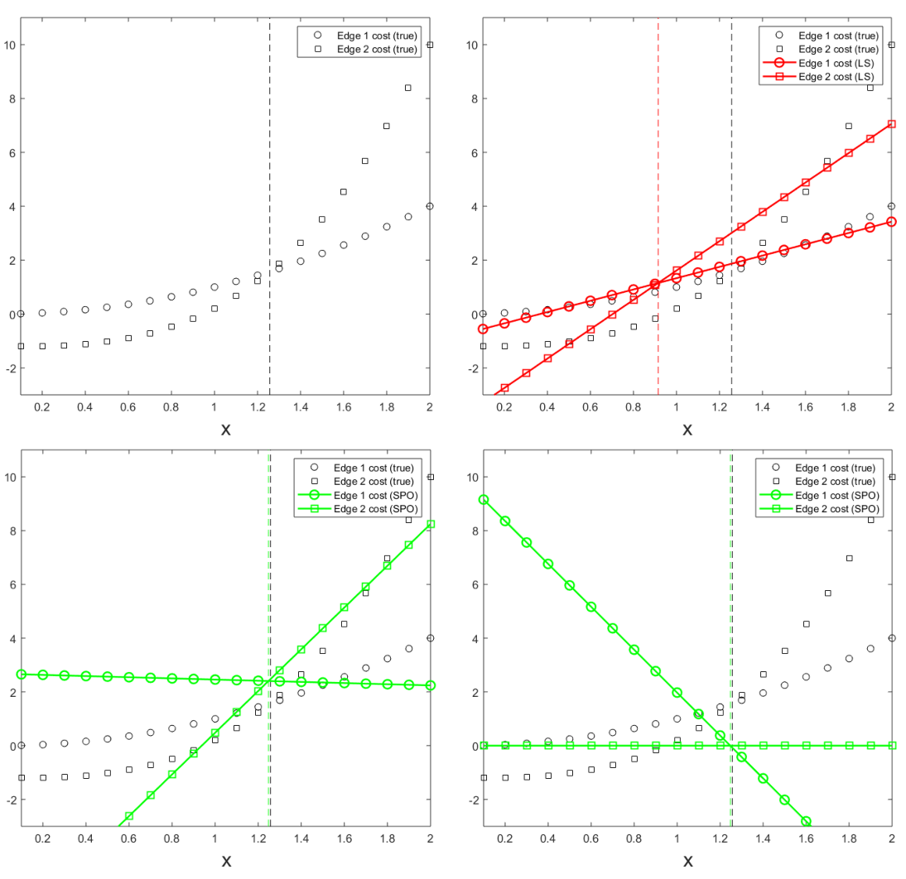

# SPO+ 怎样学习会改变最优决策的预测误差

最短路径的两条边真实成本为 \(c=(2,3)\)。预测 A 为 \((2.8,2.7)\)，均方误差为 0.365，求解器选第二条边，真实成本多付 1。预测 B 为 \((1,4)\)，均方误差为 1，求解器选第一条边，没多付成本。SPO 直接度量选中这条路径产生的额外成本。SPO+ 用一次扰动后的求解找出最该纠正的可行决策，从而对预测给出可优化的损失。 [arXiv v5 §2–3](https://arxiv.org/pdf/1710.08005v5#page=9)

Elmachtoub 与 Grigas，v5 第 11 页图 1，从采用版 PDF 裁出。负成本向量的方向决定最小值所在的支撑点。左图多面体同一个顶点能在一整个方向锥上最优，右图椭圆的支撑点随方向改变。 [v5 图 1](https://arxiv.org/pdf/1710.08005v5#page=11)

## 用预测挑决策，再用真实成本计账

训练样本为 \((x,c)\)，每个 \(c\) 包含该实例的完整成本向量。部署只能拿到 \(x\)，由模型得到 \(\hat c=f(x)\)，再令 \(w^*(\hat c)\) 最小化 \(\hat c^\top w\)。设已知可行集 \(S\) 非空、紧致，且不随预测中的 \(c\) 变化。对给定求解器的 SPO 损失为 \(c^\top w^*(\hat c)-z^*(c)\)，其中 \(z^*(c)=c^\top w^*(c)\)。论文还定义对破平局规则稳健的版本，在预测最优解集合 \(W^*(\hat c)\) 中取最大的真实成本。当两条边预测相同，最坏情况下依旧多付 1。按有利的真实成本破平局会让“所有成本预测都为零”虚假得零损失。 [v5 §2、定义 1–2](https://arxiv.org/pdf/1710.08005v5#page=12)

Elmachtoub 与 Grigas，v5 第 13 页图 2，从采用版 PDF 裁出。左边逐点看预测与标签之差，右边只在预测交换了优劣顺序的样本处计真实差额。 [v5 图 2](https://arxiv.org/pdf/1710.08005v5#page=13)

二分类特例中，令 \(S=[-1/2,1/2]\)，真实成本为 \(c\in\{-1,1\}\)。当 \(\hat c\) 与 \(c\) 同号，预测解与真实解相同，损失为 0。异号时两个解在区间两端，损失为 1。若 \(\hat c=0\)，按定义 2 取最坏破平局，损失也是 1。v5 §3 正文和命题 1 的指示式印成 \(\mathbf 1\{\operatorname{sgn}(\hat c)=c\}\)。附录 B.1 的三种情形与“不等于”的指示条件一致。 [v5 命题 1](https://arxiv.org/pdf/1710.08005v5#page=13) · [v5 附录 B.1](https://arxiv.org/pdf/1710.08005v5#page=38)

## 一次扰动求解怎样得到预测梯度

直接用 SPO 时，只要预测尚未跨过两条边的交换边界，当前后悔为常数。在边界处可跳变。论文用 \(h_S(d)=\max_{w\in S}d^\top w\) 构造凸上界
\[
\ell_{\mathrm{SPO+}}(\hat c,c)=h_S(c-2\hat c)+2\hat c^\top w^*(c)-z^*(c).
\]
对任何预测最优 \(w\)，都有 \(\hat c^\top w\le\hat c^\top w^*(c)\)，所以右边至少为 \(c^\top w-z^*(c)\)。次梯度为 \(2[w^*(c)-w^*(2\hat c-c)]\)。真实最优解可为训练实例预先求出，更新时求解扰动后的成本 \(2\hat c-c\)，再把这两个决策向量之差反传。 [v5 §3.2、定义 3 与推论 2](https://arxiv.org/pdf/1710.08005v5#page=19)

沿用预测 A，扰动成本为 \((3.6,2.4)\)，仍选第二条边。次梯度 \(2[(1,0)-(0,1)]=(2,-2)\) 把第一条边预测降下来、第二条抬上去。代入得 SPO+ 为 \(1.2\)，大于真实决策后悔 1。预测 B 的扰动为 \((0,5)\)，仍选第一条，损失和次梯度为零。线性成本与相同可行集让一次扰动查询可复用原求解器。候选券的预测成本进入总预算约束时，可行域也会变，需要额外建模。 [v5 §3.2 与 §5](https://arxiv.org/pdf/1710.08005v5#page=19) · [反事实预算场景中的 DFCL](../SRC-DFCL/阅读笔记.md) · [决策导向损失比较](../../知识库/问题/决策导向损失怎样训练预算分配的预测器.md)

Elmachtoub 与 Grigas，v5 第 15 页图 3，从采用版 PDF 裁出。垂直线标两条边的预测成本交点。对最短路径而言，把交点学到真实交换位置比追求每条曲线的点误差更直接。 [v5 图 3](https://arxiv.org/pdf/1710.08005v5#page=15)

## 一致性、模型错设与实际代价

v5 定理 1 假定条件分布关于 \(E[c\mid x]\) 中心对称，在全空间连续，可行集有非空内部，且均值成本几乎处处有唯一最优解。在无约束的可测预测函数类中，SPO+ 的风险最优预测为条件均值，也最小化 SPO 风险。最小二乘在该函数类也学习条件均值。用线性模型拟合高阶成本就可能偏离该结论的理想函数类。合成最短路实验在固定线性预测器、较高生成多项式阶数时，SPO+ 决策后悔通常更低。低阶带噪声的设置下最小二乘略占优，训练集到 5,000 时随机森林在若干高阶设置表现接近。这里评估的是独立测试集的归一化 SPO 后悔。 [v5 §4 定理 1、§6.1 图 4](https://arxiv.org/pdf/1710.08005v5#page=28)

## 版本与译本

Adam N. Elmachtoub、Paul Grigas。采用 arXiv v5，复核正文与一致性证明相关附录，未运行模型。中文 PDF 共 34 页。摘要、正文 §1–7、致谢、命题与正文图说明。保留原文公式及编号，解释 0–1 损失的印刷疑点。图内文字、参考文献与附录保留原文。译本已逐页渲染核对，采用原文与译本均完成私有备份和认证下载校验。 [中文 PDF 私有下载说明](../../译文/PDF目录.md) · [固定作者稿](https://arxiv.org/pdf/1710.08005v5) · [Management Science DOI](https://doi.org/10.1287/mnsc.2020.3922)
