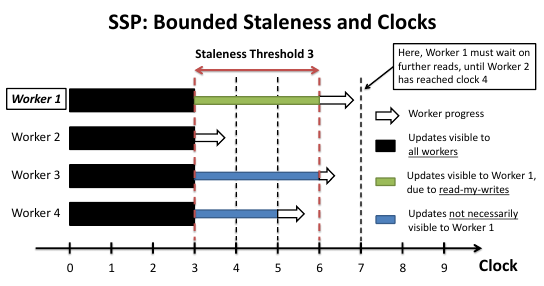
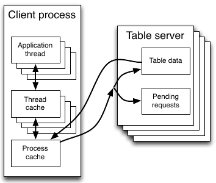
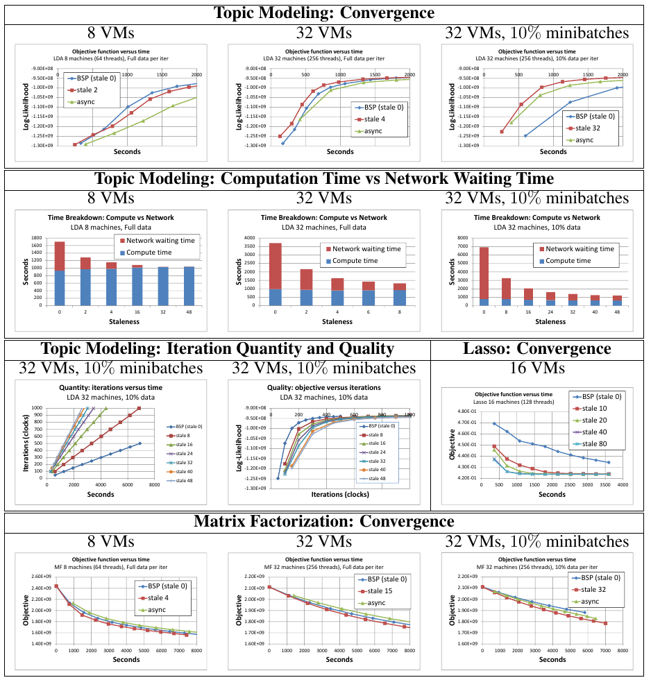

# SSP · 让慢工作者少等一轮网络

在分片参数表上，两个工作者可能同时学习同一个物品的向量。BSP（批量同步并行）要等这一轮所有工作者的更新齐备，下一轮才取值。完全异步可以直接向分片读写，快工作者可能已经训练多轮，慢工作者仍用很早取出的参数计算梯度。Ho 等提出的 SSP（陈旧同步并行）给各工作者留出有限的进度差，再用这个差值定义读操作必须纳入哪些更新。因此可以复用符合新鲜度要求的缓存，也能说明最迟何时必须看到先前的写入。

## 在时钟 6 读同一个物品向量

原文的共享状态 $x$ 以可交换、可结合的加法更新 $x\leftarrow x+u$ 为单位。设 $p$ 是工作者、$c$ 是它当前的整数时钟。工作者在时钟 $c$ 结束时提交的一批增量记作 $u_{p,c}$。以物品键 $i$ 的向量一维作教学例，初始值为 0.20，时钟 $0$ 至 $3$ 的全部增量合计 $+0.08$。现在工作者 A 在时钟 6 请求该行，允许陈旧阈值 $s=2$。它的读取由以下三部分组成。

- 所有人截至 $c-s-1=3$ 的更新，因此读出必含基准的 0.28。
- A 自己在时钟 4、5 的更新。若二者合计 $+0.03$，即使近期没有远端读，也要看到 0.31。
- 其他工作者在窗口 $[4,7]$ 中已经提交的更新属于尽力提供范围。若工作者 B 已提交其中一项 $-0.02$，且该条对 A 可见，A 的读数可以是 0.29。此处 B 也不可能同时是还停在时钟 4 的工作者，因为它在时钟 4 完成后才提交这一项。若 B 仍在时钟 4，A 可以按当前视图计算，但不能先于 B 进入时钟 5 而完成时钟 7 所需的读取。

阈值 $s$ 的单位是算法定义的时钟，不是毫秒，也不是单键的更新计数。公式的窗口上端为 $c+s-1$，因为其他工作者也可能比请求方快。$s=0$ 时，窗口为空，所有人进入时钟 $c$ 时都看见通过 $c-1$ 的更新，退化为 BSP。以上数字是教学构造，论文 §2.1 的 SGD 示例按用户行划分评分矩阵及用户因子，只共享物品因子 $R$。

作者原图，Ho 等，NeurIPS 2013 图 1，PDF 第 3 页，按图框裁取。图内配置是 $s=3$，横轴为工作者时钟。黑色代表所有人必见的较旧更新，绿色是工作者 1 已写入、自身一定能见的更新，蓝色是工作者 1 未必能见的其他工作者的更新。图右的等候点由最慢者的进度决定。[原文 §2](https://proceedings.neurips.cc/paper_files/paper/2013/file/b7bb35b9c6ca2aee2df08cf09d7016c2-Paper.pdf#page=3)。

## 缓存行存值，也存达到的时钟

仍看 A 在时钟 6 读物品 $i$。若线程缓存对 $i$ 持有行时钟 $r_{\mathrm{thread}}=4$，满足 $r_{\mathrm{thread}}\ge c-s=4$，可直接读。线程缓存未命中或只有时钟 3 时，检查机器内共享的进程缓存。两级都达不到阈值才查持有该行的服务端分片。服务端以所有线程时钟的最小值表示已经覆盖的数据进度，响应时附上该时钟。自己的写入立即进入线程缓存，调用 `clock()` 时刷新到进程缓存和服务端。快线程触及陈旧上限时可能每轮都访问服务端，慢线程的本地视图则常还能复用。缓存减少的主要是远端读，写回仍须进行。

作者原图，Ho 等，NeurIPS 2013 图 2，PDF 第 4 页，按图框裁取。客户端进程内有多个应用线程和可选的线程缓存，再由共享进程缓存发往多个表分片。该图讲存放位置，真正保证新鲜度的是逐行时钟和读请求的阈值判断。[原文 §3](https://proceedings.neurips.cc/paper_files/paper/2013/file/b7bb35b9c6ca2aee2df08cf09d7016c2-Paper.pdf#page=4)。

## 每分钟多走几步，每一步可能更不准

原文 §4 用参考顺序累加实际发生的加法更新，再用“缺少哪些更新”和“多看到哪些更新”表示工作者视图相对参考状态的偏差。在该窗口模型中，引理 1 给出两类差异的总数上界 $2s(P-1)$，其中 $P$ 为工作者数。定理 1 对凸分量、梯度范数有界、优化域直径有界并取特定递减步长的 SGD，给出随 $\sqrt{(s+1)P/T}$ 缩小的平均目标差界，附录证明还要求 $T$ 足够大。该界针对以工作者视图计算的平均损失，不能直接解释为每个工作者的每个向量按同样速率收敛，也不覆盖任意异步自适应优化器或任意非凸网络。[原文 §4](https://proceedings.neurips.cc/paper_files/paper/2013/file/b7bb35b9c6ca2aee2df08cf09d7016c2-Paper.pdf#page=5)。

作者原图，Ho 等，NeurIPS 2013 图 3，PDF 第 8 页，按图框裁取。第一行是主题建模按时间的收敛，第二行拆出计算与网络等待，第三行前两格分别按秒计迭代量和按迭代计目标进展，第三格是 Lasso，末行为矩阵分解。作者在 New York Times 主题建模、32 台虚拟机、每时钟使用 10% 数据的配置报告，BSP 网络等待约为计算时间的六倍，$s=32$ 时约为一比一。8 台虚拟机的主题建模有例外，Lasso 没跑完全异步对照。不同任务和批量下时钟的工作量不同，$s=32$ 不能直接作为推荐嵌入训练的默认值。这里测的是达到给定训练目标的用时，部署后的效果需另行验证。[原文 §5 和图 3](https://proceedings.neurips.cc/paper_files/paper/2013/file/b7bb35b9c6ca2aee2df08cf09d7016c2-Paper.pdf#page=6)。

## 原文与译本

采用 NeurIPS 2013 正式会议 PDF，9 页，精读覆盖摘要、§1–6、图 1–3，并核对正式补充材料附录 A–B 的静态划分、扩展实验与定理证明。§4 式 (2) 的窗口前项写作从时钟 1 起，紧接的文字说明从 0 起，译本保留并标注该编号差异。中文 PDF 15 页，摘要、正文、图注、脚注和致谢译为中文，参考文献、图内标签及附录 A–B 保留英文。译文保存在本地论文目录，原文和中文 PDF 已通过私有附件的认证下载核验。见[访问说明](../../译文/PDF目录.md)。问题对照见[稀疏参数分布式训练怎样控制读写陈旧](../../知识库/问题/稀疏参数分布式训练怎样控制读写陈旧.md)。[会议页与正式补充材料入口](https://proceedings.neurips.cc/paper_files/paper/2013/hash/b7bb35b9c6ca2aee2df08cf09d7016c2-Abstract.html)。
