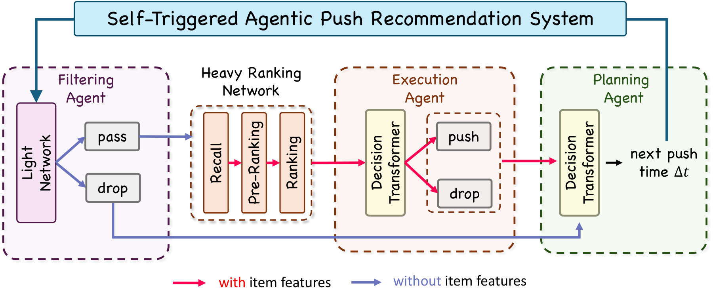
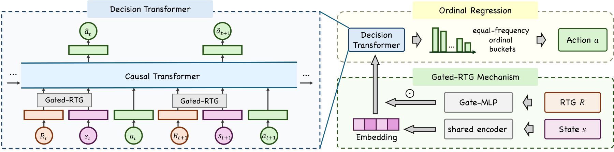
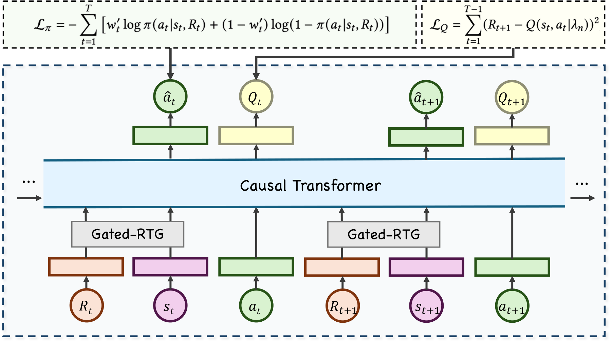
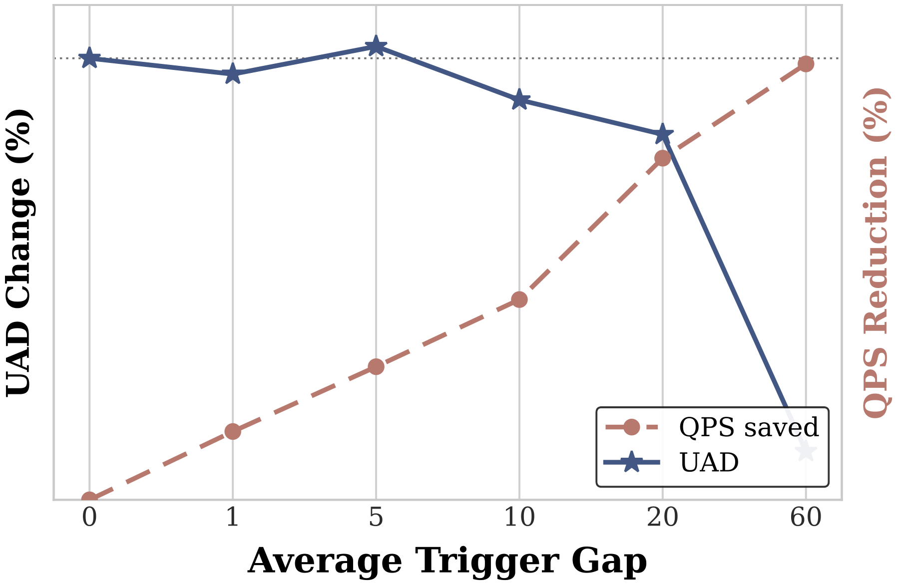

# STEPS：把下一次调用时间交给推送系统决定

固定间隔推送系统在每一轮读用户状态、召回候选、估值排序，再决定发不发。若大多数轮次都没有值得发的内容，排得更密主要增加排序成本。把次数和时间提前排好能减少调用，但当天的活跃、内容和事件还没有发生。STEPS 在每次触发时输出两个结果：本轮是否发送，以及隔多久再调用系统。它还保留直播开播等业务触发，并在重召回和排序前过滤低价值请求。[固定 v1 §1、§3](https://arxiv.org/pdf/2608.01949v1#page=2)

作者图 2，Zhao-Yu Zhang、Qingying Chen、Chunyuan Zheng 等，arXiv v1 第 3 页，源码原图转 PNG。先看下一次时间从哪里来，再看过滤怎样决定是否进入带物品的执行阶段。图中蓝线说明被过滤的请求仍会交给规划器，使用的是不含物品的特征。状态可包含用户、当前时刻、上次推送时刻，以及可用时的物品特征。两个代理共享底层嵌入。

## 把回报条件变成下次唤醒时间

用一个贯穿算例。某会员午后一直没打开应用，系统现在有机会调用。即使执行代理此次不发，规划代理仍预测下一次调用的间隔。规划器用 RTG 提示来体现希望实现的后续目标。正向奖励与活跃有关，负向奖励与关闭推送权限有关，原文把两者合成 $R_t=\sum_{j=t}^{T}(r_j^+-\lambda_n r_j^-)$。训练时从 $U(0,1)$ 采样负向惩罚权重 $\lambda_n$，推断时可调节权重以改变取舍。原文未披露生产环境给不同用户选取目标 RTG 的完整规则。

简单拼接会让高维状态盖过一维回报。STEPS 让 MLP 把回报映射成向量，再逐维乘状态嵌入。这会改变原本同一个用户状态进入解码器时各维的大小。解码器学习的是超过每条时间边界的概率。用三条边界 20、60、120 分钟演示，假设概率为 0.80、0.45、0.10，则预测间隔为 $20\times0.80+40\times0.45+60\times0.10=40$ 分钟。每项的权重是时间段宽度，概率乘宽度是在近似对尾概率曲线积分。日志若记下 45 分钟的间隔，三条边界的 BCE 标签依次是 1、0、0。实际方案按历史分布设 100 个等频桶，使密集的短间隔区域有较细分辨率。各桶在原文中分别计算 BCE，文中未说明如何强制预测概率随边界递减。这个解码值是 40 分钟后再判断，届时可以仍然不发。[原文 §3.1–3.2、§4.3](https://arxiv.org/pdf/2608.01949v1#page=3)

作者图 3，采用版第 4 页，源码原图转 PNG。左侧先注入 RTG 与状态，右侧编码和解码超边界概率。图 5 的离线检验把同一批状态的低 RTG 与高 RTG 下平均预测间隔做比。拼接基线约为 1，门控约为 1.8，证明在测试的两个提示值上平均输出会变化。比值本身不能说明每个用户都沿同一方向响应，更不能解释为实际回报的因果提升。

## 让价值评估纠正日志动作

40 分钟后，执行代理读取新的上下文。若会员仍未活跃，发送与不发送都要参与比较。正向奖励在转为活跃的区间记作 1，其他区间为 0，已活跃状态的后续正向 RTG 归零。作者用 Bellman 式的自举回报引导评估器，降低直接拟合旧策略观测回报的依赖。原文写出 $Q=Q^+-\lambda_nQ^-$，以 $R_{t+1}$ 监督当前日志动作的 $Q$，训练结束后的策略由条件动作头输出。若日志是“不发”，但示例里发的合成价值 0.08、不发为 0.03，取 $\alpha_r=20$，原文的权重给“不发”约 $\sigma(-1)=0.27$，二值交叉熵中的另一项则占 0.73。它在训练时使用两个动作的价值差，梯度不通过这个权重回流。这个数值例子只演示损失。旧日志缺乏动作覆盖时，未观测动作的 $Q$ 仍可能失真。论文也未给训练在何处显式校正这种偏差。[原文 §3.3](https://arxiv.org/pdf/2608.01949v1#page=5)

作者图 4，采用版第 5 页，源码原图转 PNG。按原文写法，$R_t^+$ 的自举项取同下标状态 $s_t$，$Q(s_t,a_t)$ 的回归目标却是 $R_{t+1}$，标准一步目标中的当前奖励和折扣怎样与日志索引对齐并不明确。负项说用相同方法，缺少单独的动作选择方向和终止规则。若两个奖励头分别取最大值，再相减，通常无法等价于以同一动作最大化正减负的合成价值。这些是原文复现边界。后续线上结果可以评价文中部署方案，不能据此唯一恢复目标函数。

## 过滤节省的是哪条重链路

若等待期间关注的创作者开播，系统仍可以提前收到业务事件。轻量过滤器先读取用户和环境，不触发物品召回。刚成功送达一次推送或用户刚自然活跃时，分钟级硬窗口抑制下游。除此之外，三层 MLP 用重执行代理蒸馏所得的判断拦截请求。通过才触发昂贵的候选排序与执行决策。表 6 中执行每千请求计算成本为过滤的 **57.72 倍**，总体成本则为 **9.62 倍**，两者请求分母不同。表 7 相对不过滤报告截断率 **74.88%**，相对随机过滤是保持最终发送量后的另一个对照。论文表 2 也报告过滤器的资源消耗 −74.88%，不能把请求比例与成本比例在其他负载下直接等同。[原文 §3.4、§4.5](https://arxiv.org/pdf/2608.01949v1#page=8)

作者图 8，采用版第 8 页，源码原图转 PNG。双轴分别是 UAD 变化和排序 QPS 降幅。平均触发间隔增加到约 20 分钟时活跃下降较小，到约一小时后损失扩大。具体阈值与平台事件分布、重链路成本有关。

## 线上结果与其他推送接口如何比较

抖音 14 天设备随机 A/B，表 1 各数均相对预规划频次生产基线。固定间隔 DT 的 UAD −0.0670%、NE +0.0205%、资源 +6.548%。STEPS 为 UAD **+0.2843%**、NE **−1.9089%**、资源 **−79.42%**。NE 在实验节定义为关闭推送权限的用户数。表 2 分别报告规划对应 +0.1808% UAD、执行对应 +0.1035% UAD、过滤对应 −74.88% 资源，实验节缺少完整的因子组合与置信区间。论文把大部分节省归给过滤，无法把总降幅视为独立替换时间解码器的效果。表 5 的 −6.87% 属于每日发送 21–30 次这一档，正文写成“超过 20 次”，缺少两档基数无法得到合并值。[原文 §4.1–4.2 表 1–2、§4.4 表 5](https://arxiv.org/pdf/2608.01949v1#page=6)

[通知候选到达后怎样决定发送或等待](../../知识库/问题/通知候选到达后怎样决定发送或等待.md)比较不同方法谁提供决策点。TIM 先给定每日配额再安排时槽，LinkedIn 通知 DT 在外部给定的决策点用回报提示选发送动作，STEPS 还把未来调用时刻作为输出。在线接事件的数据、评估开始时间与资源口径不同，三个实验的百分点无法直接排序。

## 原文与阅读范围

采用 [arXiv:2608.01949v1](https://arxiv.org/abs/2608.01949v1) 固定版与配套源码，核对摘要、§1–5、8 图 7 表。线上数据与模型未经复现。7 页中文 PDF 覆盖摘要、正文、脚注、致谢和图表标题，图内英文和参考文献保留。译后工程使用 ACM 双栏，保留原作者、DOI 和 CC BY 4.0 声明。存取见[本批交接](../../文档/会话/PAPER-022.md)。[RecSys 2026 DOI](https://doi.org/10.1145/3773078.3831932)
