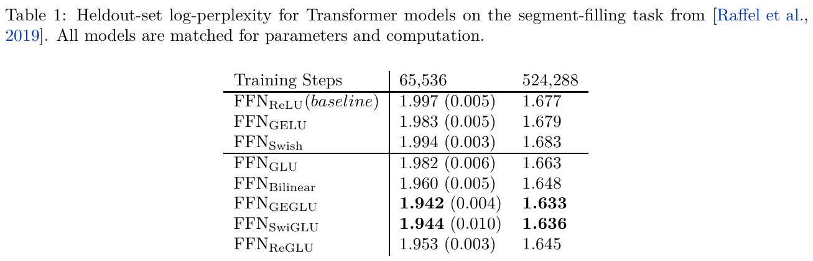

# GLU 变体改进 Transformer：用两路投影决定保留哪些特征

Transformer 的自注意力先把上下文汇到当前位置，逐位置前馈网络（FFN）再变换这条向量。原始 FFN 的每个隐藏通道只计算一次线性投影，然后独立激活。Shazeer 的问题是，若一个通道由两路投影共同确定，在相同矩阵参数预算下是否能学到更好的表示？论文将已有门控线性单元（GLU）及其变体放到 T5 前馈层，用相同的去噪预训练和下游微调比较它们。

## 从一次激活到同一通道两路相乘

以 T5 的片段填空为例。把「明天 去 公园」中的「公园」替换成一个哨兵 Token，解码端从已知前缀输出被挖掉的片段。假设预测「公园」的位置经过自注意力与交叉注意力后，进入某层 FFN 的向量简化为 $x=[2,-1]$。这是教学输入，真实 T5 所用哨兵、序列格式与解码监督见 [T5 精读](../SRC-T5/阅读笔记.md)。

先看普通无偏置 ReLU FFN。假设 $xW=[2,-1]$，激活后为 $[2,0]$，再由降维矩阵投影回模型宽度。第一个隐藏量完全取决于投影值 2。即使这行向量还投影出另一个有用特征，两个隐藏量也只是各自激活，再由降维投影线性组合。

式 (6) 改在降维前相乘。SwiGLU 用独立矩阵 $V$ 得到值支路 $xV$，再逐通道乘以 $\operatorname{Swish}_1(xW)=(xW)\odot\sigma(xW)$。若同一 $x$ 在值支路得到 $[3,4]$，则两路乘积约为 $[5.285,-1.076]$。设教学例子的 $W_2=I$，输出也就是这个向量。第一通道同时取决于「激活端看到 2」和「值端看到 3」。第二通道在 ReLU 例子里归零，在 SwiGLU 里保留自带负号的值。门控一词描述的是逐通道调制，Swish 输出可以为负或大于 1。其他变体可在[逐位置前馈层的门控与宽度](../../知识库/概念/逐位置前馈层的门控与宽度.md)里按同一个接口比较。[固定版 §1–2，式 (1)–(6)](https://arxiv.org/pdf/2002.05202v1#page=1)

该输出回到 Transformer 的残差通路和后续子层，解码端从最终状态计算实际目标 Token 的词表交叉熵。FFN 沿用这一监督。若一个隐藏通道从下游收到梯度 $g$，它的值支路梯度乘以当前的 Swish 输出，激活支路梯度乘以当前的值和 Swish 导数，两个投影都能从同一个预测误差学习。推理时沿用训练好的三个矩阵，每个位置在可见上下文的状态上做相同的逐通道乘法。位置间读取仍由注意力负责。

## 用宽度补偿第三个矩阵

两个上投影均为 $d_{\mathrm{model}}\times d_g$，下投影为 $d_g\times d_{\mathrm{model}}$。忽略偏置和逐元素运算，主矩阵参数与单 Token 的矩阵乘加量都随 $3d_{\mathrm{model}}d_g$ 变化。普通 FFN 的对应量为 $2d_{\mathrm{model}}d_{\mathrm{ff}}$。论文把 T5 Base 的普通隐藏宽度 3072 缩成 2048，固定 $d_{\mathrm{model}}=768$，两边每个 FFN 都有 4,718,592 个矩阵参数。逐元素乘法、激活和实际中间张量仍随实现变化，预算对齐本身不能给出设备耗时。[固定版 §2、§3.1，第 2 页](https://arxiv.org/pdf/2002.05202v1#page=2)

## 实验比较了哪些质量变化

Noam Shazeer 的作者表 1，固定原文第 2 页。原文没有架构图，用式 (4)–(6) 定义计算。表中两列分别是 65,536 和 524,288 个预训练步，括号值来自短跑的跨运行波动，长跑列未报告对应波动。比较同为 C4 片段填空、同训练预算的列，长跑中普通 ReLU 为 1.677、只换 Swish 的普通 FFN 为 1.683、Bilinear 为 1.648、SwiGLU 为 1.636、GEGLU 为 1.633，指标为越低越好的对数困惑度。只换激活没有得到同一收益。门控与激活一起变化的对照支持这种组合在此设置下有效，尚不能解释其普遍优化原因。[表 1 与 §3.2，第 2–3 页](https://arxiv.org/pdf/2002.05202v1#page=2)

微调对每个完整预训练的模型做一次混合训练，各任务报告开发集上的最佳检查点。GLUE 平均分以 ReGLU 的 84.67 最高，SwiGLU 为 84.36。SuperGLUE 平均分以 SwiGLU 的 74.56 最高，SQuAD v1.1 的 F1 则以 ReGLU 的 91.18 最高。原 T5 的单任务微调和预训练 dropout 配置与本文对比不同。表底的历史 T5 数值可作参照，归因应以本文同协议的各行比较为主。[固定版 §3.3，表 2–4，第 3–4 页](https://arxiv.org/pdf/2002.05202v1#page=3)

核对固定版摘要、正文、六式、四表和脚注。中文 PDF 覆盖正文、脚注及表标题，参考文献保留原文。采用固定版 LaTeX 副本和 XeLaTeX 编译四页译文并逐页目视核验。实验结果来自论文，未运行作者实现。[固定原文](https://arxiv.org/pdf/2002.05202v1) · [中文 PDF 访问说明](../../文档/工具/中文PDF发布.md)
