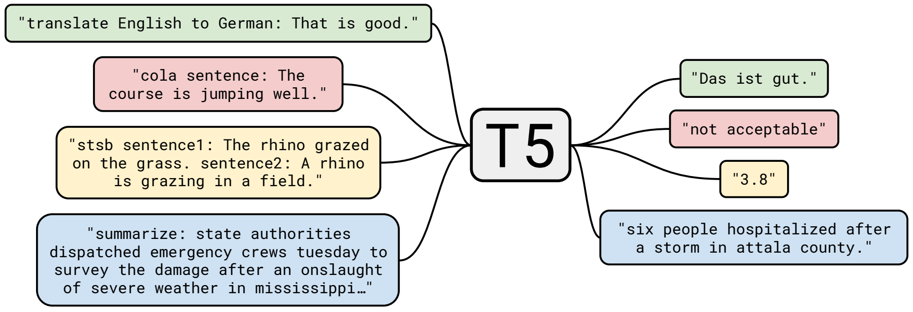
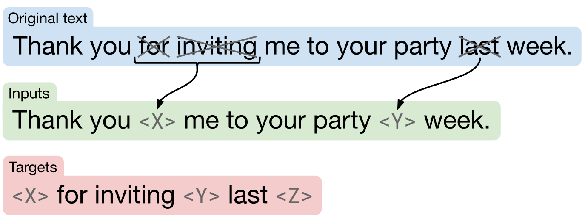
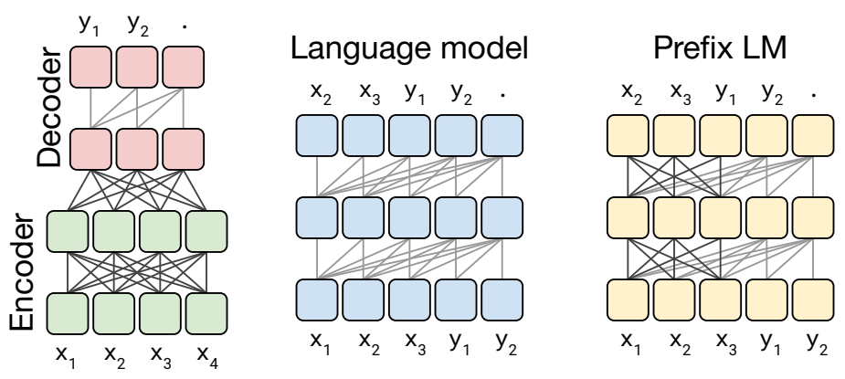
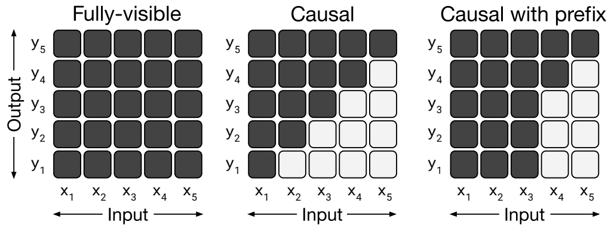
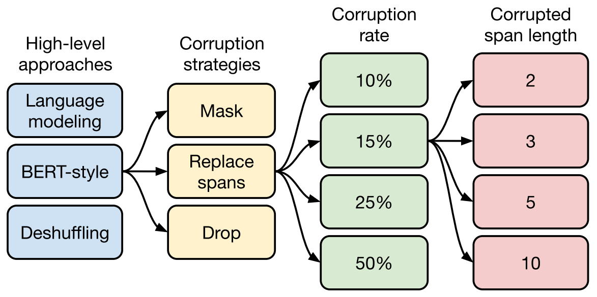
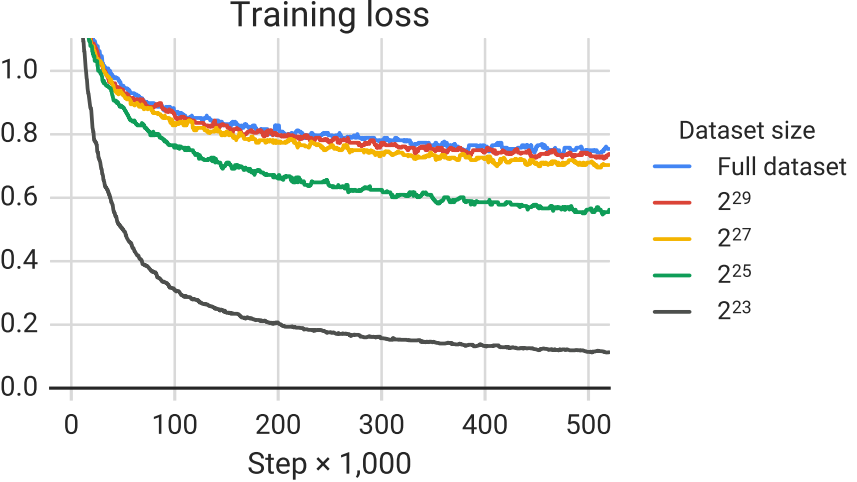

# T5：双向理解条件，因果生成答案，再用统一接口研究迁移

[固定v4原文](https://arxiv.org/pdf/1910.10683v4) · [中文PDF与阅读范围](#原文与译文) · [私有备份下载说明](../../文档/工具/中文PDF发布.md) · [GPT／BERT／T5迁移比较](../../知识库/问题/预训练怎样迁移到不同任务.md#t5将损坏恢复与下游任务都写成条件文本生成)

分类输出类别，抽取式问答输出位置，翻译与摘要输出变长文本。如果每换一种任务就更换输出头、损失和处理流程，预训练方法的效果也会与这些适配选择混在一起。T5把这些任务写成“条件文本 → 目标文本”，让双向编码器理解条件，让因果解码器生成答案，以同一种Token交叉熵训练，再系统比较结构、去噪目标、语料、迁移与规模。它提供的是统一接口及一组受控研究；作者没有将其中全部构件宣称为首创。

Colin Raffel、Noam Shazeer、Adam Roberts、Katherine Lee、Sharan Narang、Michael Matena、Yanqi Zhou、Wei Li、Peter J. Liu的 *Exploring the Limits of Transfer Learning with a Unified Text-to-Text Transformer*，2019年首发，JMLR 21(140), 2020。采用1910.10683v4（2023-09-19修订）的67页PDF。下文实验均为作者报告，未运行模型复现；表14“此前最优”截至2019-10-24。

## 从BERT和GPT走到同一种任务接口

以原文的翻译样本为起点：给定英语 `That is good.`，要求输出德语 `Das ist gut.`。GPT式模型可以把任务说明、原句和答案接在一条序列上继续预测；但纯因果结构中，输入原句较早位置的状态不能读取其右侧词。BERT能双向理解原句，却没有直接沿用其原位置MLM头生成任意长译文的接口，通常需要增加相应结构。二者不是不能处理任务，而是条件表示、输出与适配方式不同。[§2.1、2.4、3.2.1，PDF第4–5、8–10、15–18页](https://arxiv.org/pdf/1910.10683v4#page=15)。

T5将输入写为 `translate English to German: That is good.`，标签写为 `Das ist gut.`。前缀也是普通可学习的文本条件，不是切换另一套分类头的程序指令；训练样本告诉模型该怎样响应。MNLI同样写成 `mnli premise: ... hypothesis: ...`，输出 `entailment` 等标签词。因此“统一”指输入输出、词表预测和训练接口；这些任务的标签含义与评估标准仍不同，也不是仅靠前缀便获得零样本指令能力。

作者原图1，Raffel等，固定v4 PDF第3页；由未修改源码中的 `text_to_text.pdf` 整图转换，保留原标签与连线，CC BY 4.0。先看每个输入前的任务词，再看右侧输出：分类是标签文本，相似度是数字字符串，摘要是句子。图中间的T5是接口示意，没有画出内部注意力，也不表示所有主表成绩来自同一个最终检查点。

STS-B原本回归1到5的分数，本文按0.2舍入为字符串，例如2.57变成 `2.6`，形成21种离散目标。文本输出还要转回数字再评价。分类若生成不属于标签集合的文本就算错；作者未观察到这种情况，不是对任意任务的合法性保证。[§2.4，PDF第8–10页](https://arxiv.org/pdf/1910.10683v4#page=8)。

Winograd任务特别改成“标出歧义代词，生成所指名词”。WSC只在True样本训练，另加约1000条DPR样本；预测与候选名词的词集合互为包含时判True。因WNLI与WSC重叠，从不训练WNLI，也不报告其验证集；验证GLUE均分不含WNLI，最终官方测试GLUE则包含。附录B还说明WNLI测试的预处理。这些具体改写是评估条件，不能把分数当作未经修改的原始任务结果。[§2.4及附录B，PDF第9–10、45页](https://arxiv.org/pdf/1910.10683v4#page=9)。

## 把一个去噪样本展开成输入和预测标签

没有翻译或分类标注的文本怎样提供预训练监督？T5从原文拿掉一些片段，以特殊哨兵Token标出缺口，然后要求模型按次序生成缺失内容。标签直接来自被删文本，不需要另外标注；但它学习的是无标签语料中的恢复任务，不是外部正确性判定。

作者原图2，Raffel等，固定v4 PDF第13页；由源码 `objective.pdf` 整图转换，未改内容，CC BY 4.0。原句 `Thank you for inviting me to your party last week.` 删除 `for inviting` 和 `last`：输入中两段分别缩成 `<X>`、`<Y>`，输出恢复 `<X> for inviting <Y> last <Z>`。最后的 `<Z>` 标记不再有待恢复片段；这些符号对应专用词表ID，不是每个样本临时新增词表。

为把监督错位讲清，以下用更短的教学Token串；字母、概率和长度均为构造值，不是真实SentencePiece切分或T5输出，也不遵守本篇长文本的15%采样比例。把原文 `A B C D E F G` 中的 `B C` 和 `F` 删除：

- 编码器条件 $x$：`A <X> D E <Y> G`。
- 目标 $y$：`<X> B C <Y> F <Z> EOS`。
- 解码器输入 $d$：`START <X> B C <Y> F <Z>`，即目标右移一位。

`START`表示序列起始输入，`EOS`表示输出序列结束；最后的片段哨兵与EOS不是同一种标记。论文图2省略底层起止符。固定Mesh TensorFlow依赖代码的 `autoregressive_inputs` 以ID 0开始，再放入前面的目标Token；这里使用功能名START，不假定词表里有一个叫START的额外词。[§3.1.4，图2](https://arxiv.org/pdf/1910.10683v4#page=13)；[固定依赖代码的右移函数](https://github.com/tensorflow/mesh/blob/e6798a2610a2c2f4c4cd236d8214422cb1ecc00a/mesh_tensorflow/transformer/transformer.py#L1425)。该代码是本轮定向静态核查，不等于已经恢复2020年实验的完整依赖环境。

| 解码行 $t$ | 本行输入 $d_t$ | 本行可读的目标真值前缀 | 本行标签 $y_t$ |
|---|---|---|---|
| 1 | START | 空 | `<X>` |
| 2 | `<X>` | `<X>` | B |
| 3 | B | `<X> B` | C |
| 4 | C | `<X> B C` | `<Y>` |
| 5 | `<Y>` | `<X> B C <Y>` | F |
| 6 | F | `<X> B C <Y> F` | `<Z>` |
| 7 | `<Z>` | `<X> B C <Y> F <Z>` | EOS |

第三行要预测C时，输入本行是B，不能读取第四行输入C；否则就是把答案交给模型。每个哨兵也有预测损失，目标不是只在B、C、F三行计分。原文没有被删的A、D、E、G不作为此次Decoder标签，但会作为条件帮助预测、接受梯度。输入符号损坏、Attention可见性和Loss位置是三个分别控制的对象；它们与[BERT的三种遮罩分工](../SRC-BERT/阅读笔记.md)可以对照。

## 两个堆栈怎样把条件送到每一个答案位置

设这条样本输入长 $n=6$、目标长 $m=7$，隐藏宽度为 $d$。共享词表Embedding $E\in\mathbb R^{V\times d}$ 把输入ID映成 $n\times d$ 的矩阵。编码器输出 $H\in\mathbb R^{n\times d}$，每一行是一个已融合上下文的状态，不是把整句只压成一个CLS向量。因为完整损坏文本在使用时已经给定，A位置也可以读取右边的G；原始被删的B、C、F没有因此重新进入编码器。[§2.1，PDF第4–5页](https://arxiv.org/pdf/1910.10683v4#page=4)。

Decoder从右移输入得到 $m\times d$ 状态；每层依次做因果自注意力、读取Encoder的交叉注意力和逐位置前馈变换，并配残差。以交叉注意力一头为例，当前Decoder状态提供查询 $Q_D\in\mathbb R^{m\times d_k}$，$H$分别投影为 $K_E\in\mathbb R^{n\times d_k}$ 和 $V_E\in\mathbb R^{n\times d_v}$。每行查询与全部有效输入Key计算匹配，按输入位置归一化，再加权求和Value，得到该答案位置需要的条件信息。因此同一编码结果可以支持不同目标位置读取不同内容；Q/K/V不是分别来自三段文本。[通用交叉注意力与右移训练详解](../../知识库/概念/Transformer训练与机器翻译.md)。

作者原图4，Raffel等，固定v4 PDF第17页；源码 `architectures.pdf` 整图转换，未改标签和连线，CC BY 4.0。左图绿色是Encoder，粉色是Decoder，跨色连线是读取条件；中图将条件与目标放在一套因果堆栈；右图允许条件前缀内部双向。图中的“.”表示序列结束。各列小方块是位置状态，连线说明可见性，不能据省略的画法推断实际模型层数或参数共享。

作者原图3，Raffel等，固定v4 PDF第16页；源码 `attention_masks.pdf` 整图转换，CC BY 4.0。横轴是可读取的输入位置，纵轴是输出位置，深色允许读取。注意纵轴从下向上编号，不能按常见表格的从上到下习惯误判未来方向。左图对应Encoder内部；中图对应Decoder自注意力；右图是单堆栈Prefix LM的条件前缀双向、后续目标因果。交叉注意力本身另以Encoder有效位置作为可读集合，不能把中图的目标因果三角形套到它上面。

训练时七行的真值前缀已经知道，因果mask阻断未来连接，所以可在一次前向中并行计算七行。这里的并行是同一层处理多个位置；层与层仍有依赖。推理没有真值前缀，必须由上一步实际选择的Token推进。Padding位置需从可读Key及有效标签中排除；若将多个样本打包到固定长度，还必须隔开不同样本，不能仅靠一张大因果矩阵防止跨样本读取。

## 从隐藏状态到损失，梯度为什么也训练Encoder

最终Decoder每行状态 $S_t\in\mathbb R^d$ 经过词表投影，产生 $V$个logit，再Softmax得到下一Token分布。用 $g$表示输出投影前可能采用的尺度变换，可把共享权重读出写成 $z_t=g(S_t)E^\top$，$p_t=\operatorname{softmax}(z_t)$。这里重点是 $m\times d\rightarrow m\times V$，不把共享Embedding误写为共享整个编解码堆栈；具体尺度与初始化属于实现约定。[§2.1、3.1.2，PDF第4、11–12页](https://arxiv.org/pdf/1910.10683v4#page=4)。

对有效目标位置集合 $T$，核心条件生成目标是

$$
p_\theta(y\mid x)=\prod_{t=1}^{m}p_\theta(y_t\mid y_{<t},x),\qquad
\mathcal L_{\mathrm{NLL}}=-\sum_{t\in T}\log p_t[y_t].
$$

这解释的是Token负对数似然；实际训练还涉及batch归约、正则等设置，不能仅据这个单样本求和式还原完整生产损失。上例若七行真值概率分别为0.8、0.5、0.25、0.9、0.4、0.9、0.8，则序列概率约0.02592，NLL约3.6527，按七个有效Token平均约0.5218。第三行C的概率0.25贡献 $-\log0.25\approx1.3863$；这是模型在真值前缀下的条件概率，并非自由生成时已经保证前两步正确。

单行交叉熵对词表logit的梯度为 $p_t-\operatorname{onehot}(y_t)$。例如C行的真值logit梯度为 $0.25-1=-0.75$，梯度下降会推动该行相对更偏向C；各其他词的方向还经共享网络共同耦合，不能说一次更新只改变C。梯度从读出回到Decoder，经cross-attention流到Encoder的K/V投影及状态 $H$，再回到Encoder与输入Embedding。没有Encoder逐位置分类头，也不意味着Encoder冻结；未删除的上下文能通过帮助恢复缺口接受监督。通用推导见[词表预测与交叉熵](../../知识库/概念/语言模型的词表预测与交叉熵.md)。

Token ID、选中哪段的随机采样及输入拼接不是可微参数。训练调整的是表示、注意力、前馈和读出等权重；每个当前可达参数是否获得非零梯度取决于具体计算，不保证单个样本训练了所有词表行。

## 推理不再拿到答案，微调也不再生成缺口

对同一损坏输入，推理先算Encoder状态，然后从START预测第一枚Token；若选择 `<X>`，下一步输入该选择，再预测B，直到EOS或长度上限。错误前缀会改变后续条件，训练时的teacher forcing并没有提前测到这种自由生成轨迹。贪心每步取最大概率；beam同时保留若干高分前缀，仍是有限搜索，不能保证找到全局最优文本。基线用贪心，最终翻译和摘要用beam4及长度惩罚0.6。[§3.1.2、3.7，PDF第11–12、38页](https://arxiv.org/pdf/1910.10683v4#page=38)。

微调翻译时，保留预训练得到的词表表示、Encoder、Decoder和词表读出，以 `translate English to German: That is good.` 为新条件、`Das ist gut. EOS` 为标签。Decoder输入仍是目标右移，输出仍是词表概率，只是标签由被删片段换成了人工译文。标准基线全参数更新，没有新增德语专用分类头；先前预训练的参数是初始化，随后会改变。分类时同理，只把目标换成标签词及EOS；标签词若分成多个子词，就有多个预测位置。

通常从相同预训练初始化分别微调不同任务，得到不同最终模型；多任务混合是论文另行比较的训练方案。微调或实际翻译不需要把输入随机挖掉15%；“去噪”是构造预训练样本的方式，不是模型使用时永远必须执行的一步。[§2.4、3.1、3.5](https://arxiv.org/pdf/1910.10683v4#page=8)。

## 哨兵和片段长度为什么改变计算量

BERT在原位置预测选中Token；T5把缺口转成一个短目标序列，使同一片段内的C可以以前面恢复的B为条件。与GPT自然前缀续写相比，T5还能读取缺口右侧已知文本。这是训练问题和可见条件的变化，不能把T5去噪的条件似然等同于GPT对完整自然文本的同一种概率分解。

基线独立随机选择15% Token，再把相邻选中位置合并；最终T5改为主动采样平均长度3、总计15%的损坏片段。哨兵让模型知道恢复段对应哪个缺口；若直接删词而没有边界，输入更短，但丢失了缺口位置提示。[§3.1.4、3.3.2–3.3.4，表5–7](https://arxiv.org/pdf/1910.10683v4#page=22)。

原长$n$、损坏比例$r$、缺口数$s$，忽略实现的取整及EOS，输入长度约 $n(1-r)+s$，目标长度约 $nr+s+1$；最后的1来自终止哨兵。若$r=0.15$、平均段长3，则$s\approx0.05n$，输入约$0.90n$，目标约$0.20n+1$。例如$n=100$的理想化计数为删15个Token、5个缺口，输入90、目标21，而不是要求Decoder重建100个原Token；这个例子只核算长度，不是实测加速倍数。短目标减少Decoder逐位置变换与目标自注意力开销，Encoder、cross-attention、损坏生成和哨兵开销仍存在。

作者原图5，Raffel等，固定v4 PDF第25页；源码 `objectives_flow.pdf` 整图转换，CC BY 4.0。按从左到右读：先比较语言建模、BERT式恢复、乱序恢复，再细化替换方式、损坏比例与片段长度。图表示作者按阶段缩小选择，不代表把所有轴的全部组合穷举过，也不证明每个后续选择都对每个任务最优。

检验“缩短目标还能保留效果”，看表5而非只看最终模型成绩：完整重建BERT式目标与仅预测缺口的基线，GLUE为82.96/83.28，SQuAD EM为80.65/80.88。检验“连续片段是否更好”，看表7：平均长3相对独立损坏，SQuAD 80.88→81.84，SuperGLUE 71.36→72.53，翻译并非全面改善。损坏率提高到50%时GLUE与SQuAD退化；因目标更长还可能增成本。这里支持效果相近时选择更短的目标，没有证明某个目标普遍压倒其他目标。[表5–7，PDF第22–24页](https://arxiv.org/pdf/1910.10683v4#page=22)。

本文的“BERT式”实验不是原版BERT：选择15%位置，其中90%换MASK、10%换随机Token，再用Encoder–Decoder重建整段；原BERT是80%/10%/10%，只在所选位置计算MLM，另有NSP。MASS式变体同样是本篇受启发的改写；这些表不能当作原始论文的同协议直接排名。

## 沿用Transformer时改变了哪些细节

T5子层在输入侧归一化后再变换，并与子层原输入相加，形成Pre-LN残差。论文称使用只缩放、不加偏置的简化LayerNorm；具体依赖实现还省去减均值、按均方归一化，不能把普通带中心化LayerNorm的完整公式直接套进去。[§2.1](https://arxiv.org/pdf/1910.10683v4#page=4)；[固定Mesh实现的sublayer_rms_norm](https://github.com/tensorflow/mesh/blob/e6798a2610a2c2f4c4cd236d8214422cb1ecc00a/mesh_tensorflow/transformer/transformer.py#L495)。[该版本默认子层配置](https://github.com/tensorflow/mesh/blob/e6798a2610a2c2f4c4cd236d8214422cb1ecc00a/mesh_tensorflow/transformer/gin/defaults.gin)将此函数放在各子层变换之前，末尾再归一化。这项实现核查仅解释公式差别，不把当前依赖版本当作论文实验环境复现。

位置关系由自注意力logit上的相对标量偏置表达，而非把绝对位置向量逐位置加到输入。为看清偏置位置，可写成结构式

$$
A^h_{ij}=\operatorname{softmax}_{j}\left(a^h_{ij}+b^h_{\operatorname{bucket}(j-i)}+M_{ij}\right).
$$

$a^h_{ij}$表示该头Q/K投影得到的内容匹配分数，$b$按相对距离桶查标量，$M$在禁读处为负无穷、允许处为0，Softmax沿可读Key归一化。这不是论文编号公式，也不指定额外的点积缩放：固定Mesh代码的默认AttentionParams把相应尺度纳入Q初始化，attention函数直接点积后加偏置，不能不加说明再机械除一次 $\sqrt{d_k}$。[固定attention函数](https://github.com/tensorflow/mesh/blob/e6798a2610a2c2f4c4cd236d8214422cb1ecc00a/mesh_tensorflow/transformer/attention.py#L72)、[Q初始化与缩放分支](https://github.com/tensorflow/mesh/blob/e6798a2610a2c2f4c4cd236d8214422cb1ecc00a/mesh_tensorflow/transformer/attention.py#L450)。

每套相对偏置使用32桶，距离范围按对数增大，超过128的远距偏移归入饱和桶；参数跨层共享、各头不同。128不是可读上下文长度上限，多层仍能组合局部信息。相对位置偏置也不替代Padding和因果mask。原文将这些结构选择的独立消融留给后续工作，没有隔离证明其各自贡献。

基线Encoder、Decoder各12层，$d_{model}=768$、$d_{ff}=3072$、12头、每头Key/Value维64，约220M参数，Dropout 0.1。Small约60M、Large约770M、3B实际约2.8B、最大11B。3B/11B各24层、$d_{model}=1024$，主要把$d_{ff}$增至16384/65536，并用32/128头、$d_{kv}=128$；头拼接后的宽度可以经输出投影返回模型宽度，不要求“头数×头维”等于$d_{model}$。[§3.1.1、3.7，PDF第11、36–37页](https://arxiv.org/pdf/1910.10683v4#page=37)。

## 架构比较必须同时看参数和计算

表2比较标准编解码、编解码共享、各减半层、因果LM、前缀LM。前缀LM在条件输入内部双向可见，目标仍因果，在同一堆栈处理二者。普通LM条件输入内部也只能向左，限制早期输入位置表示。[§3.2/图3–4，第15–19页](https://arxiv.org/pdf/1910.10683v4#page=15)。

令$L$层单堆栈参数为$P$，编解码各$L$层约$2P$；但各堆栈只处理自己那段序列，计算近似与处理输入+目标的$L$层LM相当。作者实测每步时间接近，并将其记为$M$。这不是任意长度、硬件下的精确等价：交叉注意力约占本文模型参数10%，自注意力还有长度二次项。

在去噪设置下，标准编解码、共享编解码、前缀LM的GLUE/SuperGLUE分别83.28/71.36、82.81/70.73、81.82/68.11；仅因果LM为74.70/55.02。共享能显著减参数而保留大部分效果；减半层为80.88/68.42，弱于共享。它支持本文任务与预算下显式编解码结构有用，不足以推出所有生成任务都优于仅解码器，或推荐模型必须采用此结构。[表2，第20页](https://arxiv.org/pdf/1910.10683v4#page=20)。

## 清洗、多样性与重复次数一起决定语料价值

C4从Common Crawl 2019年4月文本构建，表8大小745GB，正文约750GB。清理包括保留句末标点、至少5词行/3句页、移除坏词页/代码/模板政策、三句片段去重，再保留英语概率至少0.99的页面。它是特定启发式筛出的英语网页，并非无偏的“全部互联网知识”。词表另以英语10份、德法罗各1份训练32000词片段；多语言词表不意味着多语言文本预训练。[§2.2–3.1.3，第5–7、12页](https://arxiv.org/pdf/1910.10683v4#page=6)。

表8未过滤版仍有语言检测，6.1TB但GLUE/SuperGLUE仅81.46/68.04，清洗版83.28/71.36；更多原始字节不保证更好。Wikipedia+TBC的SuperGLUE为73.24，但主要由MultiRC精确匹配25.78→50.93驱动；小说领域与任务来源相合。RealNews-like同样改善新闻来源的ReCoRD。领域相似能解释局部增益，却不保证任意新任务泛化。[§3.4、表8，第25–27页及附录E相关行](https://arxiv.org/pdf/1910.10683v4#page=27)。

作者原图6，Raffel等，固定v4 PDF第29页；源码 `datasets_take_loss.pdf` 整图转换，CC BY 4.0。横轴训练步数、纵轴训练损失，曲线区分原始C4及截断规模；先看小语料的训练损失更低，再对照表9的下游结果。训练曲线本身不能证明迁移泛化更好。

固定训练$2^{35}$ Token，C4截断至$2^{29}$、$2^{23}$，分别重复64、4096次，GLUE为82.87、76.34，完整数据83.28；训练损失反而随语料变小而更低，提示可能记忆。64次影响有限，不能据此推广为所有模型都能安全重复64轮；模型规模和随机损坏等条件同样重要。[表9/图6，第28–29页](https://arxiv.org/pdf/1910.10683v4#page=28)。

## 同一文本接口并没有解决多任务采样与负迁移

基线先预训练524288步，每批约65536 Token，共约34B，再每项微调262144步。AdaFactor，预训练学习率$1/\sqrt{\max(n,10^4)}$，微调固定0.001；每5000步选验证最优，GLUE/SuperGLUE基线各按合并任务微调。十次独立基线运行提供标准差，其余多数配置不是十次重复，而是假定方差类似，用“距最优不超过两倍基线标准差”加粗；这不是逐对独立显著性检验。[§3.1，第11–15页](https://arxiv.org/pdf/1910.10683v4#page=11)。

按样本数混合，先以$K$截断各任务规模：$r_m=\min(e_m,K)/\sum_n\min(e_n,K)$；温度混合再令$p_m=r_m^{1/T}/\sum_n r_n^{1/T}$。它们在大无标签数据占满训练与小任务过拟合之间折中。等量训练的GLUE/SuperGLUE为76.13/63.37，明显弱于基线83.28/71.36；合适比例改善，却没有普遍匹配逐任务微调。

先多任务预训练再微调为83.11/71.03，与基线接近；留一预训练后微调为81.98/71.68，说明未见任务仍可适配，不是每项都提升。最终T5采用含监督任务的混合预训练，因此不能称其最终权重只学过无标签C4。原文允许每个任务独立选择检查点，最终又单独微调各子任务，不是一个固定参数模型同时取得表14所有成绩。[§3.5、表11–12，第31–34页](https://arxiv.org/pdf/1910.10683v4#page=33)。

## 最终高分由规模与多项流程改动共同得到

最终约1百万步、每批2048条长度512序列，报告约1T预训练Token；用混合预训练、片段去噪、按任务微调，GLUE/SuperGLUE微调批量缩至8、每1000步存检查点；翻译和摘要改beam4、长度惩罚0.6。最终不是仅将基线参数放大，其无标签比例还按模型规模分别设置。[§3.7，第36–38页](https://arxiv.org/pdf/1910.10683v4#page=36)。

表14的11B：官方测试GLUE90.3、SuperGLUE88.9，SQuAD验证EM/F1为91.26/96.22，CNN/DM测试ROUGE-2为21.55。WMT英德/英法/英罗测试BLEU为32.1/43.4/28.1，均未超当时最佳，比较方法还可能使用回译和更大训练集。基准“人类水平”依赖标注与指标，不能据综合分数推断通用理解已达到人类。[表14及分析，第38–40页](https://arxiv.org/pdf/1910.10683v4#page=39)。

表15全部为验证集，同为Base规模：基线34B Token的GLUE83.28，基线1T为84.80，完整T5-Base为85.97；SuperGLUE71.36→73.90→75.64。它支持非规模改动组合还有价值，但未隔离每项贡献，不能把差值单独归给片段目标。[表15，第41页](https://arxiv.org/pdf/1910.10683v4#page=41)。

表13的4倍训练预算比较显示，增模型、更多训练与集成都可能有益，收益随任务变化。更长预训练可由多个下游任务摊销，大模型和集成则持续增加微调、推理成本。论文用Mesh TensorFlow和TPU Pod切片；1024芯片是Pod规格，不是每项实验都使用1024片的证据。本文没有提供可直接迁移为推荐线上QPS或成本的测量。

## 从GPT、BERT回到P5与TIGER

| 方法 | 预训练/训练条件 | 下游输出与迁移 |
|---|---|---|
| GPT初代 | 单堆栈因果读取，下一Token预测 | 全量微调骨干与任务头，分类不必生成文本 |
| BERT | 双向损坏输入，所选位置MLM与NSP | 全量微调分类、标注、起止位置等头 |
| T5 | 双向条件编码，因果生成被删片段；最终还有监督任务混合 | 类别、片段、摘要都生成目标文本；通常分别微调 |
| P5 | 从预训练T5出发，混合个性化推荐提示 | 评分、ID文本、解释等联合训练，另有用户物品表达与推荐协议 |

[预训练迁移问题](../../知识库/问题/预训练怎样迁移到不同任务.md)比较上述统一范围。[P5](../SRC-P5/阅读笔记.md)把T5接口带到推荐，但用户/物品ID、推荐监督、切分与候选仍需专门设计；T5并未在这些推荐任务验证。[TIGER](../SRC-TIGER/阅读笔记.md)使用编解码Transformer生成量化语义码，结构相似不代表继承T5语言参数或使用T5去噪；标识构造及合法检索是另一层问题。详见[个性化文本任务](../../知识库/问题/如何用语言接口统一个性化推荐任务.md)与[语义短码](../../知识库/问题/用语义短码直接检索物品.md)。

## 原文概括与表格之间的限制

表10的$d=2048$行与$d=128$逐项相同，附录E表16却给出不同的2048结果，例如GLUE82.62、英德25.64，而正文表10为81.51、19.83。保留两个原值，不自行判定正确版本。§3.2.4称去噪“始终”更好，但表2仅因果LM的SuperGLUE为去噪55.02、LM56.51，存在例外。§3.7称11B所有任务最好，表14英罗3B28.2、11B28.1，也非严格单调。§3.1.2称学习率指数衰减，与平方根倒数公式不符；§3.3.1的乱序例子还出现原句没有的fun。以上记入REV-033，不擅改数据或据此展开实验。

结构对照中的“BERT附加分类Token”是概略叙述；原BERT实际在开头放`[CLS]`。§4回顾提到仅编码器，但受控架构实验没有原BERT仅编码器模型。学习时应以具体实验设置为准，避免把相关工作或概括句当成控制证据。

## 原文与译文

原文：[固定v4 PDF](https://arxiv.org/pdf/1910.10683v4)，[JMLR出版页](https://jmlr.org/papers/v21/20-074.html)。既有精读覆盖正文§1–4、图1–6、表1–15，附录B及E的相关结果行定向核对，A/C/D部分查阅。2026-11-18按新流程复核主线所涉§2.1、2.4、3.1–3.7及对应图表，补齐样本、状态、监督与梯度、生成和微调；六张作者图直接展示，均由已登记未修改源码的独立图PDF转换，与采用版PDF核对。保留REV-033原稿疑点；没有逐项重审附录全部实验、运行模型或进行独立审查。

本轮另静态核对官方T5仓库固定commit `42909aa15d1fbd16c69333aa474a00ae8ed9fde4` 的 `t5/models/mesh_transformer.py`，确认数据流委托Mesh TensorFlow；对该依赖固定commit `e6798a2610a2c2f4c4cd236d8214422cb1ecc00a` 的 `transformer.py`、`attention.py` 及默认gin配置定向读右移、归一化与缩放相关函数；另查T5 base模型gin的结构和相对位置设置。它们用于澄清计算接口，没有证明等同2020年原实验的全部代码与配置。

已有中文PDF继续采用私有版本 `20261027.1`，48页，含署名许可页；摘要、正文§1–4及图表说明中文，附录A–E、参考文献与图内英文保留。原译文47页，包含一张大尺寸结果表；既有LuaLaTeX工程保留。2026-11-18重新登录下载原文与采用译文，核对原文67页与SHA256 `ad07e47cedf437a4156419ce5d3076e08a3e59bbfd6dac7cc53df1009cdcbe7f`、译文48页与SHA256 `7ad91d65ef021585a09766eff0b6ca231c7aaacfa6ad7efe5d12008f10bd92b7`，复用既有译文，没有新增或改写译文版本。本次版面核查范围与结果见[PAPER-006](../../文档/会话/PAPER-006.md)；原译文既有47页逐页验收记录保留。

本地附件不随Git分发：原文 `.local/papers/SRC-T5/original/T5.1910.10683v4.pdf`；采用中文PDF `.local/papers/SRC-T5/translation/private-backup/SRC-T5/SRC-T5.zh-CN.private.20261027.1.pdf`；可编辑工程 `.local/papers/SRC-T5/translation/translated-sources/20-074.tex`。原文首页CC BY 4.0及译文署名许可页保留；原文与译文已在私有附件库备份，访问说明见[PDF私有维护](../../文档/工具/中文PDF发布.md)，版本范围见[PDF目录](../../译文/PDF目录.md)。
