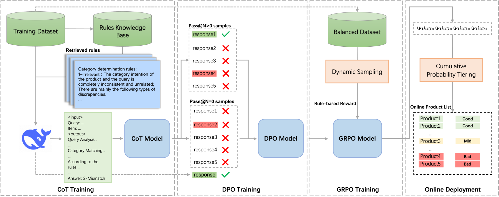
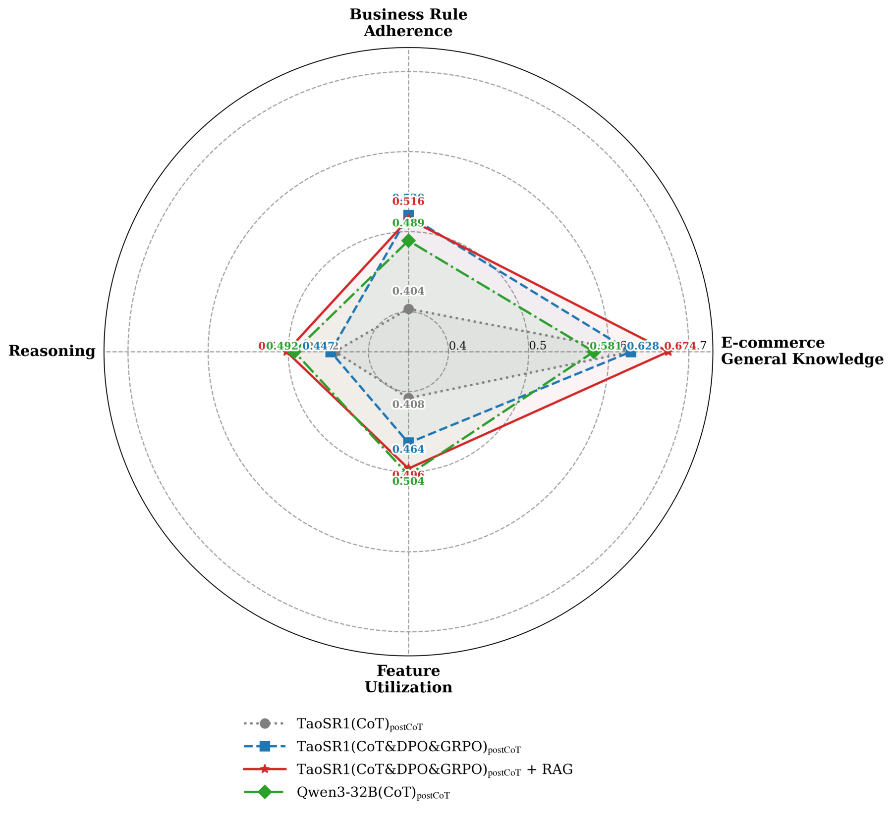

# TaoSR1：把相关性标签放到解释之前

搜“Miu Miu 的平替”时，词项匹配很容易把正品判为高度相关。BERT 也可以从人工标签学到这类关系，但只监督结论时，“为什么品牌匹配反而不满足意图”没有显式训练信号。TaoSR1 为查询—商品对合成带业务规则的思维链，把标签和解释都当成生成目标。线上只用首个标签位置的概率做分层，不生成长解释。任务是已召回商品的相关性判断，后续按 Good、Mid、Bad 排列。[原文 §1、§3，第 2–6 页](https://arxiv.org/pdf/2508.12365v4#page=2)

*作者原图 1 · 左边是训练时可见的规则和标签，中间是离线与训练内采样，右边才是生产标签和排序。Chenhe Dong 等，arXiv:2508.12365v4 第 4 页。*

## 训练时让标签和解释共同监督

淘宝标注分四级，1 不相关、2 不匹配、3 相关、4 极相关。例子中“Mate50 → Mate50 Pro”标 3，反过来标 2，方向由业务规则决定，不能用对称相似度替代。对“平替”请求，人工记录相关的原子判断因素；离线合成器按类目、品牌、风格等元数据取得相应条款，将查询、商品、规则和人工标签给 DeepSeek-R1，让它从查询、商品、类目和属性走到结论。学生用生成目标学习标签与理由。生产模型未报告在每个请求实时读取同一套规则库，附录的运行时 RAG 是实验对照，应与正式部署分开。[原文 §3.1，第 3–5 页，附录 A.3 第 10–11 页](https://arxiv.org/pdf/2508.12365v4#page=3)

若模型先生成理由再预测标签，早一步把“平替”理解为原品牌，就可能让后续标签继承错误。Post-CoT 将训练输出排成“级别 → 理由”。查询与候选先形成上下文。在最后一个输入位置，语言模型的词表头先读出类别 Token 的得分，后续位置才用正确标签与理由前缀预测下一个 Token。理由损失能更新共享参数，当前请求的未来理由不能回流影响首个类别。训练中若首类别和理由逻辑冲突，答案位置提前本身未保证一致。附录原子能力评估也没有把 Post-CoT 的主要增益归于更强的显式推理。[原文 §3.1、表 2、附录 A.3](https://arxiv.org/pdf/2508.12365v4#page=7)

## 从能答对的轨迹学习，再给始终失败的样本补监督

对同一平替请求与商品多次采样，若至少一次输出正确级别，取正确为优选、错误为拒绝。例如其中有一条正确识别正品不满足平替意图，另一条因品牌重合而判成极相关，DPO 提高优选相对参考模型的序列概率差。若五次全部错，学生采样没有正确答案，按作者方法用 DeepSeek-R1 的正确轨迹作优选，配学生错误轨迹；原来全错样本约一半纳入。所有候选均正确时如何得到拒绝项未展开。表 1 的 pass@5 为 81.73，pass@1 为 67.38，前者只表示五次里至少有一次正确，不是线上单次命中。[原文表 1、§3.2，第 5 页](https://arxiv.org/pdf/2508.12365v4#page=5)

GRPO 在训练过程中对每个输入重新采样，按预测类别是否匹配真值给二值奖励。组内有正有负才可能获得有区分的相对优势：例如 16 个输出中有 4 个正确，正确的一组高于均值 0.25，错误的低于均值。更新使用这些轨迹的相对优势和截断比率。全部正确或错误的样本直接丢弃；论文还下采样多数类，缓解类别分布失衡。表 5 和附录实现报告区间 $[0.01,0.9]$；方法段写 $[0.01,0.99]$，约束式直接写命中计数，正文语义是经验准确率。表 5 同时改变区间和类均衡，不能把 67.12 单独归给某个阈值。论文主要奖励类别正确，未直接奖励解释的证据忠实性。[原文 §3.3、表 5、附录 A.1](https://arxiv.org/pdf/2508.12365v4#page=5)

## 首位置概率足以完成线上分层

式 (6) 从首个输出位置取四个类别 Token 的 logits，在四者内部重新归一成 $p_1,p_2,p_3,p_4$。设业务阈值为 $\beta$。CumPT 在 $p_4+p_3\ge\beta$ 时给 Good，否则若 $p_4+p_3+p_2\ge\beta$ 给 Mid，其余给 Bad。原算法先独立检查 $p_4$；因 $p_3\ge0$，这步可并入 Good 判定。例：$p=(0.14,0.35,0.29,0.22)$，阈值 0.6 时，Good 质量 0.51 未达标，包含 Mid 的累积质量 0.86 达标，故为 Mid。这是服务规则，既不是四级 argmax，也不是把期望等级硬阈值化。表 7 在固定表示下比较分档；CumPT 调阈值时的 Good 精度和召回仍发生取舍。[原文 §3.4、算法 1、表 7](https://arxiv.org/pdf/2508.12365v4#page=6)

## 分类改善、人评与交易各自验证什么

表 2 的宏 F1 为 LLM base 62.22、先解释的 CoT SFT 51.54、标签先行的 CoT SFT 60.01、标签先行加 DPO 65.03、再做 GRPO 67.12。其中第 3 级 F1 从基线 32.91 到 44.94。表 3 展示 77,380 个样本，四级比例依次为 9%、36%、5%、50%。先做 DPO 再 GRPO 比只做 GRPO 高 0.28 宏 F1 点（67.12 对 66.84，表 6），未披露方差。不能把这种数据或后训练变化只归给解释顺序。

*作者原图 2 · 附录比较各配置在同一批 2000 条原子能力样本上的准确率。RAG 对照仅为离线实验。Chenhe Dong 等，arXiv:2508.12365v4 第 10 页。*

线上对 2000 条查询请求两组并人工比较各自前 10 件。平替类报告 GSB +34.43%、页面优质率 +13.11 点、商品优质率 +10.69 点。购买行为 A/B 另报 IPV +2.43%、交易量 +0.82%、GMV −0.29%，缺少足够方差信息以证明增减显著。附录 A.2 报告将分长批处理、跨机房调度、FP8 与 KV 缓存复用合并使用后，平均请求 RT 由 800 降至 286 ms、MFU 46.2%。这不是只改变标签位置得到的配对消融，也不是 P99。[原文表 8、§4.4、附录 A.2](https://arxiv.org/pdf/2508.12365v4#page=8)

## 采用版与译文

采用 11 页 arXiv:2508.12365v4。独立核实 KDD 2026 V.2 正式书目，7174–7184 页。中文 PDF 8 页逐页目视，覆盖摘要、正文、图表标题和作者脚注，保留 12 个编号数学行、8 表数值、图内原标注、英文附录与 33 条参考文献。模板中的 Conference’17/占位 DOI 不作出版依据。中文 PDF 与工程位于 `.local/papers/SRC-TAOSR1/translation/`，原文和中文 PDF 已完成私有备份与认证下载。[固定原文](https://arxiv.org/pdf/2508.12365v4) · [正式书目](https://doi.org/10.1145/3770855.3818489) · [私有 PDF 访问说明](../../文档/工具/中文PDF发布.md)

[搜索相关性判断与验证](../../知识库/模块/搜索相关性判断与验证.md#q-reasoning)比较 TaoSR1 的分层标签与 LEAPS 的扩展后过滤。
