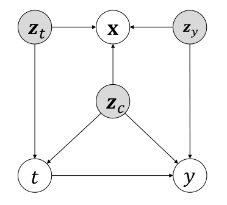
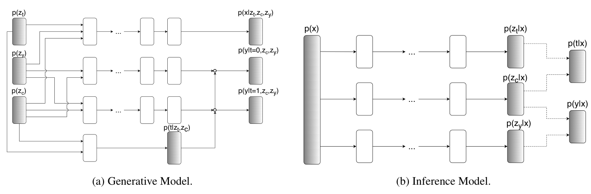
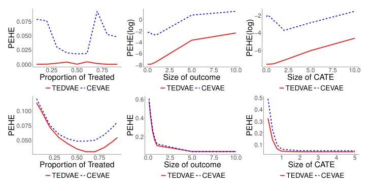
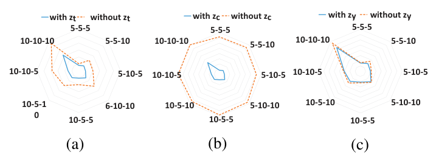

# TED-VAE 怎样把发券信号与结果信号分开

旧策略给高购买意愿的人更多券，渠道路由也能决定谁有机会领券，近期自然需求则能预测用户会不会下单。若直接用所有字段训练一个潜变量，它可以同时编码这三类差异。TED-VAE 沿用 VAE 的重构和潜空间正则，把表示拆成三路，并规定哪些路有权进入动作和结果预测。这让模型能在估券效果时集中使用混杂与结果信号，前提是观测代理与模型结构足以学出这种分工。 [原文引言和方法](https://arxiv.org/pdf/2001.10652v3#page=2) · [VAE 的重构与潜空间](../SRC-VAE/阅读笔记.md)

## 同一画像里藏着三类影响

图 1 为 Zhang、Liu、Li 作者原图，裁自采用版第 2 页。假设旧活动里渠道路由只影响指派，给定券及混杂后对下单无额外影响，它对应工具因素 $z_t$。未观测的购买意愿同时影响指派和下单，对应混杂 $z_c$。只影响下单的自然需求状态对应风险因素 $z_y$。浏览量等代理 $x$ 可以混合承载三种信号，图中三支箭头都指向 $x$。这些角色取决于变量和本活动的生成机制。渠道若还改变商品曝光，就不能按这张图把它视为纯工具因素。 [原文图 1、定理 1–2](https://arxiv.org/pdf/2001.10652v3#page=2)

固定 $z_c,z_y$ 后，图中的结果只依赖它们与给定动作 $t$。对同一画像发券和不发券时，应分别求这两个结果的条件均值，再按照该画像对应的**同一个**潜状态分布积分。令 $m_t(z_c,z_y)=\mathbb E[Y\mid t,z_c,z_y]$，依图 1 的生成分解得到

$$
\tau(x)=\mathbb E_{p(z_c,z_y\mid x)}[m_1(z_c,z_y)-m_0(z_c,z_y)].
$$

原文定理 2 证明中把 $x$ 与三组潜变量直接等同。代理由含噪分布生成时，固定 $x$ 仍可能对应多个潜状态，实际算法也要用该后验平均。定理的图结构推导需要充分的潜状态与相应处理支持。三份独立标准正态先验约束的是模型生成时的先验，给定混合代理后各路后验仍可能相关。作者用三路后验的乘积近似，数据和目标函数仍可能容许其他分解。 [原文定理 2、式 (4) 与式 (6)](https://arxiv.org/pdf/2001.10652v3#page=3) · [潜变量后门调整](../SRC-CEVAE/阅读笔记.md#为什么调整代理变量仍会留下混杂)

## 一条下单日志怎样更新三路网络

图 2 为作者原图，裁自采用版第 4 页。先看右图，三个编码器都读取同一个用户画像 $x$，各给一组高斯均值和方差。图中使用 $p(z_j\mid x)$ 标图，正文式 (6) 用 $q_{\phi_j}(z_j\mid x)$ 表示近似后验。再看左图，三组抽样一起重构 $x$，$z_t,z_c$ 进入指派头，$z_c,z_y$ 与实际动作进入对应的结果头。 [原文图 2、式 (4)–(8)](https://arxiv.org/pdf/2001.10652v3#page=4)

对一条 $(x,1,1)$ 日志，三路同时得到画像重构的梯度，各自受与标准正态的 KL 惩罚。动作头用事实发券标签 $1$ 向工具路和混杂路传递梯度。事实结果头用下单标签 $1$ 更新发券侧结果预测，梯度进入混杂路和风险路。无券头从数据中实际未指派券的日志得到监督。式 (7) 写出的下界是 $x$ 的重构项和三路 KL。式 (8) 额外加入两个带权事实对数概率。混杂路是唯一同时接到动作和结果两项额外监督的通道，但重构允许三路保留重叠信号。 [原文式 (6)–(8)](https://arxiv.org/pdf/2001.10652v3#page=4)

对新用户直接由 $x$ 抽取 $K$ 组 $(z_c,z_y)$。每组潜样本共用两次，先给结果头输入 $t=1$，再输入 $t=0$，最后平均双臂之差。假设两个潜样本的有券与无券下单率分别是 $(0.40,0.25)$、$(0.22,0.17)$，预测增量是 $(0.15+0.05)/2=0.10$。指派头与工具编码器不参与这一步，历史是否发券也无需作为新用户输入。CEVAE 则用辅助头从 $x$ 补出 $t,y$ 的分布，再经依赖它们的编码器求潜变量后验。两篇都对共用的潜在人群比较两个干预臂。 [TED-VAE 原文预测段](https://arxiv.org/pdf/2001.10652v3#page=5) · [CEVAE 的推断路径](../SRC-CEVAE/阅读笔记.md#一条事实记录怎样训练推断端和生成端)

## 实验显示哪些分工带来差异

图 3 为作者原图，裁自采用版第 5 页。第一行的生成数据具备工具、混杂和风险三类因素，第二行的生成数据只设混杂。在第一行，TED-VAE 与 CEVAE 的误差差距较大。第二行两者在多处接近，提醒读者同时考虑推断端的变化。各面板纵轴有线性与对数两种，读同一面板内的比较。 [原文合成数据与图 3](https://arxiv.org/pdf/2001.10652v3#page=5)

图 4 为作者原图，裁自采用版第 6 页。每轴是生成数据的潜维数组合，虚线为估计模型去掉对应一路后的结果。去掉 $z_c$ 的影响最明显，部分 $z_y$ 轴的两线接近。原文同段对非零维度分别举了 10 与 5，图例也只标有无该路。这个消融显示了模型结构变化对效应误差的影响，误差变化本身无法确认编码与真实因素逐维对应。 [原文合成数据消融与图 4](https://arxiv.org/pdf/2001.10652v3#page=6)

- **ACIC 2016** 使用 77 种处理和结果生成设置，每种 10 次重复，按 60%/30%/10% 训练、验证、测试。作者用前五种设置选定 TED-VAE 参数并复用于全部设置。表 1 样本外根 PEHE 为 TED-VAE $1.77\pm0.17$、X-RF $1.89\pm0.16$、CEVAE $3.28\pm0.35$。 [表 1](https://arxiv.org/pdf/2001.10652v3#page=6)
- **IHDP** 删除部分原随机试验处理样本形成选择偏差，结果按线性 A 或指数 B 生成。在 100 次重复的 60%/30%/10% 切分下，表 2 中 TED-VAE 两套测试根 PEHE 分别为 $0.60\pm0.14$ 和 $2.22\pm0.08$，CEVAE 为 $1.04\pm0.14$ 和 $3.24\pm0.12$。TED-VAE 沿用 ACIC 参数，部分深度对照按推荐范围网格搜索，比较受这一调参协议约束。 [表 2](https://arxiv.org/pdf/2001.10652v3#page=7)
- **Twins** 把同对较重者当作处理，结果为一年内死亡。筛查和删除部分记录后共 4,813 个样本，沿用同一切分比例并做 100 次重复。表 3 样本外 ATE 绝对误差为 TED-VAE $0.006\pm0.002$、GANITE $0.018\pm0.005$。正文用两臂各自均值解释真值，随后的公式却用合计分母。表中沿用作者报告，具体实现口径需结合代码另核。 [指标与表 3](https://arxiv.org/pdf/2001.10652v3#page=5) · [Twins 协议](https://arxiv.org/pdf/2001.10652v3#page=7)

GANITE 原论文的 Twins 二元设置保留 11,400 对，主要表报告根 PEHE。上面 $0.018\pm0.005$ 是 TED-VAE 在自身筛样和指标下报告的 GANITE 基线，不能拿来替代 GANITE 原版的数值。 [GANITE 的 Twins 口径](../SRC-GANITE/阅读笔记.md#实验检验了哪些效应)

TED-VAE 的分工来自重构、独立先验和头的连接。MIM-DRCFR 另以条件密度模型估计成对互信息，训练时直接抑制不同表示间的统计依赖。两种约束都需要独立数据检验分臂支持与增量幅度，尤其是历史策略几乎只给某一类用户发券时。论文试验用二元处理，此处未复现实验。 [历史发券比较](../../知识库/问题/历史发券日志如何估计补贴增量.md#只有共同原因的代理时怎样调整) · [MIM-DRCFR](../SRC-MIM-DRCFR/阅读笔记.md) · [CLUB 的上界条件](../SRC-CLUB/阅读笔记.md)

## 原文和中文译本

采用 Weijia Zhang、Lin Liu、Jiuyong Li 的 arXiv 2001.10652v3，对应 AAAI 2021。阅读正文、定理 1–2、式 (1)–(8)、图 1–4 与表 1–3。7 页中文译本覆盖摘要、正文、图表说明与描述性脚注，图内文字与参考文献保留原文。正式文件为 `.local/papers/SRC-TED-VAE/translation/利用解耦潜在因素估计处理效应_中文.pdf`，可编辑主文件为 `translated-sources/aaai21.tex`。 [采用版](https://arxiv.org/pdf/2001.10652v3) · [来源与原件哈希](来源.json) · [私有备份下载说明](../../文档/工具/中文PDF发布.md)

来源卡中的源码包是下载后未修改文件的本地重新打包。
