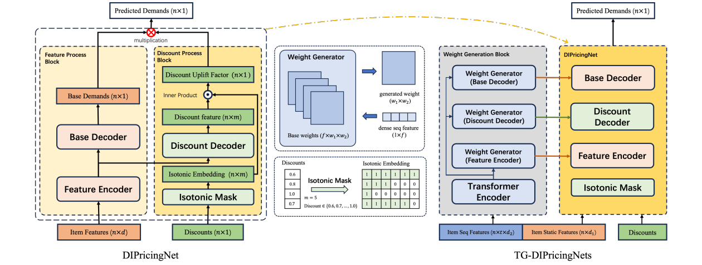
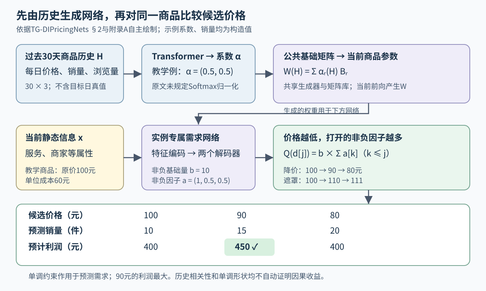

# 根据商品自身历史定价：动态生成单调需求网络

[正式原文与全文阅读器](https://dl.acm.org/doi/epdf/10.1145/3701716.3715542) · [中文PDF位置与范围](#原文译文与阅读范围) · [私有附件下载说明](../../文档/工具/中文PDF发布.md) · [需求曲线与定价问题](../../知识库/问题/商品历史如何生成单调需求曲线并支持定价.md)

同样降价10%，一种商品可能多卖很多，另一种几乎不动。把所有商品交给一套固定参数的销量模型，容易学成折中的平均关系；为每件商品独立训练，又会遇到历史短、数据少的问题。这篇论文的做法是共享一套“造模型的模型”：Transformer读取商品自己的30天量价历史，生成一组系数，组合公共基础矩阵，临时构造这件商品的需求预测网络。网络保留价格下降、预测需求不下降的结构，再枚举候选价格，计算预计利润。

这篇值得学的是**历史条件化的参数生成、非负增量累加的单调结构，以及预测后再决策的分工**。它没有证明历史销量曲线就是因果需求曲线；原文5.94%的利润数字来自历史回测分组，也不足以证明上线调价的因果收益。理解模型机制与判断实证强度，要分开走完。

正式题名为 *Pricing Items Based on Their Own History: Transformer-Generated Deep Isotonic Pricing Networks*，模型简称TG-DIPricingNets；Longxiang Zhang、Linlin Yu、Bin Chen、Zhuojun Wang、Chengfu Huo，Alibaba Group，WWW Companion 2025，1514–1518页，DOI `10.1145/3701716.3715542`。以下页码均指正式五页PDF，而非译本页码。

## 先把商品、折扣和利润的含义固定下来

一个样本要预测某件商品在目标日的销量。输入包括目标日之前30天的价格、销量、页面浏览量，组成历史矩阵 $H\in\mathbb R^{30\times3}$；还包括售前/售后服务与商家基本信息等静态特征 $x$。目标日实际销量是可观测事实；同一天换成其他价格会卖多少，不能从这一条记录直接观测。[§3.1，第3页](https://dl.acm.org/doi/pdf/10.1145/3701716.3715542#page=3)。

原文用 $d$ 表示“discount”，但式(1)的成交价是 $Pd$，所以这里统一称它为**价格倍率**：$P$为原价，$d=0.9$表示按原价90%出售，$d=1.1$表示加价10%。优惠力度增大意味着 $d$减小，不能把“折扣增加”直接翻成 $d$增大。回测的倍率范围是0.7–2.0，共131档，包含加价；若等间隔枚举，步长为0.01，原文没有另列候选构造代码。[§2.1、§3.2，第1、3页](https://dl.acm.org/doi/pdf/10.1145/3701716.3715542#page=1)。

给定商品成本价 $P_0$，模型先输出各档需求 $\hat Q(d)$，再求

$$
d^*=\arg\max_{d\in\mathcal D}\hat Q(d)(Pd-P_0).
$$

这是原文式(1)的单商品利润代理：销量乘以每件毛利。固定成本、库存、流量竞争、退款、平台和商家的收益分摊都没有在式中展开。价格越低通常销量越高，但单位毛利越薄，因此单调销量并不意味着最便宜最赚钱，利润也不一定凹或单峰。

贯穿下面的教学商品，设 $P=100$元、$P_0=60$元，只比较倍率1.0、0.9、0.8。历史仍有30行；例如最后几天记录过价格100、90、80元，以及对应销量和浏览量。这些历史只是条件信息，不能把不同日期的销量差直接当作价格的因果效应。所有后续向量、权重和销量都是为了手算构造的数值，不是原文实验输出。

## 固定需求网络如何把价格单调性写进计算

作者原图1，Longxiang Zhang等，ACM正式版第2页（论文第1515页）。从固定PDF裁出完整架构区域，未改图内内容。先看左侧固定DIPricingNet：静态特征经编码器分成基础需求与折扣两路，再与遮罩组合；接着看右侧，商品历史进入Transformer，生成三个模块的权重；中间放大了基础矩阵组合与遮罩结构。原图的 $n$表示批大小、$m$表示候选倍率数、$f$表示基础矩阵数；下文公式另用 $n$表示基础矩阵数，阅读时不要混用。

先不加Transformer。DIPN是本篇引用的Deep Isotonic Promotion Networks（深度单调促销网络）；DIPricingNet是本篇基于其单调嵌入结构构造的销量预测基线，两者不是同一个模型名。“沿用单调嵌入思路”具体指：把有顺序的候选倍率编码成逐档累积的二元向量，再与商品对应的非负因子加权求和，使降价只能增加或维持预测需求。这里的embedding是倍率到有序向量的编码；不能理解成给每档价格自由学习一个普通向量后便自然获得单调性。以下展开本篇§2.2与图1已披露的结构，不据此补全DIPN原论文的全部架构或训练目标。

本篇基线包含三个三层网络：Feature Encoder把 $x$编码成状态 $z$；Base-Demand Decoder输出非负标量 $b$；Discount Decoder输出非负向量 $a\in\mathbb R_+^m$。第四部分是随候选倍率改变的二元遮罩。这里“单调”指预测曲线的方向约束，不是对训练完成的任意神经网络做一次排序。[§2.2、图1，第2页](https://dl.acm.org/doi/pdf/10.1145/3701716.3715542#page=2)。

把倍率按从高到低排为 $d_1>d_2>\cdots>d_m$，用前缀遮罩 $M_j=(1,\ldots,1,0,\ldots,0)$，前 $j$项为1。根据正文的“基础需求乘以折扣因子与遮罩内积”，可写成

$$
z=E(x),\qquad b=B(z)\ge0,\qquad a=A(z)\ge0,
\qquad\hat Q(d_j)=b\langle a,M_j\rangle=b\sum_{k\le j}a_k.
$$

这是对正文与图1的数学展开，原文没有单列这条带下标的公式，也没有披露非负激活的具体函数。相邻两档之差为

$$
\hat Q(d_{j+1})-\hat Q(d_j)=ba_{j+1}\ge0.
$$

编码规则固定，因子大小由数据学习：例如100、90、80元依次编码成 $(1,0,0)$、$(1,1,0)$、$(1,1,1)$；网络学习每次新打开的位置贡献多少。每多打开一个位置，只能增加或维持需求。关键是遮罩逐元素嵌套，即旧的1不关闭、新的1只增加；仅仅“1的数量更多”还不够，例如从 $(1,0,0)$变为 $(0,1,1)$，加权和可能反而减小。

这个性质在输出值非负、遮罩方向正确，而且比较候选价格时固定同一组 $b,a$的条件下成立。它不要求生成网络的所有内部权重都非负。若把当前候选价格也输入权重生成器，让它随候选变化，上述比较就不再自动成立；论文的生成器读取的是过去历史。

取教学输出 $b=10$、$a=(1,0.5,0.5)$：

| 倍率与价格 | 遮罩 | 需求计算 | 预测销量 | 预计利润 |
|---|---|---|---:|---:|
| 1.0，100元 | $(1,0,0)$ | $10\times1$ | 10 | $10(100-60)=400$元 |
| 0.9，90元 | $(1,1,0)$ | $10(1+0.5)$ | 15 | $15(90-60)=450$元 |
| 0.8，80元 | $(1,1,1)$ | $10(1+0.5+0.5)$ | 20 | $20(80-60)=400$元 |

最后选90元，原因是销量增加与单件毛利下降后的乘积最大。输出向量中的每一档都是同一商品在一个候选价格下的预测销量，既不是一串待生成的语言Token，也不是三种商品的分数。

原文把 $b$称为“无折扣基础需求”，但图1在 $d=1$处也打开一个遮罩位置，正文只写乘以内积，没有说明首因子恒为1、显式加1或归一化。因此严格按已披露计算，不能保证 $b=\hat Q(1)$。上例特意取 $a_1=1$便于手算，不应倒推出作者实现有这一约束；无折扣锚定和2.0加价区间的精确遮罩映射仍待实现确认。这里的“uplift factor”只是需求乘数，也没有因此获得因果Uplift含义。

### 相邻增量累加，累加的是哪个尺度

“先预测相邻处理档的增量，再累加到基础响应上”抓住了结构直觉，但DIPN原版与本篇基线的输出尺度不同。定向核对[DIPN引用论文《A Framework for Massive-Scale Personalized Promotion》的固定v1](https://arxiv.org/abs/2108.12100v1)§4.1–4.2（Isotonic Embedding、Uplift Weight Representation），其二分类预测为

$$
z(x,T)=\beta(x)+\sum_k w_k(x)e_k(T),\qquad
\hat p(x,T)=\sigma(z(x,T)),\qquad w_k(x)\ge0.
$$

这里把原文偏置 $b$另记为 $\beta(x)$，避免与本篇基础需求混淆；它来自Bias Net，是基础logit。$T$为激励水平，$e_k(T)$是累计二元编码。跨过一个阈值只新打开一项时，$z(x,T_j)-z(x,T_{j-1})=w_j(x)$，所以精确累加的是logit增量；概率增量则为 $\sigma(z_{j-1}+w_j)-\sigma(z_{j-1})$，小步长时近似 $\sigma'(z_{j-1})w_j$，并不等于 $w_j$。原文也用这一阶展开解释uplift weight与局部响应增量的关系。

例如构造参考logit为0、后两档增量为0.4和0.3，响应概率依次为0.500、0.599、0.668；同样累加0.3，在sigmoid不同位置造成的概率变化不同。若改用真实的相邻概率差，当然可以从参考概率逐档相加还原曲线，但那不是该模型直接输出的 $w_j$。

本篇DIPricingNet则是 $\hat Q_j=b\sum_{k\le j}a_k$，相邻销量增量为 $ba_j$。若以第一档的实际预测 $\hat Q_1=ba_1$为参考，也可等价改写成 $\hat Q_j=\hat Q_1+\sum_{k=2}^j ba_k$：当前档的预测销量等于第一档预测销量，加上后续各档的销量增量。这里累加的是销量增量，而DIPN二分类版本累加的是logit增量；参考销量 $\hat Q_1$也不一定等于解码器输出的 $b$。

## 商品历史怎样变成这件商品的网络参数

固定DIPricingNet对所有样本共享参数，作者观察到低销量商品被高估、高销量商品被低估。他们认为跨类目的量价差异使固定模型难以适应。一个自然补充是先用Transformer编码历史，再把历史向量与静态特征拼接，输入固定网络；这是论文的Transformer-DIPricingNets对照。新模型进一步让历史改变网络本身的参数。[§2.3、第2–3页；附录A，第4页](https://dl.acm.org/doi/pdf/10.1145/3701716.3715542#page=4)。

附录A给出两步：

$$
\alpha=T(H;\theta_T)\in\mathbb R^n,
\qquad W_{uv}(H)=\sum_{r=1}^n\alpha_r(H)(W_o)_{ruv}.
$$

原文把 $\alpha$记为 $w_g$；$W_o\in\mathbb R^{n\times d_{\rm in}\times d_{\rm out}}$是一组全局可学习的基础矩阵，生成的 $W(H)$是一层 $d_{\rm in}\times d_{\rm out}$权重。这里的“生成”是**连续系数组合矩阵**，不是输出权重的文本，也不是为每件商品从零训练一套模型。图1分别画出了特征编码器、基础需求解码器和折扣解码器的权重生成器；正文未说明所有层是否共用同一组系数、偏置是否生成，不能补造这些细节。

Transformer在这里读30天序列，输出一个系数向量。它如何投影三维日特征、使用什么位置表示、怎样从30个状态读出向量、层数、维度和基础矩阵数 $n$，论文均未给出。注意力如何把序列信息写进状态可查[自注意力详解](../../知识库/问题/序列怎样用自注意力建立上下文.md)；本篇需要接通的是“历史状态 → 系数 → 网络权重”的接口。原文也没有说 $\alpha$经过Softmax、非负或和为1，因此一般是线性组合，不能直接称为基础模型的概率混合。

为把矩阵组合算出来，取一层输入 $x=(1,2)$，两个教学基础列向量

$$
B_1=\begin{bmatrix}2\\0\end{bmatrix},\quad
B_2=\begin{bmatrix}0\\4\end{bmatrix},\quad
\alpha=(0.5,0.5).
$$

则 $W=0.5B_1+0.5B_2=(1,2)^\top$，状态 $z=xW=5$。同样的静态 $x$，若另一段历史生成 $\alpha=(1,0)$，则 $z=2$。系数恰好非负且和为1只是本例选值。接下来的非线性解码器继续输出前节的 $b$与 $a$；为说明接口，我们构造其输出为10及 $(1,0.5,0.5)$，并未从一个公开模型实际计算得到。

这幅自绘示意作为作者原图1的补充。读图先沿上排看历史怎样组合权重，再沿下排看静态特征如何进入生成后的网络。右下的90元来自上节三个候选的利润比较。图为自主绘制的教学说明，系数和销量是构造值；省略了各层维度、非线性及训练环节，不代表原图或实际部署。

所有商品仍共享 $\theta_T$和基础矩阵，特定历史只在当前前向计算中生成 $W(H)$。这既共享了统计信息，也允许条件化参数；但 $W(H)$只能落在基础矩阵张成的空间里，表达能力受 $n$与生成器限制，并非任意商品都有任意独立权重。零历史或很少调价的商品如何处理，论文没有实验交代。

### 与MMoE相比，混合发生在参数上

为理解上述公式，可以把Transformer类比为门控网络，把 $\alpha(H)$类比为门控向量：商品历史决定如何组合共享基础矩阵。不过 $B_r$是参数矩阵，并非已经各自完成预测的多层专家。这里的作用是先生成当前商品使用的参数，再处理静态特征。

[MMoE的共享专家与任务门](../SRC-MMOE/阅读笔记.md#独立任务门改变共享组合)则先计算各个专家输出 $f_r(x)$，再按任务 $k$的门控 $g_{k,r}(x)$组合为 $u_k=\sum_r g_{k,r}(x)f_r(x)$，最后送入任务塔；标准门控使用Softmax。这里的对比依据MMoE KDD 2018正式版§4式(5)–(8)、第5页，与本篇附录A式(2)–(4)、第4页。它是对两个计算结构的分析类比，不代表本篇采用了MMoE的任务门。

以本篇一个生成权重的线性层为例，静态输入为行向量 $x$，则

$$
xW(H)=x\left(\sum_r\alpha_r(H)B_r\right)
=\sum_r\alpha_r(H)(xB_r).
$$

所以在这个线性层上，组合参数与组合各基础线性映射的输出完全等价，称为“参数上的门控”很贴切。进入非线性后，一般有 $\rho(\sum_r\alpha_r xB_r)\ne\sum_r\alpha_r\rho(xB_r)$；不能据此把整套多层生成网络等同于多个完整专家网络的输出混合。例如教学标量 $x=1$、$B_1=-1$、$B_2=1$、$\alpha=(0.5,0.5)$，先混合再ReLU得到0，先分别ReLU再混合得到0.5。

两者也有不同的条件化对象：MMoE为不同任务设置门，本篇根据商品历史生成参数。论文未披露 $\alpha$有非负或和为1的约束，因此它是门控式的组合系数，不能直接按标准Softmax门解释为专家选择概率。它也与Transformer内部的注意力权重不同：这里每个系数对应一份基础矩阵，内部注意力权重对应序列位置间的信息聚合。

## 一个训练样本怎样监督整条链路

训练时先从商品过去30天生成权重，再用静态特征和事实价格得到预测；梯度穿过需求网络、权重组合和Transformer，更新全局基础矩阵及Transformer参数。推理不做梯度更新：同一历史生成一次参数，得到全部候选需求，再算利润。[附录A式(2)–(4)，第4页](https://dl.acm.org/doi/pdf/10.1145/3701716.3715542#page=4)。

原文只写 $\hat Y=D(X_{\rm static};W)$和 $\mathrm{Loss}=L(\hat Y,Y)$，**没有完整披露训练损失、标签向量构造、未观测价格档的监督方式或零销量规则**。DWMAPE在§3.1和附录C作为评估指标提出，不能据此说训练就是最小化DWMAPE。历史销售记录本身不会自动提供131档反事实标签。

下面仅示范一种事实价格监督如何传播，不声称是作者实现。教学样本在90元实际卖了18件，只对该档预测15计算平方损失：

$$
L=\tfrac12[\hat Q(0.9)-18]^2=4.5.
$$

误差导数为 $\partial L/\partial\hat Q=-3$，于是

$$
\frac{\partial L}{\partial b}=-3(1+0.5)=-4.5,
\quad \frac{\partial L}{\partial a_1}
=\frac{\partial L}{\partial a_2}=-3\times10=-30,
\quad\frac{\partial L}{\partial a_3}=0.
$$

90元的遮罩只打开前两项，所以该样本没有直接监督第三项；但共享编码器和生成器更新后，其他价格的预测仍可能变化。一个事实点如何约束整个曲线，依靠结构与跨样本共享；没有观测覆盖的价格仍可能外推失真。输出非负函数若在某处导数为零，也会改变真实梯度，这是未披露实现不能被教学式子代替的部分。

### 参数生成引入的乘性交互与正确梯度

把多层网络缩成一个标量读出，令 $x\in\mathbb R^p$为列向量、$B_r\in\mathbb R^p$为基础向量：

$$
\hat y=x^\top W(H)=\sum_r\alpha_r(H;\theta_T)x^\top B_r,
\qquad\delta=\frac{\partial L}{\partial\hat y}.
$$

维度一致的链式法则是

$$
\frac{\partial L}{\partial B_r}=\delta\alpha_r(H)x,
\qquad
\nabla_{\theta_T}L=
\delta\sum_r(x^\top B_r)\nabla_{\theta_T}\alpha_r(H;\theta_T).
$$

基础矩阵更新被历史系数调节；历史编码器的更新被静态特征投影调节。除共同误差信号外，前向函数中就显式出现 $\alpha_r(H)x$乘积，这才是容易核实的结构差异。它说明计算路径，不保证泛化一定更好，更不证明因果识别。

原文附录B.1–B.2比较的是简化加性读出 $\hat y=a^\top T(H)+b^\top x$。其输出对两路输入的混合导数为0，但平方损失下

$$
\nabla_bL=(a^\top T(H)+b^\top x-y)x,
$$

仍通过残差依赖历史。因此不能说“训练时没有任何相互影响”。如果拼接后接非线性MLP，本身也可以表达交互；论文没有证明普通深网无法学出它。TG改变的是交互的参数化和归纳偏置。

附录B.2式(8)用 $\partial L/\partial W_{\rm seq}$继续接 $\partial F_{\rm seq}/\partial W_T$，不是一般正确的链路；应先得到 $\partial L/\partial F_{\rm seq}$。式(10)先写依赖 $W_o$的 $g_1$后又换成依赖历史的 $f_1$，式(11)没有完整写出从 $W_g$到 $W_T$的Jacobian。上述推导保留作者想表达的条件化机制，但不把原式当作严谨证明。[附录B式(5)–(11)，第4–5页](https://dl.acm.org/doi/pdf/10.1145/3701716.3715542#page=5)。

## DWMAPE改变的是谁在评估里占多大分量

普通WMAPE用总绝对误差除以总销量：

$$
\mathrm{WMAPE}=\frac{\sum_i|y_i-\hat y_i|}{\sum_i y_i}\times100\%.
$$

当销量为正时，它等价于按真实销量加权的个体百分比误差，头部商品对总分的影响大。作者按真实销量分组，在每组内计算WMAPE，再按该组商品数量加权：

$$
\mathrm{DWMAPE}=\sum_{g=1}^G\frac{N_g}{N}
\frac{\sum_{i\in g}|y_i-\hat y_i|}{\sum_{i\in g}y_i}\times100\%.
$$

这里将原式(13)里未标组下标的WMAPE写成组内表达；$N_g$为该组商品数，$N$为总商品数。它不只是给WMAPE多乘一个统一常数，而是改变跨组权重。[附录C式(12)–(13)，第5页](https://dl.acm.org/doi/pdf/10.1145/3701716.3715542#page=5)。

例如一件头部商品实际销量1000、预测900，九件尾部商品每件实际1、预测0。全局WMAPE为 $(100+9)/(1000+9)\approx10.80\%$；分为头尾两组后，DWMAPE为 $0.1\times10\%+0.9\times100\%=91\%$。尾部全预测成零的问题不再被大销量分母掩盖。这个算例说明权重选择，没有证明91%更符合某项利润目标。

原文表3报告销量区间 $[0,10)$、$[10,100)$、$[100,1000)$、$[1000,10000)$、$[10000,+\infty)$的商品占比依次为71.43%、19.19%、6.41%、2.24%、0.90%。它们合计100.17%，超出五项保留两位小数可解释的通常舍入误差；原文未解释。§3.1也未明确表3分段是否就是测试DWMAPE的全部实际分段，以及“商品数”如何对应多日销售记录。

还要处理某组真实销量和为0时的分母、分组边界稳定性、组内头部仍占主导的问题。按真实结果分组可以用于事后评估，但不能把测试真实销量分组当成推理输入。论文把它称为“unbiased”并未给出统计无偏证明；它不消除历史价格选择偏差、数据泄漏或因果混杂。

## 实验支持什么：预测改善明确，利润因果收益未建立

### 三种结构的离线比较

训练使用350万条记录、测试35万条，来自一个月持续销售商品的385万条记录。三种结构在同一测试集的DWMAPE为：[§3.1、表1，第3页](https://dl.acm.org/doi/pdf/10.1145/3701716.3715542#page=3)。

| 结构 | 历史怎样进入模型 | DWMAPE |
|---|---|---:|
| DIPricingNets | 固定参数；该基线具体接入哪些历史汇总未展开 | 70.60% |
| Transformer-DIPricingNets | 先编码历史，和静态特征拼接后预测 | 69.00% |
| TG-DIPricingNets | 历史生成参数，再处理静态特征 | 66.70% |

完整模型比固定基线低3.90个百分点，相对下降约5.52%；比历史拼接对照低2.30个百分点，相对下降约3.33%。引言写“improved by 3.9%”，准确复述应标明是百分点差。结果支持该数据和指标下完整结构误差更低；没有多seed、区间、显著性检验、等参数/等算力控制、分组结果、真实延迟或成本，无法隔离收益究竟来自交互形式、容量还是调参。

训练/测试按时间还是随机切分、同一商品是否跨集合、历史窗口是否重叠、验证集和调参边界、归一化与缺失处理、标签粒度和完整损失均未充分披露。不能把“350万/35万”直接写成严格时间外或新商品泛化验收。作者关于高低销量纠偏的动机，也缺少逐组误差表来单独支持。

### 5.94%是分组差异，尚不是采用策略后的提升

正文§3.2明确使用1688自营业务两周历史销售数据回测。模型为每件商品枚举131档求建议倍率，再按建议与实际倍率的距离给历史订单分组：

| 原文分组 | 建议与实际倍率关系 | 历史平均利润 |
|---|---|---:|
| 定价偏高 | 建议倍率比实际低超过0.05，即模型建议降价 | 6.48元 |
| 定价适中 | 两倍率相差小于0.05，按语境理解为绝对差 | 7.13元 |
| 定价偏低 | 建议倍率比实际高超过0.05，即模型建议提价 | 6.73元 |

计算 $(7.13/6.48-1)\times100\%\approx10.03\%$，$(7.13/6.73-1)\times100\%\approx5.94\%$，正是表2的两项比例。也就是说，数字比较的是不同历史订单组的平均利润，**没有观测同一组商品执行建议价格后的反事实利润**。商品、成本、曝光、类目、销量等差异都可能影响分组与利润；原文没有随机分配、匹配或离策略识别协议来排除这些解释。[§3.2、表2，第3页](https://dl.acm.org/doi/pdf/10.1145/3701716.3715542#page=3)。

摘要的“Field experiments”和引言“minimum 5.94% profit increase”应受这段实际协议约束。可以说建议接近组的历史平均利润较高，不能说平台因模型上线净利润至少提高5.94%。“平均利润”按订单、商品还是商品日归约也未充分说明，不能直接改称平台总利润或GMV提升；恰好相差0.05的边界归属同样未交代。

## 与补贴响应模型相接时，需要换哪些问题定义

TG-DIPricingNets预测商品在不同价格下的**绝对销量**，用商品毛利目标选价。若是平台给券、补贴或降费，必须重新定义结果、对照和谁承担成本，不能直接把销量乘以价差当作平台增量利润。

| 比较维度 | TG-DIPricingNets | 已精读的TaQFormer | 已精读的POUL |
|---|---|---|---|
| 干预对象与输入 | 商品价格倍率；30天商品历史和静态属性 | 多维优惠动作；请求上下文和处理坐标 | 由场景—动作概率组成的完整策略；用户特征 |
| 核心条件化 | 历史生成需求网络权重 | 处理Token查询请求记忆，OBS–RCT适配 | 原子策略表示，结果与处理残差化 |
| 输出 | 各候选价格的销量 | 完整优惠动作的响应概率 | 相对对照的条件效应 |
| 单调约束 | 非负增量配累计遮罩，固定历史时约束量价方向 | 本库未核实同类单调保证 | 正交估计本身不提供价格单调保证 |
| 数据与证据 | 观测销售预测与历史利润分组回测 | 观测预训练、随机数据适配与在线结果，仍有协议缺口 | 因果效应排序/幅度离线结果，未给策略上线收益 |
| 服务复用 | 同一商品历史可复用生成参数与需求因子；论文未报时延 | 全处理并行复用请求编码 | 可组合策略向量与用户向量差分 |

三篇任务、数据与指标不同，不能比较各自主表的数字来排名；详细比较放在[问题页](../../知识库/问题/商品历史如何生成单调需求曲线并支持定价.md#与联合优惠和正交uplift的分工)。DIPN仅定向核对固定v1的§4.1–4.2及相关架构说明，未全文精读；不能将本篇未披露的细节从DIPN名称自动补全。

对补贴业务，可以借用“历史条件化参数 + 方向约束 + 枚举可行动作”的工程分解。需要先满足三件事：历史价格/补贴变化有足够支持；方向约束适用于固定窗口和固定其他条件；结果与成本能按平台口径计算。商品价格与单用户补贴可能影响竞争、囤货、曝光和跨期需求，单商品短期模型并未覆盖这些因素。

一个最小验证应先固定用户或商品单元、结果窗口、对照与成本，按时间留出数据，对固定参数、历史拼接和生成权重做等预算比较；检查事实预测、各动作支持和曲线外推，再用价格探索或适当随机实验验证策略增量。若净价值与成本必须分别估计，转到[营销补贴总图的预算接口](../../知识库/总览/营销补贴总图.md#从增量预估走向预算决策)。这些是采用前的验证设计，本次没有训练、回放作者模型或开展业务实验。

## 原文、译文与阅读范围

采用ACM正式五页PDF，已读摘要、正文§1–5、图1、表1–3、参考文献以及支撑方法的附录A–C和式(1)–(13)；未取得可核实的arXiv同篇版本、作者LaTeX源码或官方实现，本次检索截至2026-11-16。原件身份、不可变快照与SHA256见[来源卡](来源.json)。

正文中文重排PDF为本地附件 `.local/papers/SRC-TG-DIPN/translation/根据商品自身历史定价.pdf`，不随Git分发；共7页，其中前5页为当前模型从正式PDF翻译的摘要、正文、图1图注、表1–2和译注，后2页保留原文参考文献与附录编排，也含结论英文末段。图内英文、17条参考文献、附录A–C与表3保留英文；全部13个编号公式均在译本正文或原稿附页中保留。工作版Markdown和可编辑TeX工程位于同目录及 `translated-sources/`；未确认公开全文翻译许可，因此全文译文不入公开Git。

最终原文5页、译文7页均经PDFium逐页渲染目视，核对正文范围、作者、权利声明、图1、表1–3、公式与关键数字；另查中文提取、字体嵌入及Unicode映射。本地XeLaTeX以可用UTF-8 locale编译，修正了英文字体不可用的问题。精读完成技术证据与读者路径两轮当前Agent自查；无独立审查或模型实验。原文与中文PDF已于2026-11-16私有备份，并分别真实登录下载核验PDF类型、大小、页数和完整SHA256；两库目录已同步，私有目录提交为 `8b44d90`。详细状态见[PDF目录](../../译文/PDF目录.md)，访问方法见[私有维护说明](../../文档/工具/中文PDF发布.md)。
