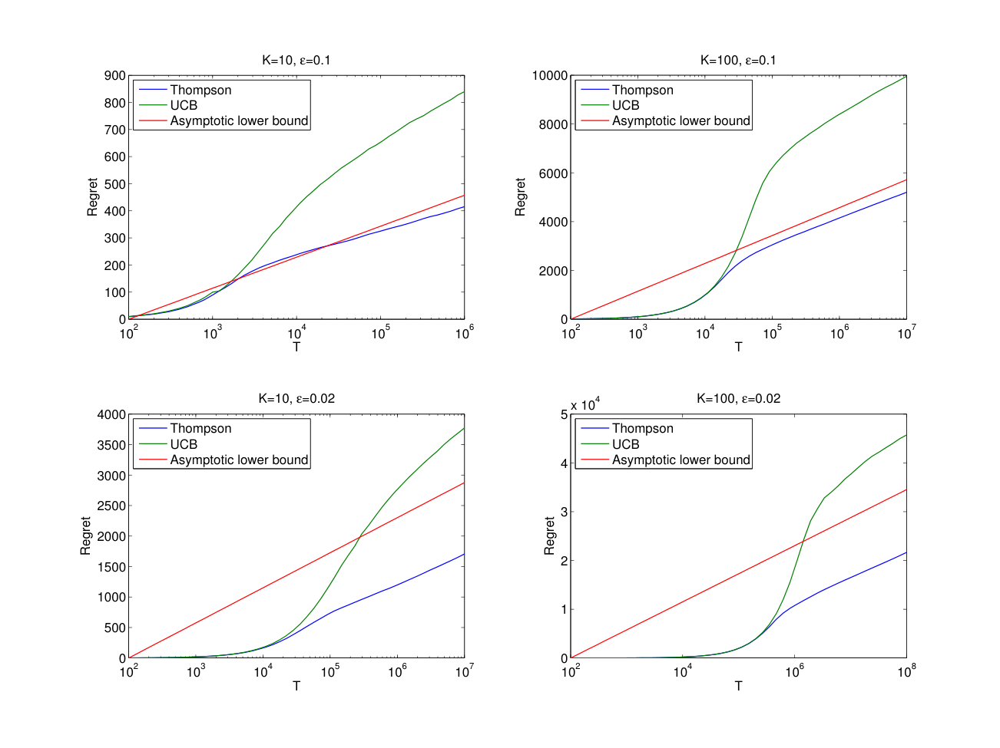
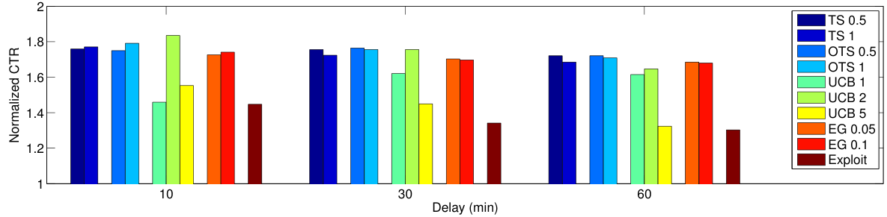

# Thompson Sampling：用后验最优概率分配探索

只按均值选广告会错过缺少反馈的新广告。UCB 给未知较多的臂加上一个置信项。另一种做法是从当前证据允许的奖励模型中抽一个，按抽到的模型选最优动作。如果某个臂只有在少数合理模型里最好，它也只占相应比例的探索机会。Chapelle 与 Li 比较了这一策略在 Bernoulli 模拟、展示广告模拟和随机新闻日志中的表现。

## 从一次点击更新下一次选择概率

每轮读到当前上下文 $x_t$ 和动作集合。轮到展示时，从参数后验抽一次 $\theta_t\sim p(\theta\mid D)$，计算每个候选的期望奖励 $f_a(\theta_t,x_t)$，取最大值对应的动作。只记录所选动作的奖励 $r_t$，把 $(x_t,a_t,r_t)$ 加入历史 $D$。

如果最优动作唯一，这个动作被选的概率正好是 $p(f_a(\theta,x_t)=\max_b f_b(\theta,x_t)\mid D)$。有并列时给定一致的打破平局规则。一次抽样就能执行策略，无需显式积分。对共享参数的上下文模型，同一轮所有动作使用同一组参数样本，这会保留各动作得分之间的依赖。[§2、算法 1–2，第 2 页](https://proceedings.neurips.cc/paper_files/paper/2011/file/e53a0a2978c28872a4505bdb51db06dc-Paper.pdf#page=2)

以两条广告为例。A 的历史是一点一未点，B 没展示过。独立的 $\mathrm{Beta}(1,1)$ 先验给出 $\theta_A\sim\mathrm{Beta}(2,2)$、$\theta_B\sim\mathrm{Beta}(1,1)$。所以 B 胜出的概率为 $1-\mathbb E\theta_A=1/2$。一次抽到 $0.48$、$0.81$，选择 B。若 B 未点击，只把 B 的失败计数加一，B 变成 $\mathrm{Beta}(1,2)$。其生存函数是 $P(\theta_B>z)=(1-z)^2$，因此下一次 B 胜出概率为 $\mathbb E[(1-\theta_A)^2]=3/10$。概率由各臂的整个后验共同决定。这里的例子采用独立 Bernoulli 臂。

## 共享广告特征时，抽的是权重

展示广告有大量候选。每个请求和广告组合生成稀疏特征 $\phi$，交叉用户、页面、广告及 ID，对其做特征哈希，逻辑模型用 $\sigma(w^\top\phi)$ 预测点击。海量广告可复用广告主、发布方等共享特征的反馈。模型以小时为单位处理反馈批次，优化带二次惩罚的逻辑损失。高斯近似用 MAP 权重 $m_i$ 作均值，用 $q_i$ 表示第 $i$ 维精度。

$$
q_i^{\text{new}}=q_i+\sum_j\phi_{ji}^2 p_j(1-p_j),\qquad p_j=\sigma(w^\top\phi_j).
$$

每批更新后的对角高斯是下批优化的先验，同时供线上式动作采样。用同一抽出的 $w$ 给所有广告算分，只把所选广告的点击样本放进下个更新批次。对角近似省去完整协方差，代价是丢掉权重维度间的相关性。文中的广告 LinUCB 对照取线性均值加 $\alpha\sqrt{\sum_i q_i^{-1}\phi_i^2}$，共享的是这同一批量逻辑回归估计，需与原版新闻 LinUCB 的线性收益和矩阵实现区分。[§4、算法 3，第 5–7 页](https://proceedings.neurips.cc/paper_files/paper/2011/file/e53a0a2978c28872a4505bdb51db06dc-Paper.pdf#page=5)

## 更新延迟与探索强度

一批反馈迟到时，确定性的指数策略可能在相似请求上反复选同一当前赢家。每次独立重抽后验能把同批曝光分散到多个可能最优的动作。该机制依赖实际采样粒度。对每批只抽一次并共用，就失去了这部分批内分散。

作者另外测试了用后验均值给抽样分数设下限的乐观变体，以及后验缩放。对 $\mathrm{Beta}(a/\alpha,b/\alpha)$，均值不变，方差相对原分布恰乘 $\alpha(a+b+1)/(a+b+\alpha)$。原文的“接近 $\alpha^2$”和 Beta 方差公式不一致，原式的比例在总计数很大时接近 $\alpha$。广告实验则直接把高斯标准差乘 $\alpha$，方差才精确乘 $\alpha^2$。缩窄后验有时降低有限时段平均遗憾，也可能让某些试次更难走出过早押注。[§3–4，第 4、6 页](https://proceedings.neurips.cc/paper_files/paper/2011/file/e53a0a2978c28872a4505bdb51db06dc-Paper.pdf#page=4)

## 三种证据的比较范围

作者原图，图 1，Chapelle 与 Li，NeurIPS 2011 PDF 第 3 页。四个子图分别改变臂数和差距，横轴为对数刻度的时域。红线在纵向移位用于比较斜率。基准为式 (1) 的 Chernoff 指数，区别于 [UCB1](../SRC-UCB1/阅读笔记.md) 的 Hoeffding 指数。图中走势是模拟现象，文末将有限时域遗憾理论列为后续工作。

- 动态 Bernoulli 模拟有 10 个候选，候选可退休替换，$T=10^6$。延迟从 1 增至 1000 步，表 1 的 UCB 和 TS 平均遗憾分别从 24,145、9,105 增至 226,220、59,256。两者都受延迟影响，TS 在这组设置中增幅较小。
- 展示广告使用真实请求与候选，点击按扰动逻辑权重模拟。四天测试中高斯 TS 的 $\alpha=0.5$ 得到 3.72% CTR 遗憾，原尺度 TS 为 3.81%，最好的 LinUCB 对照为 4.14%。数值依赖模拟点击模型和批次更新。
- Yahoo! 新闻实验用 2009 年 6 月七天、逾 3400 万条随机曝光日志回放。每篇文章独立学习逻辑权重，用户特征经 PCA 降为 20 维再加常数，平均候选约 20。论文用相对随机基准的 CTR 比较 10、30、60 分钟更新，长延迟下 TS 及乐观变体保持竞争力。固定 $K$ 的同分布定理与这里动态候选池的实际回放需要分别核对。

作者原图，图 5，Chapelle 与 Li，NeurIPS 2011 PDF 第 8 页。横轴为分钟，纵轴是相对随机基准的 CTR 倍数。[§5，第 7–8 页](https://proceedings.neurips.cc/paper_files/paper/2011/file/e53a0a2978c28872a4505bdb51db06dc-Paper.pdf#page=7)

[上下文探索与随机日志](../../知识库/问题/上下文探索怎样平衡并用随机日志评估.md) 比较后验采样、置信指数与日志回放的条件。这里每次只观察一次被选动作的即时点击，累计点击收益来自多次决策，不显式估计推荐动作改变后续用户状态的效应。

## 原文与中文材料

采用 [NeurIPS 2011 正式论文](https://proceedings.neurips.cc/paper_files/paper/2011/file/e53a0a2978c28872a4505bdb51db06dc-Paper.pdf)，核对摘要、正文 §1–6、算法 1–3、式 (1)–(2)、图 1–5 与表 1–2。

中文译文覆盖摘要、正文 §1–6、算法 1–3、公式、图表说明。 采用正式 PDF 重排，保留图内英文和参考文献。中文 PDF（本地 8 页）：`.local/papers/SRC-THOMPSON-SAMPLING/translation/SRC-THOMPSON-SAMPLING.中文.pdf`；可编辑 XeLaTeX 主文件：`.local/papers/SRC-THOMPSON-SAMPLING/translation/translated-sources/main.tex`。本地附件不随 Git 分发。原文与译文均可按[私有备份下载说明](../../文档/工具/中文PDF发布.md)取得。
