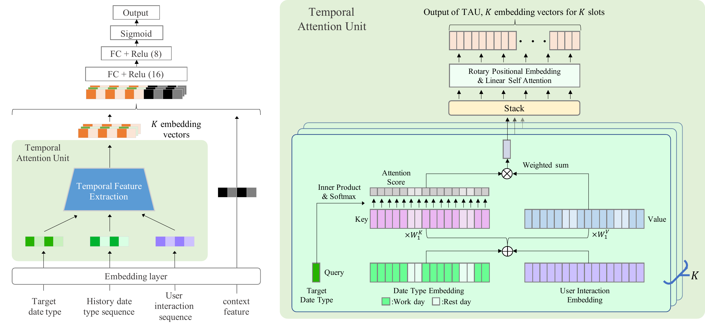
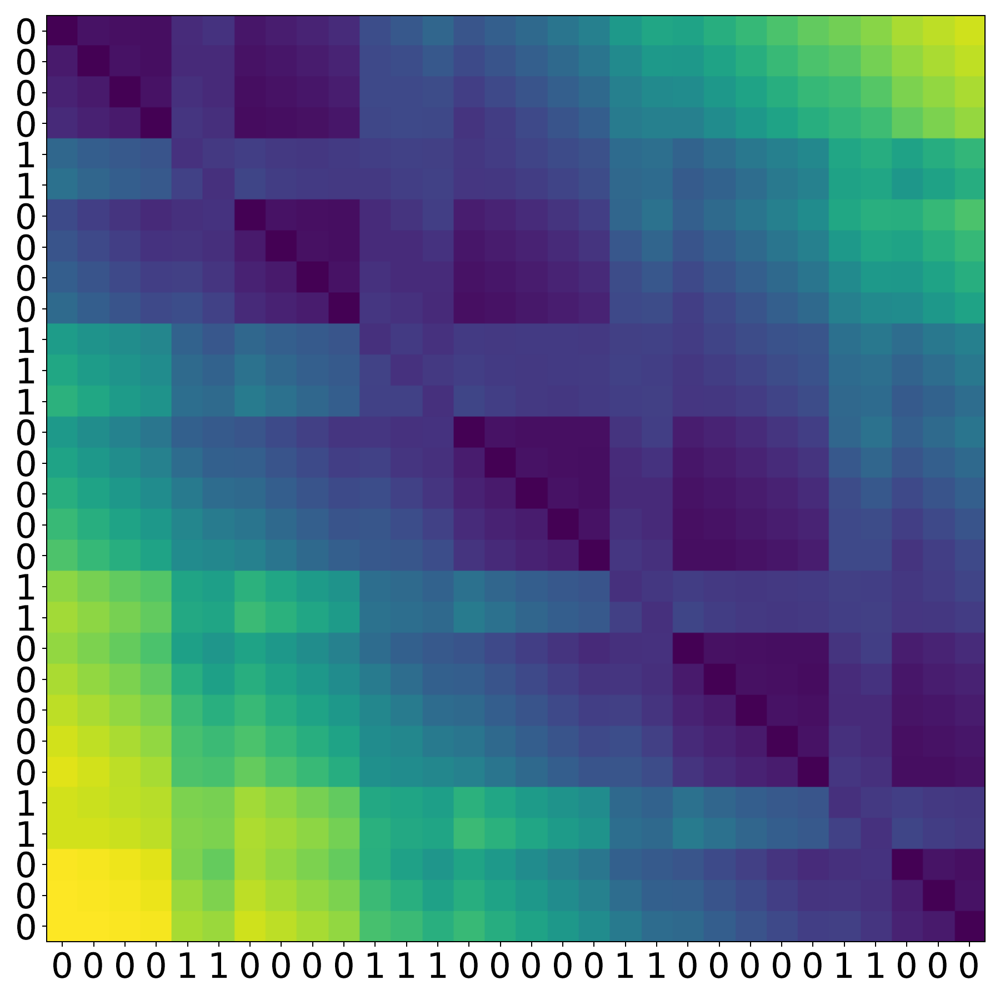
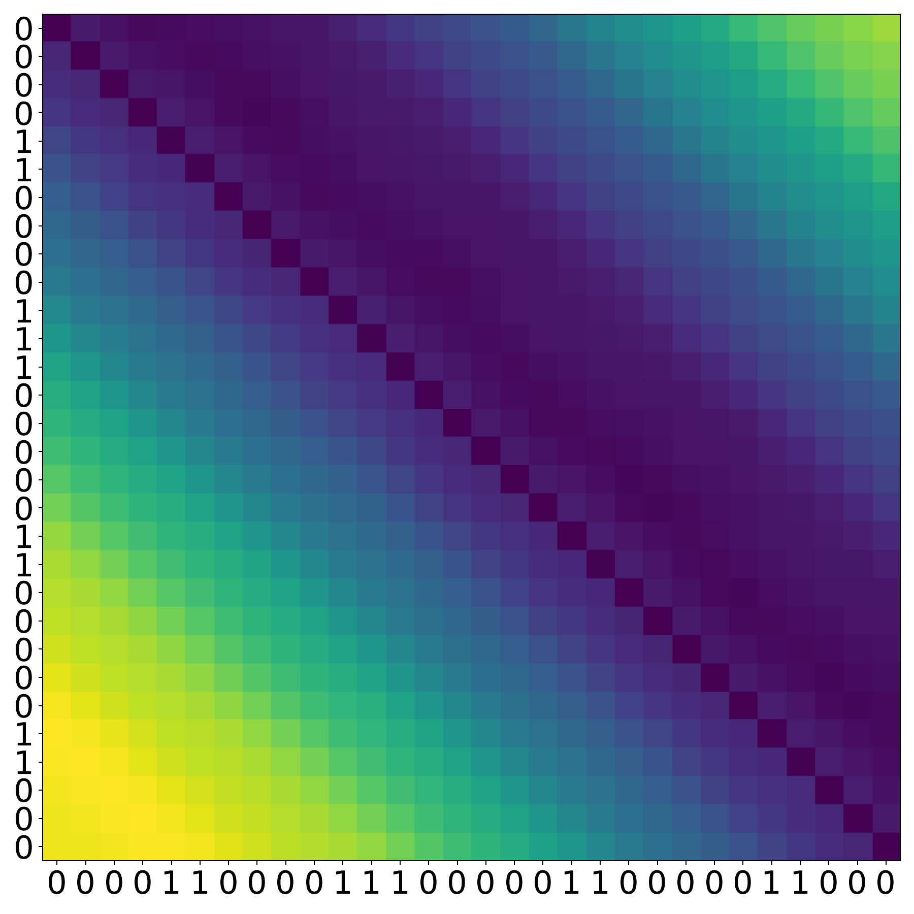

# TIM：先预测全天响应曲线，再分配通知配额

给一个用户每天几条通知的额度，还没有回答这些通知应何时发。全部挤到预测点击率最高的时槽可能造成连续打扰；均匀发送又忽略了用户的生活节奏。TIM把这个问题拆为两层：先从长期历史交互中预测用户全天各时槽的CTR，再在**给定日配额**下分配期望发送数，并让执行节奏追踪累计目标。它没有学习最优配额，也没有直接估计通知相对不发送的因果增量。

采用[arXiv固定v1](https://arxiv.org/abs/2406.07067v1)，2024-06-11首发，正式出版为[ICMR2024](https://doi.org/10.1145/3652583.3657614)，不是KDD或SIGIR。作者Huxiao Ji、Haitao Yang、Linchuan Li、Shunyu Zhang、Cunyi Zhang、Xuanping Li来自快手，Wenwu Ou标为Independent；通讯作者Xuanping Li。以下页码按原PDF物理页计，实验数字均为作者报告，本库没有训练或运行模型。

设同一位用户在工作日晚间常浏览视频，在休息日午后也经常打开应用。固定每天三条的旧策略可以按钟点均匀发送，也可以根据全体用户的平均分时 CTR 调节。两条规则在这位用户身上都缺少自己的日期和时段交互历史。下面沿着这位用户的一张分时响应表，从休息日预测走到一次实际发送判断。

## 把同一个人的全天习惯变成响应曲线

将一天划为$K$个等长时槽，每槽长度$T$。历史范围为$L$天，每个“天×时槽”有$d_1$个交互特征，例如收到通知数、点击数、活跃时长、视频浏览次数。输入为

$$X\in\mathbb R^{K\times L\times d_1},\qquad X_k\in\mathbb R^{L\times d_1}.$$

输出$p=(p_1,\ldots,p_K)$是目标日各时槽的预测CTR。论文图1的用户情境特征绕过TAU，与每个时槽的行为表示拼接，经过FC+ReLU（16、8）和Sigmoid得到输出。它并非预测用户每天的自然活跃率，更不是用款概率。输入中出现通知接收和点击，也意味着响应模式会受历史发送策略影响。[§2.1与图1，第2–3页](https://arxiv.org/pdf/2406.07067v1#page=2)。

Huxiao Ji 等，TIM 固定 v1 图 1，原文第 2 页。由作者附图转为 PNG。沿图右下角先读取一个槽的历史日期和交互，再沿右上角的 Stack 把各槽拼起来，最后回到左侧与语境拼接。

论文没有完整披露训练损失、负样本构造、曝光归因窗口、优化器、完整特征定义以及$K,T,L$配置。热图使用历史30天，不足以确认全部实验统一使用$L=30$。不能把常见的BCE训练写成作者已公开的实现，也不能根据日历空槽自行生成负样本。

## 第一层沿日期找同一时槽的可比历史

TAU的第一层对每个时槽$k$，在历史$L$天的相同时槽上做目标注意力：

$$o_k^1=\operatorname{softmax}\!\left(\frac{q_1K_1^\top}{\sqrt{d_2}}\right)V_1,$$
$$q_1=d_q^\top W_1^Q,\quad K_1=(D_h+X_k)W_1^K,\quad V_1=(D_h+X_k)W_1^V.$$

$d_q$是目标日期类型嵌入，$D_h$是历史日期类型嵌入（DTE），区分工作日和休息日；$d_2$是投影维度。也就是说，预测周末晚间时，模型可以从过往周末的同一时槽获得不同权重，而非把所有日期简单平均。这个解释是结构意图，不意味着热图证明了因果关系。目标query是预先可知的日期类型，并非目标日未来实际行为。[§2.1，第2–3页](https://arxiv.org/pdf/2406.07067v1#page=2)。

历史交互先嵌入后与DTE相加，图1支持两者在同一表示空间融合；正文没有给出从$d_1$原始特征到相加维度的全部细节，不应直接把原始异量纲特征与日期向量相加。

例如当前要预测周六午后的响应。此时查询是周六的休息日类型，键和值来自拍成同一午后槽的历史行，每行都有日期类型和历史交互。Softmax 为这些历史日分配总和为 1 的权重，得到一个午后向量。对早晨和晚间独立重复这一步，才有第二层的输入。

## 第二层沿时槽融合相邻与远距离习惯

将各槽表示堆成$O_1=(o_1^1,\ldots,o_K^1)^\top$，投影得到$Q_2,K_2,V_2$，作者写出

$$O_2=\left(J+G(Q_2)G(K_2)^\top\right)V_2.$$

$J$是全1矩阵，$G$先加入RoPE，再对每行做$\ell_2$归一化。于是一个时槽对另一个时槽的系数可理解为$1+\cos(\tilde q_i,\tilde k_j)$，理论范围为$[0,2]$。**这不是标准Softmax注意力，原式没有行和归一化分母**；不应在介绍TIM时无声补上分母。[§2.1，第3页](https://arxiv.org/pdf/2406.07067v1#page=3)。

从代数上，它可重排为$JV_2+G(Q_2)(G(K_2)^\top V_2)$，避免显式构造$K\times K$矩阵；投影维度固定时可随时槽数线性扩展。这个复杂度说明是本库对公式的分析，不是已核实的官方代码行为。论文没有给出推理延迟、内存或与标准注意力的成本对照。

## 固定配额下，为什么得到按CTR比例分配

令$n_i$为时槽$i$的**连续期望发送数**，$q$为外部分配的日配额。论文求解

$$\min_{n_i\ge0,\,\sum_i n_i=q}\ -\sum_i p_i n_i+\lambda\sum_i n_i^2,\qquad\lambda>0.$$

第一项鼓励多发到高CTR时槽，二次项惩罚集中。它是平滑偏好，不能替代最低发送间隔、免打扰时段和每槽硬上限；由于$p$没有随$n$变化，目标也没有显式建模通知疲劳对后续CTR的影响。[§2.2、式(1)–(8)，第3页](https://arxiv.org/pdf/2406.07067v1#page=3)。

根据KKT条件，一般形式为

$$n_i=\max\left(0,\frac{p_i-\varphi}{2\lambda}\right),\qquad \sum_i n_i=q.$$

$\varphi$是满足总配额的阈值。作者进一步选取$\lambda=\|p\|_1/(2q)$，在$q>0,\|p\|_1>0$时得到$\varphi=0$、$\mu=0$及

$$n_i=q\frac{p_i}{\|p\|_1}.$$

这个特殊解满足KKT，不是任意固定$\lambda$下的通用解。若只改变CTR整体尺度，同时按该规则调整$\lambda$，发送比例不变：绝对响应都很低时仍分完$q$。所以它不负责判断“是否值得发”，也没有“不发”动作的价值比较。$q=0$或全部$p_i=0$需要另设分支，论文没有展开。

例如$p=(0.1,0.2,0.3)$、$q=3$时得到$n=(0.5,1,1.5)$，并不是三个整数发送日。若业务要求一次触达只能选一个日期，把$n$直接四舍五入会改变可行性；按比例随机抽样也不同于确定地选最高分日期。此例只解释公式。

## 到达发送机会时，追踪累计目标

设当前在时槽$s$内，已过去$\Delta$，作者先线性插值得到截至当前的期望累计发送数

$$P(t_{s-1}+\Delta)=\left(\sum_{i<s}p_i+\frac{\Delta}{T}p_s\right)\frac q{\|p\|_1}.$$

原式(9)从$i=0$求和，而$p$在前文从1编号；此处按“此前时槽之和”解释，相当于补约定$p_0=0$。当外部触发到达时，作者用目标累计数$P(t)$减已发数$H(t)$，式(10)写为$\min(P(t)-H(t),1)$。[式(9)–(10)，第3页](https://arxiv.org/pdf/2406.07067v1#page=3)。

该式没有下界截断，不能在所有状态下直接当概率：若$P=0.2,H=0$时以0.2概率发送，成功后下次触发时可能$P=0.3,H=1$，原式得到$-0.7$。一个合理的工程补足是$\operatorname{clip}(P-H,0,1)$或先判断差值为正，但这只是本库建议，未核实作者实现。最终能否接近期望配额还依赖触发机会密度；文章没有证明严格填满配额、硬截止或最小间隔保证。未解决的实现范围记录于[审核台REV-046](../../维护/审核台.md)。

沿用三槽例子，午后槽走到一半时累计目标为 $P=0.5+0.5\times1=1$。如果此时已发一条，原式给出 0，如果此前未发，下一次触发给出 1。时间网格产生的连续额度由实时触发兑现，一天结束实际发送了几条要看触发和已发状态。

## 两张注意力热图和三组线上实验检验了什么

Huxiao Ji 等，TIM 固定 v1 图 2(a)、2(b)，原文第 4 页。两幅作者附图转为 PNG，先看完整模型，再看仅保留 RoPE 的对照。坐标轴 0 和 1 对应工作日与休息日。完整模型出现与日期类型对应的块状结构，去掉日期类型后色带更连续。图支持日期类型改变了这个可视化中的注意力结构，量化收益还要看表 2 的消融。

离线随机取100万快手用户，用$t$至$t+6$一周训练，$t+8$同一用户集合测试，分别构造测试日为工作日、休息日的两个数据集。这是时间向后的同用户测试，不是新用户泛化。指标为AUC、HR@$k$和A@$k$，但后两者的分母、聚合方式和候选定义没有明确给出。[§3.1，第3–4页](https://arxiv.org/pdf/2406.07067v1#page=3)。

| 模型 | 工作日AUC | 休息日AUC | 比较含义 |
|---|---:|---:|---|
| XGB | 0.5907 | 0.5917 | 不含用户交互历史的基线 |
| XGB加交互 | 0.6673 | 0.6644 | 加入历史特征后的收益 |
| MLP | 0.7704 | 0.7723 | 不含交互历史的神经基线 |
| MLP加交互 | 0.8485 | 0.8398 | 更接近TAU应比较的基准 |
| TIM | 0.8614 | 0.8559 | 历史特征加时序结构 |

表1中TIM全部指标领先四个基线，但历史特征本身已经解释了较大提升，不能把对XGB或MLP的全部差值归于注意力创新。[表1，第3页](https://arxiv.org/pdf/2406.07067v1#page=3)。表2中DTE单独加入时，工作日AUC由0.8535变为0.8532；完整TIM休息日A@1为0.360，低于仅RoPE的0.361，HR@1则同为0.0379。因此“完整模型所有消融指标都最好”不成立；较稳妥的结论是联合模型AUC和多数指标更好。原表数字与强调格式在译文保留，不静默修表。[§3.3、表2、图2，第4页](https://arxiv.org/pdf/2406.07067v1#page=4)。

在线将用户随机分为均匀发送、整体分槽CTR和TIM三组，使用相同配额分配算法。相对均匀发送的结果如下；括号内为p值，百分数是作者报告的相对变化，而非百分点。[§3.4、表3，第4页](https://arxiv.org/pdf/2406.07067v1#page=4)。

| 指标 | 整体CTR策略 | TIM策略 |
|---|---:|---:|
| DAU | +0.026%（0.37） | +0.100%（0.00） |
| 发送量 | −0.214%（0.00） | +0.023%（0.48） |
| CTR | +0.437%（0.00） | +1.217%（0.00） |
| 观看时长 | +0.014%（0.73） | +0.066%（0.11） |
| 通知关闭率 | +0.408%（0.53） | +0.448%（0.47） |

结果支持TIM这套策略相对均匀发送提升CTR和DAU。p=0.00是显示精度，不是严格为零；观看时长没有达到常用0.05显著性门槛，关闭率不显著也不能证明两策略等效或没有打扰。作者未报告在线实验周期、各组规模、绝对基线或置信区间，也没有拆开预测器与pacing策略的线上独立贡献。

## 对月初选本月优惠发送日，先迁移接口再改目标

对[当前场景](../../知识库/总览/优惠信息Push触达场景.md)，最值得借鉴的是“一次预测整个候选时间网格，再统一决策”。现有用款需求曲线可以作为月初可用特征，与候选日期、已知周期、历史触达响应一起预测日期价值；不要先把“需求最高”固定为“最适合触达”的标签。

迁移至少要改变三个条件。第一，TIM按目标日的日历类型读取历史同槽，不能把日内时槽换成月内日期就宣称已验证；月长度、月内位置、节假日和工资/还款周期可能需要新的表示，特征必须在月初可见。第二，CTR是触达响应，不是金融场景的增量用款或净收益；需要对候选发送日、不发或现行策略有覆盖的实验/可识别日志。第三，TIM在单用户固定日配额下平滑分发；月初选日可能有整数日期、跨用户日容量、优惠预算、有效期和风险约束，应用另一层约束分配。每月只发一次目前只是条件示例，不能默认成业务事实。

因此建议保留需求峰值策略作为强基线，先对比月初特征下的完整候选日响应模型，再通过日期随机化与对照识别增量，最后接预算/容量优化。直接照搬比例配额算法并不能解决“哪天优惠多创造了用款”。TIM仍是优先读的第一篇，因为它清楚展示时间网格建模与执行分发的分工；长期发送/等待及自触发论文用于后续对照，不借其标题补足TIM没有证明的能力。

## 阅读与译文

已通读固定v1全部5页、完整源码正文及3表、2幅编号图、10个编号公式；参考文献表检查过，未逐篇读引文。正文§1–4、摘要、图表标题/表头/描述和通讯作者脚注译为中文，无附录；图内英文、人名机构、出版/权利信息及24条参考文献保留。当前模型完成翻译，保留原公式及明确译注；没有外部翻译服务、官方代码运行或独立审查。

本地中文PDF：`.local/papers/SRC-TIM/translation/TIM: Temporal Interaction Model in Notification System.pdf`，4页，全页渲染目视，中文字体嵌入/映射、关键数字、引用及全部表内小数对照。可编辑主文件：`.local/papers/SRC-TIM/translation/translated-sources/sample.tex`；原文与译后工程分开保留。许可依据为arXiv非独占分发许可与PDF首页ACM权利栏，未确认公开全文译文许可，未发布正式Markdown全文译文。原文5页与中文PDF4页均已备份至私有Releases，核对远端digest、真实登录下载的PDF类型/大小/完整SHA256，匿名仓库与两份资产API均返回404。两库目录已同步；存储状态见[PDF目录](../../译文/PDF目录.md)，可复用机制见[通知配额与时机问题](../../知识库/问题/给定配额怎样安排通知发送时机.md)。
