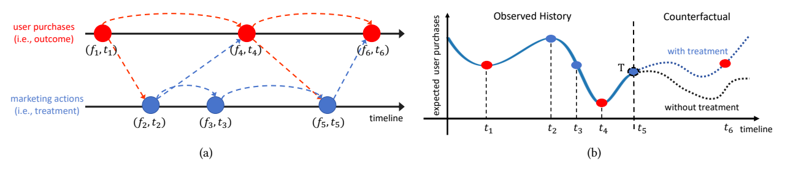
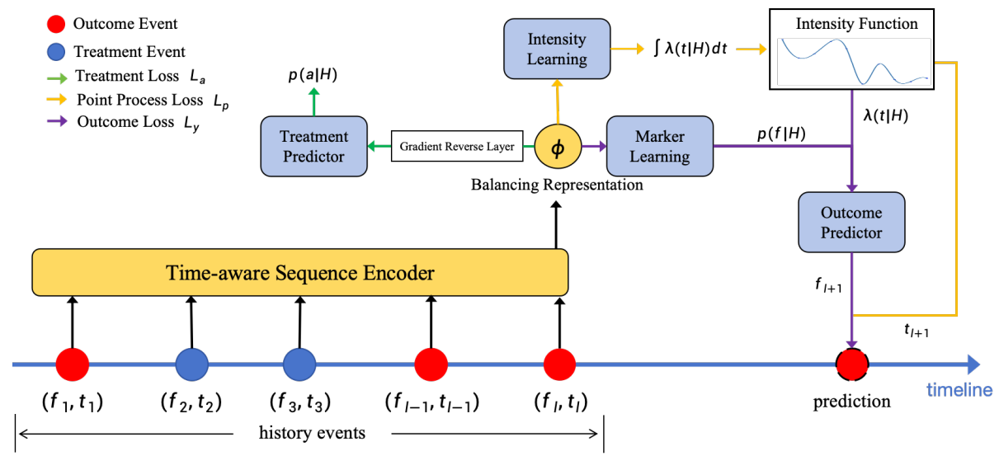
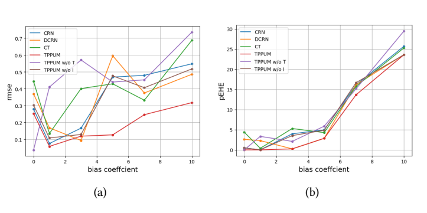
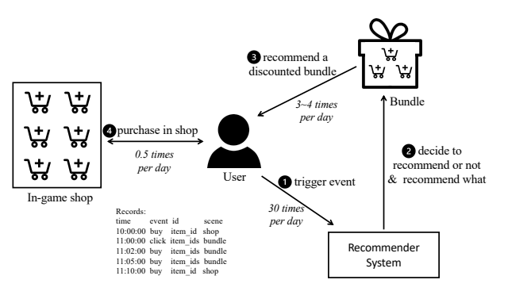
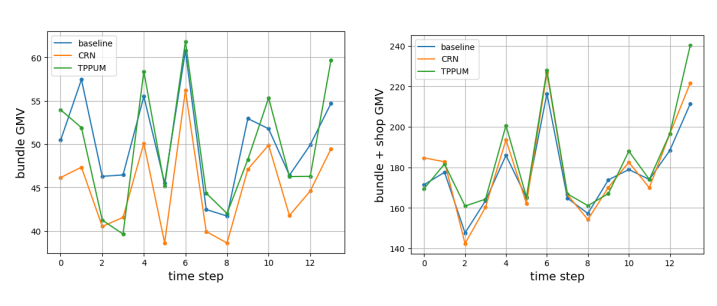

# TPPUM 怎样同时选营销时机和礼包内容

玩家一天可能触发约 30 次礼包候选，线上平均只推荐 3–4 次。大折扣可以拉高礼包成交，也可能把原来会在商店按原价花的钱替换掉。只预测礼包成交，策略就很难看到另一处收入的变化。TPPUM 把礼包推荐和商店购买写进同一条带时间戳的历史，比较施加某个候选动作与无动作下的商店购买过程。线上再结合两处 GMV 选内容和时机。 [KDD 2024 正文 §1、§6](https://dl.acm.org/doi/epdf/10.1145/3637528.3671560#page=8)

*作者原图。Zhang 等，正式 PDF 第 3 页图 1。红点为购买，蓝点为处理，虚线是给定同一历史后两种行动下的未来预期。*

## 从紧前事件造事实样本，再用同一个起点换动作

假设玩家 10:00 在商店购买、11:00 看到礼包 A、11:40 又在商店购买。11:40 的购买为一行样本，金额是事实结果，紧前的礼包 A 给出处理标签。若紧前也是一笔商店购买，行标签为无处理。更早的礼包与购买连同时间戳仍输入编码器。离线估计时，对事实处理行删掉最后的礼包，对事实无处理行加一条模拟礼包，特征取最近事实处理，时间取最后事件之后 24 小时。后一规则是论文离线构造的特定候选，解释效应时要注意被评分的动作和时间。 [§3.1、§4.5](https://dl.acm.org/doi/epdf/10.1145/3637528.3671560#page=6)

*作者原图。Zhang 等，正式 PDF 第 5 页图 2。左侧从历史得到表示，时间与标记分支连接到右侧购买预测，处理预测器从梯度反转层获得同一个表示。*

前三个事件里，预测 11:40 的购买时只编码 10:00 的购买和 11:00 的礼包，同时把 11:40 的金额留作标签。两种事件分别映射为特征向量，拼入时间间隔后由序列编码器生成 $\phi$。强度分支把 $\phi$ 和距离上一个事件的间隔拼接，用 MLP 预测累计强度，再对时间求导。另一路 MLP 输出标记表示 $e_d$。结果头把 $\phi$、强度、$e_d$ 读入，以事实购买金额计算误差。处理头根据事实动作标签学习分类，反转层使共享表示收到相反方向的处理分类信号。图 2 和式 (7) 说明训练方向，式 (8) 的符号须结合对数似然与最小化目标解读。式 (2)、(6) 将标记概率写进生存项，标准带标记过程的无事件项采用边缘时间强度。式 (3) 也没有交代如何约束 MLP 产生非负强度及在零间隔处累计为零。论文公式支持辨认模型结构，实际实现细节仍需代码核对。 [§4、式 (2)–(8)](https://dl.acm.org/doi/epdf/10.1145/3637528.3671560#page=5)

## 把购买强度和金额合成窗口分数

对于 11:00 推送和同一时刻不推送，分别在窗口内以购买强度乘以事件金额预测，再积分。假设两条路径在 24 小时内分别预计 3 次、2 次购买，平均每次 50 元、60 元，那么商店金额增量为 $3\times50-2\times60=30$ 元。推荐分数还要纳入礼包侧价值。比如两种候选礼包的自身收入相同，A 让商店收入增加 30 元，B 让商店收入减少 10 元，目标是总 GMV 时应优先 A。线上折扣档由人工规则给定，系统决定候选触发时是否展示以及展示哪些商品及数量。CNTPP 用特征总量除以事件数，得到按事件加权的平均特征。若用同一个构造例，平均金额减少 10 元，两种指标对应不同的策略目标。未来历史会随购买和后续推荐改变时，整个窗口的策略效应还要对未来行动与事件路径作边际化。 [TPPUM §4.5 式 (9)](https://dl.acm.org/doi/epdf/10.1145/3637528.3671560#page=6) · [连续时间估计比较](../../知识库/问题/不规则转化事件怎样估计补贴的窗口增量.md)

*作者原图。正式 PDF 第 7 页图 3。合成数据提供反事实真值，图中比较各混杂强度下的 RMSE 和 pEHE。*

表 2 在 Synthetic GAME 上报告 TPPUM 的 RMSE 23.2204、pEHE 36.8538。真实 GAME 用旧策略日志训练、随机指派用户测试。TPPUM 的 Qini 为 0.0205，CRN 为 0.0190，去对抗平衡后为 −0.0111。前两项衡量合成真值误差，Qini 衡量真实测试集上的排序。论文给出的 8.8470% RMSE 改善无法按表列基线复算，pEHE 与 Qini 的改进分别可按 CT 和 CRN 复算。 [§5、表 2](https://dl.acm.org/doi/epdf/10.1145/3637528.3671560#page=7)

## 线上结果需要同时看两个交易场景

*作者原图。正式 PDF 第 8 页图 4。系统在候选触发后选择是否推荐与展示内容。商店交易属于另一条路径。*

*作者原图。正式 PDF 第 8 页图 5。左图是礼包收入，右图是应用整体收入。*

在 14 天的游戏实验中，TPPUM 相对原 Transformer 策略的礼包 GMV 下降，礼包加商店的总 GMV 上升 3.6%。三小时分箱的 CRN 策略总 GMV 下降 1.8%。摘要和 §6 均写 3.6%，引言写 3.7%。这是整套策略及各自窗口、目标的线上比较，无法从中单独归因给强度模型、对抗训练或调度。 [§6、图 4–5](https://dl.acm.org/doi/epdf/10.1145/3637528.3671560#page=8)

采用 ACM SIGKDD 2024 正式版 10 页，通读 §1–7 并定向复核附录 A。未运行模型。11 页中文 PDF 按正式版重排摘要、正文、致谢、图表说明与脚注。原图内文字、参考文献和附录保留英文。未取得作者 LaTeX，保留按正式版页码组织的可编辑译稿和重排工程。 [正式原文](https://dl.acm.org/doi/epdf/10.1145/3637528.3671560) · [中文 PDF 访问说明](../../译文/PDF目录.md)
