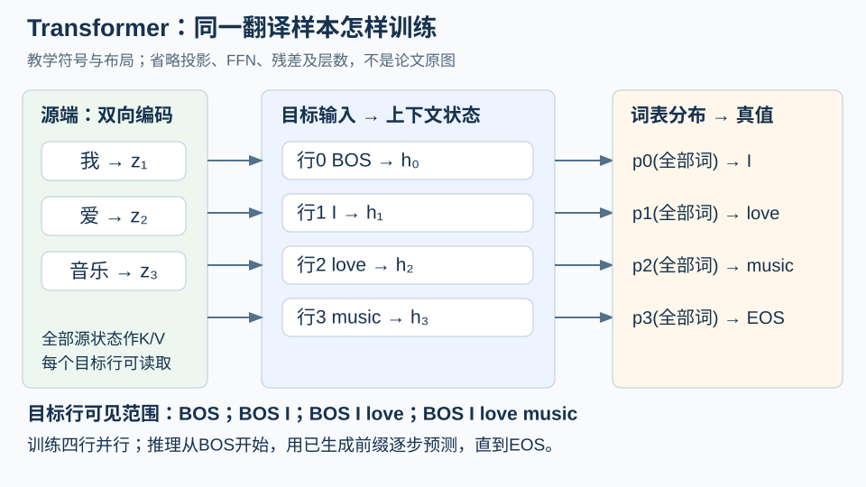
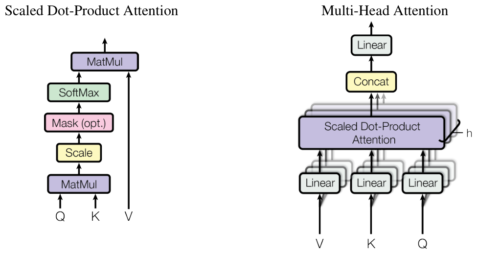

# Transformer：让序列位置直接交换信息

循环网络按照时间步更新状态，要把远处信息传到当前位置，通常必须穿过中间时间步。Transformer的关键改变是：让每个位置直接读取其他可见位置，再用逐位置前馈网络变换特征。这样，训练时不同位置可以并行计算，远距离位置之间也有短的信息路径。代价是完整自注意力需要计算位置对，注意力矩阵随序列长度平方增长。

Ashish Vaswani等人的 *Attention Is All You Need* 发表于NeurIPS 2017，这里采用[arXiv 1706.03762v7](https://arxiv.org/abs/1706.03762v7)的15页版本。原始Transformer是完整的**编码器—解码器**，服务机器翻译等序列转导任务；今天常见的仅编码器、仅解码器模型，是对这一构件体系的不同组织。注意力在此之前已经存在，本篇的贡献不能简化为“发明了Attention”。

## 先看循环翻译器在哪一步需要等待

用一个教学句对贯穿全文：源端按三个符号记为“我、爱、音乐”，目标端为“I、love、music、EOS”，EOS表示生成结束。这里把词当作Token只是为了看清计算，真实论文用BPE/word-piece子词，例子不是原文数据或真实模型输出。

循环编码器可写成 $z_i=f(z_{i-1},e(x_i))$。算“音乐”的状态前，要先得到“我”“爱”的状态；循环解码器也按已输出的目标逐步更新。旧的带Attention编码器—解码器已经可以让解码器从各源位置读取信息，**加入Attention本身并没有消除循环骨干的先后依赖**。Transformer改变的是形成源、目标上下文状态的过程：一层内每个位置同时提出查询、读取上一层可见位置的表示，再各自变换。层与层之间仍须先后执行，生成新词也仍有先后依赖。[原文§1–2，第2页](https://arxiv.org/pdf/1706.03762v7#page=2)。

源端上下文 $z_i$ 也不是“第$i$个词的固定词向量”：它已读入整句；目标端隐藏状态则是当前目标前缀结合源句之后的表示。隐藏状态可以理解为每位置一个随上下文更新的实数向量，最终由它给候选Token打分，不能把它直接读成一个词。

复习时可直达[训练对齐](#每一行拿到什么又要预测什么)、[单行注意力算例](#沿一次读取算出新的上下文向量)、[输出与梯度](#从目标状态到词表概率损失和梯度)、[生成过程](#训练时并行四行推理时怎样逐步生成)。

## 每一行拿到什么，又要预测什么

源端输入为 $x=[我,爱,音乐]$；目标真值为 $y=[I,love,music,EOS]$。训练时右移目标，得到解码器输入 $u=[BOS,I,love,music]$，BOS是起始符。批量大小先取1，源长度3、目标长度4；真实base宽度512。输入查表后，源表示为 $3\times512$，目标表示为 $4\times512$；加入同宽位置编码，不把句子压成一个向量。

| 目标行 | 此行输入 | 因果自注意力可读的目标输入 | 监督标签 | 输出的含义 |
|---|---|---|---|---|
| 0 | BOS | BOS | I | 给定源句，预测首词 |
| 1 | I | BOS、I | love | 已知I，预测下一词 |
| 2 | love | BOS、I、love | music | 已知I love，预测下一词 |
| 3 | music | BOS、I、love、music | EOS | 判断这句何时结束 |

四行都能通过交叉注意力读全部三个源位置。完整源句是翻译的条件，不属于目标端未来泄漏；目标端第0行若能读取第1行的输入I，才会直接看到自己要预测的答案。因此右移要配合因果遮罩。填充补齐的行另行排除，不把PAD当成EOS。这里的行号从0起，原文常从1起；位置编号改变不改变对齐关系。[§3.1与§3.2.3，第3、5页](https://arxiv.org/pdf/1706.03762v7#page=3)。

从左往右读图：三个源状态成为每层解码器交叉读取的记忆；中间四行先用目标前缀交流，再读源端；右边每行输出一个词表分布。图下逐行列出的前缀范围只约束目标自注意力，不遮掉源端记忆；它省略层内投影、FFN和残差，不能替代下面的计算。

## 从输入句子到逐个输出的译文

作者原图 1（Ashish Vaswani 等，1706.03762v7，PDF 第 3 页）。左侧编码整条源句，右侧从移位后的目标前缀开始。右侧中间注意力从左侧接收 K、V，查询来自当前解码器层，顶部 Linear 与 Softmax 逐位置产生词表概率。

编码器把输入Token序列转为上下文表示 $Z=(z_1,\ldots,z_n)$；解码器根据 $Z$ 和已知输出前缀预测下一个Token。例如把“我爱音乐”译成英文，编码器可同时阅读全部中文；预测“music”时，解码器只能使用已经给出的英文前缀，同时通过交叉注意力读取中文表示。

base模型的编码器与解码器各有6层，表示宽度 $d_{model}=512$。编码器每层是多头自注意力和前馈网络；解码器每层在因果自注意力之后增加读取编码器输出的交叉注意力，再做前馈变换。各子层都配残差连接和层归一化。原版采用：

$$
H_{out}=\operatorname{LayerNorm}\bigl(H+\operatorname{Dropout}(g(H))\bigr).
$$

这是依据§3.1与§5.4合写的 **Post-LN** 形式：先残差相加，再归一化。它与[SASRec](../SRC-SASREC/阅读笔记.md#遮住未来才能并行计算全部训练位置)先归一化子层输入的形式不同，不能看到“残差、LayerNorm”就认为位置完全相同。[§3.1、图1，原文PDF第3页](https://arxiv.org/pdf/1706.03762v7#page=3)。

残差让当前行的旧状态能直接与子层新结果相加；LayerNorm（层归一化）再对**该Token的512个特征**计算均值与方差，施加可学习缩放/偏移，不是把整句或整个batch平均。这样子层可以学习怎样修改已有状态，而不用完全重建它；但不能由残差存在就保证梯度永不消失。Dropout是训练时随机关闭部分分量、推理时关闭这一随机操作的正则化。这里交代它们在本篇的接口，完整导数见[归一化与残差](../../知识库/概念/LayerNorm与残差梯度.md)。

## Q、K、V怎样把内容变成读取权重

作者原图 2（Ashish Vaswani 等，1706.03762v7，PDF 第 4 页）。先读左半图的缩放、可选遮罩和 Softmax，再看权重乘 V。右半图的头使用各自的投影，拼接的是各头输出，最后还有线性变换。两幅子图的组合版取自正式排版。

查询Q表达当前位置想寻找什么，键K供查询匹配，值V承载实际读出的信息。它们是可学习投影产生的向量，并非预先人工定义的语义标签。对查询矩阵 $Q\in\mathbb R^{n_q\times d_k}$、键矩阵 $K\in\mathbb R^{n_k\times d_k}$、值矩阵 $V\in\mathbb R^{n_k\times d_v}$：

$$
A=\operatorname{softmax}_{j}\left(\frac{QK^\top}{\sqrt{d_k}}+M\right),\qquad O=AV.
$$

$M$是将原文遮罩说明显式写出的矩阵：可见连接取0，禁止连接取 $-\infty$；Softmax按每个查询行、沿键位置归一化。输出 $O_i=\sum_j A_{ij}V_j$，是当前位置按内容相关性读取的结果。即使给定A时对V是线性加权，整体仍非线性，因为A本身依赖输入。

除以 $\sqrt{d_k}$ 的动机是控制分数幅度。若查询与键各分量相互独立、均值0且方差1，点积的方差为 $d_k$，缩放后为1。这是解释尺度的简化假设，不是训练全过程都会严格成立的统计保证。分数幅度过大可能让Softmax过于饱和；缩放有助于缓解这一问题。[§3.2.1、式(1)及脚注4，PDF第4页](https://arxiv.org/pdf/1706.03762v7#page=4)。

多头注意力让不同投影各自产生读取结果，再拼接回模型宽度：

$$
\mathrm{head}_a=\operatorname{Attention}(QW_a^Q,KW_a^K,VW_a^V),\qquad
\operatorname{MultiHead}(Q,K,V)=\operatorname{Concat}(\mathrm{head}_1,\ldots,\mathrm{head}_h)W^O.
$$

其中 $W_a^Q,W_a^K\in\mathbb R^{d_{model}\times d_k}$，$W_a^V\in\mathbb R^{d_{model}\times d_v}$，$W^O\in\mathbb R^{hd_v\times d_{model}}$。base设置为 $h=8$、$d_k=d_v=64$，八头总宽度仍为512；不是每个头都保留完整512维后无代价地扩充。不同头可能学到不同关系，但没有机制保证某头必定对应某种人类可命名概念。[§3.2.2，PDF第4–5页](https://arxiv.org/pdf/1706.03762v7#page=5)。

### 点积、分头与梯度的三个易错点

自注意力表示Q/K/V同源，不表示投影后数值相同；投影参数也不含batch轴。base先将512维投影，再分为8个64维头，每头分数除以8；拼接后仍需输出投影。只切输入或按$\sqrt{512}$缩放，都不是原文base的计算。[§3.2.1–3.2.2，第4–5页](https://arxiv.org/pdf/1706.03762v7#page=4)。完整批量与交叉注意力形状见[张量推演](../../知识库/问题/序列怎样用自注意力建立上下文.md#投影分头与张量形状)。

原文说点积与加性注意力理论复杂度相近，点积可利用高效矩阵乘法而更快、更省空间；没有论证加性注意力不能并行或必然更不稳定。对Softmax，分数差距扩大才会趋向尖锐；给全部分数加同一常数不会改变输出。注意力权重趋近one-hot时，其Jacobian趋零，但不能推出V分支、残差和整网梯度全部消失。具体求导见[缩放与Softmax](../../知识库/问题/序列怎样用自注意力建立上下文.md#缩放影响分数差距softmax不是梯度保证)，属于对式(1)的分析展开，不是新增论文实验。

## 沿一次读取算出新的上下文向量

为了把上式接到样本，先只看编码器中“爱”这一行的一个头。以下向量均为构造值，取 $d_k=d_v=2$，不代表base的64维或学出的中文语义。假定该层已投影得到查询 $q=(\sqrt2,0)$，源端三个键依次为 $k_1=(0,1),k_2=(1,0),k_3=(1,1)$，值为 $v_1=(1,0),v_2=(0,2),v_3=(2,2)$。

1. 匹配：$[qk_1^\top,qk_2^\top,qk_3^\top]=[0,\sqrt2,\sqrt2]$。
2. 按键维缩放：除以 $\sqrt2$ 得 $[0,1,1]$，编码器此处无因果禁止连接。
3. 沿三个源位置Softmax：$a=[1,e,e]/(1+2e)\approx[0.1554,0.4223,0.4223]$。这里归一化的是“读哪个位置”，不是输出词表。
4. 读取值：$o=0.1554(1,0)+0.4223(0,2)+0.4223(2,2)\approx(1.0000,1.6893)$。得到的仍是特征向量，不是“爱”的分类结果。

权重相同也不代表读到相同内容：后两个位置的V不同，贡献不同；Q/K负责如何读，V负责读出什么。参数之所以能学到有用读取，是因为后续预测误差会通过 $o$ 传回V及决定权重的Q/K，而不是有人给注意力权重提供正确标签。[依据§3.2.1式(1)，第4页的教学展开](https://arxiv.org/pdf/1706.03762v7#page=4)。

在本例目标第2行，自注意力只能读BOS、I、love。若用一行四个分数表示，则最后一列先加 $-\infty$，Softmax后对应权重为0；不是先把所有位置平均再删掉未来。交叉注意力又换成“目标行提出Q，三个源状态提供K/V”，所以单头分数为 $4\times3$，而非目标自注意力的 $4\times4$。八头形状分别是 $8\times4\times3$ 和 $8\times4\times4$；批量轴省略。完整一般形状和求导放在[公共自注意力详解](../../知识库/问题/序列怎样用自注意力建立上下文.md#投影分头与张量形状)。

## 三种注意力的区别在于信息来自哪里、能看哪里

| 位置 | 查询Q | 键K和值V | 可见范围 |
|---|---|---|---|
| 编码器自注意力 | 编码器当前层输入 | 同一输入 | 源序列全部有效位置 |
| 解码器因果自注意力 | 解码器当前层输入 | 同一输入 | 当前及更早的输入位置 |
| 编码器—解码器交叉注意力 | 解码器上一子层状态 | 编码器顶层输出 | 源序列全部有效位置 |

回到同一句对：输入BOS、I、love、music，监督I、love、music、EOS。love行使用BOS、I、love预测music，不能读取后一输入位置的music。**右移与因果遮罩必须共同起作用**；只右移而不遮罩，较早预测仍可能从其他输入位置读到答案。所有已知训练位置可以并行计算，不等于推理时未知的未来Token也能并行产生。[§3.1、§3.2.3，PDF第3、5页](https://arxiv.org/pdf/1706.03762v7#page=5)。

## 前馈变换与位置编码分别补什么

注意力负责跨位置交换信息；前馈网络在每个位置独立执行相同的非线性变换：

$$
\operatorname{FFN}(x)=\max(0,xW_1+b_1)W_2+b_2.
$$

base模型从512维扩到2048维再压回512维。同一层各位置共享参数，不同层参数独立。它不是在序列轴上再做一次信息混合。[§3.3、式(2)，PDF第5页](https://arxiv.org/pdf/1706.03762v7#page=5)。

输入、输出嵌入以及输出Softmax之前的线性变换共享权重矩阵；嵌入向量乘 $\sqrt{d_{model}}$。为了显式提供顺序信息，在Token嵌入上叠加正弦位置编码：

$$
PE(pos,2i)=\sin\left(\frac{pos}{10000^{2i/d_{model}}}\right),\qquad
PE(pos,2i+1)=\cos\left(\frac{pos}{10000^{2i/d_{model}}}\right).
$$

$pos$是位置，$i$索引成对的维度。固定偏移可以用每对正余弦的线性变换表示，因此作者希望模型更容易利用相对距离。作者还假设它可能外推到更长序列；表3只显示学习式与正弦位置表示在相同开发协议下接近，**没有证明长度外推必然可靠**。因果遮罩本身也含方向信息，因此“无显式位置向量”与“任何结构都完全无序”应区分。[§3.4–3.5，PDF第5–6页；表3第9页](https://arxiv.org/pdf/1706.03762v7#page=6)。

### 嵌入共享与缩放的含义和条件

若共享词表矩阵为$E\in\mathbb R^{|\mathcal V|\times d}$，输入查表得到$E[token]$，输出logit可写为$hE^\top$；原论文另在输入侧乘$\sqrt d$。输入与输出共享要求词表索引语义及维度兼容，不是任意不同源/目标词表都能直接绑定。§3.4报告共享和缩放做法，却未证明所有初始化都应乘$\sqrt d$；“任何Xavier初始化方差都是$1/d$”也不成立，不能把这个口头解释当原文结论。[§3.4–3.5，第5–6页](https://arxiv.org/pdf/1706.03762v7#page=5)。

正弦位置编码固定偏移的线性变换可以由和角公式显式写出；无位置注意力则是置换等变，不是输出数组永远不变。两项推导以及LN按每Token特征归一化的公式，集中在[位置与归一化](../../知识库/问题/序列怎样用自注意力建立上下文.md#layernorm的统计轴与残差的梯度路径)。这些补充解释原文构件，不把RoPE、RMSNorm或现代KV缓存说成2017论文提出的技术。

## 从目标状态到词表概率、损失和梯度

注意力、FFN、残差与归一化反复完成后，目标第2行得到 $h_2\in\mathbb R^{512}$。它代表“源句与BOS I love”的条件。设共享词表矩阵 $E\in\mathbb R^{|\mathcal V|\times512}$，输出logit向量可记为 $\ell_2=h_2E^\top$，Softmax沿词表轴得到 $p_2$。logit是未归一化实数分数；概率是对所有有效输出类别归一化后的结果。**一个目标位置得到整张词表上的分布，四行组成 $4\times|\mathcal V|$，不是四个位置彼此竞争。** [§3.4，第5页](https://arxiv.org/pdf/1706.03762v7#page=5)。

先用未平滑的交叉熵看清真值怎样进入：$\mathcal L_{CE}=-\frac14\sum_{t=0}^3\log p_t(y_t)$。若四行各自真值概率是 $[0.6,0.5,0.25,0.8]$，则 $\mathcal L_{CE}\approx0.7034$。第2行取出的是music的0.25，即 $-\log0.25\approx1.3863$；不是把预测概率向量和标签ID数值相减。这里按有效Token平均是教学归约约定，不声称原文报告了所有实现细节。

原论文实际使用 $\epsilon=0.1$ 的标签平滑：把one-hot的全部监督质量集中于一个类，改为给其他类少量质量，损失为 $-\sum_v q_{t,v}\log p_{t,v}$。因此上面的0.7034**不是原论文平滑目标的数值**。平滑分布如何排除padding与采用哪种约定，见[教学实现对照](#教学实现为什么不能逐项当作原版)；原文§5.4只给系数，不能补造其未写出的实现。

对按四行平均的未平滑教学损失，$\partial\mathcal L/\partial\ell_{t,v}=(p_{t,v}-\mathbf1[v=y_t])/4$；平滑时将one-hot换成 $q_{t,v}$。第2行music的梯度为 $(0.25-1)/4=-0.1875$，若把logit当作独立坐标，沿负梯度会提高真值分数、降低其余分数；实际更新共享网络参数，各位置之间还会耦合，不能保证一步更新后每个真值logit都升高。误差经输出表回到 $h_2$，再经解码器各子层和交叉注意力回到编码器。源句没有独立的“翻译标签行”，也可收到目标损失的梯度；源/目标输入查表与输出投影共享参数时，这些路径还会在同一表上累加。这里解释可导路径，不保证每个参数在每个样本都有非零梯度。通用推导见[词表预测与交叉熵](../../知识库/概念/语言模型的词表预测与交叉熵.md)。

## 训练时并行四行，推理时怎样逐步生成

训练把真实目标前缀一次交给模型，称为teacher forcing：第2行拿到的love来自训练数据，即使模型第1行更偏爱别的词。这让四行可同时计算，同时借助遮罩保持各行条件正确。它没有授权推理读取真实译文。

推理先编码源句，再从BOS开始：首步取候选I，第二步以BOS、I预测love，接着预测music，最后预测EOS并停止。这里仅用假想贪心路径解释状态，原文测试实际使用束搜索：保留若干候选前缀、累计对数概率并按给定长度惩罚选择，束宽4、惩罚0.6是论文的结果条件。若前一步选错，下一步条件也随之改变；这正是训练真实前缀与实际生成前缀的区别。[§3与§6.1，第2–3、8页](https://arxiv.org/pdf/1706.03762v7#page=8)。

生成到一个新Token后，需要新的目标输入状态；原始论文没有把现代KV缓存算法作为本篇贡献。源句记忆可重复读取是架构接口的性质，具体服务优化要另外核实。

## 并行优势不消除平方成本

原文表1比较注意力、循环与卷积的主要位置混合成本。自注意力为 $O(n^2d)$、顺序操作数 $O(1)$、最大依赖路径 $O(1)$；循环为 $O(nd^2)$、$O(n)$、$O(n)$。这里的常数顺序操作，是相对于序列长度、固定网络层数而言，不意味着模型只有一次算子调用。[§4、表1，PDF第6–7页](https://arxiv.org/pdf/1706.03762v7#page=6)。

若把线性投影和FFN也计入，固定层数与头数、$d_{ff}=O(d)$下，完整块的主要计算可写为 $O(n^2d+nd^2)$。这是依据架构的计算分析，不能把表1的 $O(n^2d)$当作完整Transformer所有成本。注意力分数还占用随 $n^2$ 增长的空间；因此短路径、更好的训练并行度不代表任意长序列都更快。

作者提出用大小r的局部邻域把位置混合降为 $O(rnd)$，代价是路径增至 $O(n/r)$；本文把它留给未来研究，未给出对应的正式模型实验。附录第13–15页展示不同头关注远距离词、代词或句法相关位置，只能说明可视化关联，不能证明头对预测的因果贡献。

## 原论文怎样训练与评估

WMT 2014英德约450万句对，源/目标共享约37000个BPE Token；英法约3600万句，采用32000个word-piece。近似按长度分批，每批约25000个源Token与25000个目标Token。Adam取 $\beta_1=0.9,\beta_2=0.98,\epsilon=10^{-9}$，学习率为：

$$
\eta_t=d_{model}^{-1/2}\min(t^{-1/2},t\,w^{-3/2}),\qquad w=4000.
$$

前4000步线性预热，之后按步数平方根倒数衰减。base的子层输出、嵌入加位置表示使用Dropout 0.1，标签平滑为0.1。原文称“三类正则化”，但仅列Dropout与标签平滑两个小标题，不能替作者补写未报告机制。[§5，PDF第7–8页](https://arxiv.org/pdf/1706.03762v7#page=7)。

八块P100上，base约0.4秒/步、10万步、12小时；big约1秒/步、30万步、3.5天。下表是**作者报告**的newstest2014测试结果，没有本仓库复现：

| 模型 | 英译德BLEU | 英译法BLEU | 估计训练FLOPs |
|---|---:|---:|---:|
| base | 27.3 | 38.1 | $3.3\times10^{18}$ |
| big | 28.4 | 41.8 | $2.3\times10^{19}$ |

big英译德在该表超过此前列出的单模型与集成；英法41.8来自摘要和表2，§6.1正文却写41.0，译文保留并加注。FLOPs由训练时间、GPU数与估计持续单精度吞吐相乘得到，并非逐算子测量的统一端到端成本。base平均最后5个检查点，big平均最后20个；束宽4、长度惩罚0.6，最大输出为输入长度加50。硬件、平均与搜索设置都属于结果条件。[§6.1、表2，PDF第8页](https://arxiv.org/pdf/1706.03762v7#page=8)。

表3另用newstest2013开发集，且不平均检查点。其base BLEU为25.8、约6500万参数；单头24.9，4头25.5，16头25.8，32头25.4。结果支持该设置下多头有益、过多会退化，不支持头数单调越多越好。6层base为25.8，8层变体为25.5，亦不支持“任何扩大都改善BLEU”；更宽的部分设置则改善。无Dropout时BLEU24.6，有标签平滑的base困惑度4.92，比无平滑4.67更差，但BLEU25.8高于25.3，说明优化或比较单一困惑度可能遗漏任务指标。[§6.2、表3，PDF第9页](https://arxiv.org/pdf/1706.03762v7#page=9)。

句法分析采用4层、宽1024，在WSJ约4万句或约1700万句的半监督设置训练，以WSJ第22节选参、第23节测试。表4报告仅WSJ的F1为91.3，半监督为92.7；表内还有Dyer判别式91.7、多任务Luong93.0与生成式Dyer93.3。因此实验支持这一架构可迁移到结构化输出，不能概括为不分训练条件全部第一。正文“除RNNG外超过所有模型”的概括不完整，已记[审核台REV-029](../../维护/审核台.md)。[§6.3、表4，PDF第9–10页](https://arxiv.org/pdf/1706.03762v7#page=10)。

## 教学实现为什么不能逐项当作原版

[The Annotated Transformer](../SRC-ANNOTATED-TRANSFORMER/阅读笔记.md)可辅助理解分头、mask和目标右移，但固定版本的`SublayerConnection`实际先归一化，属于Pre-LN；其`make_model`分别新建源/目标Embedding与输出Linear，没有绑定原文所述共享权重。自定义`LayerNorm`还用`std + eps`，与常规$\sqrt{\sigma^2+\epsilon}$不同。读教学代码时要比较实际执行路径，不能只引用紧邻的论文说明。此处只做静态核查，没有运行该实现。

标签平滑不仅是“参数0.1”：一种约定是$q_y=1-\epsilon$，其余$K-1$个有效类别各为$\epsilon/(K-1)$，最小化$-\sum_k q_k\log p_k$。教学实现词表总数为$V$、含一个padding类，便将非真值且非padding的$V-2$类各分$\epsilon/(V-2)$，padding目标整行不计损失。另有与均匀分布混合的约定，真值会再分到$\epsilon/K$；因此同一个0.1不能保证不同接口的目标相同。原文§5.4只报告平滑系数及任务影响，没有给出上述排除padding的完整实现。这里据教学代码解释分布；不把代码细节补写成原论文已报告事实。

## 回到序列推荐，哪些可以继承、哪些需要重新决定

[自注意力问题页](../../知识库/问题/序列怎样用自注意力建立上下文.md)提炼跨位置读取、多头、遮罩、位置与成本；[下一物品预测](../../知识库/问题/从历史顺序预测下一物品.md)进一步解释SASRec如何将这些构件变为物品历史打分器。SASRec并未照搬完整机器翻译模型：它不需要单独源句编码器与目标交叉注意力，采用可学习物品位置表示，主要设置使用单头，并以抽样二元交叉熵训练。不能把机器翻译中八头的结果直接移作稀疏推荐中的最优配置，也不能把候选内积打分自动等同于生成物品语义码。

原始Transformer带来的可复用理解是把“信息如何交换”“哪些位置可见”“预测什么”和“用什么损失”拆开判断。相同Attention公式，可以服务不同任务；是否生成、是否预训练、是否需要约束解码，还要继续看目标与输出接口。

原文为1706.03762v7，完整阅读15页及正文源码；没有运行官方代码或模型实验。中文PDF与可编辑译后工程分别位于本地附件`.local/papers/SRC-TRANSFORMER/translation/Attention Is All You Need.pdf`、`translation/translated-sources/ms.tex`（后者相对同一来源目录）；正文、摘要、图表题注、描述性脚注已译，参考文献、图内文字及附录式注意力可视化保留英文。18页中文PDF均已渲染目视，宽表适配页宽；未见缺字、裁切或未解析引用。源码原件压缩包是下载后未修改文件的本地重新打包。完整译文未核实再分发授权，留本地；原文首页图表使用许可不扩展为全文译文许可。

2026-10-27修复中文不可见：旧版中文字体缺少ToUnicode映射，依赖Adobe-GB1外部映射，在当前Poppler渲染中报字体加载失败；此前的排版验收未覆盖此问题。改用LuaLaTeX重新编译并嵌入Unicode映射，18页全部重新渲染目视，正文中文可正确提取，渲染日志无字体加载错误，编译无缺字、溢出或未解析引用。修正版附件为`.local/papers/SRC-TRANSFORMER/translation/中文修正版-Transformer.pdf`；原文件名也已替换，译后工程注明LuaLaTeX，旧文件及诊断留在本地qa目录。

2026-11-02补充：依据固定v7的§3–5和教学实现静态核查，增加形状、缩放、嵌入共享与标签平滑边界。原论文PDF/译文未改；本轮不是重新翻译或模型复现。GitHub题库的逐题反查见[覆盖审计](../../维护/Transformer知识覆盖审计.md)。

2026-11-15重读：按固定原文重新串起同一句对的输入、注意力、词表监督与逐步生成，新增构造算例和机制图；沿用既有译文与PDF，未重新翻译、阅读新增实现或运行模型。
