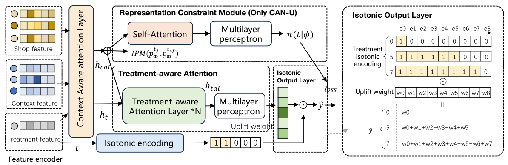
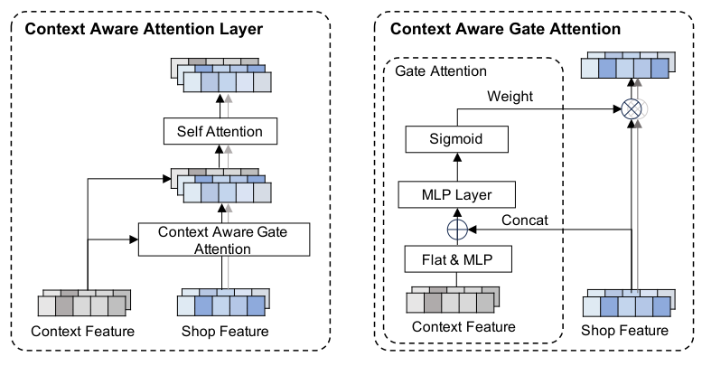
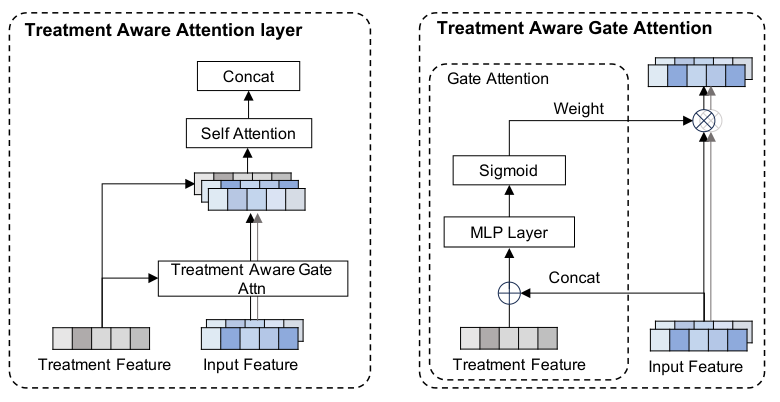
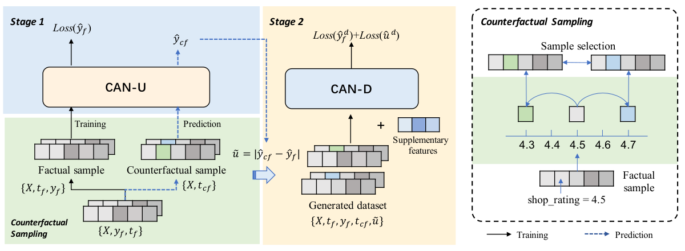
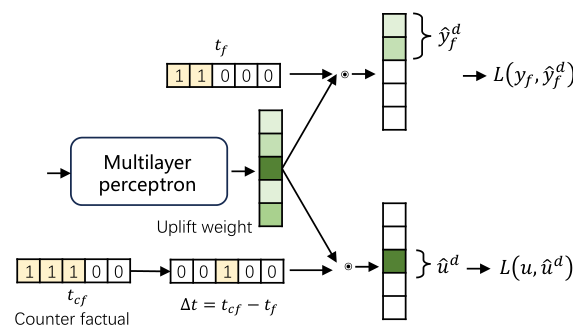
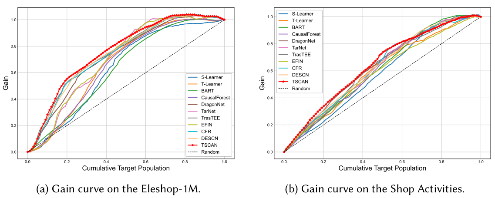
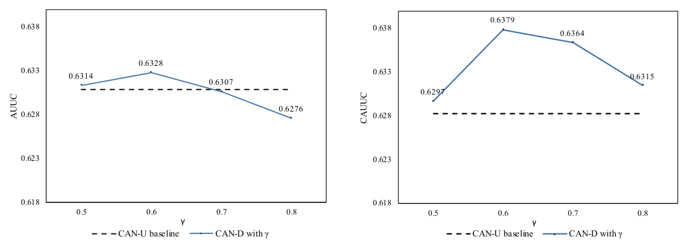

# TSCAN：将教师增量迁移给按场景打分的商家诊断模型

同一家餐馆在午间商圈高峰已接近产能，给新客券可能难以再增加订单。到下午，供需比变化，同样的券和同样的餐馆可能得到更高增量。一个普通的结果回归器可以拼接时段、餐馆和处理特征，凭事实结果学习这些交互。若旧的参加活动机制取决于经营状态，直接拟合会受到选择偏差。加入表示平衡时，和指派高度相关的经营信号也可能被压弱。TSCAN 先用受约束的 CAN-U 产生增量标签，再用事实结果和教师增量训练 CAN-D，将约束施加在教师阶段。 [原文 §1、§4.1](https://arxiv.org/pdf/2504.18881v3#page=5)

## 一个商家与一条候选建议怎样随场景更新

每行包含商家画像 $X$、候选处理 $t$、决策前环境 $C$、观察结果 $y$。以非高峰的新客券为例，店铺品类等类别特征查嵌入表，营业时长、供需比等数值特征作线性映射，分成商家、环境和处理嵌入 $(e_s,e_c,e_t)$。两条上下文门从各自嵌入和同一个经 MLP 汇总的上下文一起计算
$$
a_s=1+\sigma(W_p[e_s;\operatorname{MLP}(\operatorname{Flat}(e_c))]+b_p),
\qquad
a_t=1+\sigma(W_t[e_t;\operatorname{MLP}(\operatorname{Flat}(e_c))]+b_t).
$$
元素乘法分别得到 $h_s=a_s\odot e_s$ 和 $h_t=a_t\odot e_t$。门处于 1 和 2 之间，作用是相对放大各维。商家经自注意力融合 $h_s$ 与 $e_c$，得到 $h_{\rm cal}$。第二个门再读 $[h_{\rm cal};h_t]$，给商家表示施加处理条件权重，最后对加权商家状态和 $h_t$ 自注意力，得到 $h_{\rm tal}$。同一家餐馆同一张新客券放到高峰场景，两个门的输入会同时改变。 [原文式 (3)–(9)](https://arxiv.org/pdf/2504.18881v3#page=6)

*作者原图。Zhang、Li 与 Zhang，arXiv v3，PDF 第 5 页图 1，裁去版边。看左侧三类输入，再比较中路事实结果、仅 CAN-U 的上路约束和右侧单调输出。*

*作者原图。arXiv v3，PDF 第 6 页图 2。左边为数据流，右边展开门控细节。* [原文](https://arxiv.org/pdf/2504.18881v3#page=6)

*作者原图。arXiv v3，PDF 第 7 页图 3。处理嵌入已受环境影响，再作为二次门的条件。* [原文](https://arxiv.org/pdf/2504.18881v3#page=7)

## 教师差值与事实订单各监督什么

阶段一在事实结果预测之外加 $\alpha\mathcal L_{\rm IPM}$、$\beta\mathcal R(h)$，其中二元处理对两臂求 MMD，连续处理在每个批次按实际剂量排序后对上下半组求 MMD。模型还求 $\min_\theta\max_\pi(\mathcal L_\theta-\lambda\mathcal L_\pi)$。最大化方 $\pi$ 通过降低指派回归平方损失 $\mathcal L_\pi$ 来识别处理，最小化方 $\theta$ 则通过负号提高它，从表示中压制指派信息。这里的连续处理辅助任务按印式是对实际 $t$ 的回归，并未给出完整的条件密度。MMD 与对抗项改变了表示，仍需在处理前变量和相应支持条件下解释教师输出。 [原文式 (10)–(12)、(16)–(17)](https://arxiv.org/pdf/2504.18881v3#page=8)

假设餐馆没参加活动，事实 $y_f=100$ 单。训练后的教师在这个商家和时段预测 $\hat y_U(0)=98$、$\hat y_U(1)=104$，所以学生收到两项监督，实际未参加时的 100 单，以及教师给出的增量 $104-98=6$。学生预测 98 受事实损失往 100 调整，预测增量受伪标签往 6 调整。CAN-D 仍通过注意力使用 $C$，训练损失 $\mathcal L(y_f,\hat y^d_f)+\gamma\mathcal L(\tilde u,\hat u^d)$ 去掉了教师的分布约束。事实标签只能在实际动作上校正绝对结果，若教师在另一动作上外推错误，学生的伪增量照样有误差。上线使用 CAN-D，在相应场景比较候选建议。 [原文 §4.3、式 (18)](https://arxiv.org/pdf/2504.18881v3#page=10)

*作者原图。arXiv v3，PDF 第 10 页图 5。黑实线是训练，蓝虚线是预测。关注左下角从事实记录采样替代档，然后沿教师预测差走到第二阶段。*

## 累加非负档位怎样约束响应曲线

取 $t\in[0,1]$，$k=\lfloor Mt\rfloor$，用前缀为 1 的 $M+1$ 维向量编码剂量。以同一个权重向量 $v=(100,4,2)$ 为例，$M=2$ 时三个栅格的前缀和为 100、104、106。从 0 档上到 2 档的增量直接取中间两项之和 $4+2=6$。固定同一向量且 $v_k\ge0$ 时，结果曲线单调。饱和可由接近 0 的增量表示，随剂量先升后降则超出这类输出。 [原文式 (13)–(15)](https://arxiv.org/pdf/2504.18881v3#page=8)

*作者原图。arXiv v3，PDF 第 9 页图 4。上路掩码读出事实前缀，下路由两档的编码差挑增量分量。*

需区分单次前缀计算与重新按每个剂量运行主干。式 (15) 针对 $t_{cf}>t_f$，采样段只写 $t_{cf}\ne t_f$。若保持同一 $v$，向下差可由 $\operatorname{IE}(t_{cf})-\operatorname{IE}(t_f)$ 产生负权重并得到负的区间和。若每个剂量重新生成不同 $v(t)$，非负分量不能单独保证跨前向单调。例如 $v(0)=(100,0)$ 与 $v(1)=(80,5)$ 时，重新打分的响应从 100 变为 85。原文结构图、式 (13)–(15) 和采样段未明确固定向量的实现覆盖及下降档的训练规则，不能用图推断更强的全局保证。与 [TG-DIPricingNets](../SRC-TG-DIPN/阅读笔记.md) 相比，两者都用累加约束表达方向。TSCAN 给出离散档位增量和教师监督，后者的结构用于具体定价曲线。 [原图与采样描述](https://arxiv.org/pdf/2504.18881v3#page=9) · [连续券额的响应曲线比较](../../知识库/问题/连续券额怎样估计并约束响应曲线.md#用两个标签训练同一个前缀读出)

## 分场景看增益，整套诊断策略看订单

Eleshop-1M 用店铺平均评分作连续处理，Shop Activities 用是否参加新客券活动作二元处理，结果均为订单量。评分是观察定义的状态，现实中不同提高评分的干预可能对应不同效应。作者按商圈与时段分组，先算 $\mathrm{AUUC}_g$ 或 $\mathrm{QINI}_g$ 再按人数加权。CAUUC 评价同一组内的排序，全量投放要比较不同组分值可比性时还需要总体指标和分桶校准。 [原文 §5.1.1–5.1.2](https://arxiv.org/pdf/2504.18881v3#page=11) · [排序和幅度如何验证](../../知识库/问题/怎样验证补贴增量的排序幅度和策略价值.md)

*作者原图。arXiv v3，PDF 第 15 页图 6。横轴是累计覆盖比例，纵轴是增益，红线为 TSCAN。比较同一数据集的曲线。*

表 2 中，连续任务的 TSCAN AUUC 为 0.7538、CAUUC 为 0.7686，TransTEE 分别为 0.7489、0.7533。表 3 中去掉上下文特征、留特征而换成全连接、保留 CAN-U，CAUUC 分别变为 0.6536、0.7380、0.7474。换成普通输出的 RISO 同时改变输出结构和训练损失，因此这项差值支持整套单调增量机制，不能隔离单调性一项的贡献。 [原文表 2](https://arxiv.org/pdf/2504.18881v3#page=14) · [原文表 3](https://arxiv.org/pdf/2504.18881v3#page=16)

*作者原图。arXiv v3，PDF 第 16 页图 7。虚线是 CAN-U，蓝线是不同 $\gamma$ 的 CAN-D。左看 AUUC，右看 CAUUC。*

线上 A/B 给 90,000 名随机分组的商家发送按预测增量排过序的经营建议。论文报告相较原部署 BART，整个建议策略的订单量增加 0.76%，95% CI 为 [0.68%, 0.84%]，同时报告 $p=0.001$，未展开对应区间和检验的计算口径。这个 A/B 估计的是两套诊断推荐策略的差，不能拿来解释单个店铺是否采纳某张新客券后的因果幅度。 [原文 §5.2.3、表 4](https://arxiv.org/pdf/2504.18881v3#page=16)

## 原文和译本

Hangtao Zhang、Zhe Li、Kairui Zhang。采用 2026-02-02 的 arXiv 2504.18881v3，20 页，阅读 §1–6、图 1–7、表 1–4。卷期与 DOI 属于原稿模板元数据，版本以 arXiv 为准。中文译本为 15 页，译自作者 LaTeX 副本，覆盖摘要、正文、图表标题及说明性脚注。保留公式、图内英文、参考文献与版权声明。原译件均已私有备份并认证下载，页数、许可和访问办法见目录。未运行模型。 [中文 PDF 访问](../../译文/PDF目录.md#src-tscan) [固定版 PDF](https://arxiv.org/pdf/2504.18881v3)
