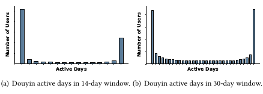
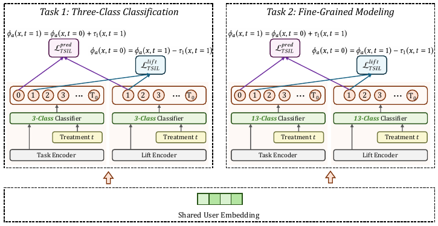

# TSIL：先估计活跃天数两端的概率，再比较触达频次

如果 14 天内的大多数用户集中在 0 天和 14 天活跃，中间的天数就会被一个回归均值掩盖。比如两位用户的预测都是 7 天，一位可能在 0 与 14 天之间各占一半，另一位可能几乎确定活跃 7 天。TSIL 先预测落在哪一段，再建模中间的整数天数。在抖音推送实验中，模型以不发或预设频次为干预，分别重构活跃天数期望。这个输出可以为频次分配提供依据。要回答月初应当选本月哪一天，还需要换成按日期定义的候选动作与标签。[SIGIR 2026 Industry Track](https://doi.org/10.1145/3805712.3808476)。

## 把 0 天、14 天和中间天数接成一个分布

Xiang Li 等，采用版第 2 页图 1，CC BY 4.0。由固定 PDF 裁出两幅柱状图，保留坐标与子图说明。先看横轴两端，在 14 天和 30 天的窗口里都有较高的柱。图展示人群计数分布，单个用户在某个干预下的活跃天数分布仍需从样本估计。[固定版第 2 页，图 1](https://raw.githubusercontent.com/zhouchenlin/zhouchenlin.github.io/717e9bc87603cd694f5eab9e35fbf56673f6aa0f/Publications/2026-SIGIR-User.pdf#page=2)。

设同一位用户的干预前特征为 $x$，$t=0$ 代表不发，$t=1$ 代表实验预设频次。令 $Y$ 为 14 天内的活跃天数，类别 $A=0,1,2$ 分别对应 $Y=0$、$1\le Y\le 13$、$Y=14$。第一个分类器给出三个概率 $\phi_a(x,t)=P(A=a\mid x,t)$，总和为 1。第二个分类器给出 $p_{k,t}=P(Y=k\mid x,t,A=1)$，在 1 到 13 天内的概率总和为 1。于是

$$
P(Y=k\mid x,t)=
\begin{cases}
\phi_0(x,t),&k=0,\\
\phi_1(x,t)p_{k,t},&1\le k\le13,\\
\phi_2(x,t),&k=14.
\end{cases}
$$

若这位用户不发时三类概率为 $(0.60,0.30,0.10)$，中间用户的条件均值为 5 天，则总体期望为 $0.30\times 5+0.10\times14=2.90$ 天。若按预设频次推送时为 $(0.52,0.36,0.12)$，中间条件均值为 5.5 天，则总体期望为 $0.36\times5.5+0.12\times14=3.66$ 天。这个算例的增量是 0.76 个活跃天。变化既来自完全不活跃和完全活跃的概率变动，也来自中间人群的离散分布变化。数字用于解释计算。[固定版第 3 页，§3.2.1–3.2.3](https://raw.githubusercontent.com/zhouchenlin/zhouchenlin.github.io/717e9bc87603cd694f5eab9e35fbf56673f6aa0f/Publications/2026-SIGIR-User.pdf#page=3)。

## 标签怎样监督两个分类器

在这位用户的一次观测里，训练只能使用其实际分到的干预和随后观察到的天数。若他在 $t=1$ 组活跃 5 天，三类交叉熵奖励 $\phi_1$，联合负对数似然奖励 $\phi_1 p_{5,1}$，期望回归项则惩罚预测期望与真实 5 天的差。若观测是 0 天，联合似然只有 $\phi_0$ 项。按样本写开，联合负对数似然已经含一项端点类别的负对数概率，另加三类交叉熵会进一步强化这个监督。中间类别的离散似然只在 $A=1$ 时直接生效，期望回归项仍可通过 $\phi_1\sum_k k p_{k,t}$ 影响第二头。论文写出三个损失的加和，CE 写为批平均，NLL 和 Reg 以样本式说明。[固定版第 3 页，§3.2.3](https://raw.githubusercontent.com/zhouchenlin/zhouchenlin.github.io/717e9bc87603cd694f5eab9e35fbf56673f6aa0f/Publications/2026-SIGIR-User.pdf#page=3)。

Xiang Li 等，采用版第 3 页图 2，CC BY 4.0。由固定 PDF 裁出，保留两项任务、共享表示和损失路径。两个任务各有直接预测头及增量头。对同一项概率，图上可从处理头直接读出，也可用对照预测加上增量重构处理预测。对照的另一条路径是处理预测减去增量。对中间分布，干预有可能改变进入中间区的人群，因此两边的条件分布差不能解释为固定人群上的因果变化。上线排序使用的总体期望差由终点质量和中间分布共同确定。原文要求概率归一，同时写各输出用 ELU+1 保证非负，未详述归一和带符号的增量头如何共同约束，现有公式不足以还原全部代码实现。[固定版第 3–4 页，§3.2.4](https://raw.githubusercontent.com/zhouchenlin/zhouchenlin.github.io/717e9bc87603cd694f5eab9e35fbf56673f6aa0f/Publications/2026-SIGIR-User.pdf#page=3)。

## 排得更准和估得更准要分开看

抖音离线数据来自约 2,059 万用户的随机推送实验。对照为零推送，实验组采用预设频次，结果是 LT14。两臂期望如何转成决策分数，见[推送频次的增量与校准](../../知识库/问题/活跃天数集中在两端时怎样估计推送频次增量.md)。表 2 的归一化 AUUC 从 MSE 的 0.9552、GMM 的 0.9602 到 TSIL 的 0.9660。校准比率以接近 1 为好，MSE 为 0.9827，GMM 为 0.4557，TSIL 为 1.0849，因此整体排名领先不意味着整体校准也领先，正文的这一表述与表值不一致。表 5 对 $A=0$ 子群给出从 0.3926 到 0.9832 的校准改善。论文没有交代线上子群标签在分配前如何确定。离线按观察期活跃天数分组，与线上按干预前可见特征分组，属于不同分析口径。[固定版第 4–5 页，表 2、5](https://raw.githubusercontent.com/zhouchenlin/zhouchenlin.github.io/717e9bc87603cd694f5eab9e35fbf56673f6aa0f/Publications/2026-SIGIR-User.pdf#page=4)。

公开数据集预测的是购买金额和捐款金额。表 1 的 AUC、Spearman、分组 MAPE 与抖音的因果增量 AUUC 回答不同问题。正文没有完整披露两个金额基准的右端点、是否以及如何离散化，以及用何种标签计算 AUC。完整损失在表 3 最优，但删掉 NLL 的 KDD CUP 98 MAPE 是 0.0779，比只用 CE 的 0.0764 更差。论文将 MSE 基线的表现归于隐含正态假设，平方误差作为条件均值估计目标本身无需正态性，正态对应的是它作为一种概率似然解释时的假设。[固定版第 4–5 页，表 1、3](https://raw.githubusercontent.com/zhouchenlin/zhouchenlin.github.io/717e9bc87603cd694f5eab9e35fbf56673f6aa0f/Publications/2026-SIGIR-User.pdf#page=4)。

线上实验把一部分推送额度从高活跃用户迁给低活跃用户。以第 10 天为例，表 6 的全体发送量变化为 $+0.002\%\pm0.025\%$，不活跃组为 $+12.945\%\pm0.130\%$，全活跃组为 $-0.631\%\pm0.033\%$。活跃天数栏同时标出 1e-4 和百分号，正文及 ROI 数字的换算口径有待解释，不能直接搬用活跃天数增幅。这里的 ROI 以总活跃与发送量的相对比率定义。未报告货币成本、长期流失或关闭通知权限的结果。对[月初优惠选日场景](../../知识库/总览/优惠信息Push触达场景.md)，可借鉴分布建模，但估计某个发送日相对不发的增量仍依赖各日期的实验覆盖及当时可见信息。[固定版第 5 页，§4.3 和表 6](https://raw.githubusercontent.com/zhouchenlin/zhouchenlin.github.io/717e9bc87603cd694f5eab9e35fbf56673f6aa0f/Publications/2026-SIGIR-User.pdf#page=5)。

## 阅读范围

通读作者发布的固定六页版本，包括摘要、§1–5、两图、六表、致谢及参考文献表。该版本首页标明 CC BY 4.0。作者 LaTeX 未取得，中文正文按正式 PDF 重排，保留图内英文与原文参考文献。实验数字来自论文。未运行模型或复现线上实验。[作者固定版](https://github.com/zhouchenlin/zhouchenlin.github.io/blob/717e9bc87603cd694f5eab9e35fbf56673f6aa0f/Publications/2026-SIGIR-User.pdf)。

中文 PDF 以 XeLaTeX 重排成 9 页，逐页渲染检查，中文可提取。包含译后的摘要与正文、两幅原图和六张表，并附原文参考文献页。可编辑主文件为 `.local/papers/SRC-TSIL/translation/translated-sources/main.tex`，本地 PDF 为 `.local/papers/SRC-TSIL/translation/TSIL-SIGIR2026-zh.pdf`。

中文 PDF 与采用版原文的[私有备份下载说明](../../文档/工具/中文PDF发布.md#登录下载)。
