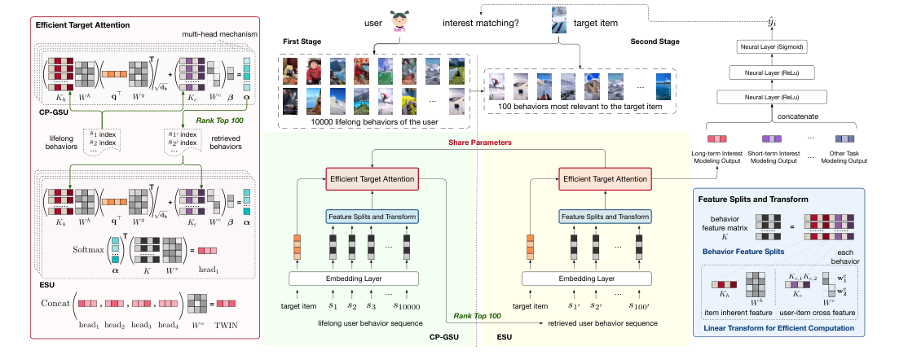
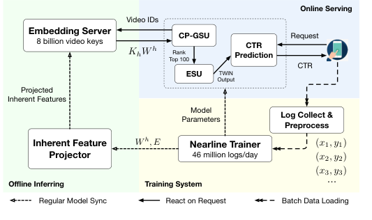
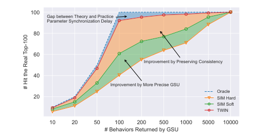

# TWIN 怎样用同一套相关性从长历史筛行为

一次请求里候选是手机壳，历史有早期手机壳、耳机与大量服饰短视频。如果先用类目粗筛，再用候选注意力精读，耳机相关的内容或许有高注意力，却已经在粗筛消失。TWIN 将候选注意力中的相关性计算延伸到大范围历史，并预计算可解耦部分。采用 Jianxin Chang 等人的 arXiv 2302.02352v2。

## 将可缓存的内容和请求时特征拆开

*Jianxin Chang 等，本文图 2，采用版 PDF 第 4 页。由采用版裁取图区。*

一条历史行为的内容侧由关联视频固有特征 $K_h$ 提供，用户与行为的交叉特征 $K_c$ 含时间间隔等请求侧信息。每头给内容与当前候选单独投影，交叉特征按字段投影到标量再加权，得到

$$\alpha=(K_hW_h)(q^\top W_q)^\top/\sqrt{d_k}+(K_cW_c)\beta.$$

离线缓存 $K_hW_h$，按历史视频 ID 拉取，请求时计算候选投影和交叉偏置。举例，缓存内容项先给耳机、手机壳、外套 $0.7,0.8,0.2$；时效偏置为 $0.2,-0.15,0$ 时，相关性顺序变成 $0.9,0.65,0.2$。若教学预算取 2，CP-GSU 先保留前两条。ESU 对选到的行为以对应 logit 归一化，然后读其 $KW_v$。候选交叉作用于筛选与最终权重，Value 的完整投影只在短序列计算。首层缩短的是历史行为，不是商品库中的被推荐候选。[§3.3，式 (4)–(8)](https://arxiv.org/pdf/2302.02352v2#page=5)。

## 两阶段一致的条件

若两个阶段使用同一评分方向、特征和参数版本，且 Top-K 的并列规则一致，同一头可保留完整历史精细评分的前列。论文使用 4 头，并通过短历史 ESU、长历史 TWIN 等输入联合训练 CTR。实际论文的 Key 缓存 15 分钟循环更新，ESU 中仍按参数更新计算。图 4 用 ESU 对全历史 $10^4$ 条取前 100 当参考，SIM Hard 的粗搜返回 100 条约命中 40，TWIN 约 94。作者把剩余差异归于参数同步延迟，实际还有候选特征、缓存覆盖和读出条件。这个命中是历史条目一致性，不是商品召回或真实点击命中。[§3.4、§4.5，图 3–4](https://arxiv.org/pdf/2302.02352v2#page=6)。

*Jianxin Chang 等，本文图 3，采用版 PDF 第 6 页。由采用版裁取图区。*

*Jianxin Chang 等，本文图 4，采用版 PDF 第 8 页。由采用版裁取图区。*

## 离线预测、部署开销与在线时长分别怎么测

表 4 的五天均值与标准差中，TWIN 为 0.7962/0.7336 AUC/GAUC，对照 SIM Soft 0.7939/0.7299。论文的 SIM 实验实现与 Alibaba SIM 原文协议不同。线上表 5 给出相对 SIM Soft 的观看时长提升，精选、发现、滑动三域为 2.778%、1.374%、2.705%。作者报告 80 亿视频键覆盖 97% 在线请求，缓存键的线性投影瓶颈下降 99.3%，下降范围是该投影环节。正文每日日志数与图 3 的图中文字有 billion 与 million 差异，产出和收益解释以对应数据表及已明确的单位为准。[§3.4、§4.3–4.8，表 4–5](https://arxiv.org/pdf/2302.02352v2#page=8)。

[SIM](../SRC-SIM/阅读笔记.md) 的硬搜把便宜条件放在前面，TWIN 通过共享候选评分减少粗搜目标偏差；比较见[长历史压缩问题](../../知识库/问题/长历史怎样在候选条件下压缩计算.md)。

## 原文与阅读材料

采用[固定 v2 PDF](https://arxiv.org/pdf/2302.02352v2)，10 页，核对 §1–5、图表、公式及上游 LaTeX。中文正文 PDF 待交付。
