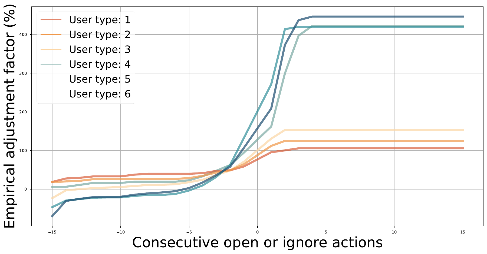
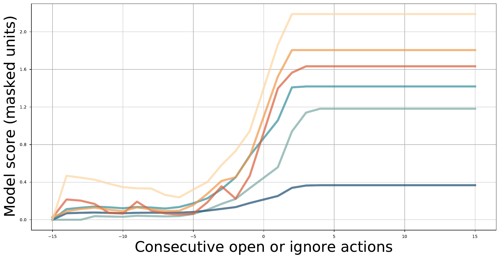
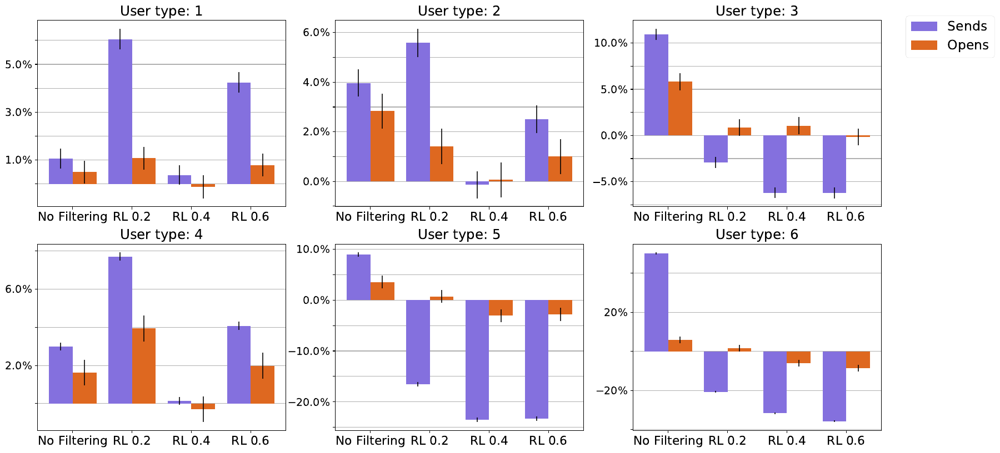

# Twitter Push 发送决策：从连续响应到长期价值阈值

系统定期给用户挑出一条候选，今日发送数还没到上限。即使候选很弱，发也有一点机会被打开，不发则没有这次打开。如果只优化眼前的打开，几乎总会发。Twitter 原有过滤器给每种用户设一个打开率阈值，用线上实验调节。本文根据用户最近连续打开或忽略的情况建模，递推发与不发的未来打开数，再把策略预计算成随状态变化的阈值。日发送上限仍是另一个可调的护栏，生产指标也仍需线上验证。[固定 v1，§2–3.2](https://arxiv.org/pdf/2202.08812v1#page=2)。

## 历史反馈怎样改变这条通知的条件打开率

假设一类用户中的某人刚连续打开三条通知，状态为 $s=3$。实际发送后若再次打开，状态变为 $4$；若忽略，状态重置到 $-1$。不发则本轮奖励为零，连续响应状态原样保留。这是作者对状态如何变化的建模约定。用户类型 $c$ 共六种，按历史 Push 行为划分。状态关心已发送通知的连续反馈，未发送机会的日志在当时不可用。[固定 v1，§2.4、§3.2](https://arxiv.org/pdf/2202.08812v1#page=4)。

作者先用每位用户序列的前半段估计个人基准打开率，后半段把每次已发送通知展平成带有发送前 $s$ 和实际结果 $y$ 的一行。对某一 $(c,s)$，比较这一组的实际打开量与按每行对应用户的基准率所期待的打开量。示意四行的个人基准率是 0.1、0.1、0.2、0.4，实际打开一次，则该组经验倍数是 $1/0.8=1.25$。训练这个倍数时使用真实打开标签及个人历史均值。系统为当前候选打分时，改用排序器给出的、经最近 24 小时数据保序校准的候选打开概率 $\hat p$。[固定 v1，§3.2–3.3](https://arxiv.org/pdf/2202.08812v1#page=4)。

Conor O’Brien 等，固定 v1 图 2a，PDF 第 6 页，从作者附图渲染。横轴是当前通知之前的连续打开或忽略条数。纵轴以百分比显示对个人基准打开率的经验调整量，零为不调整。图的上升形态部分来自单调约束。个人基准抵消一部分用户构成差异，但工作日、周末或内容质量等随时间变化的因素仍可同时影响连续状态与打开率。前半段通知过少的用户亦被排除，曲线对冷启动用户的适用性需要新证据。[固定 v1，§3.2、图 2a](https://arxiv.org/pdf/2202.08812v1#page=6)。

论文把经验倍数 $f$ 朝 1 收缩，$f_\kappa=1+\kappa(f-1)$，然后令发送时打开概率 $p=\min(f_\kappa\hat p,1)$。沿用经验倍数 1.25，若 $\kappa=0.2$，得到 $f_\kappa=1.05$，候选模型给 $\hat p=0.10$ 就对应 $p=0.105$。$\kappa$ 是作者拿去线上试的敏感性参数。确定性历史策略和未发日志缺失，使它不能从这套观察数据识别出连续状态作用的因果比例。[固定 v1，§3.2](https://arxiv.org/pdf/2202.08812v1#page=5)。

## 用一次打开的价值和下一轮状态算发送门槛

令 $V(s)$ 表示某用户类型处于状态 $s$ 时下一步的续期价值。当前 $s=3$ 发送有两条分支，打开时得到即时奖励 1 并进入 $4$，忽略时即时奖励为 0 并进入 $-1$；等待以原状态 $3$ 进入下一次机会。用作者式 (7)–(8) 的结构写为
$$
Q_{\mathrm{发}}=p\,[1+\gamma V(4)]+(1-p)\gamma V(-1),\qquad
Q_{\mathrm{不发}}=\gamma V(3).
$$
作者从有限终点价值为零向前递推，未来候选的打开打分分布按用户类型共享，折扣按决策步计。教学数值取 $\gamma=0.9$，三个示意续期值 $V(4)=0.8,V(-1)=0.2,V(3)=0.7$，则发送值为 $0.18+1.54p$，不发值为 $0.63$。在上例 $p=0.105$ 时不发，只有 $p$ 大于约 0.292 才发送。这说明即使一次打开有正价值，若忽略后损失未来打开机会，较弱候选仍可能被过滤。[固定 v1，§3.2，式 (6)–(8)](https://arxiv.org/pdf/2202.08812v1#page=5)。

Conor O’Brien 等，固定 v1 图 2b，PDF 第 6 页，从作者附图渲染。纵轴是隐藏刻度单位的模型分阈值。作者在离线按类型和连续状态二分搜索，找到发送值高于不发值的最低分。上线时取用户类型和最新状态查表，再把有量纲漂移的排序器预测校准到打开概率。阈值重算与排序器校准是两个环节；阈值也不等同于每日上限。[固定 v1，§3.2–3.3](https://arxiv.org/pdf/2202.08812v1#page=6)。

式 (6) 在未来候选取期望的内部选最优动作，式 (7)–(8) 印出的顺序则是先按固定动作求期望，再选动作。附录 A 在忽略概率截断时证明的是固定动作 $Q$ 可用候选分均值计算。若未来策略看见候选分后再行动，$\mathbb E[\max_a Q]$ 和 $\max_a\mathbb E[Q]$ 一般不同。例如未来两类候选等概率出现，发送值为 0 或 1，不发值恒 0.6。看见候选再决策得到期望 0.8，先固定动作最多得到 0.6。应按附录条件理解它的加速，不能据此认定对可见候选策略严格求得精确最优解。未运行生产实现，不判定线上求解顺序。[固定 v1，式 (6)–(8)、附录 A](https://arxiv.org/pdf/2202.08812v1#page=9)。

## 33 天线上实验检验了哪些变化

用户在 33 天内固定在同一实验组。表现较好的测试组合为 $\kappa=0.2$ 且每日上限加 2。相对分位数启发式基线，发送量 **−5.79%**、打开率 **+7.96%**（均 $p<0.01$），DAU **+0.20%**（$p<0.05$），可触达用户数 **+0.09%**（未标显著）。更大的 $\kappa$ 组合采用不同上限，两组发送量更低、打开率更高，但 DAU 分别下降 0.34% 和 0.22%。实验没有穷举上限与 $\kappa$ 的组合，结果支持部署策略组合的效果，无法独立识别上限或经验倍数收缩的贡献。可触达变化未达到显著性，不能从方向推断关闭权限减少。[固定 v1，§4，表 1](https://arxiv.org/pdf/2202.08812v1#page=7)。

Conor O’Brien 等，固定 v1 图 3，PDF 第 8 页，从作者附图渲染。橙柱是打开次数相对变化，紫柱是发送次数相对变化。类型 3 中几组少发仍可维持或增加打开，类型 1、2 部分加上限组则发送增长快于打开增长。打开率是两种总量的比，打开率提高不直接给出总打开数上升，用户类型的聚合还取决于各组体量。

[LinkedIn CIKM 通知间隔研究](../SRC-LINKEDIN-NOTIFICATION-RL/阅读笔记.md)用带探索的转移日志学动作价值，优化跨轮的访问奖励；[LinkedIn KDD 多目标通知](../SRC-LINKEDIN-NOTIFICATION-MORL/阅读笔记.md)还明确纳入点击与发送量，并用不等间隔折扣处理事件流。Twitter 路线先显式建模一维响应状态与发送反馈，再用规划求门槛。它依赖候选分校准、用户状态模型、未来候选假设和对观察相关性的收缩。不同论文线上对照、业务目标与实验持续时间不同，见[触达与时机路线](../../知识库/阅读/Push触达与时机论文路线.md)。

[发送或等待的问题比较](../../知识库/问题/通知候选到达后怎样决定发送或等待.md)对照所需状态、监督与线上验证条件。

采用 arXiv:2202.08812v1，核对正文 §1–5、三图、表 1、算法和附录 A。中文翻译覆盖正文与说明性图表和伪代码，图内文字、参考文献和附录保留原文。未复现实验。

中文 PDF 与采用版原文的[私有备份下载说明](../../文档/工具/中文PDF发布.md#登录下载)。
