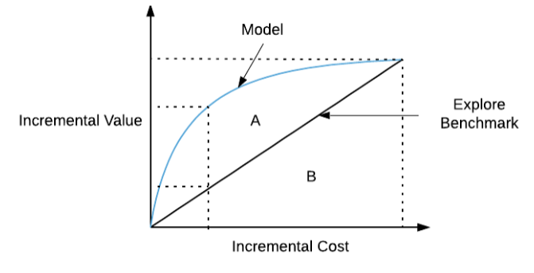
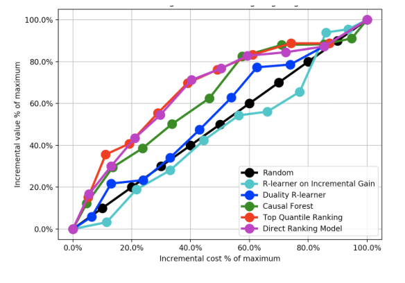
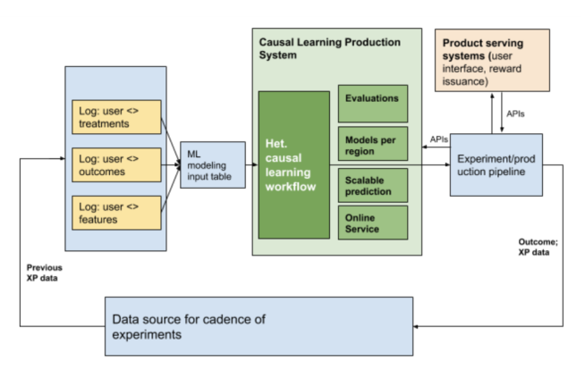

# Uber 人群营销怎样为同一预算学习排序

留存活动只有一种奖励时，逐人估计奖励引起的留存增量，就能按预期收益排队。但假设 A 增加 8 个单位价值、花 4 个单位成本，B 增加 6、花 1，预算为 3 时优先 A 会错过 B。采用随机探索获得指派、收益、成本后，Zou 等比较三种做法。Duality R-learner 在给定预算价格时学净增量，Direct Ranking 对整组收益与成本的比值训练，Constrained Ranking 把训练注意力集中到将被选中的前缀。 [arXiv v1 §2–3](https://arxiv.org/pdf/2004.09702v1#page=3)

## 一个价格怎样把成本和收益合成标签

把 A、B 看成待投放用户。固定每单位成本的影子价格 \(\lambda\)，分数为 \(s(x)=\tau^r(x)-\lambda\tau^c(x)\)。当 \(\lambda=1\) 时，A 和 B 分别得 4、5。由于条件期望对减法和常数乘法线性，可以先为每条历史事实记录构造 \(Y^E=Y^r-\lambda Y^c\)，再用 R-learner 对其残差训练单个效应头。结果残差是 \(Y^E-\hat m_E(X)\)，随机指派残差是 \(T-\hat e(X)\)。最小化两者与效应头乘积的残差平方，推理一次即可出净增量分数。若预算变动需改 \(\lambda\)，固定价格的单头随之变义。可先分别估两种增量，保留线上重新定价的自由。 [v1 §3.1、式 (4)–(12)](https://arxiv.org/pdf/2004.09702v1#page=4) · [R-learner 的残差化](../../知识库/问题/残差化怎样估计营销干预效应.md)

在连续松弛中给定 \(\lambda\)，正净增量的用户优先进入。对偶写成最小化 \(g(\lambda)\) 时，一个梯度是 \(B-\sum c_i z_i\)，超支时应提高 \(\lambda\)。采用稿式 (9) 的更新漏写 \(z_i\)，也把前文这个梯度以加号用于更新。实验中作者实际用验证集选 \(\lambda\)，未据印刷更新式验证求解。0–1 分配在阈值处另需检查可行性。 [v1 §3.1、式 (6)–(9)、§4.1.3](https://arxiv.org/pdf/2004.09702v1#page=3)

## 在随机日志上直接给名单打分

Direct Ranking 从干预前特征得 \(s=\tanh f(X)\)。每臂各自对分数作 softmax，形成该臂的加权平均，并在同一批上用两臂之差得 \(\bar\tau^r,\bar\tau^c\)。最小化 \(\bar\tau^c/\bar\tau^r\) 加正则。沿用 A 与 B，教学批包含各类型的两臂观测，假设分数令每臂的权重都是 0.25、0.75。则加权增量价值为 6.5、成本 1.75，成本／价值为约 0.269。同一批如果两人各占一半，比例变为 \(2.5/7\approx0.357\)。实际每人只落在其中一臂，随机化和相同目标权重使两臂可用来估计同一重加权人群的结果。梯度经比率、组均值和组内 softmax 回到共享的 \(f\)。收益差接近零时比值会不稳定，符号变化也会改写“越小越好”的解释。上线可直接用 \(s\) 筛人，输出的含义是效率排名。 [v1 §3.2，式 (13)–(19)](https://arxiv.org/pdf/2004.09702v1#page=4)

Constrained Ranking 先按分数排序，以人数分位点或累计成本将要越过预算的位置定阈值 \(d\)，用 \(\sigma(t(s_i-d))\) 衰减阈值以下的人，再将门控分数送入训练目标。论文用从软到硬的退火，训练描述同时报告停止 \(d\) 的梯度以改善稳定性。教学例中，若预算只允许 B，阈值放在两者分数之间后，代理目标主要由 B 周围的排序改变驱动。部署时还需要独立计算可执行前缀的成本。 [v1 §3.3、式 (20)–(21)、§4.1.3](https://arxiv.org/pdf/2004.09702v1#page=5)

## 回到同一成本评估前缀

Zou 等，v1 第 5 页图 1，从采用版原 PDF 裁出。横轴是成本，纵轴是留存等价值，两个数都由冻结分数前缀内的组间差乘以干预组人数得到。论文以最大增量成本和最大增量价值组成的矩形归一化，随机直线面积为 0.5。曲线有回折或终点增量接近零时，先检验归一化条件。 [v1 §3.4](https://arxiv.org/pdf/2004.09702v1#page=5) · [增量排序与策略价值](../../知识库/问题/怎样验证补贴增量的排序幅度和策略价值.md)

Zou 等，v1 第 7 页图 2，从采用版原 PDF 裁出。横向比较同一增量成本的留存增量，或在同一纵轴水平找各曲线所需的成本。Marketing 的 AUCC，Duality R-learner 为 0.544，Direct Ranking 为 0.664，Constrained Ranking 为 0.678。US Census 和 Covtype 是作者从公开数据的特征与观测结果构造营销式收益和成本的代理任务。表 2 中 US Census 的 Direct Ranking 为 0.583，低于 Constrained Ranking 的 0.687。 [v1 §4.1–4.2、表 2](https://arxiv.org/pdf/2004.09702v1#page=8)

Zou 等，v1 第 8 页图 5，从采用版原 PDF 裁出。随机探索日志进入下一轮训练，投放候选则用已训练规则选择，再把入选用户随机拆成处理、对照。线上报告入选人群的增量价值／成本斜率相对探索的改善，原稿未列各地区绝对值或区间。后续作者稿扩展了倾向加权，并给出略有变化的公开数据对照。 [v1 §4.2、式 (22)–(23)](https://arxiv.org/pdf/2004.09702v1#page=8) · [后续 DRM/CRM 版本](../SRC-DRM-CRM/阅读笔记.md)

## 版本与译本

Will Y. Zou、Shuyang Du、James Lee、Jan Pedersen。采用 2020 年 arXiv v1，覆盖正文、图、表与公开任务的构造，未运行模型。模板中的 Woodstock 会议信息未用于确认正式出版。中文 PDF 共 6 页。摘要、正文 §1–5、图表说明及公式。图内文字及参考文献保留原文。译本已逐页渲染核对，采用原文与译本均完成私有备份和认证下载校验。 [中文 PDF 私有下载说明](../../译文/PDF目录.md) · [固定原文](https://arxiv.org/pdf/2004.09702v1)
