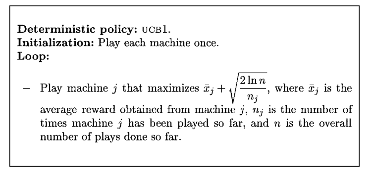
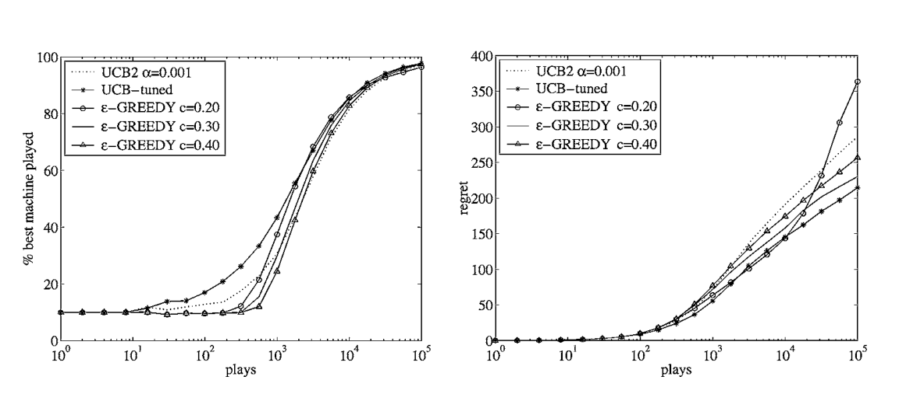

# UCB1：用置信宽度决定何时再试一个臂

每次只能为一条广告拿到点击信息。若只选历史均值最高的广告，一条好广告可能因为前几次碰巧没点击而永远失去展示机会。定期均匀随机又会把流量分给已经反复证实较差的广告。UCB1 让仍不确定的臂以较高的可能均值参与决策，并用有限时域遗憾衡量这笔探索成本。

## 单臂反馈怎样变成决策分数

每个臂 $i$ 有固定未知均值 $\mu_i$。同一臂的历次奖励独立同分布，不同臂独立，奖励落在 $[0,1]$。一次选一个臂并观察它的奖励。初始每臂试一次。已有 $n$ 次选择时，臂 $i$ 的次数是 $N_i(n)$，样本均值是 $\hat\mu_i$。下一次选最大下式的臂。

$$
U_i(n)=\hat\mu_i+\sqrt{\frac{2\ln n}{N_i(n)}}.
$$

作者原图，图 1，Auer、Cesa-Bianchi、Fischer，期刊版 PDF 第 3 页。裁出算法框并保留作者标签。初始化消除了分母为零的问题，决策只需总轮数、每臂次数和总奖励。[期刊版，第 3 页](https://cesa-bianchi.di.unimi.it/Pubblicazioni/ml-02.pdf#page=3)

例如已试 $1000$ 次。A 被选 $960$ 次，累计 $576$ 个点击，B 被选 $40$ 次，累计 $18$ 个点击。A 的均值与指数约为 $0.60$ 和 $0.720$，B 为 $0.45$ 和 $1.038$，因此下一次选 B。指数可以超过 1，因为它是决策分数。若 B 没点击，只有 B 的计数变为 41，均值变为 $18/41$，其指数降至约 $1.020$。若反复探索后仍较弱，置信宽度会随 B 的反馈积累收窄。任何臂若长期没有被选，$\ln n$ 仍会增长，给它再参与竞争的机会。数值为教学例子。

## 有限时域界从哪里来

设 $\mu^*=\max_i\mu_i$，差距 $\Delta_i=\mu^*-\mu_i$。由于第 $t$ 轮的动作只依赖已有信息，新奖励的条件期望仍是该臂的均值，所以期望遗憾满足

$$
R(n)=n\mu^*-\mathbb E\sum_{t=1}^{n}r_t
=\sum_i\Delta_i\,\mathbb E N_i(n).
$$

已知 A、B 真均值分别为 0.60、0.45 时，每次探索 B 付出的期望机会成本是 0.15，40 次的差距累计为 6。固定的一条实际轨迹有随机波动，期望分解用于理解探索次数和理论界。

证明的关键是确定差臂何时已经试够。取 $c(n,s)=\sqrt{2\ln(n)/s}$。如果最优臂的样本均值没有向下偏离其均值超过 $c(n,s^*)$，它的指数至少为 $\mu^*$。如果差臂 $i$ 的样本均值没有向上偏离超过 $c(n,s)$，它的指数至多为 $\mu_i+2c(n,s)$。因此 $s\ge 8\ln(n)/\Delta_i^2$ 时，差臂继续胜出意味着至少一个单侧偏离事件达到或超过阈值。对每个固定样本数，单侧 Hoeffding 界为 $\exp(-2s c^2)=n^{-4}$。算法自适应，不能把随机的观察次数直接当固定样本数。原证明枚举两臂可能的样本数，再按轮次求和，得到有限的尾事件贡献。

原文定理 1 给出

$$
R(n)\le 8\sum_{i:\Delta_i>0}\frac{\ln n}{\Delta_i}
+\left(1+\frac{\pi^2}{3}\right)\sum_i\Delta_i.
$$

对一组固定臂和固定差距，所有时域上这个上界按 $\ln n$ 增长。差距越小，辨别所需样本数越多，不能把这个实例依赖的界理解成所有问题共用一个很小的常数。论文与 Lai–Robbins 渐近下界的联系在于对数阶，其前导常数并未普遍达到后者的 KL 常数。[期刊版 §2–3，第 3–4、7–9 页](https://cesa-bianchi.di.unimi.it/Pubblicazioni/ml-02.pdf#page=3)

## 哪些变体改变了探索

UCB2 选中臂后按几何增长的阶段连续选择它，使用阶段置信项。递减的 $\varepsilon_n$-greedy 仍用均匀随机探索，证明中的探索率需要指定正差距的下界。UCB1-NORMAL 另用高斯奖励下的样本方差和最少采样要求。作者给出的定理 4 证明还依赖附录 B 中两个仅做数值核对的尾部猜想。UCB2 与递减贪心的部分证明步骤亦有原文疑点，见[审核台](../../维护/审核台.md)。

实验比较 UCB1-TUNED、UCB2 和递减 $\varepsilon_n$-greedy。TUNED 将置信宽度改为含经验方差的项，论文未给其遗憾界。七组 Bernoulli 环境各试 $10^5$ 次并对 100 次运行平均，随时间同时画最优臂比例和实际遗憾。比较中的 $\varepsilon_n$-greedy 使用每组环境的真差距，且逐组试过参数。高性能依赖该调参口径，十臂场景下均匀探索还会在多个弱臂间分掉流量。[§4，第 11–15 页](https://cesa-bianchi.di.unimi.it/Pubblicazioni/ml-02.pdf#page=11)

作者原图，图 12，Auer、Cesa-Bianchi、Fischer，期刊版 PDF 第 15 页。左图读最优臂比例，右图读遗憾，两图横轴均为选择次数并用对数刻度。这个环境是一个 0.55 的臂和九个 0.45 的臂。

加入请求特征后，相同曝光次数也可能在当前方向上有不同的估计精度，由 [LinUCB](../SRC-LINUCB/阅读笔记.md) 维护特征矩阵。使用同样的被选臂反馈也可以更新后验并随机选臂，见 [Thompson Sampling](../SRC-THOMPSON-SAMPLING/阅读笔记.md)。三种选择规则与日志回放条件放在[上下文探索问题](../../知识库/问题/上下文探索怎样平衡并用随机日志评估.md)比较。

## 原文与中文材料

采用作者站上的 Machine Learning 47，235–256 页排版版。[DOI](https://doi.org/10.1023/A:1013689704352) · [固定原文](https://cesa-bianchi.di.unimi.it/Pubblicazioni/ml-02.pdf)。本篇精读的证明主线是 UCB1 的定理 1，其他定理与实验按所采用的设定区分。

中文译文覆盖摘要、正文 §1–5、附录 A–B、证明、公式、图表说明、致谢与注释。 采用正式 PDF 重排，保留图内英文和参考文献。中文 PDF（本地 14 页）：`.local/papers/SRC-UCB1/translation/SRC-UCB1.中文.pdf`；可编辑 XeLaTeX 主文件：`.local/papers/SRC-UCB1/translation/translated-sources/main.tex`。本地附件不随 Git 分发。原文与译文均可按[私有备份下载说明](../../文档/工具/中文PDF发布.md)取得。
