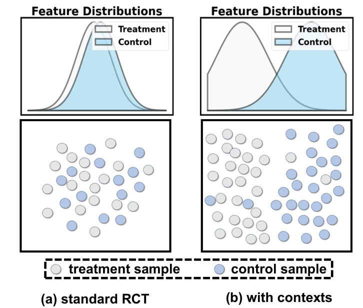
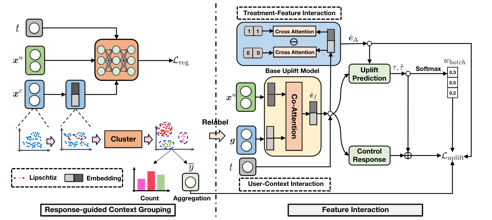
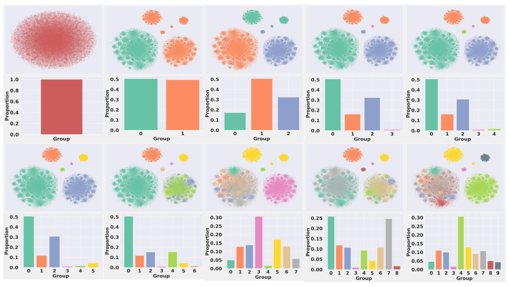
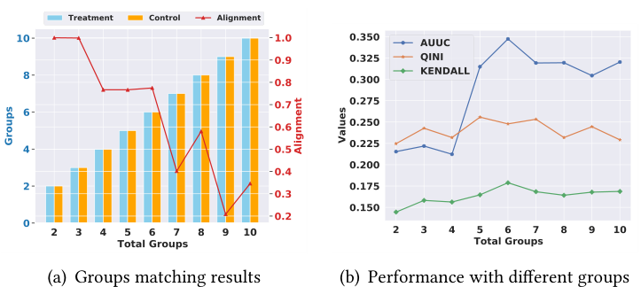
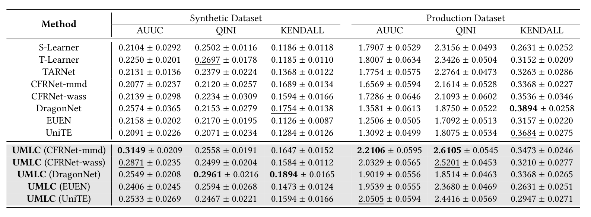
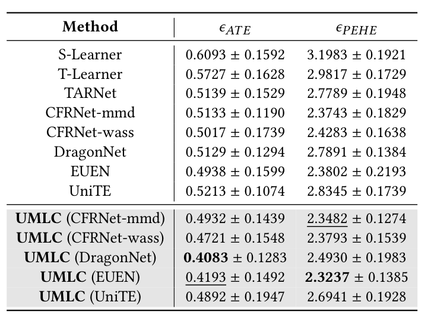

# UMLC：让响应相近的视频共享增量训练样本

一个用户看了几十条短视频。平台想知道这次播放给高清会多看多久。同一个用户在实验里只进入一臂，一条具体视频在另一臂的相似用户里也未必常出现。只用用户画像时，同一用户的所有视频收到同一个预测。拼接视频 ID 和画像虽保留了差异，却使处理与对照样本分散到大量稀疏的用户–视频组合。UMLC 先用事实观看时长学习哪些视频对响应的作用相近，把它们合为组，再学习用户与视频组如何改变基线观看时长，以及处理条件怎样重加权特征。 [原文 §1](https://arxiv.org/pdf/2502.15697v1#page=2) · [§3–4](https://arxiv.org/pdf/2502.15697v1#page=3)

*作者原图。Sun 等，arXiv v1，第 2 页图 1。先比较上排总体用户分布，再看下排同一小块中的视频覆盖。*

需要先确认视频特征在什么时点可用。如果现有清晰度处理也改变用户接下来选择或看到的视频，给定实际已观看内容后的差值会条件化在干预后变量上。用户层的随机化支持定义明确的总体策略比较，不能直接推出任意后处理上下文内的效应。对某条预定曝光在同一用户状态下做决策时，可把决策前视频特征 $x^c$ 和用户特征 $x^u$ 一起写入目标，另行检查支持度和曝光协议。 [原文 §3 的一致性、可交换性和覆盖条件](https://arxiv.org/pdf/2502.15697v1#page=3)

## 先用观看时长训练上下文距离

给训练记录 $(x^u,x^c,t,y)$，视频的类别及数值字段先编码为 $\xi_\theta(x^c)$，与用户字段和实际处理 $t$ 拼给回归器 $f$。目标是事实响应的均方误差，加 $\alpha\prod_i\operatorname{softplus}(c_i)$，其中 $c_i$ 由各层权重约束，代理预测函数对输入扰动的灵敏度。经这一步，内容的画面、类别相似只是输入线索，嵌入空间中的距离还受播放结果监督。之后对视频嵌入做 K-means，得到组 $g$，按相同 $(x^u,g,t)$ 聚合结果 $\bar y$，同一组的高清和低清结果保持分臂。 [原文 §4.1、式 (5)](https://arxiv.org/pdf/2502.15697v1#page=4) · [式 (6)–(9)](https://arxiv.org/pdf/2502.15697v1#page=5)

例如，两条视频对同类用户都属于短内容，回归器显示替换其中任何一条都只改变约 1 秒观看时长。某用户在实际低清臂上看了同组的两条视频，事实时长为 8 秒和 10 秒，训练聚合记录的低清标签是 9 秒。模型还要用其他低清和高清记录学习两臂响应。此处没有替该用户补一个已观测的高清结果，也没有将 9 秒同时当作两臂标签。

原文命题给出了分组的适用条件。设真实响应函数为 $h$，若 $|h-f|\le\mu$ 对两条视频、给定同一用户和处理均成立，且 $f$ 对视频嵌入为 $c$-Lipschitz，两条视频嵌入的距离为 $d$，则其响应差至多 $cd+2\mu$。分别应用在两臂，组内两个上下文的真实效应差至多 $2(cd+2\mu)$。后一个界是对论文命题的两次应用，还要求两臂都满足条件。K-means 优化组内平方距离，正则约束网络权重，训练均方误差也只覆盖事实标签。这三步不能单独验证簇最大直径、罕见视频的逐点逼近误差和两臂的重叠。 [原文 §4.1.2](https://arxiv.org/pdf/2502.15697v1#page=4) · [附录 A](https://arxiv.org/pdf/2502.15697v1#page=10)

*作者原图。arXiv v1，第 4 页图 2。沿左侧事实响应损失到聚类和聚合，再沿右侧查对照头与增量头。*

## 同一个用户视频组为何要分别过两次处理注意力

对上例的用户和视频组，先嵌入用户字段与组字段。协同注意力用双线性亲和度矩阵 $L=\tanh(e_u^\top W_Le_c)$ 连接两类字段，再对两侧加权汇总，得到 $\hat e_u$ 和 $\hat e_c$。例如，同是短内容组，用户过去的完播率与时长特征可能比地区字段更相关。拼接后的 $\hat e_f=[\hat e_u;\hat e_c]$ 保留这种条件化的信息。对照头用两个汇总表示预测 $\mu_0$。 [原文 §4.2.1、式 (10)–(14)](https://arxiv.org/pdf/2502.15697v1#page=5)

处理交互则把低清与高清嵌入分别作为 query，对同一 $\hat e_f$ 用交叉注意力打两次权重 $a_t^0$、$a_t^1$，取 $\hat e_\Delta=(a_t^1-a_t^0)*\hat e_f$。这里的 $*$ 表示按字段加权并求和。两路 MLP 分别从 $\hat e_f$ 和 $\hat e_f+\hat e_\Delta$ 得到 $\hat\tau$ 和 $\tilde\tau$。若对照预测 9 秒，基本支路增量 0.8 秒，交互支路增量 1.3 秒，则两个处理预测分别是 9.8 与 10.3 秒。两支增量预测间的差 0.5 秒进入小批量 softmax 权重的指数项。它既不是真实增量标签，也不是处理指派概率。 [原文 §4.2.2、式 (15)–(16)](https://arxiv.org/pdf/2502.15697v1#page=5) · [式 (17)–(18)](https://arxiv.org/pdf/2502.15697v1#page=6)

对上面低清记录，只对 $\mu_0$ 和 9 秒计事实损失。对高清记录，则对 $\mu_0+\hat\tau$ 以及带系数 $\beta$ 的 $\mu_0+\tilde\tau$ 计事实损失。外层用前述批内权重重加权，另加 $-\gamma\|\hat e_\Delta\|_F^2$ 来鼓励可区分的处理特征。训练伪代码描述了将分组数据及这项损失接到基模型。原文式 (17)–(18) 定义了两种候选输出，附录算法给出训练，公开仓库的固定版本给出了部分基模型的实际读出。 [原文式 (18)](https://arxiv.org/pdf/2502.15697v1#page=6) · [附录 C.5](https://arxiv.org/pdf/2502.15697v1#page=12)

作者仓库的 CFRNet 接入把处理注意力放在训练损失中。前向验证只把基础表示送入两个结果头，输出 $y_1-y_0$。EUEN 和 UniTE 的前向也直接读取基础增量头。CFRNet 训练代码中的 softmax 差值符号是“基础增量减带交互的增量”，与论文式 (18) 中“带交互减基础”的符号相反，而且按臂归一化。实现与论文公式应分开阅读。 [CFRNet 损失和读出](https://github.com/ZexuSun/UMLC/blob/b9c91b08306e90732a1ed2fbd5fb7fa58c55cebc/Framework/models/model_CFRNet_try.py#L82-L162) · [EUEN 前向](https://github.com/ZexuSun/UMLC/blob/b9c91b08306e90732a1ed2fbd5fb7fa58c55cebc/Framework/models/model_EUEN_try.py#L123-L144) · [UniTE 前向](https://github.com/ZexuSun/UMLC/blob/b9c91b08306e90732a1ed2fbd5fb7fa58c55cebc/Framework/models/model_Unite_try.py#L190-L216)

同一仓库的 DragonNet 分支返回 $(y_0,y_1,\operatorname{Pr}(T=1\mid X),\epsilon)$，验证脚本却把第三项作为增量收集。这条代码路径需要先核对验证口径，才能用来复现表 1 的 DragonNet 行。表 1 以下只按论文原报告转述，无法由这份静态代码判断作者实际跑表的版本。 [DragonNet 前向](https://github.com/ZexuSun/UMLC/blob/b9c91b08306e90732a1ed2fbd5fb7fa58c55cebc/Framework/models/model_DragonNet_try.py#L69-L80) · [公共验证脚本](https://github.com/ZexuSun/UMLC/blob/b9c91b08306e90732a1ed2fbd5fb7fa58c55cebc/Framework/models/valid.py#L26-L46)

## 组数太大时同类对照又会减少

论文先用用户字段找处理与对照近邻，再看同类用户的上下文组是否相等。满足条件的处理用户数除以全部处理用户数，就是 Alignment。两臂都覆盖所有组仍可能出现低 Alignment，因为视频组与用户的联合分布还可能不同。模拟数据生成时就设置了六类具有不同响应机制的上下文，训练嵌入的图能看出六簇，$K$ 从 6 到 7 时 Alignment 明显下降，多项排序指标也回落。这个模拟结果说明怎样一起读覆盖与预测质量，实际业务不应沿用常数 6。 [原文 §5.4](https://arxiv.org/pdf/2502.15697v1#page=8)

*作者原图。arXiv v1，第 8 页图 4。先看原始特征投影，再看不同 $K$ 的嵌入组和样本数。*

*作者原图。arXiv v1，第 8 页图 5。左边对照组数和对齐率，右边按同一横轴看模型指标。*

## 哪些结果支持排序，哪些支持幅度

生产实验对比一周内高低清晰度的播放体验，论文报告五个随机种子的结果。表 1 中，CFRNet-mmd 加模块后，生产数据 AUUC 为 $2.2106\pm0.0595$，基模型为 $1.6569\pm0.0594$。同表中 DragonNet 加模块后的生产 QINI 由 1.8750 变成 1.8514，其 Kendall 则由 0.3894 变成 0.3368。表 2 中去掉 RCG 的 CFRNet-mmd，生产 AUUC 从 2.2106 变成 1.9073，Kendall 却从 0.3473 到 0.3578。模型按 QINI 调参，各指标有不同侧重。 [原文表 1–2](https://arxiv.org/pdf/2502.15697v1#page=7)

*作者原表。arXiv v1，第 7 页表 1。每次按相同数据和度量对照原基线与对应的 UMLC 接入。*

合成环境同时知道高低清响应，能核对真实效应。表 4 用整体 ATE 的绝对误差，以及按原文定义的逐条效应平方误差均值（PEHE 未开方）。例如 EUEN 加模块后，PEHE 从 2.3802 降到 2.3237。这组真值只由模拟机制提供。生产随机实验提供策略处理效应的比较条件，但文中这些离线排序数值和模拟误差无法直接给出按模型投放后的净收益。 [原文附录 C.3–4](https://arxiv.org/pdf/2502.15697v1#page=11) · [怎样区分排序、幅度和策略价值](../../知识库/问题/怎样验证补贴增量的排序幅度和策略价值.md)

*作者原表。arXiv v1，第 11 页表 4。两列误差可以各有最优模型。*

## 和复用对照样本、迁移教师增量的区别

[Perfect Match](../SRC-PERFECT-MATCH/阅读笔记.md) 从另一臂复用实际邻居事实记录扩大小批训练，每条邻居仍带自己的处理和结果。UMLC 的核心聚合发生在同臂同上下文组，目的是让不同视频共享统计强度。它在选组分析里才用跨臂近邻作覆盖诊断。二者都受支持度限制，借用信息的对象不同。 [历史发券日志的匹配比较](../../知识库/问题/历史发券日志如何估计补贴增量.md)

[TSCAN](../SRC-TSCAN/阅读笔记.md) 用原场景表示训练教师，再将教师两档预测差监督给学生。UMLC 先压缩上下文取值，再在下游模型内获得处理注意力差，并以事实时长优化。只要场景有重要的细粒度异质性，压缩过度就会损失决策所需的幅度。 [连续券额与场景诊断](../../知识库/问题/连续券额怎样估计并约束响应曲线.md)

## 原文与译本

Zexu Sun、Qiyu Han、Minqin Zhu、Hao Gong、Dugang Liu、Chen Ma。采用 2025-01-04 的 [arXiv 2502.15697v1](https://arxiv.org/pdf/2502.15697v1)，共 15 页。核对摘要、§1–6、图 1–5、表 1–2、附录 A–C 中的推导、实验定义、真值数据和算法。另读作者代码固定提交 `b9c91b0` 的四个基模型前向、CFRNet 损失与验证器，未运行模型。译本覆盖摘要、正文、致谢、正文图表标题及说明性脚注，保留原公式、图内标注、附录与参考文献。 [中文 PDF 访问](../../译文/PDF目录.md#src-umlc)
