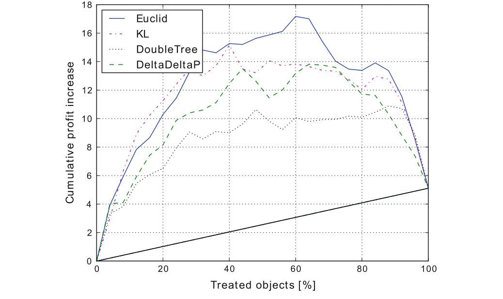
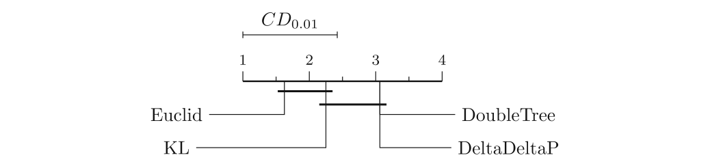
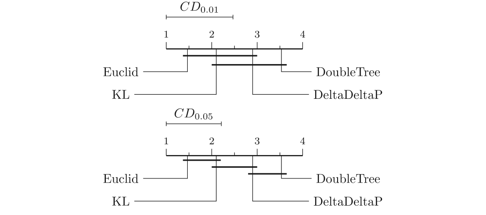
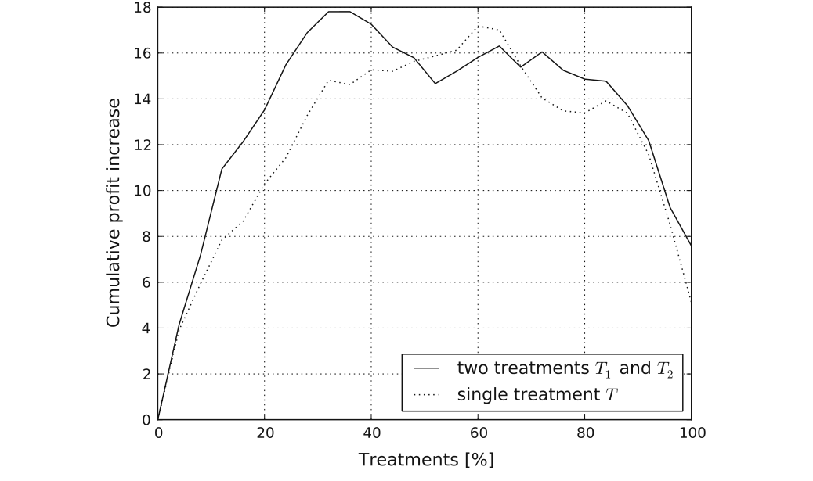

# 单种与多种处理的 Uplift 决策树

两棵购买预测树各自在券组和无券组找最能预测下单的字段。如果高活跃用户天然更常下单，两棵树都可能沿活跃度分裂，即使券作用对高低活跃用户相同。Rzepakowski 和 Jaroszewicz 用一棵共用树比较两组的类别分布。一次分裂要使各子节点内的处理与对照分布比父节点更分开。最终用叶内有符号的类别概率差算收益，可比较多个处理，也允许选择不发券。 [原刊 §1–3、§5](https://doi.org/10.1007/s10115-011-0434-0)

## 一次分裂会不会把效应相反的人分开

设独立随机试验中，每条记录有指派前画像 $X$、是否发券 $T$ 和观察窗内是否下单 $Y$。构造一个例子，两臂里都有一半用户浏览过详情页。浏览用户的券组与对照下单率分别为 40% 和 20%，其余用户为 10% 和 15%。两叶增量分别为 $+20$ 和 $-5$ 个百分点。父节点两臂下单率为 25% 和 17.5%，全体增量为 $+7.5$ 个百分点。这里用给定频率展示计算，实际建树会在样本计数上做拉普拉斯平滑。

令 $A$ 为候选测试，$a$ 为一个分支，$N(a)/N$ 为双臂样本合并后的分支占比。$P_T(Y\mid a)$ 与 $P_C(Y\mid a)$ 分别是券组、对照组在该分支的类别分布。先算子节点的加权散度，再减去父节点散度：

$$
D_{\rm gain}(A)=\sum_a\frac{N(a)}N D(P_T(Y\mid a):P_C(Y\mid a))-D(P_T(Y):P_C(Y)).
$$

对二分类，下单概率差为 $\delta$ 时，未下单概率差为 $-\delta$，所以平方欧氏散度 $E(P:Q)=\sum_y(p_y-q_y)^2$ 等于 $2\delta^2$。两叶散度为 $0.08$、$0.005$，按样本占比平均为 $0.0425$，减去父节点 $2(0.075)^2=0.01125$，增益为 $0.03125$。在两臂分流相同时，二分类平方欧氏增益就是两倍的叶效应加权方差，负增量叶也能贡献分裂增益。三个以上的类别可以沿同一公式求和。数值特征尝试相邻取值之间的阈值，类别特征可直接划成多支。 [原刊 §1.1、§3.1–3.2](https://link.springer.com/content/pdf/10.1007/s10115-011-0434-0.pdf#page=5)

另外两种散度为 $\mathrm{KL}(P:Q)=\sum_y p_y\log(p_y/q_y)$ 和 $\chi^2(P:Q)=\sum_y(p_y-q_y)^2/q_y$。两种都有方向，以对照分布 $Q$ 为基准。在小叶中，如果对照几乎没人下单，尤其是卡方散度中的小分母会把少数处理组下单放大。平方欧氏不含这个除法。若两组在各分支中的占比相同，原文定理 3.2 保证三种增益非负。若不相同，父节点的组间差混入人群构成差异，可能比分支内更大，增益就会取负。原文例 3.1 的分支占比在两臂分别为 30% 和 90%，KL 从父节点的 1.1808 降到分裂后的 0.2636。 [原刊 §3.2、式 (1)、例 3.1](https://link.springer.com/content/pdf/10.1007/s10115-011-0434-0.pdf#page=7)

## 跨臂分流、剪枝和叶内决策

树用归一化后的分数选切点。以平方欧氏为例，令 $r=N^T/N$，$\operatorname{Gini}(P)=1-\sum_y p_y^2$。分母 $J(A)$ 把三项相加：组别基尼 $\operatorname{Gini}(r,1-r)$ 乘候选测试在两臂上的分流散度 $E(P_T(A):P_C(A))$，两臂各自分流的基尼按 $r,1-r$ 加权，再加 $1/2$。第一项压低把某臂几乎单独分出去的测试，第二项校正多路测试，常数限制接近单支时分数被过度放大。本例两臂分流完全相同，分流散度为零，两臂分支基尼都为 $0.5$，$J(A)=1$。若某叶只有券组，算法形式上可退化成基尼分裂，但这个叶缺少直接反事实信息。历史日志中已观测测试分流相似，仍可能有未测混杂。 [原刊 §3.3、式 (2)](https://link.springer.com/content/pdf/10.1007/s10115-011-0434-0.pdf#page=8)

建树时给每个节点记下绝对差最大的类别及其符号。二分类两类别绝对差相同，可固定记录下单类。本例记录左叶正、右叶负、父节点正。独立验证集中按原规则落叶，度量概率差在原方向上的大小，反向会扣分。若验证叶效应为 $+17$ 和 $-4$ 个百分点，两叶等权时方向对齐后的值为 $10.5$ 个百分点，超过父节点的 $6.5$，保留分裂。若验证右叶变成 $+7$，叶值为 $(17-7)/2=5$，低于父节点的 $12$，剪去分裂。这份留出参与确定结构，和 Causal Tree 用专门估计样本报告已选叶效应的用途不同。 [原刊 §3.5](https://link.springer.com/content/pdf/10.1007/s10115-011-0434-0.pdf#page=10) · [Causal Tree 的选树、估计和区间](../SRC-CAUSAL-TREE/阅读笔记.md#为什么挑完切点还要换一批样本)

部署时按指派前特征把新用户送到叶。若一单价值为 100，给每人发券成本为 12，则高响应叶的净增量是 $100\times0.20-12=8$，另一叶为 $100\times(-0.05)-12=-17$。前一叶发券，后一叶不发。多类别时用 $-c+\sum_y v_y[P_T(y\mid l)-P_C(y\mid l)]$，其中 $v_y$ 为类别收益。分裂中的散度把正负差都视为分布变化，落叶后再用方向与成本决策。 [原刊 §3.4、式 (3)](https://link.springer.com/content/pdf/10.1007/s10115-011-0434-0.pdf#page=10)

## 多个券档怎样共用一棵树

沿用同一场景，再随机分出一个成本为 3 的低成本券组。设两叶下单率为 28% 和 23%，它在两叶都提升 8 个百分点，净增量同为 5。第一叶原券净值 8，仍选原券；第二叶低成本券净值 5，原券为 $-17$，选低成本券。每条训练记录只进入自身所在臂的类别计数，新用户直接比较所在叶各档的净值及无券的零值。用户共用预算时，还需把这些叶级收益和成本带入全局分配。 [原刊 §5、式 (4)](https://link.springer.com/content/pdf/10.1007/s10115-011-0434-0.pdf#page=16) · [组合与预算的算例](../../知识库/问题/组合营销策略如何共享结构并估计因果增量.md)

训练时，原文式 (5) 用 $\alpha\lambda_i$ 加权各档与对照的散度，再用 $(1-\alpha)\gamma_{ij}$ 加权各处理两两散度。前者看相对不发的变化，后者让分裂关注处理之间的差异。两部分都是无符号距离，$\alpha$ 调整关注点，不能直接指定胜出档。条件化和减父节点沿用单处理。权重按各处理人数或两处理人数乘积设定时，空处理不参与相应比较。按式 (5)，若节点只有一档有数据，未归一化增益等于单处理增益乘 $\alpha$。若 $\alpha=0$，散度也无法判断对照分布是否与各处理相同，定理 5.1 的严格等价与退化表述要加上参数条件。 [原刊式 (5)–(7)、定理 5.1](https://link.springer.com/content/pdf/10.1007/s10115-011-0434-0.pdf#page=17)

Causal Tree 的 CT-H 看叶平均效应可预测性的改进并扣除估计方差，再在独立估计样本上报叶效应。CTS 让分裂追踪子节点各自选档后带来的目标收益变化。多处理 Uplift 树可为对照差、档间差分配权重，但分裂可以偏爱某个概率差异很大的分区，即使两侧最终选择同一档。 [CT-H 精读](../SRC-CAUSAL-TREE/阅读笔记.md) · [CTS 分裂与策略价值](../SRC-CTS/阅读笔记.md)

## 排序和多档选择各用什么实验检验

作者原图 1，Springer 刊版第 314 页（PDF 第 12 页）。用同一模型分别在券组和对照组排序，两臂取相同覆盖比例，累计收益曲线相减，臂大小不同需换算量纲。横轴是覆盖比例，纵轴是曲线差。不同模型在低覆盖和中高覆盖处的间距不同。两臂的百分位相同并不能保证入选者可比，曲线面积也没有度量概率差的校准。 [原刊 §4.1](https://link.springer.com/content/pdf/10.1007/s10115-011-0434-0.pdf#page=12) · [排序、校准和策略价值](../../知识库/问题/怎样验证补贴增量的排序幅度和策略价值.md)

作者原图 2–3，Springer 刊版第 316–317 页（PDF 第 14–15 页）。横轴是跨数据集平均名次，越靠左越好。粗线连接在该显著性水平无法区分的方法。16 个 UCI 数据集由原有属性人为分臂。主比较采用两次五折，AUUC 的 Friedman 检验为 $p=0.0029$。Euclid 平均名次 1.625，显著优于 DoubleTree 和 DeltaDeltaP，与 KL 的差别未达显著。覆盖 40% 的曲线高度有类似结果，部分差异仅在 0.05 水平成立。卡方与另外两种散度的比较 $p=0.06$，证据不足以确立排序。 [原刊 §4.2–4.3、表 1–2](https://link.springer.com/content/pdf/10.1007/s10115-011-0434-0.pdf#page=13)

作者原图 4，Springer 刊版第 322 页（PDF 第 20 页）。把 splice 的 attribute1 取值 A、G 分成两档，平方欧氏树以 $\alpha=1/2$ 训练。实线是每叶选档，虚线把两档合并。测试保留建议档等于实际档的处理样本，对照沿用单档做法，再按用于计算的样本数归一化。图说明在这套人为分臂和归一化下，双档规则在不少覆盖点更高，两条曲线在约 50%–70% 的区间内交叉。若人群或动作的指派概率不同，命中样本会偏向日志中更常出现的动作。估计全人群策略价值需要按已知概率校正并纳入回退动作。该实验未评估真实营销部署的因果收益。 [原刊 §5 与图 4](https://link.springer.com/content/pdf/10.1007/s10115-011-0434-0.pdf#page=19) · [CTS 的全人群策略重放](../SRC-CTS/阅读笔记.md#随机日志怎样重放一条定价规则)

## 原文与中文译本

采用 Piotr Rzepakowski、Szymon Jaroszewicz 的 Springer 正式刊版，DOI 10.1007/s10115-011-0434-0。核对正文 §1–6、主要图表与定理附录。译本重排摘要、正文、主图表标题与致谢，保留图内英文、附录、文献和作者简介。正式文件为 `.local/papers/SRC-UPLIFT-TREE/translation/单种与多种处理的Uplift决策树_中文.pdf`，可编辑主文件为 `translated-sources/main.tex`。未运行模型。 [采用版](https://link.springer.com/content/pdf/10.1007/s10115-011-0434-0.pdf) · [原件版本与哈希](来源.json) · [私有备份下载说明](../../文档/工具/中文PDF发布.md)
