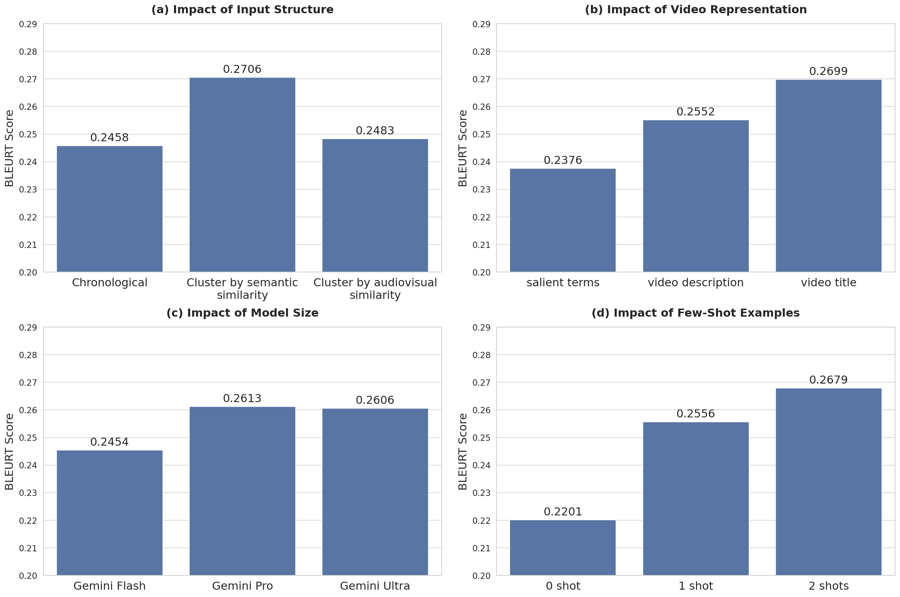
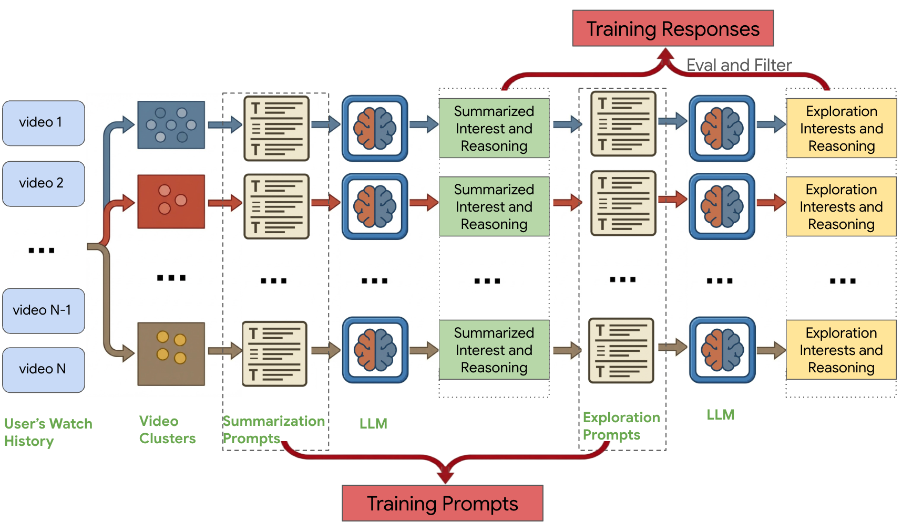
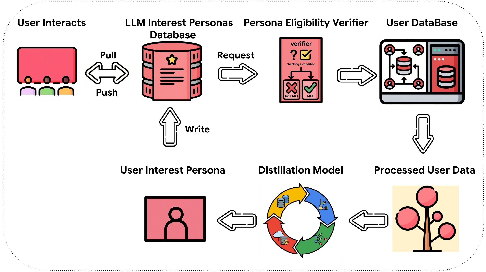

# User Personas：把用户历史写成兴趣文本，再交给既有检索系统

用户连续看了“手冲咖啡入门”“家用磨豆机比较”和“牛奶打发”，经典序列模型可将视频ID编码成用户向量，检索下一个可能观看的视频。这条路径高效，但向量本身不直接告诉人“用户在学习家庭咖啡制作”，也没有自然语言接口来提出“家庭拉花”这类相邻探索方向。本篇把一个语言层插在历史与候选之间：先概括已知兴趣，再为每个兴趣生成相关而新颖的主题，最后复用现有推荐模型把主题落实到视频。

[固定原文：2606.12198v2](https://arxiv.org/abs/2606.12198v2)，正式题名 *LLM-Based User Personas for Recommendations at Scale*，Haoting Wang、Haokai Lu等17位作者。本文采用2026年7月15日修订版，首发2026年6月10日；Google/Google DeepMind，Yu Xia注明工作在Google期间完成。原稿Woodstock 2018、DOI等是模板占位，不能当发表证据。中文PDF与访问说明见[附件目录](../../译文/PDF目录.md)。

## 先把概括、探索和物品检索分开

本篇的persona不是人口属性表，也不是可直接计算点击概率的心理真值。它是一组由观看历史推断的自然语言兴趣及生成理由。概括部分回答“已有行为表现了什么”，探索部分回答“可能还愿意看哪些相邻主题”。二者都可能出错：偶然看过不等于长期喜欢，相关主题也未必值得推荐。

沿上述教学实例，可把咖啡视频组概括为“家庭咖啡制作”，再提出“拉花入门”“不同烘焙度的风味”“家庭咖啡角布置”三个探索主题。另一组跑步视频则产生另一组兴趣。这里的标题、标签和三主题内容都是教学构造，不是论文披露的用户记录或模型输出；每个概括对应三个探索的结构来自附录B提示。

高层LLM输出文本，低层序列推荐模型输出物品候选。它与TIGER逐Token生成商品语义码不同，也与AMEN生成连续未来向量、供候选CTR网络读取不同。共享的目标是更好地利用历史，改变的接口却分别是文本条件、离散物品码和连续状态，不宜只按“生成式”三个字合并。[§3.1、§4.1、附录B，PDF第3–4、8页](https://arxiv.org/pdf/2606.12198v2#page=3)。

## 输入先分组，再让语言模型读取标题

直接将观看ID如V17、V92交给普通语言模型，没有可利用的视频语义。把ID查成标题后，仍有顺序混杂的问题：咖啡、跑步、咖啡、新闻交错，模型可能只给出宽泛兴趣。本文先把历史分成内容相近的簇，再从各簇采样少量视频标题，按组放进提示。输入仍来自已发生行为，没有把未来点击当推理输入。

两种聚类需要区别。语义聚类利用显著词及其显著性，把视频和个性化兴趣联系起来；音视Embedding聚类则在视频内容向量空间形成细簇，再合并宏观簇。前者在离线摘要质量上更好，后者支持可扩展的在线组织。**教师数据构造使用显著词语义簇；线上实验明确使用Embedding簇。**不能把最优离线配置写成线上原样部署，也不能由此补造它们之间未报告的转换。[§3.2、§4.1.2、§5.4.1，PDF第3–6页](https://arxiv.org/pdf/2606.12198v2#page=3)。

标题、视频描述、显著词分别是输入材料的不同粒度；这里“标题较好”不是“文本越短越好”的普遍规律。作者解释，描述中可能含推广和音乐版权噪声，显著词又可能过于宽泛。离线点击主题集的比较支持本数据下的选择，没有隔离所有数据清洗因素。

*作者原图3，固定v2 PDF第5页，Haoting Wang等。四幅图纵轴都是BLEURT，但分别改变输入结构、视频表示、模型、示例数；它们不是统一成本下四个模型的排名。源码原PNG直接引用，无科学内容改写。*

以数百位用户实际点击的主题文本作参考，图3报告：按时间输入0.2458、语义簇0.2706、音视簇0.2483；显著词0.2376、描述0.2552、标题0.2699；Flash 0.2454、Pro 0.2613、Ultra 0.2606；0/1/2-shot为0.2201/0.2556/0.2679。Pro到Ultra没有继续提升，因此“规模越大越好”只能理解为较大的Pro/Ultra优于该Flash配置，不能说严格单调。未给出这些离线差异的完整方差和统一搜索预算。[§5.1、图3，PDF第5页](https://arxiv.org/pdf/2606.12198v2#page=5)。

## 大教师多次生成，学生一次完成两项任务

线上若为每个兴趣分别调用大模型概括、推理、扩展，调用数和生成开销会随兴趣数增长。本篇把复杂生成放进教师数据生产：从数万位满足训练同意、近期高满意观看数量充足的用户中采样，移除不安全/敏感视频，按显著词相似性组织语义簇，并移除观看过少的簇。Gemini 1.5 Pro通过多次调用和分步提示分别生成、修订概括兴趣、探索主题及理由，产出供小模型学习的回复。[§4.1.2，PDF第4页](https://arxiv.org/pdf/2606.12198v2#page=4)。

*作者原图1，固定v2 PDF第4页，Haoting Wang等。自左向右是观看历史→用户簇→概括提示/LLM→概括兴趣及理由→探索提示/LLM→探索兴趣及理由；下方括号对应学生的训练提示，上方括号对应训练回复，评估/过滤后使用。直接取源码原图，与原论文相同像素。*

教师回复经过数量和格式筛选，剩余回复随机80%训练、20%评估。这里的“高质量”首先有结构检查，不能据此保证兴趣忠实性、新颖性或安全性全被人工核实；论文未给完整人工标注协议。拆分单位报告为合格回复，没有完整用户去重/时间隔离说明，不能额外声称用户独立或时间外推测试。

学生输入是统一提示及分簇标题，目标是教师整理后的双任务回复。Flash和Nano均做微调，部署只需一次LLM推理同时产生概括与探索；“一次推理”包含自回归生成多个Token，不是一个矩阵步同时写完所有文本。

从训练含义看，若用通常的文本监督，历史标题是条件，教师回复是目标，模型在回复位置预测下一Token，信号由词表头经过隐藏状态回到可训练参数。可用教学表达

$$
L_{\rm text}=-\sum_{t\in\mathcal T}\log p_\theta(y_t\mid x,y_{<t})
$$

理解“学会按给定历史写出这类回复”：$x$为提示及历史，$y$为教师文本，$\mathcal T$是参与损失的位置。**这不是论文给出的实现公式**；原文没有报告实际loss、prompt是否计损失、mask、优化器、更新参数范围或训练超参数，不能把上述常规解释当已核实实现，也不能称用真实未来点击直接优化了学生。教师理由属于训练回复的一部分，但是否忠实于实际决策没有独立验证。[§4.1.2、§5.2、附录B，PDF第4–5、8页](https://arxiv.org/pdf/2606.12198v2#page=4)。

## 线上请求读取缓存，画像重建在后台

“实时画像”容易被误读为每个请求都等待LLM。本文实际做法是：访问到来时查询画像数据库；存在有效画像就立即交给下游；缺失或陈旧时触发后台任务，当前请求不等待生成。后台取历史、清洗、聚类、采样标题、调用量化后的学生，再更新数据库，供后续访问使用。[§4.2、图2，PDF第4页](https://arxiv.org/pdf/2606.12198v2#page=4)。

*作者原图2，固定v2 PDF第4页，Haoting Wang等。上方是请求与画像数据库/资格检查，下方是用户数据→处理历史→蒸馏模型→写回画像。读图时区分前台读和后台写：出现刷新触发，不代表本次请求等待下方路径完成。直接复用源码原PNG。*

例如用户上午已有咖啡画像，下午突然观看修车视频：下午请求可能仍使用旧画像，触发刷新后才在后续请求看到变化。更新频率、回看窗口可以配置，降低开销的代价是瞬时意图存在滞后。原文没有给TTL、历史条数、各簇采样数、量化位宽、硬件、QPS或P95时延，不应把“低开销”“十亿用户平台”换算成未披露吞吐或成本。

只有合格观看足够的用户才有画像，明确负反馈视频会移除。新回复要经过安全分类；若被标记，则回退此前安全合格画像。首次没有旧画像且生成失败时具体走什么回退分支，原文未说明。后台资格筛选与输出安全检查也不同于证明每个兴趣都是事实。

## 文本不是最终推荐，仍要通过候选与排序

线上采用epoch 26.20的Gemini Nano。每次请求从已有画像**均匀随机取一个概括兴趣、一个探索兴趣**，用文本约束序列Transformer的最近邻搜索空间，再将候选送入既有排序。这样，同一缓存画像可在不同请求中提供不同兴趣，不必每次刷新LLM；这也不是按LLM置信度挑最优主题。

教学上，将选中的文本写成$q$，其语义相关的视频集合写成$C(q)$，历史序列模型产生用户向量$u(h)$，就能用

$$
\operatorname{TopK}_{i\in C(q)}\ s(u(h),v_i)
$$

理解检索接口。这个式子整理自§3.1/§4.2，并非原文编号算法：先用文本限定允许检索的视频，再由原有用户—物品匹配寻找候选。论文没有交代$C(q)$怎样构造、语义阈值/索引、约束与用户分数的精确实现，不能补成“LLM直接向量化后全库ANN”或指定某个检索器。两种兴趣各自产生多少候选、怎样去重融合，也未完整披露。[§3.1、§4.2、§5.4.1，PDF第3–4、6页](https://arxiv.org/pdf/2606.12198v2#page=3)。

文章另讨论双塔备选：把文本画像编码为查询向量，与视频向量做相似检索。但线上实验明确使用序列Transformer与受限最近邻，不能把备选双塔当最终部署。本例的“家庭拉花”只有经过视频集合约束、用户匹配、排序、最终曝光之后，才可能影响观看；画像合理不等于它一定进排序或得到曝光。

## 离线三类指标分别检验什么

输入组织实验以**用户点击主题**为参考；蒸馏实验以**教师生成的概括兴趣**为参考，两者虽然都报BLEURT，测量对象不同，分数不能串起来解释为用户兴趣准确率。

蒸馏指标中，IFR要求双任务完成、格式正确、兴趣条数符合要求；它检验可解析性，不检验内容事实。BLEURT测学生概括与教师的语义接近程度；创造力用LLM并排评价学生与教师的“概括—探索”组合，评价器也不是用户真实偏好的无噪声真值。后两项仅在通过IFR的回复上计算，条件集合随模型变化，有选择效应。

| epoch 26.20 | Nano | Flash |
|---|---:|---:|
| IFR | 99.08% | 99.68% |
| BLEURT，教师概括为参考 | 0.328 | 0.345 |
| 创造力分数 | −0.018 | +0.023 |

Nano格式和概括可用，但创造力没有像Flash那样改善；选择Nano是作者对成本/时延的取舍，不能改写成Nano各项更好。epoch由评估集选择，因此该表不是未经选择的独立最终验收集。分数的精确定标、方差、评委稳健性与完整训练预算未报。[§5.2、表2，PDF第5–6页](https://arxiv.org/pdf/2606.12198v2#page=5)。

## 用户认可和线上增量支持到哪里

第一项调查面向数千名研究前一周活跃的美国用户：先展示某簇三个代表视频，用户表示记得观看后才评分。超过80%的回答者认为标签高度准确，71%表示很想看更多该主题视频。第二项与知识图谱抽取主题比较，57%严格偏好LLM画像，20%认为相当，不能把相加的77%称为严格偏好。两者都不能无条件推广到全球全部用户或不记得视频的人。[§5.3，PDF第5–6页](https://arxiv.org/pdf/2606.12198v2#page=5)。

线上对照与实验采用等量、互不重叠的用户流量，运行超过30天，对照没有LLM画像；实验改变的是画像生成、兴趣采样、约束检索接入等整套路径。作者报告以下相对增量，均$p<0.05$：

| 指标 | 相对增量 |
|---|---:|
| 用户观看时长 | +0.04% |
| 活跃用户数 | +0.03% |
| 参与主题数 | +0.04% |
| 拥有多个持久参与主题的用户数 | +0.03% |

这些是相对百分比，不是百分点。论文没有给流量占比、实验人数、完整随机化细节、各指标绝对基数或置信区间；“平台服务十亿用户”不是“十亿人参与实验”。观看时长与持久参与主题的具体操作定义也缺少完整公式。作者关于世界知识、稀疏兴趣推断和轻度用户收益的解释合理，但没有把这些机制分别隔离的消融。[§5.4、图4，PDF第6–7页](https://arxiv.org/pdf/2606.12198v2#page=6)。

探索来源候选的曝光比概括来源少40.91%，在已经曝光的条件下被观看概率却高13.6%。这一比较经过下游排序选择，无法单独识别“探索策略优于概括策略”的因果效应，也不能推出把全部流量转给探索就会更好。总A/B支持整套接入有增量；来源间条件统计只提示排序和探索协同值得继续检验。长期收益段未另报明确观察窗/数值，不将其扩展成已验证的长期留存结论。

## 与同批论文放到同一链路比较

| 路线 | 生成对象 | 怎样变成推荐决策 | 主要服务边界 |
|---|---|---|---|
| [TIGER](../SRC-TIGER/阅读笔记.md) | 物品语义码Token | 码序列映射物品候选 | 合法码路径、逐步生成与候选覆盖 |
| [OneRec-V2](../SRC-ONEREC-V2/阅读笔记.md) | 下一目标物品的SID | 直接生成候选并做偏好对齐 | 上下文复用、目标解码与在线生态 |
| [OneReason](../SRC-ONEREASON/阅读笔记.md) | 推理表示及推荐结果 | 快慢路径及近线候选接入 | 推理成本、刷新与部署路径分别核对 |
| [AMEN](../SRC-AMEN/阅读笔记.md) | 连续未来兴趣状态 | 候选读取后预测CTR | 生成器冻结，候选对齐仍在线计算 |
| 本篇 | 概括/探索文本与理由 | 文本约束既有序列检索，再排序 | 后台刷新缓存、每请求兴趣采样 |
| [RankMixer](../SRC-RANKMIXER/阅读笔记.md) | 候选特征Token的连续表示 | 已知候选打分 | 精排矩阵计算和参数/FLOPs预算 |

这张表只比较输出和接口，不把不同平台、目标、流量和资源的增量排名。关于历史状态与未来预测的共同问题见[兴趣演化比较](../../知识库/问题/候选相关兴趣如何随历史演化.md#先生成兴趣文本再约束检索)。

## 阅读与翻译范围

已读固定v2正文§1–6、附录A/B三份提示和原文9页，核对图1–4、表1–2；参考文献未逐篇精读，未读作者算法实现，未运行模型。正文、图表说明译为中文，附录提示、参考文献、作者及原图内文字保留；中文7页已逐页目视，公式引用/表数、字体嵌入/中文映射、动作检查通过；原文9页与译文均已于2026-11-18真实认证下载并核对完整SHA256，访问见附件目录。论文保留原作者的较强主张，笔记按实际证据限定解释。
