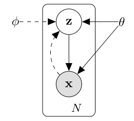
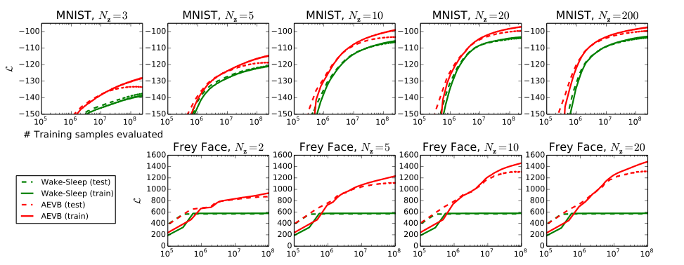
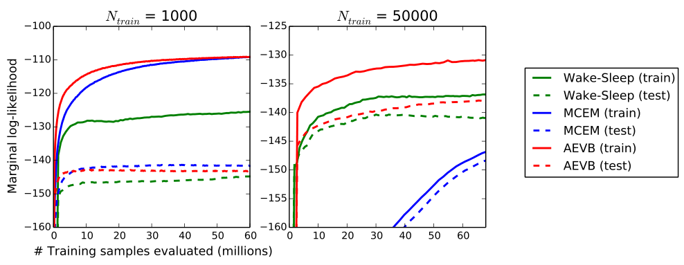
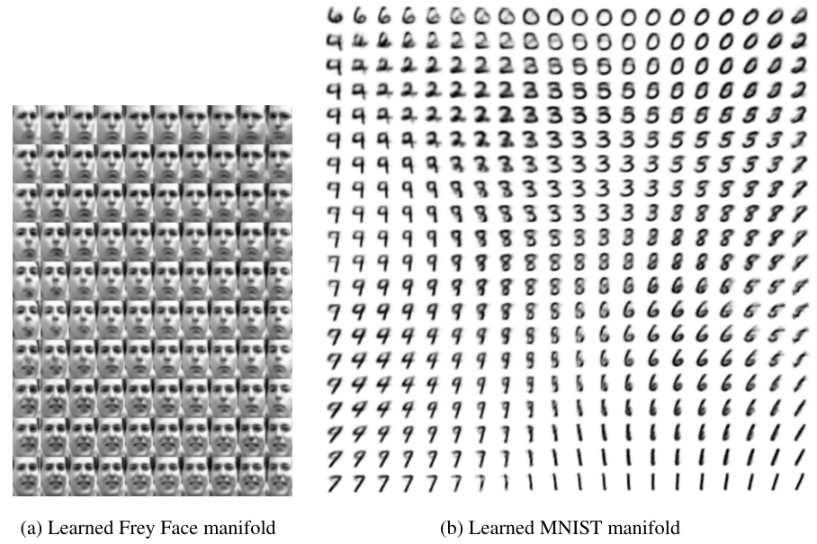

# 变分自编码器怎样用一个目标学习推断与生成

观察到一张手写数字图像 $x$ 后，想知道哪些潜在笔画状态 $z$ 能生成它。同时，希望模型学会从这些状态生成新图像。若解码器是非线性网络，后验 $p_\theta(z\mid x)$ 需要对所有 $z$ 计算边缘似然，通常没有可用的闭式解。Kingma 和 Welling 用一个概率编码器近似后验，给定图像就输出一个分布，再把采样改写成可微的确定性变换。编码器和解码器因此能由同一个似然下界训练。 [原文 §1–2](https://arxiv.org/pdf/1312.6114v11#page=1)

## 一张手写数字怎样进入推断与生成两条路径

图 1 为 Diederik P. Kingma 与 Max Welling 的原图，裁自 arXiv 1312.6114v11 第 2 页。先沿实线看生成过程，再沿虚线从观测回看模型用来近似后验的方向。框内是一条样本的计算，$N$ 表示重复的样本数。 [原文图 1、§2.1](https://arxiv.org/pdf/1312.6114v11#page=2)

生成端先抽 $z\sim p_\theta(z)$，再抽 $x\sim p_\theta(x\mid z)$。在二元像素的示例中，解码器接收潜向量，为每个像素给出伯努利概率。训练时手里的数据却是 $x$，真实的 $z$ 没有标签。精确地按贝叶斯公式倒推，要计算 $p_\theta(x)=\int p_\theta(x\mid z)p_\theta(z)\,dz$。单独为每张图迭代采样或拟合近似后验，会把推断成本乘到训练样本数上。

编码端把新图像交给共享网络 $q_\phi(z\mid x)$。以对角高斯为例，它输出均值 $\mu_\phi(x)$ 和各维标准差 $\sigma_\phi(x)$，表示在给定这张图时潜向量的可能取值。把一次推断的计算训练进共享网络称为摊销推断。训练后，若要表示已有图像，读取均值或抽编码样本。若要生成新图，先从先验取样，再用解码器产生像素概率或采样。两条路径的起点不同。 [原文 §2.1、§3 与附录 C](https://arxiv.org/pdf/1312.6114v11#page=5)

## 一个下界怎样同时监督像素和潜空间

插入近似后验 $q_\phi(z\mid x)$ 后，边缘对数似然可写成
$$
\log p_\theta(x)=\mathcal L(\theta,\phi;x)
+\mathrm{KL}\big(q_\phi(z\mid x)\Vert p_\theta(z\mid x)\big),
$$
$$
\mathcal L(\theta,\phi;x)=
\mathbb E_{q_\phi(z\mid x)}[\log p_\theta(x\mid z)]
-\mathrm{KL}\big(q_\phi(z\mid x)\Vert p_\theta(z)\big).
$$

第一式最后的 KL 非负，因此 $\mathcal L$ 是证据下界（ELBO）。对固定 $\theta$，最大化它会把编码分布推向后验。第二式则给出实际训练的两个项。重构项鼓励从该图的潜样本读回观测像素的概率。先验项则约束其潜分布落在生成时能够抽到的区域。对一张图，如果把一个一维编码推到 $\mu=5$、$\sigma=1$，它距离标准正态先验的 KL 就是 $12.5$ nat。除非重构项因这个远离原点的编码改善足够多，否则目标偏向更接近先验的表示。 [原文 §2.2、式 (1)–(3) 与附录 B](https://arxiv.org/pdf/1312.6114v11#page=3)

## 把随机性移到网络权重以外

直接估计编码器梯度可以用得分函数乘采样结果，但样本质量随运气波动，而且原文指出这一梯度估计的方差很大。高斯编码器可以改写为
$$
\epsilon\sim\mathcal N(0,I),\qquad
z=\mu_\phi(x)+\sigma_\phi(x)\odot\epsilon .
$$

例如一张图的一维输出为 $\mu=1,\sigma=0.5$，这步抽到 $\epsilon=-1$，传给解码器的就是 $z=0.5$。在这一遍反传内固定 $\epsilon$，解码器给出的梯度可以通过 $\partial z/\partial\mu=1$ 与 $\partial z/\partial\sigma=-1$ 传回编码器。下次前向重新抽噪声。随机性还在，网络参数所处的计算路径已经可微。通用 SGVB 采样估计 $\log p_\theta(x,z)-\log q_\phi(z\mid x)$。高斯例子可直接求 KL，只对解码项采样。原文算法 1 在实验中用 100 个数据点一批，每点抽一个 $z$。这是一种实验配置，不能代替对估计方差的检查。 [原文 §2.3–2.4、算法 1 和 §3](https://arxiv.org/pdf/1312.6114v11#page=4)

## 学习曲线和潜网格分别告诉我们什么

图 2 为作者原图，裁自采用版第 7 页。纵轴是每样本平均 ELBO 估计，横轴是已评估的训练样本数。横向按潜空间大小比较，红色 AEVB 在所示配置中达到更高下界。该比较使用相同架构的识别网络，MNIST 与 Frey Face 分别用 500 和 200 个隐藏单元。 [原文 §5、图 2](https://arxiv.org/pdf/1312.6114v11#page=7)

图 3 为作者原图，裁自采用版第 8 页。边缘似然比较另用 3 个潜变量、100 个隐藏单元，并用 MCMC 估计。两张面板的训练样本数是 1,000 和 50,000，虚线是测试集。小数据面板中 MCEM 与 AEVB 的测试结果接近。大数据面板中，所示计算范围内 AEVB 的测试估计高于 wake-sleep 和 MCEM。论文报告高维潜空间的似然估计会变得不可靠，因此这里的结果限于低维估计协议。 [原文 §5、图 3 与附录 D–E](https://arxiv.org/pdf/1312.6114v11#page=8)

图 4 为作者原图，裁自采用版第 10 页。图中每格是规则网格坐标经过标准高斯逆累积分布变换后解码的结果。相邻格子呈现连续变化，轴的含义由模型和数据决定。迁移到发券问题时，可以让生成模型从同一潜变量解释多个代理字段，但必须另外核对为何该潜变量足以调整因果混杂。 [原文附录 A、图 4](https://arxiv.org/pdf/1312.6114v11#page=10) · [发券日志的识别条件](../../知识库/问题/历史发券日志如何估计补贴增量.md)

## 原文和中文译本

采用 Diederik P. Kingma、Max Welling 的 arXiv 1312.6114v11，首版于 2013 年提交。阅读摘要、§1–7、算法 1、三幅正文图及附录 A–E 的相关推导和实验细节。中文译本 13 页，译出摘要、正文、正文图注与描述性脚注，保留作者书目、附录和图内文字。使用本地 LuaLaTeX 编译作者源码副本，逐页渲染检查。正式文件为 `.local/papers/SRC-VAE/translation/自编码变分贝叶斯_中文.pdf`，可编辑主文件在 `translated-sources/iclr14_sva.tex`。 [采用版原文](https://arxiv.org/pdf/1312.6114v11) · [来源](来源.json) · [私有备份下载说明](../../文档/工具/中文PDF发布.md)
