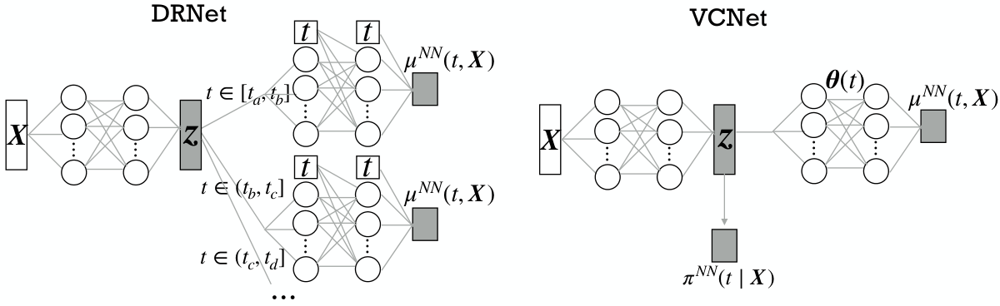
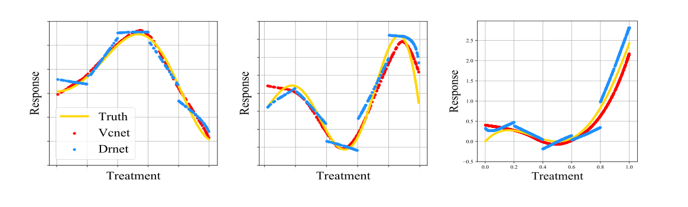

# VCNet 让处理剂量连续调节结果网络

若按金额区间各训一套预测头，同一用户的 7.99 元和 8.01 元券会经过不同头，即使实际券规则没有跳变，估计也可能在 8 元附近突然抬高。VCNet 让剂量改变同一个结果头的参数，用连续基函数把相邻剂量连接起来。第二步将 DragonNet 的标量扰动扩展为随剂量变化的函数，让一组共享局部参数的残差校正服务整条人群平均曲线。 [v1 §1、§3–4](https://arxiv.org/pdf/2103.07861v1#page=2) · [DRNet 按区间分头](../SRC-DRNET/阅读笔记.md) · [DragonNet 定向正则](../SRC-DRAGONNET/阅读笔记.md)

## 从一条实际发券记录得到整条人群曲线

设 $t$ 为同类券的归一化面额，$X$ 为指派前特征，$Y$ 为七日消费。VCNet 要估计的是固定目标人群在统一施加剂量 $t$ 时的平均期望 $\psi(t)=E[Y\mid do(T=t)]$。在处理前特征阻断混杂且目标剂量在各特征人群有正密度时，可先估计 $\mu(t,x)=E[Y\mid T=t,X=x]$，然后用同一批用户对各候选的 $\mu(t,x)$ 平均。这避免了按实际券档分组后去平均不同人群。某个用户在各档的预测可贡献给曲线，但理论和实验主目标是边际平均曲线。 [v1 §2–3，PDF 第 3 页](https://arxiv.org/pdf/2103.07861v1#page=3)

记录中的用户特征先由编码器得到 $z$，一条支路在剂量网格上出分并线性插值，拟合给定 $x$ 的分配密度 $\pi(t\mid x)$。另一条用实际券档计算样条基 $\Phi(t)$，用共享矩阵 $A$ 生成网络参数 $\theta(t)=A\Phi(t)$，再预测 $\mu(t,x)=f_{\theta(t)}(z)$。若一个权重是 $2+3t$，剂量从 0.4 增至 0.6 时，它由 3.2 变为 3.8，这一权重既影响当前样本，也通过系数 2 和 3 与其他剂量共享监督。实际网络每个参数都可使用一组样条基，包括随剂量改变不同隐单元的权重。只有这条记录的实际剂量受到结果平方损失与密度负对数似然监督。预测时换成其他剂量，重新计算基值与结果头参数。连续基与连续激活产生连续的预测，非负导数并未被强制。 [v1 §3.1–3.3、式 (1)](https://arxiv.org/pdf/2103.07861v1#page=4)

Nie 等，固定 v1 第 3 页图 2。左侧由剂量区间选择独立头，右侧由同一表示产生条件密度并以剂量生成结果头参数。 [作者图 2](https://arxiv.org/pdf/2103.07861v1#page=3)

原文 §3.2 的插值把 $t_1$ 写为网格索引，却在公式中直接从剂量 $t$ 减 $t_1$。作者固定实现按相邻点索引找分数部分。以 $B=10,t=0.36$ 为例，两个端点是 0.3 与 0.4，右端比例为 $0.6$。代码插值后直接返回分数，未执行原稿所述的连续密度积分归一化，评价和训练还各在分母加入 $10^{-6}$。有限样本的这项实现细节与定理里的合法密度假设需分别核对。 [v1 §3.2](https://arxiv.org/pdf/2103.07861v1#page=4) · [固定插值实现](https://github.com/lushleaf/varying-coefficient-net-with-functional-tr/blob/a2e95381577dc3ee73a55e0f569c2335e042455e/models/dynamic_net.py#L105)

## 用样条调整整条曲线的加权残差

若直接平均 $\hat\mu(t,X_i)$，结果头若系统性低估某剂量附近的响应，平均也会承接该误差。VCNet 先将标量扰动推广为 $\epsilon(t)=\sum_k a_k\varphi_k(t)$。在事实剂量 $t_i$ 上，以 $Y_i-\hat\mu(t_i,X_i)-\epsilon(t_i)/\hat\pi(t_i\mid X_i)$ 做平方损失，再以权重 $\beta_n$ 加回原来的两任务损失。每个基函数的系数由它覆盖的剂量共同监督。推理用同一目标人群平均修正后的 $\hat\mu(t,X)+\hat\epsilon(t)/\hat\pi(t\mid X)$。若某用户的 $\hat\mu$ 为 30 元，$\hat\epsilon(t)=0.6$，$\hat\pi(t\mid x)=0.3$（归一化剂量上的密度），修正后为 32 元，再与其余用户的修正值求平均。密度接近零时，修正容易变大，所以重叠仍是条件。 [v1 式 (3)–(4)、定理 2](https://arxiv.org/pdf/2103.07861v1#page=6) · [固定出分代码](https://github.com/lushleaf/varying-coefficient-net-with-functional-tr/blob/a2e95381577dc3ee73a55e0f569c2335e042455e/utils/eval.py#L27)

若无额外参数惩罚且对 $a_k$ 优化到驻点，各基函数加权的残差矩趋近零，不需要为每个连续剂量单设一个自由扰动。附录 A.2.3 对双重稳健余项写为 $E[(\pi/\hat\pi-1)(\mu-\hat\mu)]$，其中两项都在同一目标剂量求值，说明任一辅助函数正确时总体余项为零。定理 2 给出整条曲线的 $L^2$ 误差界，含平滑率 $n^{-1/3}\sqrt{\log n}$ 与两项辅助误差的乘积，依赖密度上下界、光滑及函数类复杂度、样条维数随样本量增长和 $\beta_n\to0$。这个结论也不能直接用作某个极少见剂量的逐点置信区间。定理 1 的 Dirac delta 写法是总体广义表达，有限样本在连续剂量上需要邻域平滑或函数近似。 [v1 §4.1、§4.3](https://arxiv.org/pdf/2103.07861v1#page=7) · [附录 A.2.3–A.2.4](https://arxiv.org/pdf/2103.07861v1#page=14) · [和残差化估计的分工](../../知识库/问题/残差化怎样估计营销干预效应.md)

## 人群曲线误差与光滑性实验证据

Nie 等，固定 v1 第 2 页图 1。左、中、右依次为模拟、IHDP、News 的一次典型测试运行。黄线是真值，红点为 VCNet，蓝点为 DRNet。读图时优先看分段边界附近的预测形状。 [作者图 1](https://arxiv.org/pdf/2103.07861v1#page=2)

表 1 比较附加密度头后的 DRNet 和分段改造的 DragonNet。模拟与 IHDP 重复 100 次，News 重复 20 次，计算平均曲线的 AMSE。模拟列 VCNet 直接估计为 0.018，VCNet 加定向正则为 0.014，DRNet 加定向正则为 0.027。News 上 VCNet 双重稳健回归 0.023，VCNet 加定向正则 0.024，表 2 的 GPS 为 0.022。因而定向正则和变系数结构在不同数据上的效果应分别看，作者认为直接版本始终最差，表 1 有反例。与 DRNet 原文比较时，后者 MISE 先算逐用户曲线误差再平均，VCNet 的 AMSE 先固定人群平均响应再比较，不能横向对比数值。 [v1 §6、表 1–2](https://arxiv.org/pdf/2103.07861v1#page=8)

[连续券额响应比较](../../知识库/问题/连续券额怎样估计并约束响应曲线.md)将本文和有序券档、单调约束放在同一条选档链路上。

## 版本与译本

Lizhen Nie、Mao Ye、Qiang Liu、Dan Nicolae。

采用 arXiv v1，核对摘要、正文 §1–7、式 (1)–(4)、图 1–2 和表 1–2，重点核对附录 A.1、A.2.3–A.2.4 和 A.4。静态阅读固定作者代码的插值、FTR 损失及曲线出分函数，未运行实验。作者 LaTeX 副本用于翻译摘要、正文、图表说明、描述性脚注，参考文献、图内文字和附录正文保留英文。 [固定原文](https://arxiv.org/pdf/2103.07861v1) · [版本与许可](https://arxiv.org/abs/2103.07861v1) · [中文 PDF 访问](../../译文/PDF目录.md)
