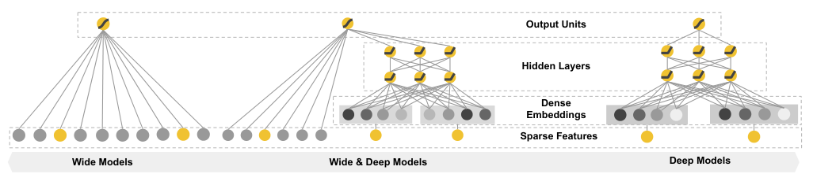
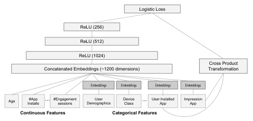
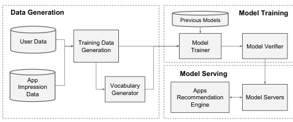

# Wide & Deep：让独立交叉记忆与嵌入泛化共同学习

[原文版本与中文 PDF 位置](#原文与阅读范围) · [私有备份下载说明](../../文档/工具/中文PDF发布.md#登录下载)

推荐既需要复用历史中稳定的具体搭配，也需要判断少见甚至未见的组合。只给每个组合独立权重，稀疏组合难学习；只用共享低维嵌入，又可能把本来不同的小众偏好压得过近。Wide & Deep让人工选择的交叉特征直接连接输出，同时用嵌入和多层网络学习组合，二者在同一个监督损失下训练。

本文采用Heng-Tze Cheng、Levent Koc等16位Google作者的 **arXiv 1606.07792v1（2016-06-24）**，4页正文§1–7，无附录。不以其他版本、教程或后续实现补齐本篇未给的参数。

## 记忆不等于死记所有组合，泛化也不保证推荐相关

将用户已安装Netflix与本次展示Pandora编码为二值特征，二者同时为1时激活一个交叉权重。这条权重从该搭配的历史曝光标签学习，可以表达精细的正向或负向关联。若改用“视频类已安装应用×音乐类展示应用”，就能以更粗粒度覆盖其他应用，但选择粒度仍需要特征工程。[§1，PDF第1页](https://arxiv.org/pdf/1606.07792v1#page=1)。

嵌入把同一字段取值在不同组合中复用，因此未共同出现的特征对也有机会获得预测。作者以稀疏、高秩的查询—物品关系解释过度泛化：很低维的表示难保留大量互不相似的小众偏好，独立交叉可补充例外规则。这是设计动机，论文没有秩估计或关于实际数据的表达下界证明；非零分数本身也不等于一定进入最终推荐。所谓多样性优势没有独立的列表多样性指标或消融，不能当作已证实业务结论。

Cheng 等作者原图 1，1606.07792v1 (2016-06-24)，PDF 第 2 页。并排比较宽模型、宽深联合及纯深模型的连接。

## 宽分支选择交叉，深分支共享表示

宽分支在原始特征 $x\in\mathbb R^d$ 之外加入预先选定的变换：

$$
\phi_k(x)=\prod_{i:c_{ki}=1}x_i,\qquad c_{ki}\in\{0,1\}.
$$

这是原式(1)的选择集合写法，避免把未选特征的零次幂误解为数值计算。二值特征都为1时交叉才为1。每个所选交叉有独立系数；它可以是二阶或更高阶，Wide & Deep并非只允许二阶交叉。模型对变换后的特征线性，但相对于原始输入已引入非线性。[§3.1、式(1)，PDF第2页](https://arxiv.org/pdf/1606.07792v1#page=2)。

深分支将类别字段映射到可学习嵌入，与连续特征拼接为 $a^{(0)}$，逐层计算：

$$
a^{(l+1)}=\operatorname{ReLU}(W^{(l)}a^{(l)}+b^{(l)}).
$$

输出在logit层相加，再用一次Sigmoid：

$$
z=w_{wide}^{\top}[x;\phi(x)]+w_{deep}^{\top}a^{(l_f)}+b,
\qquad p(Y=1\mid x)=\sigma(z).
$$

$w_{wide}$是宽分支系数，$w_{deep}$将深分支末层激活映射成标量。这里相加的是对数几率分数，不是把两路概率直接相加；$p$用于安装标签预测，但输出在0到1之间并不自动证明校准。[§3.2–3.3、式(2)–(3)，PDF第2–3页](https://arxiv.org/pdf/1606.07792v1#page=3)。

## 联合损失如何让两条路径互补

两路从同一个logistic损失反向传播。对单条标签 $y$，由该损失可得 $\partial\ell/\partial z=p-y$；宽交叉权重接收 $(p-y)\phi_k(x)$，深分支接收同一残差经网络传播的梯度。因此一条已被宽分支解释的规则会改变深分支面对的剩余误差。这是从公式得到的机制分析，不等于任何数据上必然互补。

作者用FTRL加 $L_1$ 正则优化宽分支，AdaGrad优化深分支；联合训练不要求优化器相同。与分别拟合模型、推理时才合并的集成不同，联合模型训练时就知道另一分支的贡献，宽分支可以只补充少量交叉，而非独立承担全部任务。这里共享的是预测目标与输出误差，不是像[DeepFM](../SRC-DEEPFM/阅读笔记.md)那样让显式二阶分支与MLP共享同一套嵌入。[§3.3，PDF第3页](https://arxiv.org/pdf/1606.07792v1#page=3)。

Cheng 等作者原图 4，1606.07792v1 (2016-06-24)，PDF 第 3 页。同一次曝光的连续和类别输入走深支，选取的类别乘积走宽支。

## 应用安装标签、训练输入与更新路径

本篇是召回后的排序模型，并非用深网为全库百万应用逐一打分。每条训练样本对应一次应用展示，展示应用被安装为1，否则为0；论文未完整说明安装归因窗口、负例采样或标签延迟处理，不补入点击率任务的默认条件。[§2、§4.1，PDF第2–3页](https://arxiv.org/pdf/1606.07792v1#page=3)。

类别词表只为超过最低出现次数的字符串建立ID，门槛没有给出。连续特征按训练数据生成的分位边界映射：第 $i$ 个区间取 $(i-1)/(n_q-1)$，也未给 $n_q$。生产宽分支使用“已安装应用×展示应用”；深分支每类别32维，嵌入与连续值拼成约1200维向量，图4给出三层ReLU宽度1024、512、256。[§4、图4，PDF第3页](https://arxiv.org/pdf/1606.07792v1#page=3)。

作者称在超过5000亿样本上训练，没有说这是单日量、一次实验独立数据量或公开可复现集。新数据到达后重新训练，以旧模型嵌入和线性权重热启动，不能进一步声称所有深层参数、优化器状态都热启动，或持续流式逐样本更新。上线前试运行并对比上一版本质量，频率、训练时长与完整验证协议未给出。

沿第 06 批的同一次广告曝光，令已选择的 ESPN×Nike 交叉为 1，宽分支总分 \(0.3\)，深分支总分 \(0.1\)，偏置取 0。则点击概率为 \(\sigma(0.4)\approx0.599\)。若标签为 1，共同的 logit 梯度约为 \(-0.401\)。宽分支的交叉权重直接收到该梯度，经 [FTRL-Proximal](../SRC-FTRL/阅读笔记.md#一次曝光怎样更新两个状态) 的状态递推；深分支经过其读出和各隐藏层，使用 AdaGrad 更新嵌入及网络权重。这是用于比较结构的广告教学样本，论文线上标签是 Google Play 应用获取。

[在线 CTR 的逐坐标更新](../../知识库/问题/在线CTR怎样得到稀疏权重.md)把同一条曝光的 \(p-y\) 接到近端阈值与学习率。

## 三周线上结果不等于离线AUC的单调变换

Google Play主入口的线上实验持续三周，纯宽对照随机选1%用户，Wide & Deep与纯深各另用1%用户。对照是已高度优化、包含丰富交叉特征的逻辑回归，原文称使用相同特征集；纯深还采用与联合模型相同的神经结构。没有公开精确样本数、绝对获取率、置信区间或检验方法。[§5.1、表1，PDF第3–4页](https://arxiv.org/pdf/1606.07792v1#page=4)。

| 模型 | 离线留出集AUC | 线上应用获取率相对纯宽增益 |
|---|---:|---:|
| Wide（对照） | 0.726 | 0% |
| Deep | 0.722 | +2.9% |
| Wide & Deep | 0.728 | +3.9% |

作者报告联合模型相较纯宽、纯深均统计显著。正文“相对纯深+1%”是近似说法：表中两个相对同基线的增益相差1个百分点，换成纯深获取率作分母约为 $1.039/1.029-1\approx0.97\%$。不是安装率提高1个百分点，更不是CTR或收入提高3.9%。

纯深离线AUC低于纯宽，线上获取率却更高，说明离线固定曝光分布上的区分能力并非线上决策收益的同义词。作者猜测模型会推荐更多新组合、再从新响应学习，但没有单独控制探索或反馈路径，不能据此断定线上收益完全来自探索、多样性或某一个分支。

Cheng 等作者原图 3，1606.07792v1 (2016-06-24)，PDF 第 3 页。训练用曝光和词表，部署前校验，服务将候选上送模型。

## 拆批并行减少了时延，未减少总候选数

峰值系统每秒打分超过一千万个应用，这不是一千万请求每秒。表2在总200候选下比较单批与拆批：[§4.3、§5.2、表2，PDF第3–4页](https://arxiv.org/pdf/1606.07792v1#page=4)。

| 每线程批次大小 | 线程数 | 客户端服务时延，含服务开销 |
|---|---:|---:|
| 200 | 1 | 31ms |
| 100 | 2 | 17ms |
| 50 | 4 | 14ms |

31到14ms约减少54.8%，或时延比约2.21；线程变多并非算术操作量等比例减少，也不能直接当作吞吐翻倍。原文未给硬件、时延分位、饱和负载和成本；14ms不能称P99或对任意负载的保证。与[IntTower](../SRC-INTTOWER/阅读笔记.md)预计算物品表示不同，这里用户/应用特征共同进入深网，仍有逐候选前向成本，批次并行只是执行方式。

独立交叉、FM因子共享及DeepFM共同嵌入的差别已合并到[稀疏特征交互问题](../../知识库/问题/稀疏特征的低高阶交互学习.md)，机制可比较，Google Play线上结果与DeepFM的Criteo离线数字不能直接排名。

## 原文与阅读范围

采用 [arXiv 1606.07792v1](https://arxiv.org/abs/1606.07792v1)，重读§1–7、图表及描述性脚注。沿用 3 页中文正文译本，覆盖摘要及正文、图表说明，保留图内英文和参考文献。

本地文件 `.local/papers/SRC-WIDEDEEP/translation/SRC-WIDEDEEP.zh-CN.private.20261027.1.pdf`，可编辑工程主文件 `.local/papers/SRC-WIDEDEEP/translation/translated-sources/wide-n-deep-paper-draft.tex`。[许可与范围盘点](../../译文/PDF目录.md) · [私有备份下载说明](../../文档/工具/中文PDF发布.md#登录下载)
