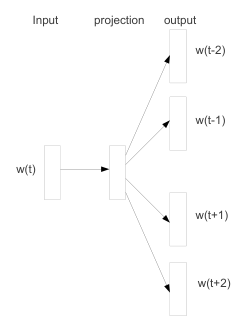

# Word2Vec 怎样用负采样学上下文表示

Skip-gram 让中心词预测上下文。对于「降噪 耳机 舒适」，以「耳机」为中心、窗口半径为 1 会产生「降噪」和「舒适」两个真实上下文。传统 Softmax 每个正对都对全词表计算归一化。Mikolov 等以抽到的少数噪声词构造二元分类损失，目标从条件概率拟合转向学习可复用的向量。

作者原图 1，Mikolov、Sutskever、Chen、Corrado 与 Dean，arXiv 1310.4546v1，PDF 第 2 页。中间是同一个中心词的向量，右侧每个输出位置对应一条中心—上下文训练对。

## 从归一化预测到正负词对

设中心词向量为 $v_c$，某个输出词的向量为 $v'_o$，两张词表均有 $d$ 维向量。标准模型用 $\exp(v_o'^\top v_c)/\sum_{w=1}^{W}\exp(v_w'^\top v_c)$ 给词 $o$ 概率。一个正对要评价所有 $W$ 个分数。分层 Softmax 改为乘上根到词叶节点的二路概率，Huffman 树使高频词路径更短，叶节点仍构成归一化分布。NEG 用下面的期望目标训练中心向量和被访问的输出行：

$$
\log\sigma(v_o'^\top v_c)+
\sum_{i=1}^k\mathbb E_{n_i\sim P_n}\log\sigma(-v_{n_i}'^\top v_c).
$$

以「耳机→降噪」为正对，抽「球拍」为噪声。取正负内积各为 0.6、0.2，最大化目标时对应的两个分数导数约为 $+0.354$ 与 $-0.550$。同一中心行收到两部分梯度，输出表只访问「降噪」和「球拍」。每正对处理 $k+1$ 次内积，训练后可用所学表示作相似性和类比。真实条件概率仍需定义并计算其归一化项。[原文 §2.1–2.2，式 (2)–(4)，PDF 第 3–4 页](https://arxiv.org/pdf/1310.4546v1#page=3)。

原版 NCE 在分类 logit 中减去噪声质量的对数，并显式处理数据与噪声的比率。NEG 用裸点积做二元判别，两者共享数据与噪声比较的结构。若将每个词对的分数视为独立可拟合的自由参数，训练先验是一个正词对配 $k$ 个噪声，则最优裸 logit 为 $\log p_{\rm data}(w\mid c)-\log(kP_n(w))$。有限维内积通过共享向量逼近这种分差结构。[NCE 原文精读](../SRC-NCE/阅读笔记.md)。

## 高频丢弃和负采样频率有两个入口

训练文本以 $1-\sqrt{t/f(w)}$ 的概率丢弃足够常见的词。这里 $f(w)$ 是相对频率，低于阈值的词不做负概率丢弃。若 $f=10^{-3}$、$t=10^{-5}$，丢弃率为 0.9。这个操作减少类似「的」的常见词占据正上下文。负例的 $P_n(w)\propto f(w)^{3/4}$ 则决定一个已生成正对的对手。两个词频比为 $16:1$ 时，负例质量比变成 $8:1$。相比直接按词频抽，低频词相对得到更多噪声曝光。[原文 §2.2–2.3，PDF 第 4–5 页](https://arxiv.org/pdf/1310.4546v1#page=4)。

## 短语进入词表以后仍走同一训练路径

作者按相邻词共现计算 $(\operatorname{count}(a,b)-\delta)/[\operatorname{count}(a)\operatorname{count}(b)]$，高于阈值的组合替换为一个短语 Token，如 Air_Canada。多次扫描可合并更长短语。短语一旦成为词表条目，就和普通词共享同样的窗口与损失。相似性来自上下文，论文还以向量加减验证某些类比和组合结果。[原文 §4–6，PDF 第 5–8 页](https://arxiv.org/pdf/1310.4546v1#page=5)。

表 1 的同维度类比实验中，NEG-5 用 $10^{-5}$ 降采样后从 38 分钟降至 14 分钟，总准确率由 59% 到 60%，其中句法 63% 到 61%，语义 54% 到 58%。总分变化伴随两类指标反向移动。表 3 的短语类比使用另一套语料与设置，直接移植这些数字会混淆训练预算与评价任务。[表 1 与表 3，PDF 第 5–6 页](https://arxiv.org/pdf/1310.4546v1#page=5)。

采用 [arXiv 1310.4546v1](https://arxiv.org/abs/1310.4546v1)，阅读 §1–7、关键式、图和表。

中文学习译本 8 页。摘要、正文 §1–7、图表说明及脚注译为中文，参考文献和图内原字保留。基于作者 LaTeX 编译。本地附件为 `.local/papers/SRC-WORD2VEC-NEG/translation/Word2Vec.中文.pdf`。采用版原文与译文均已认证下载并核对完整 SHA-256。见 [PDF 备份说明](../../文档/工具/中文PDF发布.md)。
